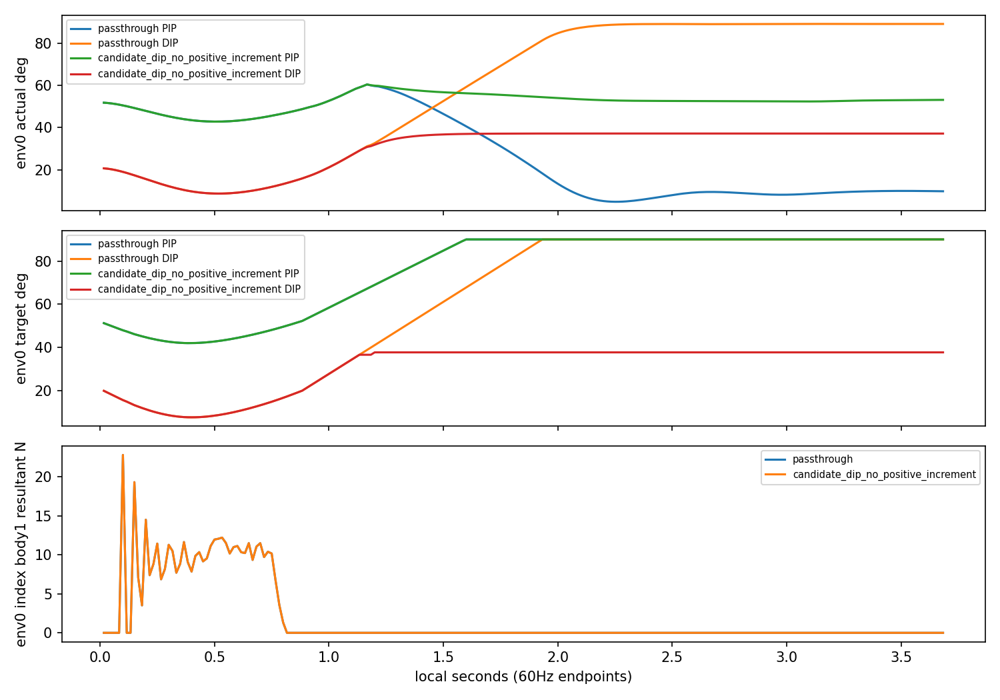

# 검지 DIP 양의 추가목표 억제 대조

| 조건 | 달성/전체128 | clean | wrong | 물리/손목실패 | 개입환경/controls | 음의증분통과 |
|---|---:|---:|---:|---:|---:|---:|
| passthrough | 128/128 | 1.00000000 | 0.00000000 | 0/0 | 0/0 | 3072 |
| candidate_dip_no_positive_increment | 128/128 | 1.00000000 | 0.00000000 | 0/0 | 128/19457 | 3072 |

전체256개 첫시도에 실패를 포함하고 완료 뒤 retry는 제외했다. 두 실행 모두 원 B300 strict/fresh=False·128 native105 cap.25·90쌍·설정·원9항보상/비용·원시계·scene종료 및 모델/RNG/업데이트 불변을 검증했다. 보상9항과 실패비용은 attempts.csv에 그대로 남겼다.

전128 60Hz sidecar에서 원 DIP목표의 추가 양의 증분만 해당 gate에서 old target으로 되돌리고, negative/zero·그 외104열·target메모리/scene제출/관측이 원 경로와 일치하는지 검산했다. 억제된 증분은 저장하지 않고 gate가 꺼지면 새 원제어로 돌아온다. 원래 target−actual 차이는 남으므로 관절자세 고정과 다르다. 음의 명령 통과는 실제 해제 성공 증거가 아니다.

새 passthrough의 기존 B300 evaluation exact: **True**. 원trace 필드별 shape/exact/최대차는 comparison.json에 보존했다. 정합 실패나 작은 수치차가 있어도 원파일/허용오차를 바꾸지 않는다.

| env0 음중 | actual4 ° | target4 ° | body1/2/3 평균N | 손목 mm/° | CPU6gate |
|---|---|---|---|---|---|
| passthrough | 47.58741, 7.42946, 8.52155, 89.21126 | 90.00019, -30.00000, 90.00019, 90.00019 | 0.00000, 0.00000, 7.97780 | 16.59123, 3.85352 | [11, 11, 11, 11, 11, 0] |
| candidate_dip_no_positive_increment | 32.86810, 6.43094, 52.42589, 37.19401 | 90.00019, -30.00000, 90.00019, 37.67494 | 0.00000, 0.00000, 6.61455 | 16.51664, 3.78706 | [11, 11, 11, 11, 11, 0] |

선택4 actual/target·손목·세마디합력의 음전/음중/음후 표본과 CPU helper의 loaded/position/facing/positive/candidate/wrong 재구성을 JSON/CSV에 보존했다. candidate/wrong 불일치와 nearest 잔차도 숨기지 않는다. gate는 이전 endpoint 상태를 다음 control에 적용하며 저장 env0 clock과 이를 교차검산했다.
전128 통계는 원음원장과 작은 제어sidecar이고 상세힘/기하/추종은 env0 첫시도 60Hz 끝점뿐이다. 몸체합력은 접촉쌍압력·motor torque·240Hz 최대하중이 아니며 나머지127 상세힘을 추정하지 않는다.
이는 frozen B300에 가한 closed-loop 진단개입이다. 관측과 이후 NN행동도 달라질 수 있으므로 fixed-tape 단일인과, 자연스러움, 새 학습성과·기본제어 채택으로 확대하지 않는다. old 중지 normal-projection 시험과 동일조건이라고 주장하지 않는다. 추가 문턱/보상/학습/GPU실험은 없다.

