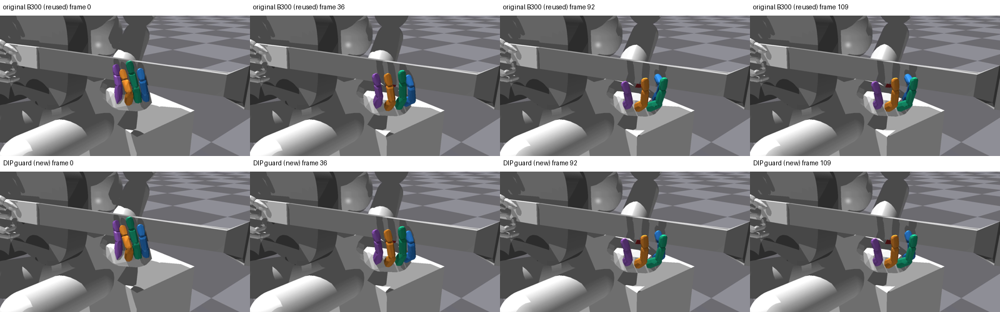
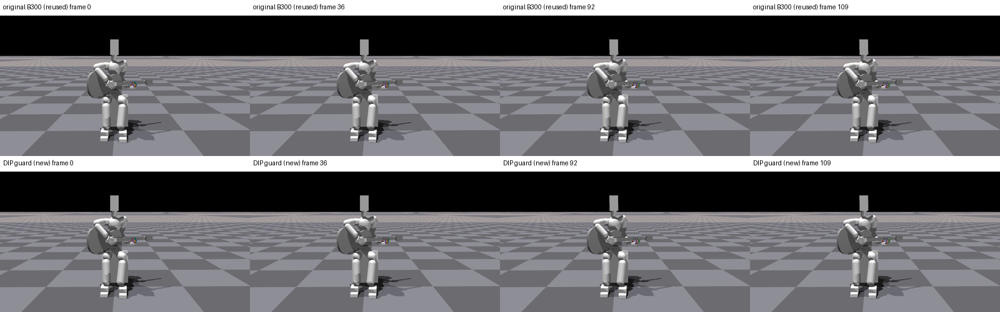

# 검지 DIP guard 실제 영상

| 조건 | 손 | 전신 |
|---|---|---|
| 기존 B300 (재사용) | [손](/home/ajou/yigyu/3/docs/2026-10-27/guitar_learning_failure_diagnosis_v1/05_verified_fixes/low_effort_index_zero_cost_init_v1/native_video_000300/hand.mp4) | [전신](/home/ajou/yigyu/3/docs/2026-10-27/guitar_learning_failure_diagnosis_v1/05_verified_fixes/low_effort_index_zero_cost_init_v1/native_video_000300/fullbody.mp4) |
| DIP guard (신규) | [손](/home/ajou/yigyu/3/docs/2026-10-27/guitar_learning_failure_diagnosis_v1/05_verified_fixes/index_candidate_dip_guard_v1/native_video_v1/runs/guard/hand.mp4) | [전신](/home/ajou/yigyu/3/docs/2026-10-27/guitar_learning_failure_diagnosis_v1/05_verified_fixes/index_candidate_dip_guard_v1/native_video_v1/runs/guard/fullbody.mp4) |

두 새 MP4는 원 native renderer의 env0 첫시도다. 동일 B300 strict/fresh=False·128cap.25/90쌍/guard 실행이며 checkpoint/모델/updates300/입력/scene·encoder 종료를 확인했다. 평가용 fingerprint callback은 호출되지 않았고 원 renderer 자체의 strict 검증을 사용했다.
신규 H264/1280×720/30fps/110프레임씩 총220프레임 전체디코딩, 8대표PNG를 추출했다. frame n은 control endpoint2(n+1)이고 t0와 홀수 마지막endpoint221에는 frame이 없다. 위 비교sheet의 첫행은 기존 B300 PNG를 출처와 SHA를 확인해 재사용했고 기존 영상을 다시 렌더하지 않았다.
env0 원 guard 평가와 q/target/body/gate/action/wrist/몸체합력의 exact 여부와 최대차, 전128 scalar sidecar 및 first-attempt 검산은 verification.json에 보존했다. 음악성과의 전체분모는 기존 독립검수된256 평가원장을 따르고 새 영상 자체는 env0 요약이다.
몸체합력은 쌍별 압력·motor torque·240Hz 최대하중이 아니다. 영상의 큰 굽힘 감소를 자연스러움/해제 성공·새 학습성과·기본제어 채택으로 확대하지 않는다. 직접 시각검사와 독립검수 결과는 VISUAL_QA.md/review에 별도로 기록한다.

