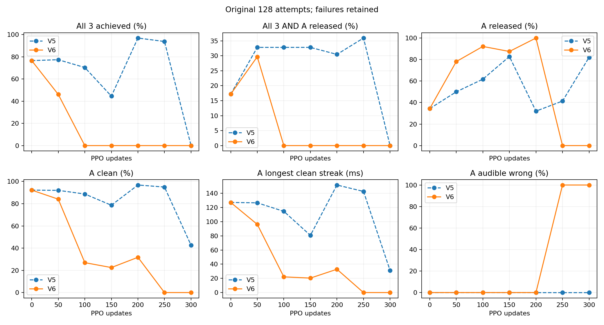
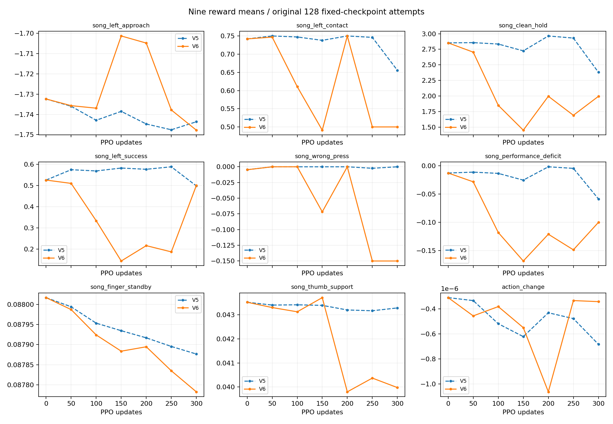
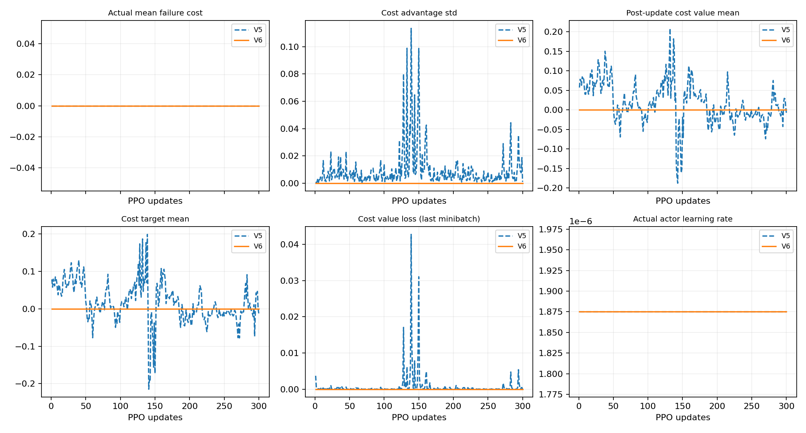

# V6: 비용 예측기 초기값 0과 V5 비교

원128시도·384음 전체와 실패를 포함했다. PPO300 및 초기 2평가·후속 7평가를 모두 검사했다. 마지막300 모델이 최종 결과다. V5 잘못 명명된 추가 평가와 V4 부분 실행은 성과에서 제외한다.

|버전/회차/모드|A/B7/B8 달성|all3|A 해제|joint|실패|평균 보상|gate|
|---|---|---:|---:|---:|---:|---:|---|
|V5/0/고정|100/122/125|98|44|22|0|2.501710|False|
|V5/0/확률|24/42/53|14|111|12|0|1.344531|False|
|V5/50/고정|100/124/127|99|64|42|0|2.565068|False|
|V5/100/고정|92/121/126|90|79|42|0|2.524893|False|
|V5/150/고정|58/127/128|57|106|42|0|2.411769|False|
|V5/200/고정|124/128/128|124|41|39|0|2.674685|False|
|V5/250/고정|121/127/127|120|53|46|0|2.640487|False|
|V5/300/고정|0/128/127|0|105|0|0|1.862986|False|
|V5/300/확률|4/19/30|1|116|1|0|0.750304|False|
|V6/0/고정|100/122/125|98|44|22|0|2.501710|False|
|V6/0/확률|24/42/53|14|111|12|0|1.344531|False|
|V6/50/고정|68/97/120|59|100|38|0|2.327677|False|
|V6/100/고정|0/83/88|0|118|0|0|1.070662|False|
|V6/150/고정|0/38/36|0|112|0|0|0.276258|False|
|V6/200/고정|0/47/64|0|128|0|0|1.263567|False|
|V6/250/고정|0/34/62|0|0|0|0|0.468865|False|
|V6/300/고정|0/128/128|0|0|0|0|1.123712|False|
|V6/300/확률|2/10/7|0|1|0|0|-0.007149|False|

마지막 고정평가 V5→V6 all3 0→0, joint 0→0, A 달성 0→0. 단일 seed 관찰이며 일반적 인과효과를 확정하지 않는다.

|버전/회차/모드/음|clean|wrong|missing|최장 clean(s)|
|---|---:|---:|---:|---:|
|V5/0/고정/4|0.92231|0.00000|0.04018|0.12700|
|V5/0/고정/7|0.95085|0.01562|0.01913|0.64989|
|V5/0/고정/8|0.97975|0.01562|0.00236|0.32888|
|V5/0/확률/4|0.52385|0.00000|0.39429|0.04825|
|V5/0/확률/7|0.79045|0.00781|0.16076|0.28184|
|V5/0/확률/8|0.78962|0.00781|0.15521|0.14683|
|V5/50/고정/4|0.92013|0.00000|0.04070|0.12650|
|V5/50/고정/7|0.94300|0.00000|0.03561|0.63452|
|V5/50/고정/8|0.99364|0.00000|0.00318|0.33114|
|V5/100/고정/4|0.88714|0.00000|0.05911|0.11451|
|V5/100/고정/7|0.95289|0.00000|0.02814|0.63263|
|V5/100/고정/8|0.99436|0.00000|0.00282|0.33278|
|V5/150/고정/4|0.78622|0.00000|0.13002|0.08061|
|V5/150/고정/7|0.94254|0.00000|0.03930|0.64640|
|V5/150/고정/8|0.99570|0.00000|0.00215|0.33568|
|V5/200/고정/4|0.96820|0.00000|0.01600|0.15161|
|V5/200/고정/7|0.99601|0.00000|0.00236|0.76901|
|V5/200/고정/8|0.99981|0.00000|0.00009|0.34780|
|V5/250/고정/4|0.94995|0.00000|0.02560|0.14257|
|V5/250/고정/7|0.98792|0.00781|0.00247|0.75890|
|V5/250/고정/8|0.99219|0.00781|0.00000|0.34558|
|V5/300/고정/4|0.42627|0.00000|0.46862|0.03124|
|V5/300/고정/7|0.95661|0.00000|0.02970|0.67531|
|V5/300/고정/8|0.99766|0.00000|0.00121|0.33981|
|V5/300/확률/4|0.27730|0.00000|0.65435|0.02774|
|V5/300/확률/7|0.73605|0.00836|0.20234|0.19647|
|V5/300/확률/8|0.74848|0.00781|0.18522|0.11053|
|V6/0/고정/4|0.92231|0.00000|0.04018|0.12700|
|V6/0/고정/7|0.95085|0.01562|0.01913|0.64989|
|V6/0/고정/8|0.97975|0.01562|0.00236|0.32888|
|V6/0/확률/4|0.52385|0.00000|0.39429|0.04825|
|V6/0/확률/7|0.79045|0.00781|0.16076|0.28184|
|V6/0/확률/8|0.78962|0.00781|0.15521|0.14683|
|V6/50/고정/4|0.84074|0.00000|0.08621|0.09614|
|V6/50/고정/7|0.88239|0.00000|0.07797|0.49004|
|V6/50/고정/8|0.98075|0.00000|0.00963|0.30063|
|V6/100/고정/4|0.26936|0.00000|0.65991|0.02214|
|V6/100/고정/7|0.64668|0.00000|0.32602|0.37784|
|V6/100/고정/8|0.93401|0.00000|0.03427|0.23277|
|V6/150/고정/4|0.22515|0.00000|0.70003|0.02040|
|V6/150/고정/7|0.57445|0.24365|0.11860|0.19779|
|V6/150/고정/8|0.65105|0.23438|0.06475|0.11105|
|V6/200/고정/4|0.31753|0.00000|0.64367|0.03288|
|V6/200/고정/7|0.79709|0.00000|0.16275|0.30885|
|V6/200/고정/8|0.88046|0.00000|0.06469|0.17268|
|V6/250/고정/4|0.00000|1.00000|0.00000|0.00000|
|V6/250/고정/7|0.81685|0.00000|0.13003|0.25147|
|V6/250/고정/8|0.87297|0.00000|0.06798|0.17117|
|V6/300/고정/4|0.00000|1.00000|0.00000|0.00000|
|V6/300/고정/7|0.99441|0.00000|0.00300|0.76868|
|V6/300/고정/8|0.99963|0.00000|0.00019|0.34695|
|V6/300/확률/4|0.01562|0.98438|0.00000|0.00266|
|V6/300/확률/7|0.75342|0.00781|0.18970|0.20893|
|V6/300/확률/8|0.63048|0.00781|0.29143|0.08009|

초기71개 중69개는 동일하고 비용 head2개만0이다. 초기 동작·9보상·전체128원장은 동일하다. 최초 update부터 차이가 가능하며 최초5회 지표 동일성을 전제하지 않는다.

V5 실제 비용 전구간0=True, cost advantage/value/target·loss 전구간 정확0=False, 최종 비용 head0=False. KL 재시도 합계2, 실제 LR 범위 1.875e-06~1.875e-06.
V6 실제 비용 전구간0=True, cost advantage/value/target·loss 전구간 정확0=True, 최종 비용 head0=True. KL 재시도 합계2, 실제 LR 범위 1.875e-06~1.875e-06.

학습률·KL 재시도의 후속 차이는 개입이 매개한 경로이며 수동 설정 차이가 아니다. 공유 value encoder 때문에 reward critic 표현도 달라질 수 있어 actor만의 격리가 아니다. 실제 비용이 양수라면 신호0을 유지한다고 가정할 수 없다. 학습 보고에 없는 teacher counter를0으로 만들지 않았다.

A goal/q/body-resultant 요약은 analysis.json 각 env0_trace에 모두 수록한다. env0 첫 시도60Hz 끝점의 관찰이며240Hz 전체 이력·128환경의 원인이나 접촉쌍/압력/음향의 증명이 아니다.

V5 마지막 고정 env0: A 말기 11끝점, 후보7, resultant<0.01N 4; goal4(deg)=[38.732818603515625, 27.659692764282227, 56.268638610839844, 26.01410484313965], 실제q4(deg)=[38.82151794433594, 19.73076057434082, 56.44388198852539, 26.084142684936523].
V6 마지막 고정 env0: A 말기 11끝점, 후보0, resultant<0.01N 0; goal4(deg)=[41.04110336303711, 27.756811141967773, 56.92245864868164, 27.38178825378418], 실제q4(deg)=[41.34211349487305, 22.616714477539062, 56.93453598022461, 27.318340301513672].

이 증거만으로 다른 seed·손가락·자유 기타·전곡의 성공을 주장하지 않는다. 다음 행동은 마지막 평가의 개선 여부와 실제 A 제어 관측을 검토한 뒤 결정한다.
