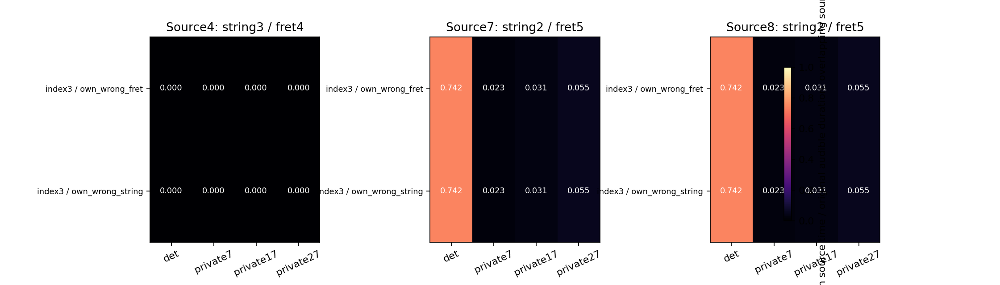
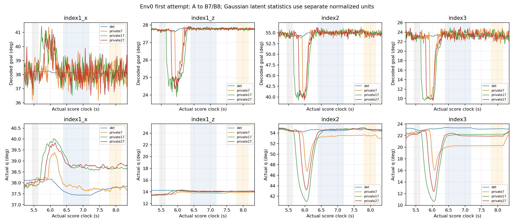

# 最終V7: 정책 잡음과 실제 오압현 출처

V7 마지막300 저장본을 고정하고 원128 첫시도·384음을 네 번 관찰했다. 물리/reset seed는7이며 정책 잡음만 private7/17/27로 분리했다. fit/PPO/optimizer 갱신은0이다. 평균행동과private7은 기존 V7의 전체128 원장·9보상 및 env0 모든 nonforce trace가 동일하다.

|조건|all3|A 해제 포함 joint|A 해제|실패|원 stage_ready|
|---|---:|---:|---:|---:|---|
|det|13|5|13|0|False|
|private7|58|30|60|0|False|
|private17|60|27|59|0|False|
|private27|68|29|60|0|False|

기준 수행 재현 통과와 원 음악 수용기준 통과는 구분한다. stage_ready가 거짓이어도 이 관찰에서 실패 시도를 제외하지 않는다.

|조건/음(원소스ID)|달성|clean|wrong|missing|
|---|---:|---:|---:|---:|
|det/4|110|0.842392|0.000000|0.148602|
|det/7|18|0.175163|0.742188|0.075280|
|det/8|19|0.190020|0.742188|0.052062|
|private7/4|60|0.633562|0.000000|0.326792|
|private7/7|100|0.829812|0.023396|0.134880|
|private7/8|100|0.831690|0.023438|0.130980|
|private17/4|64|0.615232|0.000000|0.341969|
|private17/7|100|0.825956|0.031250|0.132072|
|private17/8|100|0.820448|0.031250|0.134358|
|private27/4|73|0.673267|0.000000|0.289668|
|private27/7|102|0.823789|0.054688|0.113107|
|private27/8|102|0.826571|0.054688|0.107720|

원소스4(A)는 3번현4프렛, 원소스7/8(B)은 2번현5프렛이다. 7/8은 프렛 번호가 아니다. 각 출처 시간은 해당 음의 실제 발음 길이로 나누고 전체128환경에 평균했다. 원인·몸체는 동시에 활성일 수 있어 합산 감점이나 독립 비중으로 해석하지 않는다.

|조건/음|몸체/원인|시간비율 평균|활성환경/128|출처 프렛 범위*|
|---|---|---:|---:|---|
|det/7|index3/own_wrong_fret|0.742188|95|4..4|
|det/7|index3/own_wrong_string|0.742188|95|4..4|
|det/8|index3/own_wrong_fret|0.742188|95|4..4|
|det/8|index3/own_wrong_string|0.742188|95|4..4|
|private7/7|index3/own_wrong_fret|0.023396|3|4..4|
|private7/7|index3/own_wrong_string|0.023396|3|4..4|
|private7/8|index3/own_wrong_fret|0.023438|3|4..4|
|private7/8|index3/own_wrong_string|0.023438|3|4..4|
|private17/7|index3/own_wrong_fret|0.031250|4|4..5|
|private17/7|index3/own_wrong_string|0.031250|4|4..5|
|private17/8|index3/own_wrong_fret|0.031250|4|4..5|
|private17/8|index3/own_wrong_string|0.031250|4|4..5|
|private27/7|index3/own_wrong_fret|0.054688|7|4..5|
|private27/7|index3/own_wrong_string|0.054688|7|4..5|
|private27/8|index3/own_wrong_fret|0.054688|7|4..5|
|private27/8|index3/own_wrong_string|0.054688|7|4..5|

*프렛 min/max는 목표·몸체별 모든 기여 원인의 합집합 범위이며 원인별 독립 범위가 아니다. wrong_string은 목표현이 아닌 표본을 뜻하지만 저장된 이 원장만으로 정확히 어느 다른 현인지까지 정하지 않는다. 실제 접촉쌍·줄 압력·음향의 증명도 아니다.

|조건|Gaussian latent 잡음 RMS 4축|Gaussian std 평균 4축|잡음/std RMS 4축|
|---|---|---|---|
|det|0.00000/0.00000/0.00000/0.00000|0.00812/0.01192/0.01260/0.00944|0.00000/0.00000/0.00000/0.00000|
|private7|0.00810/0.01199/0.01258/0.00942|0.00812/0.01192/0.01260/0.00944|0.99810/1.00635/0.99862/0.99732|
|private17|0.00811/0.01191/0.01255/0.00948|0.00812/0.01192/0.01260/0.00944|0.99936/0.99961/0.99656/1.00419|
|private27|0.00809/0.01202/0.01266/0.00944|0.00812/0.01192/0.01260/0.00944|0.99700/1.00880/1.00463/1.00024|

첫128행의 mean/log_std는 네 조건에서 정확히 같다. 위 수치는 tanh 이전 Gaussian latent 단위이며 관절 도수가 아니다. 아래 곡선은 선택4축의 실제 디코딩 목표와 native 관절각을 도수로 바꾼 env0의 관찰이다.

세 private 잡음 수행에서 나타난 점수·출처 차이는 표본 변화에 따른 궤적 관찰이다. 첫 행동 이후에는 상태와 평균행동도 피드백으로 달라지므로 후반 mean 차이를 순간 잡음만의 인과효과로 설명하지 않는다. 같은 초기 물리 seed의 정책잡음3개이지 새 학습seed3개나 일반화 검증이 아니다.

9보상 평균, 원 수용기준, 모든 몸체·원인별 시간비율과 활성환경 수는 analysis.json에 보존했다. 고정기타·검지4축·원3음·seed7 범위를 넘는 다른 손가락/학습seed·자유기타J33·원67음 목표는 미완료다.
