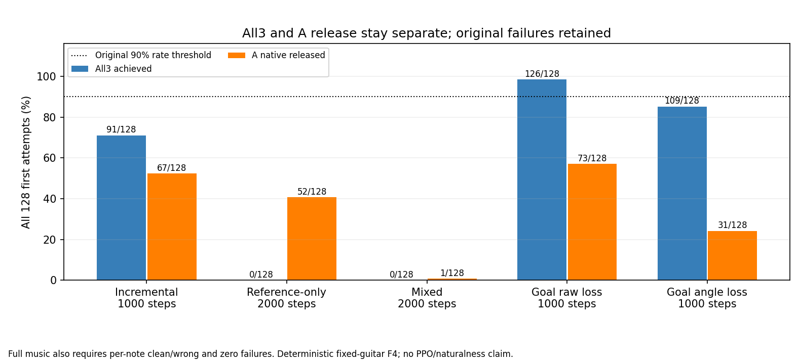

# 각도 손실1000회 NN 실제 비교

all3는109/128, A 해제는31/128로 기존 goal raw의126/128·73/128보다 후퇴했다. 원90% 음악·해제·AND 기준 모두 미달이므로100PPO는 실행하지 않는다.

[관측과 해석](INTERPRETATION.md) · [전체 수치](comparison.json)

| 조건,각128 | A/B7/B8 달성 | all3 | A 해제 | 음악/해제/AND |
|---|---|---:|---:|---|
| incremental1000 | 0.882812,0.742188,0.710938 | 0.710938 | 0.523438 | False/False/False |
| reference_only2000 | 0.210938,0.054688,0.085938 | 0.000000 | 0.406250 | False/False/False |
| mixed2000 | 0.398438,0.593750,0.593750 | 0.000000 | 0.007812 | False/False/False |
| goal_raw1000 | 0.984375,1.000000,1.000000 | 0.984375 | 0.570312 | True/False/False |
| goal_angle1000 | 0.984375,0.859375,0.867188 | 0.851562 | 0.242188 | False/False/False |

새128/384·실패·9항을 모두 보존했다. 원goal raw 모델의 fit종료1/별도회복평가는 정상fit으로 고치지 않았다. raw/각도/물리요청을구분하며 상세각/기하/힘은env0 60Hz·precontrol4환경 한정이다. body 순힘은접촉쌍 압력이 아니고 단독인과/자연성/자유기타/PPO효과를증명하지않는다. AND 미달이면100PPO0·계수/예산자동탐색0이다.
