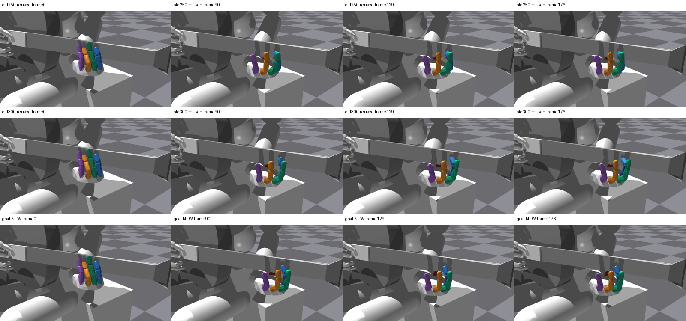
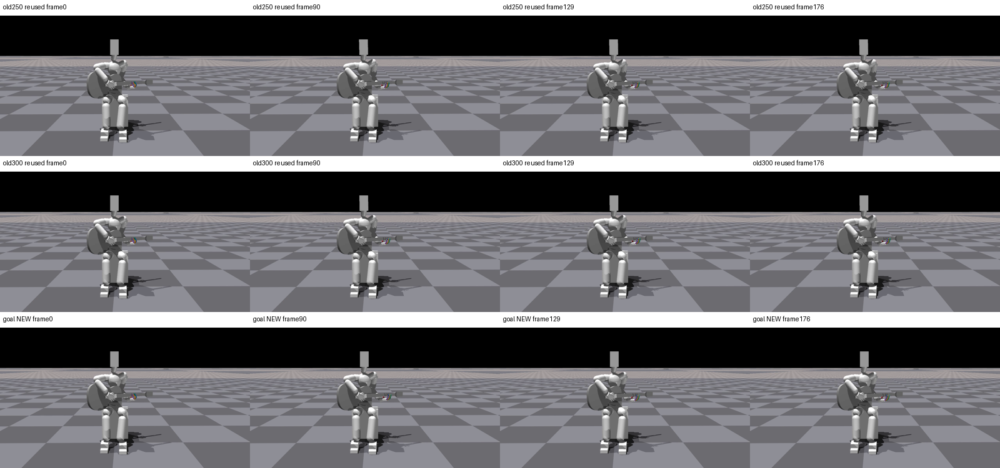

# Goal 초기화 모델 실제 영상 QA

[손 영상](/home/ajou/yigyu/3/docs/2026-10-27/guitar_learning_failure_diagnosis_v1/05_verified_fixes/index_prefix_goal_codec_v1/native_video_v1/runs/initial/hand.mp4) · [전신 영상](/home/ajou/yigyu/3/docs/2026-10-27/guitar_learning_failure_diagnosis_v1/05_verified_fixes/index_prefix_goal_codec_v1/native_video_v1/runs/initial/fullbody.mp4)

사전지정 env0 첫시도 1회이며 성공 환경을 고르지 않았다. 원128평가는 A126/B7·B8각128/all3 126, A release73/128: musicTrue/releaseFalse/stage_readyFalse다. 영상env0의 실제 음악·해제 결과는 verification.json의 원장 비교에 보존한다.
원70e40d 모델·1000 supervised step/PPO0/실제 GoalPolicy와 두 layered contract를 native 원본 full strict load했다. 고정기타/F4/finite staged wrist/current-goal DIP guard/128cap.25/90쌍, 첫tick NN·fresh=False·reference/N0·goal→physical변환1회다. RL-only·자유기타J33·자연스러움/압력의 증거가 아니다.
두 H264/1280×720/30fps/177frame 전체354frame CPU decode, 대표8PNG/비교2sheet. frame n=control endpoint2(n+1), t0없음. 고정0/90/129/176=시작/A음중/B7음중/마지막. old250/300 행은 기존 PNG를 재사용했고 재촬영하지 않았다.
원128평가 env0원장9항·공통raw·전128 scalar와 typedgoal 차이는 verification.json에 그대로 보존했다. physical action과 normalized goal/decoded goal을 구분한다. qd/tick별9항은 원trace에 없어 동일성을 주장하지 않는다. evaluator fingerprint callback은 renderer에서 쓰지 않았다.
색: 엄지 빨강/검지 파랑/중지 초록/약지 주황/소지 보라. 직접 시각검사와 가림 한계는 VISUAL_QA.md, 독립검수는 review.json에 기록한다. 원fit exit1/누락보고서2개와 별도회복수용 이력은 유지했다.

영상 env0는 A/B7/B8 모두 달성, clean1/0.9892873976946475/1·wrong0·fail0이지만 A releaseFalse/release_s0이다. 원128평가 동일 env0 원장9항 전체 exact다.
354끝점 공통raw 차이는 합력 최대3.814697265625e-6N와 시간8.881784197001252e-16s이며 나머지 공통필드는 exact다. 전128 guard21필드와 precontrol4환경 typedgoal/요청·관측 및 env0typedgoal은 exact, rawgoal→physical변환은354회·NN reference0이다.

