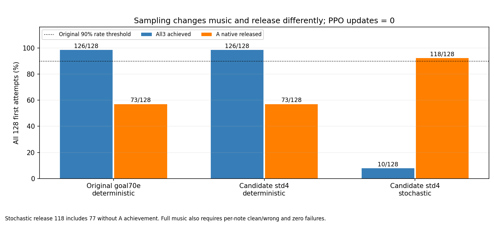

# 목표각 유한 탐색: 실제128×2 비교

후보std4를 적용한 deterministic은 원70e의128원장과 acceptance를 exact 재현했다. stochastic은 all3가10/128로 낮아졌고 A 해제는118/128이지만 그중77은 A 미달성과 함께였다. 음악과 해제를 분리하면 두 조건 모두 AND 미달이므로 PPO/새reward 실행·추가fit/표본탐색은 하지 않는다.

| 조건(각128/384음) | A/B7/B8 달성 | all3 | A 해제 | 음악/해제/AND | 물리/손목 실패 |
|---|---|---:|---:|---|---|
| deterministic | 126/128/128 | 126/128 | 73/128 | True/False/False | 0/0 |
| stochastic | 46/34/36 | 10/128 | 118/128 | False/True/False | 0/0 |

원90% 기준·384음/조건·실패를 모두 보존했다. 원 .171171 std의 stochastic native 대조는 이번에 실행하지 않았으므로, 이 후보가 원std보다 낫거나 나쁘다고 비교하지 않는다. stochastic clean 평균은 A/B7/B8=.634371/.532634/.540061, wrong은0/.296833/.296875다.

| A달성×해제(각128) | 달성+해제 | 달성+미해제 | 미달성+해제 | 미달성+미해제 |
|---|---:|---:|---:|---:|
| deterministic |71|55|2|0|
| stochastic |41|5|77|5|

해제118/128(92.1875%)를 정상 압현 후 해제118회로 해석하지 않는다. 원 released는 ever가 있는 정해진 falling-edge 창의 latch이며 A achieved와 같은 지표가 아니다. 전체128 분모에서 A달성과 해제가 함께인 경우는41/128이다.

## 같은 guard와 독립 목표잡음의 상호작용

source 명제는 현재 eligible 접촉에서 DIP 양의 목표증분을 차단하고 음수·0을 통과시키는 것이다. 기존354×128 NPZ의 first/finite/실패/reset 보호를 유지하고 같은 current_goal·연속clock의 eligible 구간을 비교했다. none의 wrong은 현재목표 오압현 통계로 쓰지 않았다.

| 원60Hz 전체 첫시도(준비 포함) | deterministic | stochastic |
|---|---:|---:|
| eligible / blocked |22,859 /21,787|16,522 /12,843|
| eligible 최종 Δ 양/음/0 |0 /1,063 /21,796|0 /3,679 /12,843|
| 동일goal 연속구간 수 |1,451|2,977|
| 음의 누적변화 구간 |254|2,195|
| 구간DIP 목표변화 최소/중앙/최대(°) |−.4375 /0 /0|−3.7011 /−.6135 /0|
| 다음 저장 동일goal candidate=False 관측 |1,072|2,724|

양증분 억제와 음수 통과가 독립 목표잡음과 결합할 때 연속 eligible 구간의 목표가 감소하는 관측이 실제로 늘었다. 이 자료를 단순 모델 취약성 하나로 설명하지 않는다. 반대로 guard가 음악 후퇴의 단독 원인이라는 대조도 하지 않았다. 마지막 이탈 행은 다음60Hz 관측이며240Hz 최초 사건·지속 무접촉·압력 인증이 아니다. goal 전환으로 끝난 구간은379/253, same-goal wrong=True 이탈은0/1로 별도 기록했다.

## 저장된 env0·4환경 범위

env0의 A/B7/B8 음창 candidate는 det11/11·46/46·21/21에서 stoch10/11·42/46·17/21로 줄었다. stoch의 position/facing은각11/11·46/46·21/21이지만 loaded도10/11·42/46·17/21이고 wrong은 모두0이다. env0에서 A는 달성·해제True, B7/B8은 미달성·해제True다. 따라서 다른127환경의 B wrong 원인을 env0 기하로 대신 설명하지 않는다.

env0 음창 손목오차 평균 A/B7/B8은 det .818/.999/1.075mm, stoch1.264/1.082/1.621mm다. 선택 distal 순힘 평균은 det .139/.232/.277N, stoch .213/.240/.264N이며 proximal 평균은 det7.753/12.968/13.026N, stoch9.178/12.434/12.224N이다. 순힘은 접촉쌍·실제 현 압력이 아니다. 자세·팔feedback도 달라지므로 선택각 한 축으로 원인을 확정하지 않는다.

4환경 자체 release24행의 예정각 대비 PIP/DIP RMS는 det .964/1.251°, stoch .886/.984°로 이 작은 자료에서는 낮지만 전체 음악 성과는 후퇴했다. 이24행을128환경 전체의 개선으로 확대하지 않는다. stochastic 저장 rawgoal과 CPU tanh(mean)의 최대차이는 .050282이며 이는 표본과 평균의 차이지 재생 오류가 아니다. 저장 sampled rawgoal→decode→physical 요청은 두조건 exact다. det만 CPU rawmean 재생을 요구했고 최대잔차2.38e−7이다.

## 실제 실행 감사와 원9항

두 실제child는 종료0이며 각각354 act/convert 호출이었다. 요청 flag는 두조건 모두 deterministic=True지만 실제 사용은 det True·stoch False다. actor RNG 전진은0/354, 원모델 strict load 뒤 같은 seed7·std4 개입 후 모델 고정/PPO0/reference0이며 새checkpoint는 없다. 원70e 파일과 metadata/identity는 변경하지 않았고 원fit 종료1·명시적 recovery 출처를 보존했다. fullstrict 성공은 native 원실행 감사이며 CPU 모델 state 재생을 CUDA strict load라고 부르지 않는다.

실효 std4는 [.0081166131,.0119162761,.0125984587,.00944169145]이다. float32 Lσ−nominal 잔차는 약−3.55e−9~+1.60e−9rad로 보고됐으며 후보의 해석적 상한을 native 유한표본의 정확한 잡음상한·물리변위/힘상한으로 바꾸지 않는다. det 원128원장·목표/자세/행동 trace는 exact, 공통 env0 bodyforce 최대차이만3.8147e−6N이다. native105/.25Nm/90쌍/128·장면종료·입력 before/after는 원감사로 확인했고 CPU는 직접입력만 재해시했다.

| 지급9항 평균(원단위) | deterministic | stochastic |
|---|---:|---:|
| song_left_approach | -1.75424385 | -1.68662675 |
| song_left_contact | 0.750000039 | 0.580250025 |
| song_clean_hold | 2.96569318 | 1.70706633 |
| song_left_success | 0.74609375 | 0.2265625 |
| song_wrong_press | 0 | -0.089056209 |
| song_performance_deficit | -0.00232947565 | -0.136519978 |
| song_finger_standby | 0.0880249315 | 0.0880281873 |
| song_thumb_support | 0.0434570509 | 0.0450293282 |
| action_change | -3.53247109e-07 | -1.61155984e-06 |

9항 합과 episode reward의 최대 잔차는 det5.68e−6/stoch3.63e−6이다. 보상은 기존 지급값 그대로이며 새 유보 보상을 실행하지 않았다. 이번은 같은 고정기타 검지3음 모델의 두 실행모드 비교로 자연성·자유기타/J33/67음·PPO 학습효과를 주장하지 않는다.
