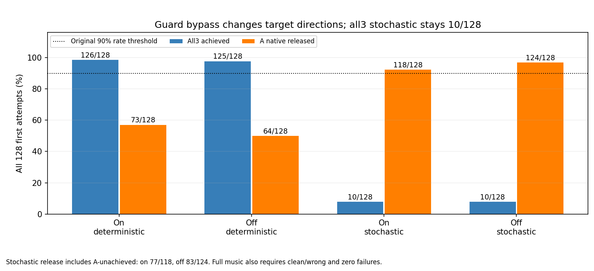

# Goal DIP guard-off 실제 비교

DIP 추가 양증분 보호를 끄자 eligible 구간에서 양의 목표변화가 다시 통과했지만, stochastic의 세 음 전체 달성은 on/off 모두10/128이었다. deterministic은126→125/128, A 해제는73→64/128이었다. 두 off조건 모두 원음악·해제 AND 기준 미달이다. 원90% 기준·원9보상·실패분모를 유지하며 PPO/fit/추가GPU/계수탐색은 하지 않았다.

| 조건(각128/384음) | A/B7/B8 달성 | all3 | A 해제 | 음악/해제/AND | 물리/손목 실패 |
|---|---|---:|---:|---|---|
| on deterministic | 126/128/128 | 126/128 | 73/128 | True/False/False | 0/0 |
| off deterministic | 126/127/128 | 125/128 | 64/128 | True/False/False | 0/0 |
| on stochastic | 46/34/36 | 10/128 | 118/128 | False/True/False | 0/0 |
| off stochastic | 43/36/46 | 10/128 | 124/128 | False/True/False | 0/0 |

off stochastic의 clean 평균은 A/B7/B8=.606179/.642507/.650631, wrong은0/.166740/.166586이다. B clean/wrong은 on(.532634/.540061, wrong약.2968)보다 좋아졌지만 all3는 그대로이며 A 달성은46→43으로 낮아졌다.

| A달성×해제(각128) | 달성+해제 | 달성+미해제 | 미달성+해제 | 미달성+미해제 |
|---|---:|---:|---:|---:|
| on deterministic |71|55|2|0|
| off deterministic |62|64|2|0|
| on stochastic |41|5|77|5|
| off stochastic |41|2|83|2|

off 해제124/128 중83은 A미달성과 함께다. 정상달성과 해제가 함께인 수는 on/off stochastic 모두41/128이다. 따라서 높은 released 비율을 정상 압현 후 해제 성공으로 바꾸지 않는다.

## 실제 off와 would-block 구분

각 off조건45,312 첫시도control(354×128)에서 raw_target=final_target exact, actual_blocked=blocked=0, 다른104열·target memory·제출/관측오차0 및 원bounds/rate 검사를 통과했다. would_block은 off실행에서 관측한 eligible & raw>old인 가상 on조건이며 실제 개입이 아니다. on/off는 폐루프라 이후관측과 NN요청이 달라진다. 같은 행동을 물리에 제출한 대조로 부르지 않는다.

| 전체 첫시도60Hz·준비 포함 | on det | off det | on stoch | off stoch |
|---|---:|---:|---:|---:|
| eligible |22,859|23,059|16,522|17,928|
| actual blocked |21,787|0|12,843|0|
| would-block(off만) |—|12,378|—|8,656|
| eligible Δfinal-old 양/음/0 |0/1,063/21,796|12,378/10,492/189|0/3,679/12,843|8,656/9,272/0|
| 동일goal구간 누적DIP목표 중앙(°) |0|+.0534|−.6135|−.2274|
| 동일goal구간 최소/최대(°) |−.4375/0|−.4382/+3.1546|−3.7011/0|−3.6292/+3.4764|
| 다음저장 동일goal candidate=False 관측 |1,072|1,041|2,724|2,894|

한쪽 목표감소만 허용하던 source 동작은 off에서 없어졌고, stochastic 구간 감소 중앙값의 크기도 줄었다. 그러나 candidate 이탈 관측은 줄지 않았고 전체음악은 회복되지 않았다. 이 비교는 guard가 관측된 방향성을 만든다는 근거와, 이것만 제거해 전체음악이 회복되지 않았다는 결과를 분리한다. guard 단독원인/무관함 또는 기본학습에서 영구삭제의 근거로 확대하지 않는다. 구간은 같은goal·연속clock·finite/first/실패/reset보호로 나눴고 이탈은 다음60Hz 관측이며240Hz 최초사건이 아니다. none의 wrong은 현재목표오압현 통계에서 제외했다.

## 각도·부하와 실제 자료 범위

| DIP 최대값 | on det | off det | on stoch | off stoch |
|---|---:|---:|---:|---:|
| 전128 최종목표(°) |24.0890|24.0889|26.4302|26.6294|
| env0 실제각(°) |24.0614|24.0770|24.0103|24.5492|

원native DIP 상계는90.00019°다. off 전128 목표는 상계까지 최소65.9113°/63.3708° 남았고, env0실제각에도 이전 약89° 굴곡 재발은 관측되지 않았다. 다른127환경 실제각은 저장되지 않아 전환경 실제굴곡 미발생을 인증하지 않는다. 이 frozen warmstart 비교를 장기PPO에서의 안전성으로 상속하지 않는다. 선택4 실제범위·목표·상계잔여는 comparison.json의 DIP_extrema_on_off에 있다.

env0 off 음창 A/B7/B8 candidate는 det11/11·46/46·21/21, stoch10/11·43/46·19/21이다. stoch position/facing은11/11·46/46·21/21 전부통과하고 loaded도10/11·43/46·19/21이며 wrong은0이다. 다른127환경의 B wrong원인을 env0로 대신 설명하지 않는다.

env0 stoch 음창 손목오차 A/B7/B8 평균은 on1.264/1.082/1.621mm→off1.405/1.196/1.631mm다. distal 순힘 평균은 on.213/.240/.264N→off.226/.271/.273N, proximal은9.178/12.434/12.224N→9.196/12.479/12.280N이다. 상세 힘·기하·각은env0 60Hz/제어전4관측 범위이며 순힘은 접촉쌍·현압력이 아니다. 특정접촉원인이나 자연스러운 압현을 인증하지 않는다.

## 실행·보상 감사

원70e는 원계약으로 native fullstrict load한 뒤 같은 std4 실행개입·seed7을 적용했다. on/off의 개입후 모델hash와 std보고서는 exact다. 각 off조건의 act/Goal convert는354회, 실제 actor RNG전진은det0/stoch354회였다. 원요청 deterministic=True와 실제 sampling flag를 구분하고, stoch는 저장된 sampled rawgoal로 decode/physical 요청을 exact 재생했다. det에만 CPU mean동일성을 요구했다. 원guard-on 계약/metadata는 그대로이며 guard_execution_override.json이 실제off를 별도선언한다. 새checkpoint/PPO/fit/reference목표주입은 없다. 원70e fit종료1/recovery 출처도 보존했다.

native105/.25Nm/90쌍/원범위/속도·장면종료·입력before/after 감사를 재사용하고 직접관련 SHA만 검사했다. 전체2천pin 재귀재감사는 하지 않았다. 현재분석은 원on분석을 메모리 출력으로 재사용하고 off전용 검산으로 대체했으며, 원on verifier를 actual off인 것처럼 통과시키지 않았다. CPU adapter의 sourceJSON읽기/중복exclusive쓰기 후처리 오류 두 건과 당시ownsource·부분출력은 각각 before_*에 보존했고 최소수정 후 실제 CPU종료0을 확인했다. 원native자료/producer/source/모델은 바뀌지 않았다.

| 원9항 episode평균 | on det | off det | on stoch | off stoch |
|---|---:|---:|---:|---:|
| song_left_approach | -1.75424385 | -1.75506083 | -1.68662675 | -1.71193583 |
| song_left_contact | 0.750000039 | 0.750000038 | 0.580250025 | 0.654720082 |
| song_clean_hold | 2.96569318 | 2.97021996 | 1.70706633 | 1.89931762 |
| song_left_success | 0.74609375 | 0.744140625 | 0.2265625 | 0.244140625 |
| song_wrong_press | 0 | 0 | -0.089056209 | -0.0499988518 |
| song_performance_deficit | -0.00232947565 | -0.00165529166 | -0.136519978 | -0.116656311 |
| song_finger_standby | 0.0880249315 | 0.0880262946 | 0.0880281873 | 0.0880298932 |
| song_thumb_support | 0.0434570509 | 0.0434477236 | 0.0450293282 | 0.044345318 |
| action_change | -3.53247109e-07 | -3.35930083e-07 | -1.61155984e-06 | -9.54877106e-07 |

off 9항합/episode reward 최대잔차는 det6.75e−6/stoch3.76e−6다. 모든256 새시도/768음을 포함했고 기존on256/768은 별도실행 출처로 비교했다. 보상유보나 새성공/자세threshold를 이 비교에 섞지 않았다.
