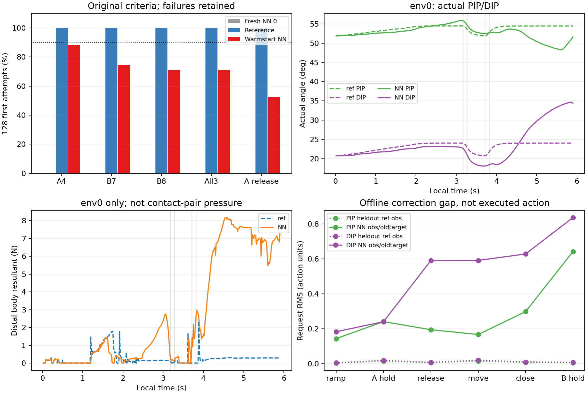

# 일부 NN 재현은 생겼지만 원 기준 미달

reference는128환경의 각음·전체3음·A release128/128이다. 수집 프로세스는 사후기록 검사 오류로 **종료1/reportfalse**였고, 동결 소스 경로와 원 native완료·자료를 독립 검산한 별도 수용이다. 원값은 보존했다. 그 뒤 fit25.344초/evaluate76.354초는 각각 종료0이다.

| NN-only 원128분모 | A4 | B7 | B8 | 전체3음 | A native release |
|---|---:|---:|---:|---:|---:|
| 달성/해제 수 |113|95|91|91|67|
| 비율 |88.281%|74.219%|71.094%|71.094%|52.344%|
| clean 평균 |.869795|.769109|.714573|—|—|
| wrong 평균 |0|.125|.125|—|—|

물리/손목실패는0이다. 음악·해제·AND는 모두 미달이므로100PPO 유지 실험은 허용하지 않았다. 기존 fresh0000의 전체0/128과 달리 참고를 초기값으로 사용한 NN-only의 부분 재현은 생겼다. 모방 없는 RL 성공이나 자연스러움·자유기타/전곡 성과는 아니다.

A 달성/release 교차집계는 **달성+release67, 달성+미release46, 미달성+미release15, 미달성+release0**이다. 저장된 native audible clean시간>0과 교차하면 clean>0+release67, clean>0+미release48, clean0+미release13이다. 원 `ever` 필드는 저장되지 않았으므로 clean0을 접촉한 적 없음으로 바꾸지 않는다. 미release61개 전부를 정상 압현 후 전혀 못 풀었다고 해석할 수 없다.

초기73개 state와 원model identity를 CPU에서 대조했고 공유 finger encoder/index head 외 state·critic/std/buffer는 exact, cost2개0·새 PPO optimizer empty/updates0이다. 새 회복 metadata/procedure는 원 종료1과 자료 수용 SHA를 명시한다. NN의 원 native strictload·평가 전후 모델/RNG/updates 동결 및 reference호출0/N주입false 보고를 보존했다. CPU 저장관측으로 재생한 NN 요청의 최대차이는5.96e−8 action이다. CPU모델 읽기로 native full-load/CUDA RNG를 대신 검증했다고 주장하지 않는다.

지도학습에서 남은 작은 오차도 누적 요청에 중요할 수 있다. 동일 장면 heldout env3의 PIP/DIP RMS는 A유지 .01561/.01978, 이동 .01652/.02089 action이었다. A유지 구간의 요청차를4/60으로 단순 적분한 값은 PIP−.04306/DIP−.05158rad다. 이는 guard/범위/실제동역학을 거치기 전 proxy이며 실제 관절변위나 침투량이 아니다.

NN env0은 A음11개 saved끝점에서 정상 candidate지만 해제 창6끝점 모두 A candidate가 남았다(reference는3/6). B재접근7끝점에도 A7/7이 남고 B7/B8 음중 A candidate46/46·21/21, B candidate0/wrong46·21이다. 원 CPU기하 복원과 saved candidate/wrong는 mismatch0이었다. 원장128환경 통계와 이 실패한 env0의 상세를 구분한다.

env0에서 처음 저장된 post-A candidate-off 끝점은3.4초다. 원240Hz 첫상실 시각이나 그 사이 연속접촉을 이60Hz 표본으로 복원하지 않는다. B7 wrong 원인은 선택 index3의 own-wrong-fret46/own-wrong-string46, B8은 own-wrong-fret0/own-wrong-string21이며 other-higher는0이었다. 이는 원기하 provenance이며 특정 접촉쌍 인증은 아니다.

| env0 음중/이동 평균 | reference | NN-only |
|---|---:|---:|
| A distal 합력N |.145|2.113|
| B7 distal 합력N |.245|6.073|
| B8 distal 합력N |.284|6.495|
| B8 proximal 합력N |13.059|18.455|
| B7/B8 손목오차mm |.998/1.116|10.750/10.906|
| B8 말미 PIP/DIP 실제° |54.45/24.06|48.98/34.25|

NN은 음수 명령도 내지만 준비/해제/재접근의 target과 실제 궤적이 reference와 달라졌다. 모방해 작은 각도를 요청했다는 사실만으로 능동 해제/저하중을 달성한 것은 아니다. 비선택 B/엄지와 팔 안내는 원 제어지만 실제 손 상태가 바뀌어 손목 feedback도 달라질 수 있다. 특정 충돌쌍·손가락 한 축·팔·보상 중 하나를 원인으로 확정하지 않는다. body resultant는 접촉쌍 압력·토크·피부전체분리 인증이 아니다.

## 후속 제안에 필요한 제한적 CPU 근거

원 `reference_action`에 저장 preclock/oldtarget4와 원39축 기준/범위를 넣어 원1416행의 요청4열을 **bit exact**로 재현했다. 선택4 출력에 영향을 주지 않는 다른35축 oldtarget은 원 기준으로 채웠다. 새 물리 실행이나 NN평가 중 참고 행동 계산·주입은 하지 않았다.

같은 함수에 이미 저장된 NN oldtarget/clock을 넣으면 현재 NN 요청과 큰 corrective 차이가 생긴다. B유지의 원reference 관측 heldout PIP/DIP RMS .00713/.00923과 달리, NN관측/oldtarget에서 corrective요청과 NN요청의 RMS는 .64186/.83602다. 최대 action차1.06536은 두 값이 각각[−1,1]이므로 가능한 차이다. 네 환경의 같은 시계 B유지 pretarget 차이는 최대 PIP12.858°/DIP12.116°, 스케일된 관측 state L2 중앙값은2.211이다. 이는 분포 차이의 기술 통계이며 인과 증명이나 독립 seed 일반화 검사가 아니다.

해제6끝점×4환경에서는 실제 NN DIP 요청과 이 corrective DIP 요청의 부호가24/24 반대였다. 고정 N과 oldtarget을 직접 비교하면 DIP는15/24에서 N보다 낮고9/24에서 높았다(평균−.277°, 범위−1.667..+1.016°). 반면 아직 보간 중인 그 시각의 reference 목표보다 DIP oldtarget은24/24 모두 낮았다(평균−1.779°). 따라서 반대 부호를 전부 최종 N보다 과하게 열렸다고 부를 수 없다. 나머지 MCPx는 고정N보다24/24 낮고 MCPz/PIP는24/24 높았다. 이들은 native좌표 부호이며 실제 피부 분리나 해부학적 열기 인증이 아니다. corrective 양의 DIP는 원 current-goal guard에 막힐 수도 있다(전체 잠재369끝점). 즉 corrective label을 얻을 수 있다는 사실은 그 label의 실행이나 압현/해제 회복을 보장하지 않는다.

따라서 저장된 NN 관측/oldtarget에서 계산한 corrective요청으로 한 번만 자료 보강하는 가설은 다음 검토 대상으로 좁힐 수 있다. 아직 새 학습자료를 추가하거나 재학습·하이퍼파라미터 탐색·물리수집·보상/codec/std 변경은 하지 않았다. 지도 label을 바꾸는 새 개입이므로 별도 예산/출처/성공 기준 계획이 필요하며, 이번 미달을 근거 없이 통과로 바꾸지 않는다. 상세힘은env0 60Hz, 관측은env0..3뿐이고240Hz 연속접촉/다른127환경 힘/nativeqd·nearestpoint는 미저장이다.

