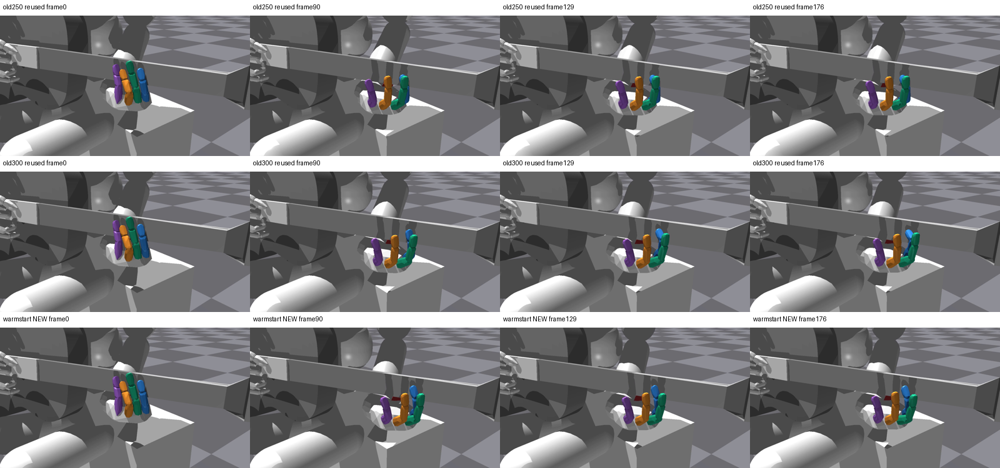
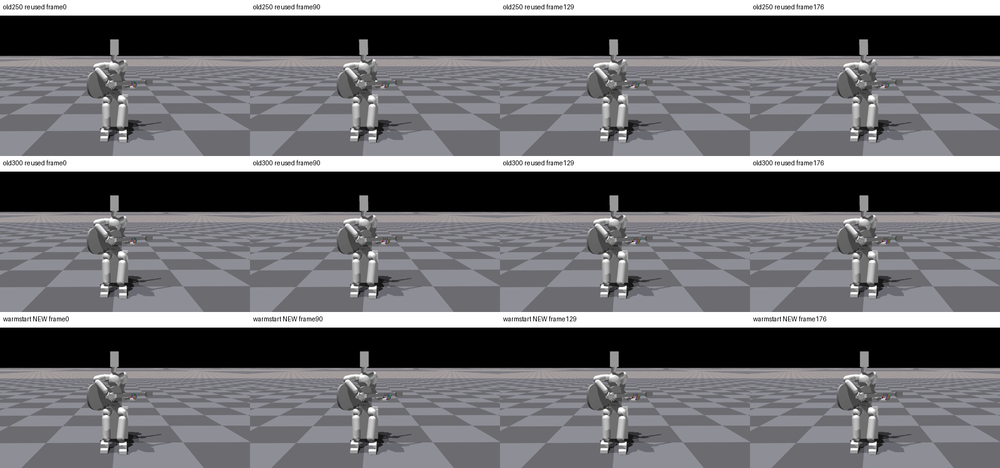

# Supervised 초기화 모델 실제 영상 QA

[손 영상](/home/ajou/yigyu/3/docs/2026-10-27/guitar_learning_failure_diagnosis_v1/05_verified_fixes/index_prefix_imitation_warmstart_v1/recovery_v1/native_video_v1/runs/initial/hand.mp4) · [전신 영상](/home/ajou/yigyu/3/docs/2026-10-27/guitar_learning_failure_diagnosis_v1/05_verified_fixes/index_prefix_imitation_warmstart_v1/recovery_v1/native_video_v1/runs/initial/fullbody.mp4)

사전지정 env0 첫시도 1회이며 성공 환경을 고르지 않았다. 모델 전체 원평가는 all3 91/128, A/B7/B8 113/95/91, A release67/128로90%기준 미달이다. 영상 env0는 A만 달성하고 B7/B8 오압현, A releaseFalse인 실패사례다.
1000 supervised step/PPO0 원본 초기화 저장본을 실제 full native strict load했다. 고정기타/F4/finite staged wrist/current-goal DIP guard/128cap.25/90쌍, 첫tick NN·fresh=False·reference/N0이다. 학습정책 RL-only·자유기타J33·자연스러움/압력의 증거가 아니다.
두 H264/1280×720/30fps/177frame 전체354frame CPU decode, 대표8PNG/비교2sheet. frame n=control endpoint2(n+1), t0없음. 고정0/90/129/176=시작/A음중/B7음중/마지막. old250/300 행은 기존 PNG를 재사용했고 재촬영하지 않았다.
원128평가의 env0원장9항·22공통raw 및 전128 scalar21필드 exact/차이는 verification.json에 그대로 보존했다. qd/tick별9항은 원trace에 없어 동일성 증명대상이 아니다. evaluator fingerprint callback은 renderer에서 쓰지 않았다.
색: 엄지 빨강/검지 파랑/중지 초록/약지 주황/소지 보라. 직접 시각검사와 가림 한계는 VISUAL_QA.md, 독립검수는 review.json에 기록한다. 원collect exit1의 별도회복수용 이력과 실제 모델 metadata는 원 recovery 분석에 보존되어 있다.

