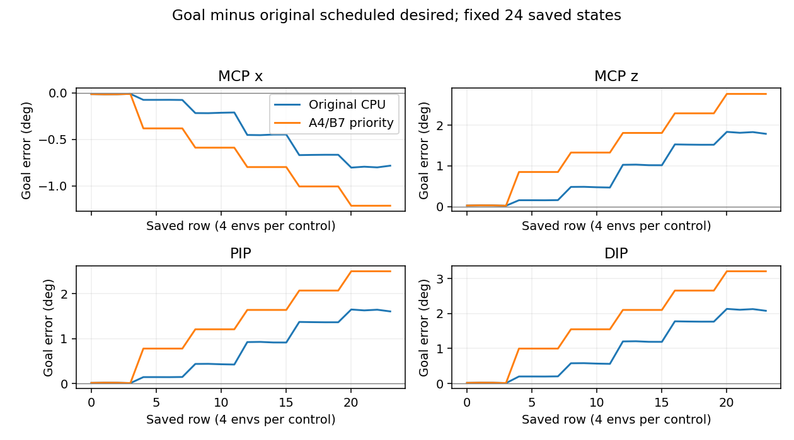

# 해제창 priority 고정 상태 대조

**이24행에서는 A4/B7 priority 복사가 원 예정 해제목표와의 각도차를 줄이지 않았다.** 음악/해제 성공 또는 학습 원인에 대한 검사가 아니다.

| 축 | 원→교체: 예정desired RMS(도) | 원→교체: full N RMS(도) | 최대목표변화(도) |
|---|---:|---:|---:|
| MCP x | 0.470597 → 0.774850 | 0.937585 → 1.232345 | 0.429283 |
| MCP z | 1.072217 → 1.762233 | 2.151848 → 2.820710 | 0.979675 |
| PIP | 0.964335 → 1.595820 | 1.930298 → 2.542935 | 0.893150 |
| DIP | 1.251069 → 2.046847 | 2.489373 → 3.260546 | 1.127960 |

원70e40d 모델의4환경×6controls=24행을 고정했다. 첫4행의 원priority는 이미A4/B7이므로 교체전후 입력·출력이 exact no-op이다. 나머지20행에서만 원B7/B8 priority를 같은행 main A4/B7의24열 전체로 바꿨다. 만료된A의 음중flag나end_delta/후속접촉 정보도 원main값 그대로다. 재정규화·새시계·N주입·physics·학습은 없다.
원state561/events/mask/priority_mask와 나머지6priority·모델73tensor 불변을 확인했다. 원CPU rawgoal 재현 최대잔차1.4901161193847656e−7로 선행검수된2.384185791015625e−7 이내다. 모델은 genuine GoalPolicy/원identity로 model state를 strict복원했으며 CPU추론이native CUDA전체상태복원을 대체한다는 주장은 하지 않는다.
N/예정desired는 검수된release_window.json의 원각도차와 같은행 저장decode값을 기준으로 재사용했다. 새시계나물리후상태는 재구성하지 않았다. rows.csv와 comparison.json은24행 원rawgoal/CPU원출력/교체출력/각도와두기준까지의차이를 모두 보존한다.
priority 교체는 공통 finger_encoder context와 index head의 두token에 함께 들어간다. 따라서 경로별기여를 분리하지 않았다. 원main에A정보가이미있으므로 정보부재·원NN이A를보지못함·학습인과를 확정하지 않는다. 원selector와다른 만료A우선입력은 진단용 counterfactual이며 다음제어의 해제성공/장면궤적/다른124환경/자유기타J33을 예측하지 않는다. 원priority를기본환경에서유지/변경하라는결론도내리지않는다.
결론은 이고정상태에서 단순A우선복사의 출력효과가 기대한해제방향개선이아니었다는것이다. 이검사만으로 추가fit/학습/보상변경을시작하지않는다. 직접사용파일SHA만확인했고원2천핀전체재귀재감사는하지않았다.

