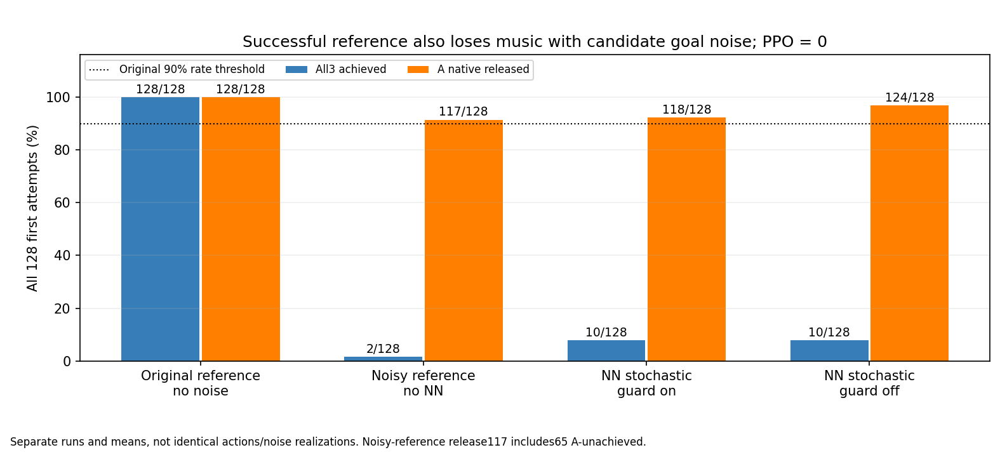

# 성공 reference의 목표각 잡음: 실제128 검산

원clean reference는 all3/해제128/128이었지만 같은 후보분포 잡음을 넣은 새noNN reference는 all3 2/128이었다. 음악False·해제True·AND False다. 잡음이 NN 없는 성공 reference에서도 성과후퇴와 함께였으므로 NN 근사오차만으로 현상을 설명할 수 없다. 다만 NN과 reference의 평균·행동·폐루프 상태가 달라 NN 단독 인과를 식별한 대조도 아니다. 원90% 기준을 유지하고 PPO/fit/새GPU/후보검색은 하지 않는다.

| 조건(각128/384음) | A/B7/B8 달성 | all3 | A 해제 | 음악/해제/AND | 물리/손목 실패 |
|---|---|---:|---:|---|---|
| 원clean reference | 128/128/128 | 128/128 | 128/128 | True/True/True | 0/0 |
| 새noisy reference | 54/16/12 | 2/128 | 117/128 | False/True/False | 0/0 |
| 기존NN on stochastic | 46/34/36 | 10/128 | 118/128 | False/True/False | 0/0 |
| 기존NN off stochastic | 43/36/46 | 10/128 | 124/128 | False/True/False | 0/0 |

새noisy reference의 clean 평균은 .646677/.339315/.335352, wrong은0/.5078125/.5078125다. 새128시도/384음·실패분모·9항을 전량 보존했고 나머지3행은 검수된 별도실행 출처를 재사용했다.

A 달성×해제는 달성·해제52, 달성·미해제2, 미달성·해제65, 미달성·미해제9다. 해제117/128 중65는 A미달성과 함께였으며 정상달성 후 해제117회로 해석하지 않는다. 원released latch는 안정된 무접촉·피부전체분리가 아니다.

## 잡음·callback·noNN 감사

실제 root child종료0/86.668194초, 원reference callback·Normal(zeros[128,4],실효std4)·RNG전진·Goal convert는각354회였다. 전체45,312 벡터/181,248 scalar draw를 first mask로 압축하지 않았다. NN constructor/model load/fit/PPO는0이다. 증거gate의 checkpoint pin을 모델을 실제로드했다는 주장으로 바꾸지 않는다. 원goal_codec_report의 model_RNG_frozen=True는 policy=None인 reference 분기의 기록이며 새sampling 증명으로 사용하지 않았다. 실제sampling은 reference_noise_report의 calls/RNG/스트림SHA/전체집계를 사용했다.

실효 std4=[.0081166131,.0119162761,.0125984587,.00944169145], seed7·shape·분포 형태는 기존NN 후보와 같지만 같은 평균·latent·행동·실제잡음 실현이라고 주장하지 않는다. 원NN epsilon 전체가 저장되지 않아 실제noise 실현 bitexact 동등성을 검사하지 않았다. 전체128 draw의 epsilon=noise/std 평균은 [.000096,.001080,−.005872,.000400], RMS는 [.998102,1.006353,.998624,.997320]다. 이 통계는 실제runtime 집계이고 유한표본의 꼬리0이나 물리변위/압력상한을 증명하지 않는다.

bounded4 관측은1416행이다. 원raw reference CPU 재생잔차0, noisy=tanh(atanh(raw_reference)+scaled_noise)의 CPU 최대잔차1.19e−7, epsilon 나눗셈잔차0, saved noisyraw→decode/physical 요청 잔차0이다. finite float32 산술허용오차8epsilon을 별도로 기록했고 실제잔차를 숨기지 않았다. native zero-noise roundtrip 잔차는5.96e−8이다. bounded4 epsilon RMS는 [.986405,.995321,.995864,.977308]로 전체128 집계와 구분했다. observations4의 requested_reference_action은 이번 noisy physical 요청이며 원clean 지도label로 위장하지 않는다.

## env0 기하와 A→B gap의 가용 신호

env0 B7/B8 음창 wrong은0/0, position/facing은46/46·21/21 전부통과, loaded/candidate는42/46·17/21이다. 전체128의 B wrong평균 .5078125를 env0 기하로 대신 설명하지 않는다. env0 음창 proximal 순힘평균 A/B7/B8은9.303/12.841/12.616N, distal은.213/.240/.263N, 손목오차는1.303/1.076/1.594mm다. 순힘은 접촉쌍·현압력이 아니다.

Aend3.1703→Bpress3.832 구간의 제어전 관측은각39행이다. 원event_fields/scales와 source onset으로 이미저장된 token만 식별했으며 onset복원 최대잔차2.97e−8초다. 새기하나 미저장접촉을 복원하지 않았다.

| env | A token 존재 | 그중 A candidate | 그중 A released latch | B7 token/현재B7 candidate | A가없어 알수없는 행 |
|---|---:|---:|---:|---|---:|
| 0 | 6/39 | 2 | 4 | 39/39 · 0 | 33 |
| 1 | 6/39 | 0 | 6 | 39/39 · 0 | 33 |
| 2 | 6/39 | 2 | 6 | 39/39 · 0 | 33 |
| 3 | 6/39 | 3 | 3 | 39/39 · 0 | 33 |

A token은 원end+.1 뒤 사라지므로 env1~3의 나머지33행에서 이전A 잔류접촉은 알 수 없다. 현재goal B7 candidate=False가 이전A candidate=False를 의미하지 않는다. env0만 원3-note trace의 gap39개60Hz 끝점에서 A candidate10회/B candidate0을 직접관측했고, 같은10끝점에서 B7/B8 wrong이 각각동시에True였다. 이는 virtual 판정의 동시관측이며 특정접촉쌍이나 피부 전체가 붙었다는 인증이 아니다. 선행 N에서 body1하중이 남았다는 한계를 그대로 유지하며 N 반환만으로 wrist 고착/모든접촉이 풀렸다고 가정하지 않는다.

기존guard 45,312 첫시도control에서 eligible13,775/blocked10,646/음증분3,129/양증분0이다. 같은goal 구간누적DIP 변화중앙−.63515°·최소−3.67570°로 NN없는 참고에서도 한쪽목표감소 관측이 남았다. 이것을 잡음·손목feedback·잔류접촉 중 하나의 단독원인으로 확정하지 않는다. 전체128상세힘/다른127기하/240Hz최초사건/자유기타·전곡·PPO효과로 확대하지 않는다.

## 원9항·물리·입력 범위

native105/.25Nm/90쌍/128·원bounds/rate·원guard·장면종료·callback/별칭복원·입력before/after 감사를 확인했다. CPU는 직접관련 SHA만 재해시했고 전체2천pin 재귀재감사는 하지 않았다. 원source/producer/prep/모델/기존결과는 변경하지 않았다. root의 gap질문 전 첫분석source/결과는 before_gap_contact_question에 보존했다.

| 원9항 episode평균 | noisy reference |
|---|---:|
| song_left_approach | -1.64173508 |
| song_left_contact | 0.467427102 |
| song_clean_hold | 1.32134446 |
| song_left_success | 0.16015625 |
| song_wrong_press | -0.152343726 |
| song_performance_deficit | -0.172163093 |
| song_finger_standby | 0.0880302826 |
| song_thumb_support | 0.0455302225 |
| action_change | -1.61955196e-06 |

9항합과 episode reward 최대잔차는3.13e−6이다. 보상/시간/성공 판정은 변경하지 않았고 임의새threshold·추가실행·기본채택 결론을 더하지 않았다.
