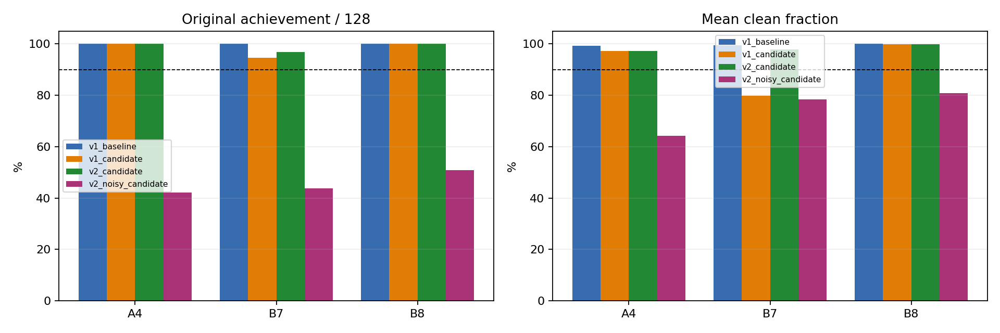
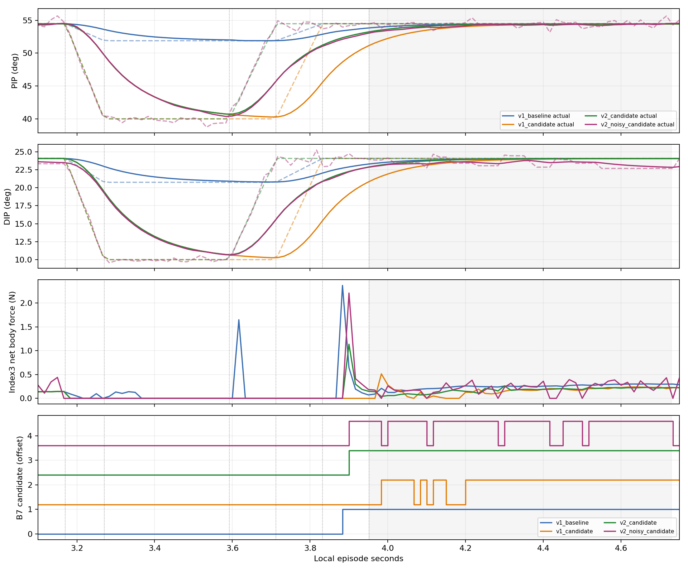
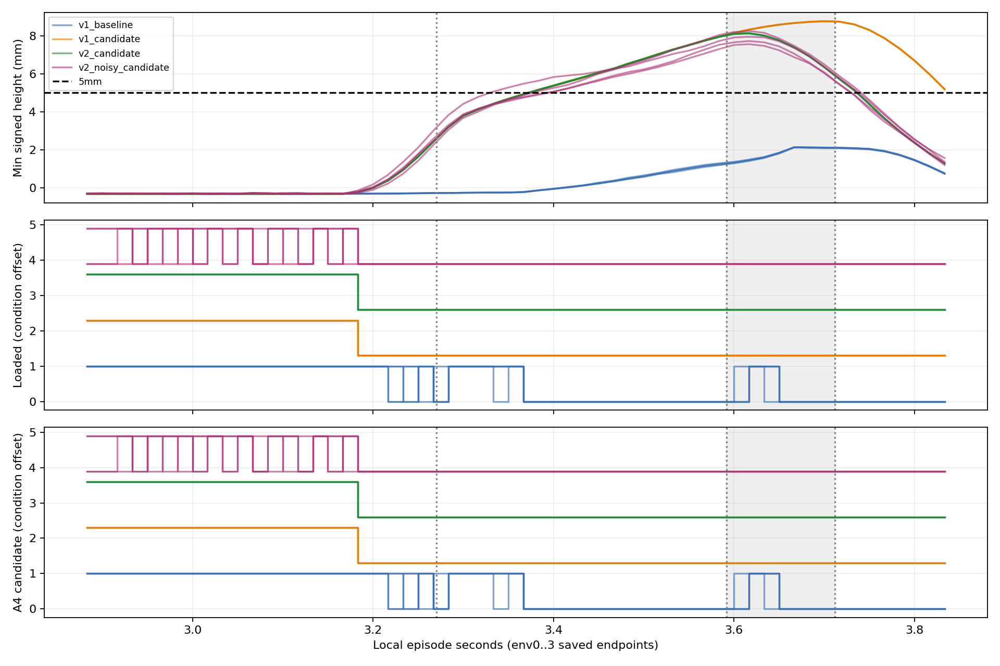

# closing lead v2 실제128 비교 분석

PIP/DIP closing 준비만120ms 앞당긴 V2는 결정론적 원128시도에서 음악·A해제 gate를 모두 통과했다. V1후보 대비 B7 clean이79.916%→97.843%로 회복했다. 기존 baseline128/128을 완전히 재현한 성과는 아니며 V2 전체3음 달성은124/128이다.

## 조건과 분모

V1 baseline은 재사용한 원 실행이다. V2 runs/baseline의 두 JSON 복사는 새 GPU실행으로 세지 않는다. 각 조건은 원128시도/384음 전체를 분모로 사용하고 실패/미달성 시도를 제외하지 않는다. V2는 N PIP40°/DIP10°와 closing길이120ms를 유지하며 closing만[3.712,3.832]→[3.592,3.712]초로 옮겼다. MCP/팔/손목, 원press/onset/end, 속도/PD/effort/충돌/보상9항/종료기준은 유지한 단일 lead 비교다.

| 조건 | 음4/7/8 달성 | 전체3음 달성 | A4해제 | 음악/해제 gate | 물리/손목 실패 |
|---|---|---:|---:|---|---|
| v1_baseline | 128/128/128 (각128) | 128/128 | 128/128 | True/True | 0/0 |
| v1_candidate | 128/121/128 (각128) | 121/128 | 128/128 | False/True | 0/0 |
| v2_candidate | 128/124/128 (각128) | 124/128 | 128/128 | True/True | 0/0 |
| v2_noisy_candidate | 54/56/65 (각128) | 34/128 | 102/128 | False/False | 0/0 |

| 조건/음 | clean 평균 | wrong 평균 | missing 평균 | 달성·해제 동시/128 |
|---|---:|---:|---:|---:|
| v1_baseline/4 | 0.993692198 | 0.000000000 | 0.003153901 | 128 |
| v1_baseline/7 | 0.995306541 | 0.000000000 | 0.002346729 | 0 |
| v1_baseline/8 | 1.000000000 | 0.000000000 | 0.000000000 | 0 |
| v1_candidate/4 | 0.972357298 | 0.000000000 | 0.013821351 | 128 |
| v1_candidate/7 | 0.799157119 | 0.000000000 | 0.162302620 | 1 |
| v1_candidate/8 | 0.999252321 | 0.000000000 | 0.000373840 | 0 |
| v2_candidate/4 | 0.972357298 | 0.000000000 | 0.013821351 | 128 |
| v2_candidate/7 | 0.978425823 | 0.000000000 | 0.011205549 | 0 |
| v2_candidate/8 | 0.999065401 | 0.000000000 | 0.000467300 | 0 |
| v2_noisy_candidate/4 | 0.641343707 | 0.000000000 | 0.293062794 | 50 |
| v2_noisy_candidate/7 | 0.783290081 | 0.000000000 | 0.181942838 | 9 |
| v2_noisy_candidate/8 | 0.808025140 | 0.000000000 | 0.155119883 | 11 |

A4 released 판정은128개 에피소드의 원값이다. B7/B8 released 값은 별개이며 이 A해제 gate를 대체하지 않는다. mean clean90%, 달성90%, wrong10% 등 원판정을 그대로 사용했다.

## 실제 추종과 접촉

B7 onset은local3.952초다. onset직전 저장끝점3.950초에서 PIP/DIP 실제각은 baseline53.839/23.285°, V1후보51.122/20.804°, V2후보53.233/22.869°다. 다음끝점3.966667초에서 공통목표54.485/24.068°에 대해 V2실제53.393/23.023°다. V2는 V1후보보다 실제 복귀가 빨라졌다. env0의 B7 candidate는 V1후보의 초기 지연·여러 토글과 달리 V2에서3.966667..4.716667초 연속이다. 이 대표환경은 전체128환경의 개별궤적을 보장하지 않는다. net body force는 특정 현의 pair pressure나 실제 음향 측정과 구분한다.

A4 clean은 V1후보와V2가동일하다. 최초 개방 action시작3.166667초가A끝3.1703초보다 조금 이른 기존 endpoint일정 관찰은 이번closing변경에서 고치지 않았다. 초기 개방의 모든 음질 손실 원인을 단독으로 확정하지 않는다.

## 표면의 공통창과 바뀐 구간

원공통창 env0..3/clock692..920는 조건별232행이며 각끝점에서 원distal128점 signed height 최소를 사용한다. 전체128환경·모든240Hz substep을 검사한 것으로 확대하지 않는다. V2의 N유지와 early closing은 분리해 비교한다.

| 조건/창 | 끝점수 | 최소(mm) | 5mm이상 | loaded | A candidate |
|---|---:|---:|---:|---:|---:|
| v1_baseline/common_original_phase3 | 104 | -0.271848 | 0 | 27 | 27 |
| v1_baseline/unchanged_N_hold | 76 | -0.271848 | 0 | 19 | 19 |
| v1_baseline/v2_early_closing | 28 | 1.288404 | 0 | 8 | 8 |
| v1_candidate/common_original_phase3 | 104 | 3.178095 | 80 | 0 | 0 |
| v1_candidate/unchanged_N_hold | 76 | 3.178095 | 52 | 0 | 0 |
| v1_candidate/v2_early_closing | 28 | 8.126122 | 28 | 0 | 0 |
| v2_candidate/common_original_phase3 | 104 | 3.178095 | 80 | 0 | 0 |
| v2_candidate/unchanged_N_hold | 76 | 3.178095 | 52 | 0 | 0 |
| v2_candidate/v2_early_closing | 28 | 6.344774 | 28 | 0 | 0 |
| v2_noisy_candidate/common_original_phase3 | 104 | 3.036064 | 81 | 0 | 0 |
| v2_noisy_candidate/unchanged_N_hold | 76 | 3.036064 | 53 | 0 | 0 |
| v2_noisy_candidate/v2_early_closing | 28 | 6.026742 | 28 | 0 | 0 |

원phase3=[3.2703,3.712]초, unchanged_N_hold=[3.2703,3.592]초, v2_early_closing=[3.592,3.712]초다. V2결정론적 후보는 공통phase3에서 재접촉0을 유지하지만 5mm는80/104만 충족한다. 따라서 정적후보7.56mm 예측을 실제전체최소값이나 gate완전성공으로 옮겨적지 않는다. 바뀐28끝점의최소6.344774mm와5mm28/28은 그 짧은구간만의 값이다. 준비anchor/qtarget정적기하와 실제index1 frame·q추종·손목자세 차이의 개별 인과 기여는 여기서 분리확정하지 않는다.

## 잡음 확인

원4성분 std/Normal128×4 조건의 실제 noisy128 결과를 별도 조건으로 포함했다. 전체3음 달성34/128이며 stage_ready=False다. 결정론적 gate통과와 잡음 내성은 별도 결론이다. 이 한seed/한std 진단을 일반화하거나 학습 성과로 해석하지 않는다.

잡음은 각60Hz 제어에서 선택4축(index1_x,index1_z,PIP,DIP)의 atanh(rawgoal) 공간에 넣는 무차원 Normal이다. 유효 sigma4=[0.008116613142192364, 0.011916276067495346, 0.012598458677530289, 0.00944169145077467]이며 각도 rad값이 아니다. env0 전체354끝점의 결정론적 대비 실제decoded목표차 RMS(rad)는[0.010883839800953865, 0.003311457112431526, 0.008471718057990074, 0.01042922679334879]이고, 도 단위는[0.623598039150238, 0.18973250687122345, 0.4853936731815338, 0.597550630569458]다. 이값은 해당비선형변환·기준목표·샘플에따른측정값이며 sigma의보편적각도환산이아니다.

과거 noisy_reference 전체3음2/128과 현재34/128은 동일seed7·동일Normal128×4 잡음stream SHA256 bdf05ebdbe3c86708b334de206a6343fe573d7a35d9450ba484a6f7b96eb277b 및 저장env0..3 scaled_noise byte-exact를 확인했다. 조건부비교는가능하나 과거 runtime경로/관측계약과현재경로차이가있고 현재결정론적baseline동등성은별도로확인한것이다. 또한 과거대비N열기와closing lead둘이함께다르므로32개증가를lead하나의인과효과로분리할수없다. 음악gate는현재도실패이며A해제는과거117/128에서현재102/128로낮아졌다.

잡음실패는모든음에서wrong평균0과missing증가로나타난다. 결정론적closing회복만으로처음A와후속B의지속접촉취약성이해결되지않았다. env0 audible 저장끝점 candidate비율은A4 0.9091/B7 0.8696/B8 0.8095이며거리최대0.766/0.828/0.333mm로이동·접촉판정이끊긴다. 이대표값만으로128환경실패의전체기하원인을확정하지않는다. 원A해제미달26개와음별달성실패의교차는analysis.json에별도로보존했다.

다음단일검증제안: V2일정/목표/PD/원잡음draw를그대로재생하면서 index1_x에실제로가하는잡음만0으로하는128시도를한번비교한다. 다른3축에는현재와동일한draw를넣고draw자체는128×4로유지한다. env0에서MCP index1_x의목표변동및추종오차가함께늘어나는관찰을근거로한성분분리검증이며, 현재원인을확정한해결책이나std검색이아니다. 성공기준은원음별/전체/해제gate및cost/물리실패,특히Aclean과해제102/128의변화다. 새실행은이분석에서수행하지않았다.

## 보상9항·cost와 무결성

| 조건 | 총reward합 | cost합 | wall초 |
|---|---:|---:|---:|
| v1_baseline | 366.588720560 | 0.000000000 | 54.084 |
| v1_candidate | 342.454634190 | 0.000000000 | 53.384 |
| v2_candidate | 365.885488749 | 0.000000000 | 52.468 |
| v2_noisy_candidate | 207.882939378 | 0.000000000 | 55.346 |

| 보상항 | v1_baseline | v1_candidate | v2_candidate | v2_noisy_candidate |
|---|---:|---:|---:|---:|
| song_left_approach | -224.766640306 | -217.068894029 | -219.192461729 | -219.167871118 |
| song_left_contact | 96.000001729 | 96.000002205 | 96.000001073 | 92.041670434 |
| song_clean_hold | 382.592325926 | 354.658519506 | 377.581089497 | 285.780530289 |
| song_left_success | 96.000000000 | 94.250000000 | 95.000000000 | 43.750000000 |
| song_wrong_press | 0.000000000 | 0.000000000 | 0.000000000 | 0.000000000 |
| song_performance_deficit | -0.070408074 | -2.259171958 | -0.378294742 | -11.371275244 |
| song_finger_standby | 11.267667040 | 11.268602625 | 11.268602625 | 11.268780619 |
| song_thumb_support | 5.566282123 | 5.606043737 | 5.607022777 | 5.581429895 |
| action_change | -0.000045030 | -0.000037991 | -0.000037991 | -0.000157554 |

원total reward와 각항합은float누적순서에따른작은반올림차이를가질수있다. analysis.json은음별실패포함분모·release교차·보상9항·원acceptance·onset전후각도·구간별표면을보존한다. verification.json은입력전후SHA256과실제8개자체검사(모두통과)를기록한다. 새 GPU실행·NN생성·학습·각도grid/std검색은모두0이며원자료/활성소스/봉인입력을수정하지않았다. 이분석은고정기타·검지3음·대표env0/표면4환경범위이며J33·다른손가락·자유기타·67음·다른seed완료를뜻하지않는다.
