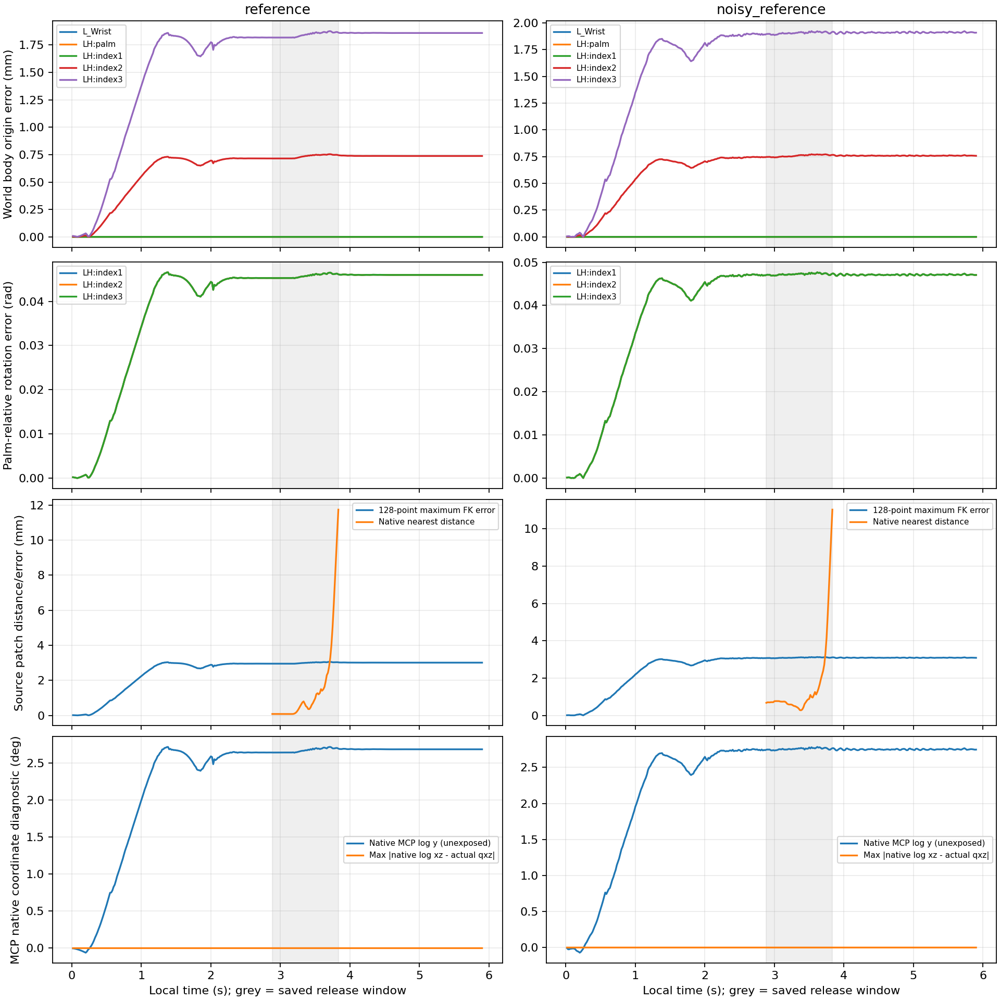

# 원FK와 실제 검지 자세 감사 결과

2026-10-28 CPU 읽기전용 분석 완료. **프로그램 검증은 통과했으나 원 `full_fk`의 검지 정확성 검증은 실패했다.** 현 FK를 그대로 사용하여 mm 수준의 해제 목표를 최적화할 근거가 없다. 손목·손바닥은 잘 맞지만 MCP2 이후 검지 회전과 distal 표본 위치는 실제 native pose와 다르다. 이는 학습·물리 실행의 성공 여부를 새로 판정한 결과가 아니다.

## 범위와 검증 방법

- 두 기존 조건 `reference`, `noisy_reference`의 env0 실제 q105/강체 pose 각354행만 사용했다. 전체창은 clock4~1416(60Hz, 마지막 기존 종료 endpoint 포함), 별도 해제창은 clock692~920의58행이다. 다른127환경의 q·손바닥 pose를 추정하지 않았다.
- 해제창의 env0·clock·local/source time을 정확히 정합했다. 대응하는 index3/guitar xyzw pose는 NPZ 사이 **바이트에서 복원한 배열 값이 완전히 동일**하다. joint105 순서와 logical body106 순서는 prepared initial의 human66/guitar39 및 chair1과 일치한다. 모든 관절각·pose는 유한하며 quaternion norm 오차는1e-6 미만이다.
- `load_prepared_reset_contract()`의 준비 actual q105와 준비 native pose로 원FK를 **한 번만** 보정했다. 각 trace의 실제 q105에 적용했으며 행마다 보정하거나 drive target으로 바꾸지 않았다. 좌표는 m, 회전은 rad다. 문서의 위치 오차는1000을 곱한 mm, 회전 오차는 quaternion 부호에 무관한 SO(3) 최단각이다. palm-relative 비교에는 각 자료의 자체 palm pose를 썼다.
- 결과를 읽기 전 코드 상수로 FK 정합 허용오차를 **위치0.01mm·회전1e-4rad**로 정했다. 이는 부동소수점 정합을 확인하기 위한 감사 기준이다. 기존 패드·접촉·해제·물리·음악 성공기준은 바꾸지 않았다.
- 원 source128 안쪽표본을 native/FK distal pose로 각각 world에 배치하고 동일한 실제 기타 pose로 guitar 좌표로 옮겼다. 두 좌표계의 오차 크기는1e-10mm 이내에서 일치한다. native 재구성 표본은 저장 `points_G`와3e-7m 이내에서 일치한다.

## 실측 오차

다음은 **전체354행 world 위치 최대오차(mm)** 다. 모든 지표의 min/median/p95/max/RMS와 해제창별 값은 `results.json`에 있다.

| body | reference | noisy_reference |
|---|---:|---:|
| L_Wrist | 0.000349 | 0.000328 |
| LH:palm | 0.000346 | 0.000336 |
| LH:index1 | 0.000355 | 0.000330 |
| LH:index2 | 0.754327 | 0.772320 |
| LH:index3 | 1.876874 | 1.922624 |

손목·손바닥의 world 회전 최대오차는 두 조건 모두1.10e-6rad 미만이다. 해제58행의 손목/손바닥 위치 최대오차도 각각0.000243/0.000308mm(reference), 0.000292/0.000315mm(noisy_reference)다.

**palm-relative 위치/회전 최대오차**는 다음과 같다. `위치mm / 회전rad` 표기다.

| 창 | body | reference | noisy_reference |
|---|---|---:|---:|
| 전체354 | index1 | 0.000132 / 0.0465624 | 0.000124 / 0.0476872 |
| 전체354 | index2 | 0.754254 / 0.0465624 | 0.772234 / 0.0476872 |
| 전체354 | index3 | 1.876797 / 0.0465623 | 1.922547 / 0.0476871 |
| 해제58 | index1 | 0.000128 / 0.0464868 | 0.000108 / 0.0476872 |
| 해제58 | index2 | 0.754254 / 0.0464868 | 0.772234 / 0.0476872 |
| 해제58 | index3 | 1.876797 / 0.0464867 | 1.922547 / 0.0476871 |

index1의 부착점은 잘 맞아도 회전은 약0.047rad 다르고, 그 회전 차이가 하위 index2/3의 위치 차이로 누적된다. PIP/DIP를 **각 자체 parent에 상대화**하면 두 조건 전체354행의 회전 최대오차는6.57e-7rad 이하, 위치 최대오차는0.000111mm 이하이다. 오차가 검지 전체의 모든 hinge에서 각각 생겼다는 해석보다 palm→index1 MCP2 관계를 먼저 조사할 근거가 된다.

## MCP2에서 관찰된 좌표 정보

원 XML의 index1은 축x,z 두 개이며 body에 별도quat가 없다. 실제 `log(R_palm^-1 R_index1)`의 x,z는 저장 actual q의 x,z와 전체 최대2.15e-7rad 이내에서 일치한다. 그러나 같은 상대회전의 y성분은 준비자세의 **-0.015032°**에 고정되어 있지 않다.

| 조건·전체354행 | native 상대 log y 최소° | 중앙값° | 최대° |
|---|---:|---:|---:|
| reference | -0.061135 | 2.648470 | 2.714861 |
| noisy_reference | -0.071303 | 2.742975 | 2.784835 |

원FK의 `Exp(Aq) * zero`는 준비자세에서 보정한 상수zero를 쓴다. 실제 pose에는 노출된 두 q좌표에 없는 y성분이 변하는 현상이 있으므로 단순히 x,z를 순서대로 돌린다는 새 공식을 채택할 근거는 없다. 이 실험은 locked-axis constraint drift나 importer 동작 등의 **원인을 확정하지 않았다**. 추가로 관측되지 않은 자유도를 q105만으로 정확하게 복구한다고 주장할 수도 없다. arbitrary 새 모델이나 팔용 Jacobian을 적용하지 않았다.

## source128 표본과 실제 여유의 관계

| 조건 | 창 | native→FK 표본오차 중앙값mm | p95mm | 최대mm |
|---|---|---:|---:|---:|
| reference | 전체354 | 2.452087 | 2.927649 | 3.053282 |
| reference | 해제58 | 2.580110 | 2.951416 | 3.053282 |
| noisy_reference | 전체354 | 2.510847 | 3.009702 | 3.128887 |
| noisy_reference | 해제58 | 2.672129 | 3.041920 | 3.128887 |

해제창의 저장 native 최근점 거리는 reference 최소/중앙값0.078301/0.524939mm, noisy_reference 0.272828/0.741281mm다. 각 시점 **native가 선택한 동일한 최근점**에서 FK 위치오차는 중앙값2.453309/2.512102mm다. 이 오차가 저장 최근점 거리보다 큰 행은 각각49/58,50/58이다. 따라서 FK 오차가 여유에 비해 작다고 볼 수 없다. 이 비교만으로 접촉 판정이 몇 행 뒤집힌다고 계산하지 않았으며, 최근점 거리를 signed separation·전체 피부·실제 줄압력의 인증으로 해석하지 않는다. 기존 cached positive/candidate는 해제창에서27행/25행이며 바꾸지 않았다.

## 실제 관절각과 drive target을 구분해야 하는 이유

준비 actual과 준비 target의 q 최대차이는0.053143rad다. 실제 q를 보정기준으로 썼을 때 준비자세 자체 최대오차는 위치3.17e-13mm·회전1.07e-15rad다. 이 자기일치는 보정의 산술 확인일 뿐 독립적인 native 동작 정확성의 증거가 아니다.

같은 FK에 준비 target을 넣으면 index3의 준비 actual pose와3.881863mm·0.014429rad 달라진다. 저장 trace actual q를 target q로 치환하면 source128 FK 점은 해제창에서 최대 **12.619661mm/13.608776mm** 추가로 움직인다. 따라서 목표각을 실제각으로 간주하면 별도의 큰 오차를 넣게 된다. 이 민감도 실험은 동일한 기존 FK에 입력만 바꾸었으며 새로운 보정은 하지 않았다.

## 원입력·검사·재현

두 run의 `inputs_before.json`에 기록된 원 controller SHA는 `c52b9628f71700275d56ddbf064760c3ce37400dd96332c895bcef964383754d`다. 해당 CAS `.data`의 바이트를 이 SHA로 확인하고 그 안 `full_fk` AST가 현행 import한 함수와 동일함을 확인했다. 현 controller 전체 파일 SHA는 과거 pin과 **다르다**(import 통합); 파일 전체가 동일하다고 주장하지 않는다. 실제 사용한 human XML SHA는 두 run pin과 동일한 `62d3483c19d04624168c834ebfe12d029a91579553b6d6f621162c1030549778`다. 다른 현재 소스를 옛 pin으로 억지 검증하지 않았다.

준비계약 원입력110개와 원NPZ·metadata·원pin 파일·현 함수파일·원CAS·분석코드 등 총125개 명시 입력의 SHA를 분석 전후 비교했고 모두 불변이다. 목록과 SHA 전체는 `results.json`에 있다. 실행은 IsaacGym/Torch import 없이 CPU만 사용했다. 새 GPU 실행0·PPO0이며 모델·분포·보상·native 활성소스·archive·원자료를 수정하지 않았다.

자체검사는 알려진 상대변환, antipodal quaternion의 동일회전, mm/rad 단위 오차 검출, 틀린 tick 거부를 포함한다. 실제 입력에는105/106 순서·354/58 크기·유한성·quaternion norm·clock/pose exact join·128 source mask/normal·저장 표본 재구성·world/G 거리불변성·준비 baseline 자기일치·전후SHA 검사를 적용했다. 그래프도 렌더링하여 확인했다. 실행 returncode0, `program_completed=true`, `inputs_unchanged=true`, **`fk_accuracy_gate=false`**다. 독립 change-reviewer 검수는 root 작업에서 이어서 수행한다.

```bash
cd /home/ajou/yigyu/3
OPENBLAS_NUM_THREADS=1 OMP_NUM_THREADS=1 MPLCONFIGDIR=/tmp/index_release_fk_audit_mpl \
  /home/ajou/miniconda3/envs/rl38/bin/python \
  docs/2026-10-27/guitar_learning_failure_diagnosis_v1/05_verified_fixes/index_release_fk_audit_v1/analyze.py
```

출력: `results.json`(근거·통계·SHA·gate), `series.json`(두 조건의 원시간축 오차/MCP 추이), `fk_native_comparison.png`(4행×2조건), 이 문서. 이 결과의 다음 최소 조사 범위는 MCP2의 native 실제회전과 노출q의 관계다. 원FK를 통과한 것으로 간주하여 유한 해제목표 최적화로 건너뛰지 않는다.


