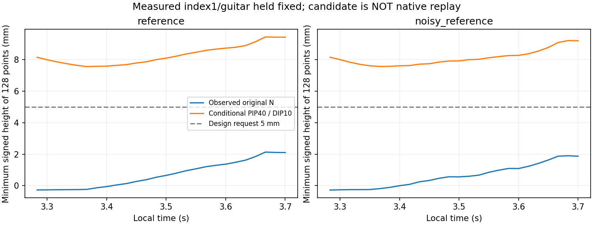

# 실측 첫마디 기준의 해제 후보

원FK의 MCP2 오차를 없앤 것처럼 취급하지 않고 실제 native index1 pose를 각 시점의 기준으로 삼았다. 원FK의 downstream PIP/DIP hinge만 강체 정합해서 사용했고, 실제각을 그대로 넣었을 때 distal128점은 최대 **0.000150mm**, 회전은 **1.12e−6rad** 오차로 실제 자료를 재현했다. 이 정합은 실측 첫마디를 입력으로 받은 조건부 계산이며 q105 전체의 올바른FK를 만들었다는 뜻이 아니다.

사전에 정한 **PIP40°·DIP10° 단일후보**만 검사했다. 원N(약51.897°·20.751°)에서 각각11.897°·10.751° 더 펴는 목표다. native 관절범위 안이며 원4rad/s 제한에서 목표 변화에 필요한 이론상 최소시간은 약 **51.9ms**다. 실제 관절이 그 시간에 도달한다는 의미는 아니다.

|조건·env0 phase3 끝점26개|원128표본의 최소 signedheight|후보128표본의 최소 signedheight|5mm 설계 여유|
|---|---:|---:|---|
|reference|-0.2701mm|7.5582mm|통과|
|noisy_reference|-0.2755mm|7.5654mm|통과|

5mm는 기존 압현 판정 상단3mm보다2mm 위를 요청하는 설계 기준이다. 원음악 성공/접촉/해제 latch 기준은 바꾸지 않았다. 원측정의 음수 높이는 분리 여유로 해석하지 않는다. 모든 source-valid 굽힘 안쪽128점을 포함했지만 전체 피부나 손가락 다른마디는 아니다.

**후보의 실제 해제 개선은 아직 미검증**이다. 원reference/잡음reference 두 실행의 env0·phase3 각26개에서 실측 index1과 기타pose를 고정한 조건이다. 새 목표를 실행하면 부하·충돌·첫마디의 미노출 회전·팔과 손목·실제각 추종이 달라질 수 있다. 실제로 바꾸기 전 paired finite replay가 필요하며, 이 CPU 결과를128환경의 물리 도달률이나 학습 성과로 확대하지 않는다. 초기 준비나 첫음에는 후보를 주지 않고 원A→N→B 일정의 N에서 PIP/DIP 목표만 바꾸는 단일 개입을 다음 실행 범위로 삼는다.

자체검사는 anchor의 공통강체변환 불변성과 음수height 배제를 확인했다. 실제 입력은 원joint105 순서·시계·env0 distal/guitar pose exact 정합·sourcevalid128·native범위·실측 baseline 재현·q불변을 검산했다. `results.json`에 입력SHA 전후불변·각행 시계/높이·고정후보/상한/단위가 있다. 실행은 CPU 약2초·종료0이며 새native/PPO/fit/모델생성0, 활성소스·원자료 변경0이다.

실행: `/home/ajou/miniconda3/envs/rl38/bin/python -B docs/2026-10-27/guitar_learning_failure_diagnosis_v1/05_verified_fixes/index_release_hinge_candidate_v1/analyze.py`. 기존 `results.json`이 있으면 원결과를 덮어쓰지 않도록 중단한다. 결과를 다시 확인할 때는 기록된SHA와 산술을 읽기전용으로 검산한다.

독립검수 후 두 조건의 actual replay 계획을 확정한다. 새std/보상/시간표/충돌변경과 동시에 적용하지 않는다. 후보가 실제로 유효해도 최초압현 중 잡음 취약성은 별도로 남는다.
