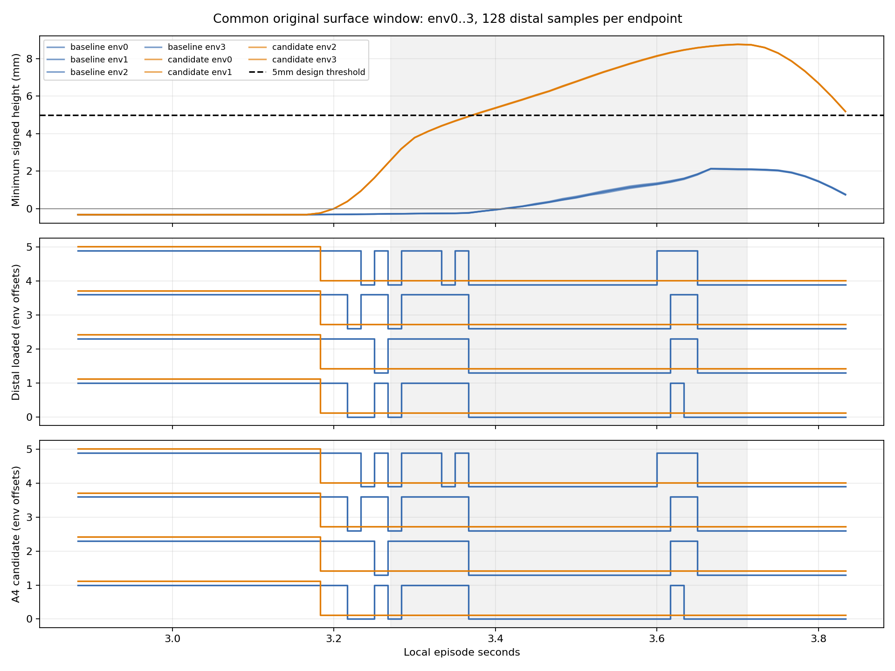
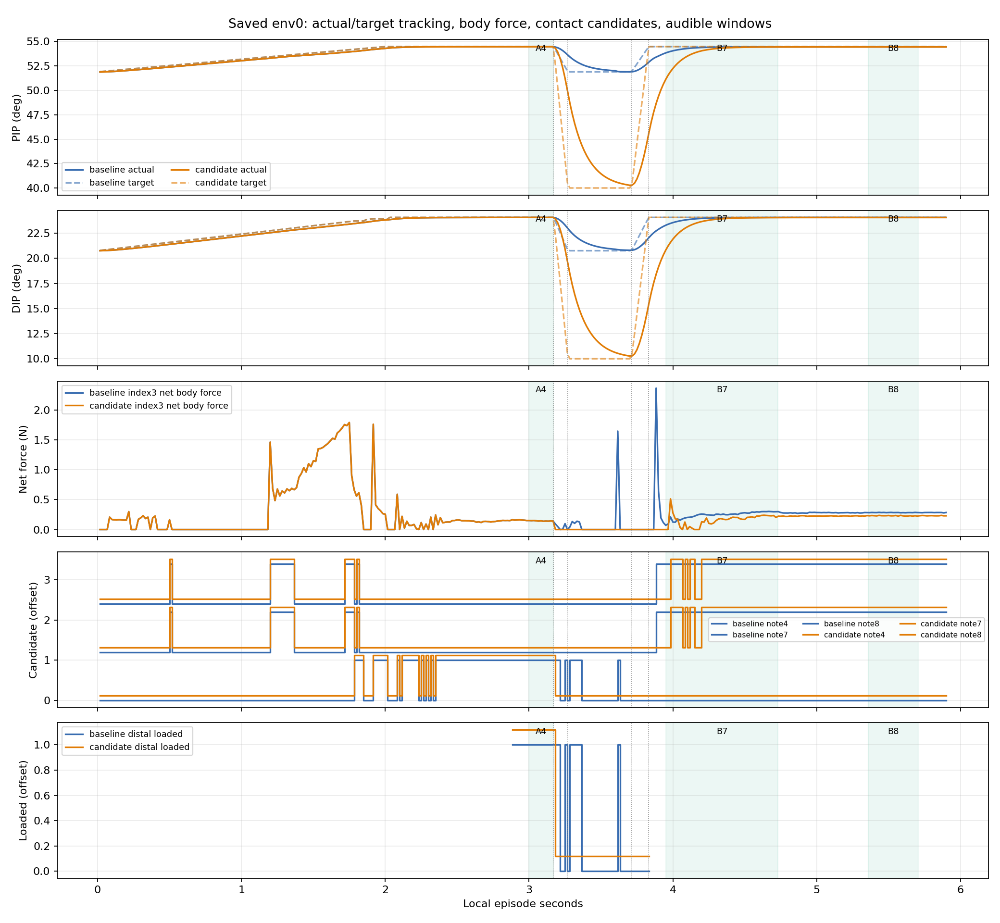
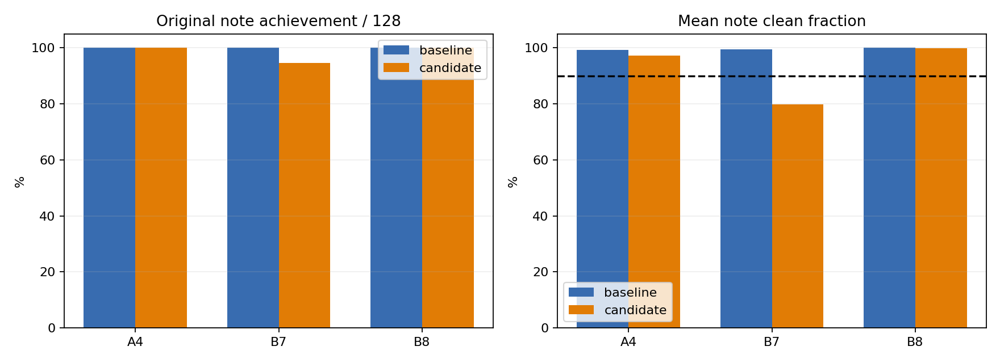

# index release hinge native128 분석

후보는 저장한 실제 해제 구간의 distal 재접촉을 없앴으나, 다음 음 B7 품질을 유지하지 못했다. 기존 gate는 그대로 실패하며 noisy native 실행과 학습으로 진행할 근거가 없다. 이 결과는 no-NN 결정론적 진단이며 정책 성능이 아니다.

## 실행과 분모

baseline/candidate 각각 원128시도·384음 전체를 분모로 사용했다. 두 조건 모두 유효128, 물리/손목 실패0, cost 합0이다. scene close 완료, 입력466핀 변경0이다. 실행 시간은 각각54.08/53.38초다. baseline env0의354행 q/target/body/candidate/wrong/released/release_s는 이전 clearance reference와 원소별 bit-exact다.

초기 baseline 시도1의 Ninja 오류는 rl38/bin이 PATH에 없어서 GpuScene.__init__에 진입한 뒤 gymtorch 확장을 로드하는 중 발생했다. native simulator 생성과 physics 진행 전의 오류다. execution_failures/baseline_attempt01 및 relocation/log를 보존한 뒤 PATH만 고쳐 성공했다. 이것을128환경의 물리 실패로 세지 않는다. 원 runtime 소스 수정은 없다.

| 조건 | A4 달성 | B7 달성 | B8 달성 | 전체3음 달성 | A4 해제 |
|---|---:|---:|---:|---:|---:|
| baseline | 128/128 | 128/128 | 128/128 | 128/128 | 128/128 |
| candidate | 128/128 | 121/128 | 128/128 | 121/128 | 128/128 |

| 조건/음 | 평균 clean | 평균 wrong | 평균 missing | 달성과 해제 동시 |
|---|---:|---:|---:|---:|
| baseline/4 | 0.993692198 | 0.000000000 | 0.003153901 | 128/128 |
| baseline/7 | 0.995306541 | 0.000000000 | 0.002346729 | 0/128 |
| baseline/8 | 1.000000000 | 0.000000000 | 0.000000000 | 0/128 |
| candidate/4 | 0.972357298 | 0.000000000 | 0.013821351 | 128/128 |
| candidate/7 | 0.799157119 | 0.000000000 | 0.162302620 | 1/128 |
| candidate/8 | 0.999252321 | 0.000000000 | 0.000373840 | 0/128 |

A4 해제 성공128은 B7/B8의 해제를 뜻하지 않는다. B7/B8 released 값0은 이 진단의 A 해제 gate 실패로 취급하지 않는다. 후보 B7 달성121/128과 평균 clean79.916%는 별개 지표다. 평균 clean90% gate를 통과하지 못해 stage_ready=false이다. noisy mode 호출 흔적은 있으나 Isaac Gym 이전의 기계 gate에서 차단되었고 실제 noisy native 실행은0회다.

## 실제 표면과 정적 예측

공통 저장창은 env0..3, clock692..920이며 조건별232행(환경별58행)이다. 전부 valid, post_failure0. phase3는 local3.2703..3.712초의104끝점이다. 각 끝점에서 원 distal128점의 signed height 최소값을 사용했다.

| 조건 | phase3 최소 높이(mm) | 5mm 이상 끝점 | loaded 끝점 | A candidate 끝점 |
|---|---:|---:|---:|---:|
| baseline | -0.271848410 | 0/104 | 27/104 | 27/104 |
| candidate | 3.178094625 | 80/104 | 0/104 | 0/104 |

후보의 실제 minimum3.178mm와5mm충족80/104는 정적 후보의7.56mm 예측과 구분해야 한다. 재접촉 제거는 이4환경의 저장된 phase3 끝점에서 확인한 결과다. 전체128환경의 모든 물리 substep에 대한5mm 보장이 아니다. 정적 계산의 index1 anchor/목표각 조건과 실제 index1 frame·q 추종·손목 자세 조건이 다르므로 실제 표면과 차이가 날 수 있다. 이 trace만으로 각 요인의 인과 기여를 분리 확정하지 않는다.

## 타이밍과 추종 관찰

A4 audible은 local3.0000..3.1703초다. 최초 변경 action은3.166667초에 시작하고3.183333초 endpoint에 나타난다. endpoint를 보고 개방량을 정하는 일정이 A4 끝보다 약3.63ms 일찍 개방을 시작한다. A4 clean 하락에 기여할 수 있는 관찰이며, 전체 하락 원인을 이것 하나로 확정하지 않는다.

B7 press3.832초, onset3.952초, end4.7299초다. onset 직전 저장끝점3.950초에서 baseline PIP/DIP실제53.84/23.28도, 후보51.12/20.80도다. 다음 저장끝점3.966667초에서 목표는 두 조건54.485/24.068도이며 baseline 실제53.921/23.385도, 후보51.555/21.224도다. 더 크게 열린 후보는 같은 closing 일정에서 실제 복귀가 늦다.

env0 B7의 onset 이후 저장끝점 candidate는 baseline3.966667..4.716667초 연속이다. 후보는3.983333..4.050000,4.083333,4.116667..4.133333,4.200000..4.716667초로 끊긴다. 초기 접촉 지연과 이후 candidate/힘 토글은 분리해 관찰해야 한다. net body force는 특정 현과의 pair pressure나 음향 성공을 보증하지 않는다. surface창 밖의 loaded 상태를 force만으로 재정의하지 않았다.

N PIP40/DIP10을 유지하면서 closing만0.12초 일찍 준비하고, 원0.12초 duration 및 MCP/손목 일정을 유지하는 단일 lead 변경은 복귀 지연 가설을 검증할 다음 실험으로 합리적이다. 아직 실행하거나 효과를 확인한 결과가 아니며 새128 비교에서 A4·B7/B8 각각과 해제/표면을 다시 판정해야 한다.

## 보상9항과 cost

에피소드 총 reward를128개 합산하면 baseline366.588720560, candidate342.454634190이며 평균2.863974379/2.675426830이다. 아래 항목은 원 reward_components의 합이다. float 누적 순서 때문에 항목합과 원 total합에는 작은 반올림 차이가 있을 수 있다.

| 항목 | baseline 합 | candidate 합 |
|---|---:|---:|
| song_left_approach | -224.766640306 | -217.068894029 |
| song_left_contact | 96.000001729 | 96.000002205 |
| song_clean_hold | 382.592325926 | 354.658519506 |
| song_left_success | 96.000000000 | 94.250000000 |
| song_wrong_press | 0.000000000 | 0.000000000 |
| song_performance_deficit | -0.070408074 | -2.259171958 |
| song_finger_standby | 11.267667040 | 11.268602625 |
| song_thumb_support | 5.566282123 | 5.606043737 |
| action_change | -0.000045030 | -0.000037991 |

## 검증 범위

analysis.json은 재계산 수치·원 acceptance·보고서·접촉 구간을 포함한다. verification.json은 읽은 입력의 분석 전후SHA256과 최소 자체검사9개(모두 통과)를 포함한다. 새 GPU실행·NN생성·학습·각도 grid/std검색은 모두0이다. 독립 검수는 상위 작업에서 수행한다. 원자료·source·pin은 수정하지 않았다.
