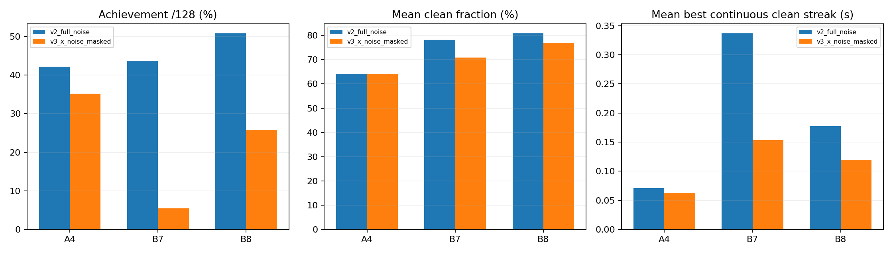

# index1_x 잡음 mask 단일실험 결과

index1_x에 가하는 잡음만0으로한V3는 원4성분잡음V2보다 전체3음달성이34→5/128로낮아졌다. 이mask를개선안으로채택하지않는다. 일부시도는좋아졌지만지속접촉은전반적으로악화했다. 이것은축을동결할근거도, index1_x잡음이항상필수라는증거도아니다.

## 동일draw의실제128쌍

각조건은원128시도·384음전체분모를유지했다. V2/V3의동일env_id를짝지었다. full128×4 Normal draw hash는모두`bdf05ebdbe3c86708b334de206a6343fe573d7a35d9450ba484a6f7b96eb277b`이며,저장env0..3의1416행scaled_noise는byte-exact다. V3는원4draw를모두소비하고적용col0만0이다. 다른3성분applied_noise와raw_noisy_goal은V2와byte-exact,원raw_reference도동일하다. 전체128draw의동일성은실행metadata hash,저장샘플동일성은NPZ bytes로구분검증했다.

| 조건 | A4/B7/B8 달성(각128) | 전체3음 | A해제 | 물리/손목실패 |
|---|---|---:|---:|---|
| v2_full_noise | 54/56/65 | 34/128 | 102/128 | 0/0 |
| v3_x_noise_masked | 45/7/33 | 5/128 | 97/128 | 0/0 |

| 쌍별달성 | 둘다 | V2만 | V3만 | 둘다미달 |
|---|---:|---:|---:|---:|
| 전체3음 | 1 | 33 | 4 | 90 |
| A해제 | 83 | 19 | 14 | 12 |
| 4 | 22 | 32 | 23 | 51 |
| 7 | 3 | 53 | 4 | 68 |
| 8 | 20 | 45 | 13 | 50 |

전체3음성공전이: 원V2성공34중33이V3에서미달했고1만유지했다. 원V2미달94중4가V3에서새로성공했다. 따라서모든개별시도에동일한방향으로작용한것은아니다.

## 연속clean과해제교차

| 조건/음 | mean clean | mean wrong | mean missing | 최장연속clean 평균(s) | 해당음달성 AND A해제 | 해당음미달 AND A미해제 |
|---|---:|---:|---:|---:|---:|---:|
| v2_full_noise/4 | 0.641343707 | 0.000000000 | 0.293062794 | 0.071181510 | 50/128 | 22/128 |
| v2_full_noise/7 | 0.783290081 | 0.000000000 | 0.181942838 | 0.336556510 | 56/128 | 26/128 |
| v2_full_noise/8 | 0.808025140 | 0.000000000 | 0.155119883 | 0.177106250 | 64/128 | 25/128 |
| v3_x_noise_masked/4 | 0.641053166 | 0.000000000 | 0.276769549 | 0.062951562 | 41/128 | 27/128 |
| v3_x_noise_masked/7 | 0.708331325 | 0.000000000 | 0.231707562 | 0.153453125 | 6/128 | 30/128 |
| v3_x_noise_masked/8 | 0.769679664 | 0.000000000 | 0.176084808 | 0.119401042 | 29/128 | 27/128 |

B7연속clean 평균은0.336557→0.153453초로0.183103초줄었다. 원필요연속길이0.31116초에비해평균clean만으로달성여부를설명할수없다. B7 clean은36쌍개선/91악화/1동일이고달성은53쌍상실/4쌍획득이다. A4 mean clean은거의같지만달성54→45로낮아져연속성의중요성을보인다.

env0의audible저장끝점candidate누락은V2의1/6/4개에서V3의2/7/4개다. 모두exported distal합력<0.01N의unloaded flag와겹친다. 대표env0만으로전체128실패원인이나pair별무접촉을확정하지않는다. net body force는접촉파트너·벡터상쇄·실제현압력·음향을분리하지못한다. 원240Hz판정은현재와직전candidate가모두참인구간만clean으로적산하며단절시연속streak를리셋한다. 저장60Hz끝점이전체240Hz이력은아니다.

A해제latch는음끝후100ms안의true→false와ever를요구한다.97/128해제를나머지31개가실제로계속눌렀다는뜻으로해석하지않는다. B7/B8의별도released값과A해제gate도구분한다.

## 보상9항과안전

| 항목 | V2합 | V3합 |
|---|---:|---:|
| song_left_approach | -219.167871118 | -219.089807987 |
| song_left_contact | 92.041670434 | 94.291670769 |
| song_clean_hold | 285.780530289 | 271.240322173 |
| song_left_success | 43.750000000 | 21.250000000 |
| song_wrong_press | 0.000000000 | 0.000000000 |
| song_performance_deficit | -11.371275244 | -14.710450523 |
| song_finger_standby | 11.268780619 | 11.268518604 |
| song_thumb_support | 5.581429895 | 5.617490996 |
| action_change | -0.000157554 | -0.000049091 |

원reward합은V2 207.882939378, V3 169.867609765이다. 두cost합0,scene close완료,원핀변경0이다. 항목합과원total은float누적순서로작은반올림차이를가질수있다.

## 다음은학습된접촉강건성

같은교사평균과나머지잡음을유지한한축mask가전반적으로악화했으므로이단일실험을마치고다른축mask·std/각도grid를이어가지않는다. 실제load/clean단절을단순히잡음문제로만보거나탐색을금지할근거가없다. 탐색이실패를만드는것은학습중허용되는현상이며 **noisy90%성공은PPO시작의필수조건이아니다**. 기존noisy gate실패는진단결론으로남기고학습시작계약과혼동하지않는다.

다음짧은학습비교는결정론적124/128을확인한수정평균교사V2에서초기화한학습평균과원평균교사동작을명시예산으로비교하는것이합리적이다. 원4축분포/가동범위·실제접촉기준·effort cap·물리·보상9항을유지하고상태/표면오차에따라유한한press/hold/해제보정을학습한다. 교사평균을정책초기평균또는명시적인학습residual기준으로쓰는계약은구현전에확인해야하며무작위평균정책을교사보정으로부르지않는다. 평가에는훈련전후deterministic128과같은원noise128의음별clean/최장연속streak/실제하중/해제/실패를함께기록한다. 탐색std나평가gate를결과에맞춰낮추지않고훈련소모/실제업데이트도공개한다. 이분석에서는NN/PPO/새GPU를실행하지않았다.

index1_x잡음이일부경로에서접촉을도왔을가능성은있지만, 네축이동시에작용하는비선형동역학에서특정axis가필수라는주장이나preload방향/크기를정하는근거가아니다. 물리적preload는후속학습의가능한유한접촉여유가설이며정적plane깊이를압력으로대체하거나접촉기준을완화하지않는다.

## 재현과무결성

analysis.json은원128분모·쌍별전이·음별연속streak/해제교차·보상9항·잡음동일성을보존한다. verification.json은입력31파일의전후SHA256과실제9개자체검사통과를기록한다. analyze.py는CPU분석만수행하며원자료·활성소스·봉인입력은수정하지않았다.
