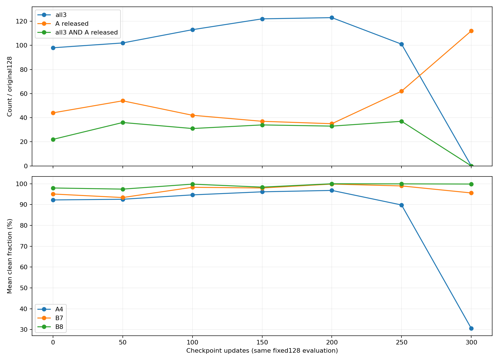
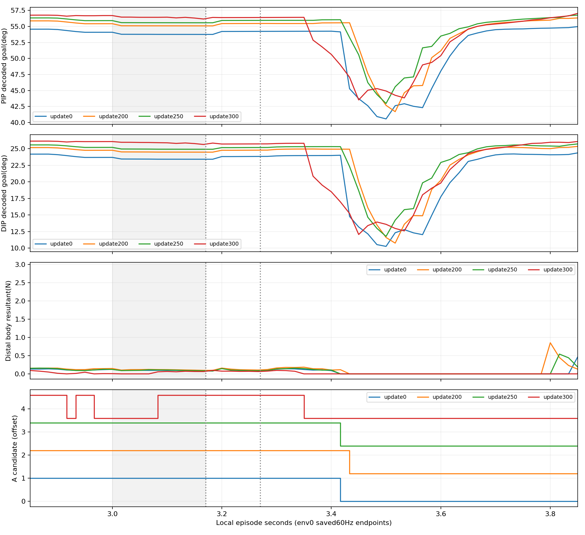
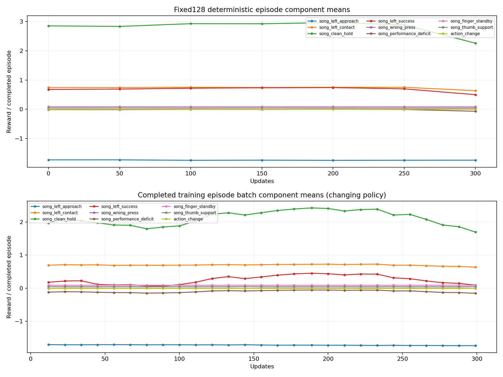

# V4 stage_PPO_v1: 실제300업데이트와사전지정128평가

PPO는중간200업데이트에서전체3음달성123/128까지올랐으나,마지막300에서는A4달성이0/128로무너져전체3음0/128이되었다. B7은127/128,B8은128/128이다. 최종확률적평가도전체1/128이다. 어느고정checkpoint도음악·A해제AND gate를모두통과하지못했다. 중간최고성과로마지막실패를대체하지않는다.

## 원128분모와joint순위

모든평가는원128시도·384음전체를분모로한다. 아래0은fit1000모델이며PPO0이다. 교사V2성과를NN성과에상속하지않는다.

| update/평가 | A4/B7/B8달성(각128) | 전체3음 | A해제 | joint(전체3음 AND A해제) | mean reward | gate |
|---|---|---:|---:|---:|---:|---|
| u000_det | 100/122/125 | 98 | 44 | 22 | 2.654053647 | False |
| u000_stochastic | 24/42/53 | 14 | 111 | 12 | 1.352343071 | False |
| u050_det | 106/124/123 | 102 | 54 | 36 | 2.643898185 | False |
| u100_det | 115/126/127 | 113 | 42 | 31 | 2.775123197 | False |
| u150_det | 124/126/126 | 122 | 37 | 34 | 2.779431921 | False |
| u200_det | 123/128/128 | 123 | 35 | 33 | 2.836534610 | False |
| u250_det | 101/128/128 | 101 | 62 | 37 | 2.711423203 | False |
| u300_det | 0/127/128 | 0 | 112 | 0 | 1.713047870 | False |
| u300_stochastic | 1/11/21 | 1 | 119 | 1 | 0.566479585 | False |

사전선언한gate→joint→all3순위에서gate통과는없고joint최다는250의37/128이다. all3최다200의123/128은A해제35·joint33이다. 이는전체음악과해제를함께학습한완성성과가아니다. primary영상은점수를알기전에선택한마지막300결정론적env0이며좋은중간환경으로바꾸지않는다.

| 평가/음 | clean평균 | wrong평균 | missing평균 | 최장연속clean평균(s) |
|---|---:|---:|---:|---:|
| u000_det/4 | 0.922306224 | 0.000000000 | 0.040184907 | 0.126999479 |
| u000_det/7 | 0.950851250 | 0.015625000 | 0.019132038 | 0.649890365 |
| u000_det/8 | 0.979753595 | 0.015625000 | 0.002357433 | 0.328877604 |
| u000_stochastic/4 | 0.523848845 | 0.000000000 | 0.394293465 | 0.048248958 |
| u000_stochastic/7 | 0.790450117 | 0.007812500 | 0.160756490 | 0.281836979 |
| u000_stochastic/8 | 0.789615783 | 0.007812500 | 0.155207361 | 0.146830990 |
| u050_det/4 | 0.925629098 | 0.000000000 | 0.039479197 | 0.129945052 |
| u050_det/7 | 0.933853363 | 0.015625000 | 0.032843332 | 0.628473698 |
| u050_det/8 | 0.974260396 | 0.015625000 | 0.005431142 | 0.325919271 |
| u100_det/4 | 0.946581706 | 0.000000000 | 0.026995865 | 0.139669010 |
| u100_det/7 | 0.983013830 | 0.000000000 | 0.009624604 | 0.705289583 |
| u100_det/8 | 0.998130802 | 0.000000000 | 0.000934599 | 0.342172135 |
| u150_det/4 | 0.961319791 | 0.000000000 | 0.019626823 | 0.144144531 |
| u150_det/7 | 0.979781972 | 0.015625000 | 0.002654717 | 0.750449219 |
| u150_det/8 | 0.983814241 | 0.015625000 | 0.000280380 | 0.340685417 |
| u200_det/4 | 0.968058818 | 0.000000000 | 0.016161737 | 0.149881250 |
| u200_det/7 | 0.998463411 | 0.000000000 | 0.001000122 | 0.772954167 |
| u200_det/8 | 1.000000000 | 0.000000000 | 0.000000000 | 0.348300000 |
| u250_det/4 | 0.898104142 | 0.000000000 | 0.054197403 | 0.118836458 |
| u250_det/7 | 0.989612123 | 0.000000000 | 0.006261851 | 0.760943750 |
| u250_det/8 | 0.999439241 | 0.000000000 | 0.000280380 | 0.345925000 |
| u300_det/4 | 0.305684515 | 0.000000000 | 0.619192234 | 0.026772135 |
| u300_det/7 | 0.955914294 | 0.000000000 | 0.028836986 | 0.653933073 |
| u300_det/8 | 0.998670626 | 0.000000000 | 0.000664687 | 0.341691927 |
| u300_stochastic/4 | 0.238026644 | 0.000000000 | 0.699039073 | 0.023672135 |
| u300_stochastic/7 | 0.703291380 | 0.023437500 | 0.218122308 | 0.169038281 |
| u300_stochastic/8 | 0.704171751 | 0.023437500 | 0.211118065 | 0.096498438 |

## 마지막A4는실제로무엇이달라졌나

마지막A4 clean평균0.305685,최장연속clean평균0.026772초로필요연속0.06812초보다짧다. B7/B8만보면남아있는성공이A실패를감춘다. env0에서도A4 clean0.339401·best streak0.0375초로미달이다.60Hz저장끝점중나중6개candidate가참이라는것은그사이240Hz연속성이유지되었다는뜻이아니다. 원clean은현재/직전candidate가모두참인240Hz구간만적산하고단절시streak를리셋한다.

대표env0의A audible[3,3.1703]초의평균목표와실제각도(도),축순서index1_x/index1_z/PIP/DIP:

| update | decoded목표평균4 | 실제q평균4 | body합력평균N | loaded끝점/11 |
|---|---|---|---:|---:|
| 0 | 39.382370/27.646973/53.791149/23.450354 | 39.265266/17.110548/54.077885/23.699852 | 0.095435210 | 11 |
| 50 | 39.224377/27.652052/54.123497/24.035744 | 39.124763/17.460627/54.409801/24.278170 | 0.094283298 | 11 |
| 100 | 38.981071/27.645128/54.517212/24.328541 | 38.888721/17.378786/54.797840/24.555901 | 0.105304718 | 11 |
| 150 | 38.639053/27.644136/54.844234/24.421507 | 38.529617/17.102943/55.121780/24.643522 | 0.110070303 | 11 |
| 200 | 38.532608/27.628601/55.126122/24.521399 | 38.425819/17.241493/55.402481/24.731936 | 0.114337690 | 11 |
| 250 | 38.659855/27.614470/55.609837/24.957426 | 38.628342/18.195463/55.879391/25.145880 | 0.100090124 | 11 |
| 300 | 38.743587/27.669140/56.413731/25.892073 | 38.871872/19.860023/56.582970/25.960522 | 0.034891695 | 6 |

200→300에서PIP/DIP목표평균55.126/24.521→56.414/25.892°로이동했고실제q도55.402/24.732→56.583/25.961°로달라졌다. index1_z실제각은17.241→19.860°로변했다. 이것은여러축과폐루프상태가함께변한관찰이며한관절의과굴곡만이원인이라고분리확정하지않는다.

원source pad128점·native body pose·live guitar로A접촉predicate를모든평가의354끝점에서재구성해원candidate와정확히일치했다. 최종det env0 A audible11끝점중처음5개누락은position/facing기하통과·wrong0인데body-resultant load가0.01N미만이었다(첫끝점0.0054786N,이어4끝점0N). 위치/높이/방향의3mm gate를완화할근거가없다. 나머지6끝점은loaded/candidate참이지만240Hz연속streak는위와같이미달했다. 모든128환경의개별기하/force원인을대표env0로확정하지않는다.

이합력은IsaacGym net-contact-force tensor를refresh한body resultant다. physics240Hz/substeps1/CC_LAST_SUBSTEP에서제어후60Hz끝점만저장했으며중간4개physics이력이나평균force가아니다. 합력0은pairwise무접촉·현압력0·음향실패의증명이아니고,파트너와벡터상쇄를분리할수없다. source signed plane gap는실제contact penetration/압력이아니다.

A해제latch는ever가있고음끝후100ms안에candidate가true→false로변할때만성립한다. 마지막A해제112/128과A달성0은동시에가능하다. 높은해제율을정상press→hold→release성공으로간주하면안된다. 반대로해제미달을나머지가물리적으로계속눌렀다는뜻으로읽지도않는다.

## 보상9항과학습목표의정렬

현재9항은접근·contact진행·audible clean·note achievement·wrong·missing/streak deficit·standby·thumb·actionchange다. A해제AND성공을직접지급하는항목은없다. 기존Aachievement는연속clean문턱에서지급되며release는별도의평가gate다. 따라서all3가좋아진200에서도joint가33에그친것은보상과최종판정의불일치가남았다는직접관찰이다. 그러나마지막A망각이보상을최대화한해법이라고주장하지않는다. 실제평가mean reward도200의2.836535에서300의1.713048로낮아졌다.

| 항목 | fit0 det | u200 det | u300 det | u300 stochastic |
|---|---:|---:|---:|---:|
| song_left_approach | -1.732367230 | -1.749261531 | -1.743098445 | -1.740621287 |
| song_left_contact | 0.741862021 | 0.750000016 | 0.636204460 | 0.633608101 |
| song_clean_hold | 2.852914412 | 2.966525950 | 2.260269686 | 1.645489704 |
| song_left_success | 0.677734375 | 0.740234375 | 0.498046875 | 0.064453125 |
| song_wrong_press | -0.004687499 | 0.000000000 | 0.000000000 | -0.007031249 |
| song_performance_deficit | -0.012938464 | -0.002251164 | -0.069546226 | -0.160692540 |
| song_finger_standby | 0.088017087 | 0.087940660 | 0.087893579 | 0.087898789 |
| song_thumb_support | 0.043522295 | 0.043350125 | 0.043278560 | 0.043375191 |
| action_change | -0.000000311 | -0.000000457 | -0.000000554 | -0.000000592 |

9항전체의평가checkpoint곡선과변하는정책으로완료된훈련episode batch곡선을함께보존한다. 훈련곡선은고정정책평가가아니고episode완료시점으로묶었다. 원total과항목합은float누적순서에따른작은반올림차이가가능하다.

## KL·학습률·cost/value의관찰

설정actor_lr=3e-5,KL retry factor0.25다. update1에서2회KL거부/복구후actual_lr=1.875e-6이되었고나머지299업데이트에서추가retry는없었다. 첫최대시도KL2.418171,최종수락KL0.00485786이다. actual actor_lr는이후같게유지됐다. 보고grad norm은clip전이며전체범위5.91075..77.02727,clip기준0.5다. 작은수락KL이나학습률이모든상태에서접촉/행동망각을막는다는뜻은아니다.

| update | accepted KL | preclip grad norm | cost raw adv 평균/표준편차 | cost value평균 | cost target평균 |
|---|---:|---:|---|---:|---:|
| 1 | 0.004857861 | 55.168709 | -0.001304509/0.000827396 | 0.057222136 | 0.078633592 |
| 50 | 0.000257481 | 33.532360 | -0.003764320/0.002709579 | -0.028928557 | -0.017591029 |
| 100 | 0.000409596 | 51.554333 | 0.009747900/0.010984606 | -0.000912326 | 0.007438197 |
| 150 | 0.000494524 | 47.333256 | 0.022238916/0.011228667 | 0.026424813 | 0.042812159 |
| 200 | 0.003997222 | 19.651031 | -0.002881552/0.005167156 | 0.022264321 | 0.008336417 |
| 250 | 0.000281936 | 32.870453 | -0.000605746/0.001732210 | 0.008252912 | 0.007915784 |
| 300 | 0.005452732 | 9.290030 | 0.000610970/0.000685824 | -0.008189229 | -0.005177936 |

실현훈련mean failure cost는300회모두0이고완료episode cost합0이나,bootstrapped cost critic/target/advantage는0이아니다. cost_weight1로reward−cost advantage에들어가므로실현cost가없어도actor신호에기여할수있다. 음의cost value도그대로기록했으며실제음의안전비용을뜻하지않는다. 단일critic출력이나고정teacher-state분포만으로A망각의원인이라고단정하지않는다. analyticKL/gradient/advantage/critic minmax와손실은analysis.json에보존했다.

## 실제소모와중단시도의구별

attempt02는동일fit0에서새로시작해300업데이트·1,228,800전이를완료했다. 완료episode3456개의합1,223,424전이와아직열린5376전이(128환경×42step)를구분한다. 완료훈련episode의전체3음167/3456은정책이계속달라지는학습중원장이며최종300성공률로쓰지않는다. 종료report/exit0/closed·sourcepin불변을확인했고고정평가중checkpoint/model/optimizer는freeze되었다.

attempt01은SIGTERM exit143로49업데이트·200704전이에서중단했다. 완료512episode/전체3음39,물리/손목실패기록0이지만Python sceneclose/finalreport/50checkpoint는없다. 발신자와원인은미확정이다. attempt02는49에서resume한것이아니며이전전이/episode/성과와합치지않는다. 실제추가소모200704전이를별도로공개한다. 두시도훈련소모합1,429,504전이라는계산은비용합산일뿐349업데이트짜리연속학습을뜻하지않는다.

## 가장직접적인다음단일변경제안

**기존song_left_success의A지급조건만「A achieved AND 원A released」로바꾸고원release window가정산된뒤같은0.25예산을지급한다.** B7/B8지급과나머지8항·전체예산·기하/force/음악문턱·full joint range·effort cap은유지한다. 독립release보너스는마지막A실패+release112를보상할수있으므로제안하지않는다. 이한조건변경은현재joint평가와보상목표의불일치를직접줄이는검증가설이다. 처음fit0/같은seed와사전지정동일예산으로현재결과와비교해야하며여러축/std/grid나긴fit반복으로대체하지않는다.

이제안이최종망각의원인을모두해결한다는증거는없다. 목표드리프트·실제load단절·release timing·cost bootstrap신호가함께관찰됐으므로실제128의Aclean/streak·joint·해제·실패를그대로재검증해야한다. 이분석에서는새훈련/NN추론/native/GPU실행또는보상수정을하지않았다.

## 검증과고정기록

입력670파일의전후SHA256동일,자체9검사통과. analysis.json은모든9평가의원128분모·음별지표·joint·checkpointfreeze·원force/predicate재구성·훈련원장/9항/KL/value를보존한다. 사전fit단계와CPU50drift산출은수정하지않았다. 이폴더는실제완료PPO단계의분석기록이며영상·상위문서와별도검수한다.
