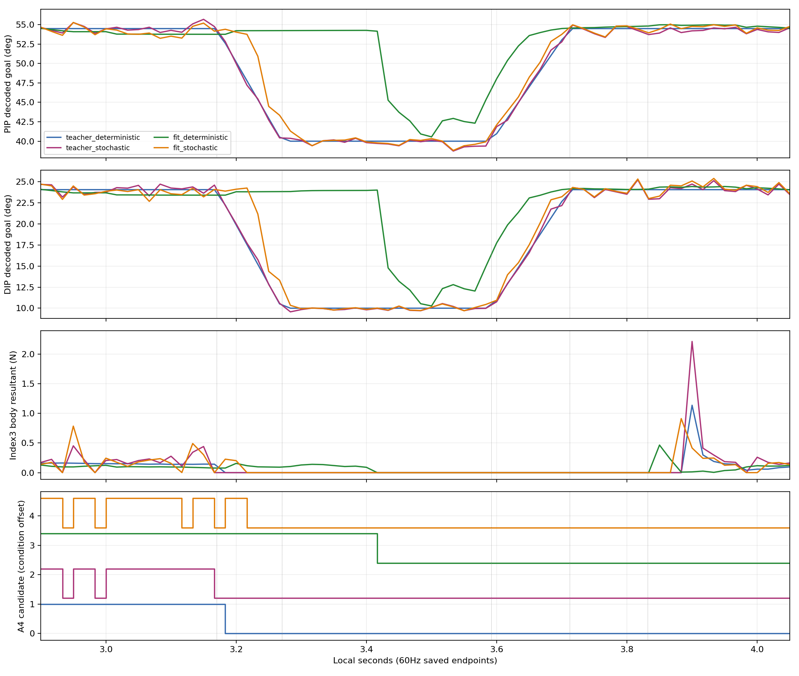

# V4 stage_fit_v1: 오프라인초기화 뒤 실제NN128 평가

fit1000의정규화goal MSE는0.049078→0.0000505234로낮아졌지만, NN-only 실제평가는교사V2성과를유지하지못했다. 결정론적전체98/128·A해제44/128, 확률적전체14/128·A해제111/128이다. 이문서는fit단계만고정한기록이며이후PPO300의결과/성공을대신하지않는다. 오프라인loss를실제음악성공의대리지표로쓰지않는다.

## 원128분모의실제성과

각조건은원128시도·384음전체다. fit모델은GoalPolicy557의새actor에서선택4축mean을1000회fit한초기화이며이단계PPO는0회다. 평가중selected reference호출은0,제어는NN-only이고checkpoint/model/optimizer가freeze되었다. 원교사와성능을비교하지만확률적환경의draw가과거noNN과byte-identical이라고확인한것은아니다.

| 조건 | A4/B7/B8달성(각128) | 전체3음 | A해제 | 물리/손목실패 |
|---|---|---:|---:|---|
| teacher_deterministic | 128/124/128 | 124/128 | 128/128 | 0/0 |
| teacher_stochastic | 54/56/65 | 34/128 | 102/128 | 0/0 |
| fit_deterministic | 100/122/125 | 98/128 | 44/128 | 0/0 |
| fit_stochastic | 24/42/53 | 14/128 | 111/128 | 0/0 |

| 조건/음 | mean clean | mean wrong | mean missing | mean best clean streak(s) | 음달성 AND A해제/128 |
|---|---:|---:|---:|---:|---:|
| teacher_deterministic/4 | 0.972357298 | 0.000000000 | 0.013821351 | 0.159147135 | 128 |
| teacher_deterministic/7 | 0.978425823 | 0.000000000 | 0.011205549 | 0.666055990 | 124 |
| teacher_deterministic/8 | 0.999065401 | 0.000000000 | 0.000467300 | 0.343636458 | 128 |
| teacher_stochastic/4 | 0.641343707 | 0.000000000 | 0.293062794 | 0.071181510 | 50 |
| teacher_stochastic/7 | 0.783290081 | 0.000000000 | 0.181942838 | 0.336556510 | 56 |
| teacher_stochastic/8 | 0.808025140 | 0.000000000 | 0.155119883 | 0.177106250 | 64 |
| fit_deterministic/4 | 0.922306224 | 0.000000000 | 0.040184907 | 0.126999479 | 22 |
| fit_deterministic/7 | 0.950851250 | 0.015625000 | 0.019132038 | 0.649890365 | 40 |
| fit_deterministic/8 | 0.979753595 | 0.015625000 | 0.002357433 | 0.328877604 | 43 |
| fit_stochastic/4 | 0.523848845 | 0.000000000 | 0.394293465 | 0.048248958 | 20 |
| fit_stochastic/7 | 0.790450117 | 0.007812500 | 0.160756490 | 0.281836979 | 37 |
| fit_stochastic/8 | 0.789615783 | 0.007812500 | 0.155207361 | 0.146830990 | 46 |

실패하거나미달성한시도를분모에서제외하지않았다. A해제latch는ever가있고음끝후100ms안의candidate true→false를요구한다.44/128해제를84개가물리적으로영구압현했다는뜻으로읽지않는다. 원240Hz clean은현재/직전candidate가모두참인구간이고단절시연속streak를리셋한다.

## NN 실제동작은어디서교사와갈라졌나

env0의동일60Hz시간끝점을정렬했다. 아래는교사대비실제NN의decoded목표RMS(도)다. 이차이는closed-loop에서달라진입력상태와NN출력을함께포함하며고정teacher-state상오프라인오차와구분한다.

| NN조건/구간 | index1_x | index1_z | PIP | DIP |
|---|---:|---:|---:|---:|
| deterministic/A_audible | 0.076044 | 0.108894 | 0.700000 | 0.622084 |
| deterministic/opening | 0.735255 | 1.742582 | 8.685911 | 8.451424 |
| deterministic/N_hold | 0.852044 | 1.989921 | 10.073168 | 9.833950 |
| deterministic/early_closing | 0.409579 | 0.945887 | 5.835958 | 5.482561 |
| deterministic/B7_audible | 0.011471 | 0.010808 | 0.110637 | 0.065601 |
| deterministic/B8_audible | 0.029180 | 0.033201 | 0.115444 | 0.076273 |
| stochastic/A_audible | 0.065568 | 0.091685 | 0.578359 | 0.503231 |
| stochastic/opening | 0.341960 | 0.813873 | 4.150420 | 4.119258 |
| stochastic/N_hold | 0.014330 | 0.099172 | 0.279510 | 0.213094 |
| stochastic/early_closing | 0.050960 | 0.314464 | 0.922762 | 0.907799 |
| stochastic/B7_audible | 0.017722 | 0.012741 | 0.205474 | 0.168811 |
| stochastic/B8_audible | 0.017307 | 0.018714 | 0.118070 | 0.089798 |

N_hold=[3.2703,3.592]초에서deterministic NN PIP/DIP실제목표는교사보다평균+8.256/+7.943°더굽혀져있고최대오차14.257/14.015°다. 실제관절q의교사대비RMS도8.702/8.515°다. 교사N40°/10°를그대로유지하는실제동작이아니다. A4 audible목표bias는PIP/DIP -0.694/-0.617°이며B7 audible목표RMS는0.111/0.066°로상대적으로작다. 대표환경의해제구간추종문제와전체A해제저하는정합적관찰이나,모든환경의원인을단독으로확정하지않는다.

env0 N_hold19끝점에서deterministic NN은A candidate/몸체loaded가8번남고해제latch=false다. 교사는동구간candidate/loaded0이다. 확률적NN env0는동구간candidate/loaded0이고해제latch=true이지만전체음악달성은14/128이다. 한대표환경의해제를전체성과로확대하지않는다. 힘의단위는N인exported body-resultant이며압력/현별contact pair/음향을측정한자료가아니다. tensor의벡터상쇄·파트너를분리할수없다. trace는60Hz끝점이고240Hz전체하중이력이아니다.

## 오프라인6bucket: 같은장면heldout과실제폐루프의구별

bucket경계는[2,3.1703,3.2703,3.712,3.832]초이며input시각+1/60의예측끝점으로분류했다. phase3는V2의N유지와early closing을함께포함한다. train env0..2,heldout env3의같은장면teacher상태1416행을사용했다. 다음rms4는정규화goal의무차원값이며각도rad나실제접촉오차가아니다.

| split/phase | 행수 | RMS index1_x/index1_z/PIP/DIP |
|---|---:|---|
| train/0 | 357 | 0.0002761/0.0089067/0.0027026/0.0022572 |
| train/1 | 213 | 0.0004013/0.0094644/0.0077936/0.0038606 |
| train/2 | 18 | 0.0004269/0.0211235/0.0124008/0.0073502 |
| train/3 | 78 | 0.0000706/0.0015423/0.0019511/0.0025173 |
| train/4 | 21 | 0.0001389/0.0039010/0.0029005/0.0015942 |
| train/5 | 375 | 0.0002125/0.0044429/0.0041807/0.0013719 |
| heldout_same_scene/0 | 119 | 0.0002763/0.0089920/0.0026615/0.0022283 |
| heldout_same_scene/1 | 71 | 0.0004010/0.0094613/0.0077967/0.0038617 |
| heldout_same_scene/2 | 6 | 0.0004339/0.0212093/0.0124486/0.0076950 |
| heldout_same_scene/3 | 26 | 0.0000744/0.0016261/0.0019904/0.0024726 |
| heldout_same_scene/4 | 7 | 0.0001305/0.0037099/0.0028159/0.0015070 |
| heldout_same_scene/5 | 125 | 0.0002116/0.0044088/0.0041899/0.0013740 |

phase2의heldout normalized RMS는index1_z0.021209/PIP0.012449로다른일부구간보다크다. 그러나같은teacher-state오차가작다는것이NN자체상태의관측분포·전이/접촉을재현한다는보장은없다. 실제N목표편차를offline수치로숨기지않는다.

## 보상9항·안전·다음PPO300의기준선

| 항목 | teacher_deterministic | teacher_stochastic | fit_deterministic | fit_stochastic |
|---|---:|---:|---:|---:|
| song_left_approach | -219.192461729 | -219.167871118 | -221.743005395 | -219.478657842 |
| song_left_contact | 96.000001073 | 92.041670434 | 94.958338737 | 90.937837318 |
| song_clean_hold | 377.581089497 | 285.780530289 | 365.173044682 | 269.301179349 |
| song_left_success | 95.000000000 | 43.750000000 | 86.750000000 | 29.750000000 |
| song_wrong_press | 0.000000000 | 0.000000000 | -0.599999905 | -0.299999952 |
| song_performance_deficit | -0.378294742 | -11.371275244 | -1.656123432 | -13.979528680 |
| song_finger_standby | 11.268602625 | 11.268780619 | 11.266187109 | 11.267728530 |
| song_thumb_support | 5.607022777 | 5.581429895 | 5.570853755 | 5.601548538 |
| action_change | -0.000037991 | -0.000157554 | -0.000039815 | -0.000118862 |

모든조건cost합0,sceneclose완료·원핀변경0이다. 원total과항목합은float누적순서의작은반올림차이가가능하다. NN실제실패를고치기위해이번fit를계속반복하거나축mask/std/각도grid를추가하지않는다. fit1000모델을그대로PPO300의고정초기기준으로삼고,현재fit deterministic98/해제44 및stochastic14/해제111과비교한다. noisy90%통과는PPO시작필수조건이아니며탐색실패는학습자료가될수있다. 원접촉기준·4축fullrange·effort cap·보상9항을유지하면서실제state에서의안정적press/hold/해제와연속streak를학습하는것이목표다. 이후실제학습업데이트/전이/중단/KL/성능을별도stage_PPO_v1로남겨동일128평가로검증해야한다.

## 이단계기록의무결성

verification.json은입력62파일의분석전후SHA256과실제8검사통과를보존한다. 분석은CPU만사용했고NN/checkpoint를실행하지않았다. 이stage는fit완료+실제평가2개를고정한기록이며V4전체최종봉인이나후속PPO의완료선언이아니다. 활성소스/원결과/봉인입력을수정하지않았다.
