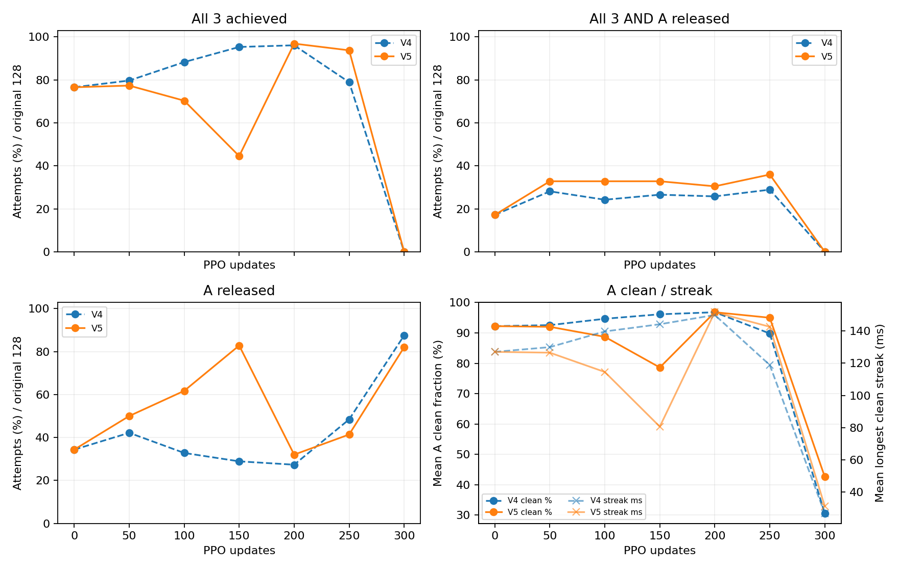
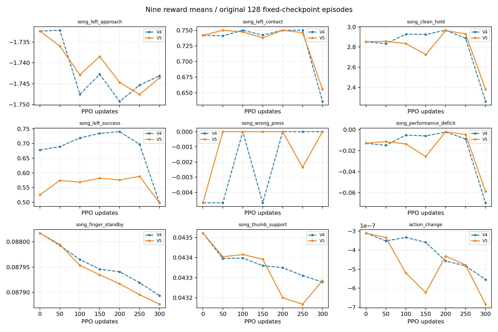
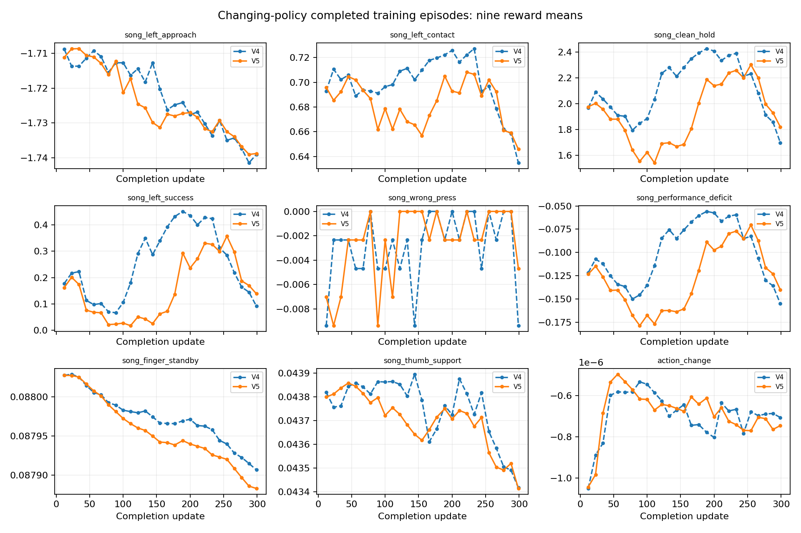

# V5: A 달성 보상 정산과 원 V4의 실제 비교

원 128시도·384음 전체가 분모다. 실패를 제외하거나 좋은 중간 checkpoint를 최종 결과로 대체하지 않았다. 초기 fit1000과 PPO0 이후 50 간격 고정128·최종 확률128을 모두 비교한다.

| 버전/업데이트/평가 | A/B7/B8 달성 | all3 | A 해제 | joint | 보상평균 | 실패 | gate |
|---|---|---:|---:|---:|---:|---:|---|
| V4/0/고정 | 100/122/125 | 98 | 44 | 22 | 2.654054 | 0 | False |
| V4/0/확률 | 24/42/53 | 14 | 111 | 12 | 1.352343 | 0 | False |
| V4/50/고정 | 106/124/123 | 102 | 54 | 36 | 2.643898 | 0 | False |
| V4/100/고정 | 115/126/127 | 113 | 42 | 31 | 2.775123 | 0 | False |
| V4/150/고정 | 124/126/126 | 122 | 37 | 34 | 2.779432 | 0 | False |
| V4/200/고정 | 123/128/128 | 123 | 35 | 33 | 2.836535 | 0 | False |
| V4/250/고정 | 101/128/128 | 101 | 62 | 37 | 2.711423 | 0 | False |
| V4/300/고정 | 0/127/128 | 0 | 112 | 0 | 1.713048 | 0 | False |
| V4/300/확률 | 1/11/21 | 1 | 119 | 1 | 0.566480 | 0 | False |
| V5/0/고정 | 100/122/125 | 98 | 44 | 22 | 2.501710 | 0 | False |
| V5/0/확률 | 24/42/53 | 14 | 111 | 12 | 1.344531 | 0 | False |
| V5/50/고정 | 100/124/127 | 99 | 64 | 42 | 2.565068 | 0 | False |
| V5/100/고정 | 92/121/126 | 90 | 79 | 42 | 2.524893 | 0 | False |
| V5/150/고정 | 58/127/128 | 57 | 106 | 42 | 2.411769 | 0 | False |
| V5/200/고정 | 124/128/128 | 124 | 41 | 39 | 2.674685 | 0 | False |
| V5/250/고정 | 121/127/127 | 120 | 53 | 46 | 2.640487 | 0 | False |
| V5/300/고정 | 0/128/127 | 0 | 105 | 0 | 1.862986 | 0 | False |
| V5/300/확률 | 4/19/30 | 1 | 116 | 1 | 0.750304 | 0 | False |

마지막300 고정 평가에서 V4→V5 all3는 0→0, joint는 0→0, A 달성은 0→0다. 이 수치가 이번 단일 비교의 관찰 결과이며 seed 하나로 일반적 인과효과를 확정하지 않는다.

| 버전/평가/음 | clean | wrong | missing | 최장 clean 평균(s) |
|---|---:|---:|---:|---:|
| V4/0/고정/4 | 0.922306 | 0.000000 | 0.040185 | 0.126999 |
| V4/0/고정/7 | 0.950851 | 0.015625 | 0.019132 | 0.649890 |
| V4/0/고정/8 | 0.979754 | 0.015625 | 0.002357 | 0.328878 |
| V4/0/확률/4 | 0.523849 | 0.000000 | 0.394293 | 0.048249 |
| V4/0/확률/7 | 0.790450 | 0.007812 | 0.160756 | 0.281837 |
| V4/0/확률/8 | 0.789616 | 0.007812 | 0.155207 | 0.146831 |
| V4/50/고정/4 | 0.925629 | 0.000000 | 0.039479 | 0.129945 |
| V4/50/고정/7 | 0.933853 | 0.015625 | 0.032843 | 0.628474 |
| V4/50/고정/8 | 0.974260 | 0.015625 | 0.005431 | 0.325919 |
| V4/100/고정/4 | 0.946582 | 0.000000 | 0.026996 | 0.139669 |
| V4/100/고정/7 | 0.983014 | 0.000000 | 0.009625 | 0.705290 |
| V4/100/고정/8 | 0.998131 | 0.000000 | 0.000935 | 0.342172 |
| V4/150/고정/4 | 0.961320 | 0.000000 | 0.019627 | 0.144145 |
| V4/150/고정/7 | 0.979782 | 0.015625 | 0.002655 | 0.750449 |
| V4/150/고정/8 | 0.983814 | 0.015625 | 0.000280 | 0.340685 |
| V4/200/고정/4 | 0.968059 | 0.000000 | 0.016162 | 0.149881 |
| V4/200/고정/7 | 0.998463 | 0.000000 | 0.001000 | 0.772954 |
| V4/200/고정/8 | 1.000000 | 0.000000 | 0.000000 | 0.348300 |
| V4/250/고정/4 | 0.898104 | 0.000000 | 0.054197 | 0.118836 |
| V4/250/고정/7 | 0.989612 | 0.000000 | 0.006262 | 0.760944 |
| V4/250/고정/8 | 0.999439 | 0.000000 | 0.000280 | 0.345925 |
| V4/300/고정/4 | 0.305685 | 0.000000 | 0.619192 | 0.026772 |
| V4/300/고정/7 | 0.955914 | 0.000000 | 0.028837 | 0.653933 |
| V4/300/고정/8 | 0.998671 | 0.000000 | 0.000665 | 0.341692 |
| V4/300/확률/4 | 0.238027 | 0.000000 | 0.699039 | 0.023672 |
| V4/300/확률/7 | 0.703291 | 0.023438 | 0.218122 | 0.169038 |
| V4/300/확률/8 | 0.704172 | 0.023438 | 0.211118 | 0.096498 |
| V5/0/고정/4 | 0.922306 | 0.000000 | 0.040185 | 0.126999 |
| V5/0/고정/7 | 0.950851 | 0.015625 | 0.019132 | 0.649890 |
| V5/0/고정/8 | 0.979754 | 0.015625 | 0.002357 | 0.328878 |
| V5/0/확률/4 | 0.523849 | 0.000000 | 0.394293 | 0.048249 |
| V5/0/확률/7 | 0.790450 | 0.007812 | 0.160756 | 0.281837 |
| V5/0/확률/8 | 0.789616 | 0.007812 | 0.155207 | 0.146831 |
| V5/50/고정/4 | 0.920130 | 0.000000 | 0.040699 | 0.126499 |
| V5/50/고정/7 | 0.942999 | 0.000000 | 0.035606 | 0.634519 |
| V5/50/고정/8 | 0.993645 | 0.000000 | 0.003178 | 0.331136 |
| V5/100/고정/4 | 0.887140 | 0.000000 | 0.059106 | 0.114509 |
| V5/100/고정/7 | 0.952888 | 0.000000 | 0.028141 | 0.632627 |
| V5/100/고정/8 | 0.994358 | 0.000000 | 0.002821 | 0.332779 |
| V5/150/고정/4 | 0.786220 | 0.000000 | 0.130019 | 0.080612 |
| V5/150/고정/7 | 0.942535 | 0.000000 | 0.039300 | 0.646396 |
| V5/150/고정/8 | 0.995701 | 0.000000 | 0.002150 | 0.335682 |
| V5/200/고정/4 | 0.968201 | 0.000000 | 0.015995 | 0.151610 |
| V5/200/고정/7 | 0.996011 | 0.000000 | 0.002363 | 0.769005 |
| V5/200/고정/8 | 0.999813 | 0.000000 | 0.000093 | 0.347804 |
| V5/250/고정/4 | 0.949949 | 0.000000 | 0.025599 | 0.142570 |
| V5/250/고정/7 | 0.987918 | 0.007812 | 0.002475 | 0.758899 |
| V5/250/고정/8 | 0.992188 | 0.007812 | 0.000000 | 0.345579 |
| V5/300/고정/4 | 0.426273 | 0.000000 | 0.468618 | 0.031240 |
| V5/300/고정/7 | 0.956606 | 0.000000 | 0.029703 | 0.675310 |
| V5/300/고정/8 | 0.997664 | 0.000000 | 0.001215 | 0.339805 |
| V5/300/확률/4 | 0.277305 | 0.000000 | 0.654348 | 0.027741 |
| V5/300/확률/7 | 0.736051 | 0.008357 | 0.202339 | 0.196474 |
| V5/300/확률/8 | 0.748481 | 0.007812 | 0.185215 | 0.110534 |

A의 원시 달성0.5를 회수하고 원 해제창 뒤 한 번만 정산해 최종 가중예산0.25를 지급한다. entitlement와 실수령·실패억제를 구분했다. episode별 예산·eligibility·pending=0·보상합과 env0 trace 단조·최대1회 지급·초기 reset 0을 검사했다. 시간은 원악보5.7203초 마감이며 local3.2703초와 섞지 않는다. 부분 reset과 끝경계의 합성 검사는 cpu_verification.json을 별도로 따른다.

| 버전 | 학습 전이 | 완료 episode | 완료 전이 | 열린 전이 |
|---|---:|---:|---:|---:|
| V4 | 1228800 | 3456 | 1223424 | 5376 |
| V5 | 1228800 | 3456 | 1223424 | 5376 |

학습 episode와 batch 보상곡선은 정책이 변하는 중의 기록이다. 고정 checkpoint 성공률로 쓰지 않는다. V4 중단 attempt01의49업데이트는 비교계보와 분모에서 제외했다. V5 잘못 실행한 추가 고정128은 보존하되 fit_stochastic_actual만 원래 확률평가로 사용했다. 추가 소모 증거는 execution_attempts에 남아 있다.

초기71 tensor 동등성과 음악/동작 일치의 기존 검증 및 독립검수를 analysis.json에 연결했다. 이 분석은 원자료·checkpoint·source pin 전후 SHA, model/optimizer freeze, 평가 교사호출0과 종료/close를 재검사한다. 훈련 report에 교사호출 counter가 없는 경우 0이라고 추정하지 않고 미계측으로 남긴다. native force는 body resultant이며 현별 압력·접촉쌍·음향을 뜻하지 않는다. 원240Hz 연속 clean/streak를60Hz 대표끝점으로 대체하지 않았다. 추가 NN 추론·물리·학습 실행은0이다.

## 보상·정산의 정확한 원장

| 평가 | A removed raw 합 | entitled raw 합 | paid 합 | suppressed 합 | closed |
|---|---:|---:|---:|---:|---:|
| 0/고정 | 50.000000 | 11.000000 | 5.500000 | 0.000000 | 128 |
| 0/확률 | 12.000000 | 10.000000 | 5.000000 | 0.000000 | 128 |
| 50/고정 | 50.000000 | 21.500000 | 10.750000 | 0.000000 | 128 |
| 100/고정 | 46.000000 | 22.000000 | 11.000000 | 0.000000 | 128 |
| 150/고정 | 29.000000 | 21.500000 | 10.750000 | 0.000000 | 128 |
| 200/고정 | 62.000000 | 19.500000 | 9.750000 | 0.000000 | 128 |
| 250/고정 | 60.500000 | 23.500000 | 11.750000 | 0.000000 | 128 |
| 300/고정 | 0.000000 | 0.000000 | 0.000000 | 0.000000 | 128 |
| 300/확률 | 2.000000 | 2.000000 | 1.000000 | 0.000000 | 128 |

| 보상항 | V4 fit0 | V5 fit0 | V4 u200 | V5 u200 | V4 u300 | V5 u300 | V5 u300 확률 |
|---|---:|---:|---:|---:|---:|---:|---:|
| song_left_approach | -1.732367230 | -1.732367230 | -1.749261531 | -1.744712515 | -1.743098445 | -1.743606101 | -1.742049460 |
| song_left_contact | 0.741862021 | 0.741862021 | 0.750000016 | 0.750000017 | 0.636204460 | 0.655591174 | 0.645785179 |
| song_clean_hold | 2.852914412 | 2.852914412 | 2.966525950 | 2.964029048 | 2.260269686 | 2.380542705 | 1.761836707 |
| song_left_success | 0.677734375 | 0.525390625 | 0.740234375 | 0.576171875 | 0.498046875 | 0.498046875 | 0.103515625 |
| song_wrong_press | -0.004687499 | -0.004687499 | 0.000000000 | 0.000000000 | 0.000000000 | 0.000000000 | -0.002425475 |
| song_performance_deficit | -0.012938464 | -0.012938464 | -0.002251164 | -0.001916763 | -0.069546226 | -0.058750025 | -0.147583417 |
| song_finger_standby | 0.088017087 | 0.088017087 | 0.087940660 | 0.087916905 | 0.087893579 | 0.087876561 | 0.087883777 |
| song_thumb_support | 0.043522295 | 0.043522295 | 0.043350125 | 0.043200600 | 0.043278560 | 0.043285879 | 0.043341282 |
| action_change | -0.000000311 | -0.000000311 | -0.000000457 | -0.000000432 | -0.000000554 | -0.000000684 | -0.000000606 |

## 실제 A 단절과 actor 신호

| 버전/update | A candidate 끝점/11 | unloaded 끝점 | 목표 4축 평균(도) | 실제 4축 평균(도) |
|---|---:|---:|---|---|
| V4/0 | 11 | 0 | 39.3824/27.6470/53.7911/23.4504 | 39.2653/17.1105/54.0779/23.6999 |
| V4/200 | 11 | 0 | 38.5326/27.6286/55.1261/24.5214 | 38.4258/17.2415/55.4025/24.7319 |
| V4/250 | 11 | 0 | 38.6599/27.6145/55.6098/24.9574 | 38.6283/18.1955/55.8794/25.1459 |
| V4/300 | 6 | 5 | 38.7436/27.6691/56.4137/25.8921 | 38.8719/19.8600/56.5830/25.9605 |
| V5/0 | 11 | 0 | 39.3824/27.6470/53.7911/23.4504 | 39.2653/17.1105/54.0779/23.6999 |
| V5/200 | 11 | 0 | 38.7143/27.6405/55.1260/25.0214 | 38.6710/17.8114/55.4022/25.2282 |
| V5/250 | 11 | 0 | 38.5295/27.6185/55.4848/25.4124 | 38.4734/18.0680/55.7612/25.6009 |
| V5/300 | 7 | 4 | 38.7328/27.6597/56.2686/26.0141 | 38.8215/19.7308/56.4439/26.0841 |

V5 마지막 env0는 A audible 11개 저장끝점 중 처음1개 candidate 참, 이어4개 거짓(body resultant=0), 마지막6개 참이다. 이4개는 기존 load gate를 통과할 수 없었다. 앞뒤 끝점이 참이어도 원240Hz 연속 clean이 유지된다는 뜻은 아니다. 현별 압력·접촉쌍 또는 모든128환경의 실패기하로 일반화하지 않는다. 200·250과300의 여러 목표·실제 관절축이 함께 움직였으므로 특정 관절 하나를 원인으로 확정하지 않는다.

| 버전/update | 수락 KL | clip전 grad norm | cost raw adv 평균/표준편차 | cost value 평균 | cost target 평균 |
|---|---:|---:|---|---:|---:|
| V4/1 | 0.004857861 | 55.168709 | -0.001304509/0.000827396 | 0.057222136 | 0.078633592 |
| V4/50 | 0.000257481 | 33.532360 | -0.003764320/0.002709579 | -0.028928557 | -0.017591029 |
| V4/100 | 0.000409596 | 51.554333 | 0.009747900/0.010984606 | -0.000912326 | 0.007438197 |
| V4/150 | 0.000494524 | 47.333256 | 0.022238916/0.011228667 | 0.026424813 | 0.042812159 |
| V4/200 | 0.003997222 | 19.651031 | -0.002881552/0.005167156 | 0.022264321 | 0.008336417 |
| V4/250 | 0.000281936 | 32.870453 | -0.000605746/0.001732210 | 0.008252912 | 0.007915784 |
| V4/300 | 0.005452732 | 9.290030 | 0.000610970/0.000685824 | -0.008189229 | -0.005177936 |
| V5/1 | 0.004857861 | 55.168709 | -0.001304509/0.000827396 | 0.057222136 | 0.078633592 |
| V5/50 | 0.000357229 | 29.003403 | -0.015395491/0.006800052 | 0.006513224 | 0.019011470 |
| V5/100 | 0.000293928 | 54.748680 | 0.013341334/0.014096107 | -0.006006493 | 0.003169238 |
| V5/150 | 0.000056406 | 28.837994 | -0.167364589/0.098679909 | -0.018781659 | -0.172884276 |
| V5/200 | 0.001552416 | 19.552780 | -0.000870242/0.007871855 | -0.008580781 | -0.011006430 |
| V5/250 | 0.005417301 | 30.518795 | -0.008219138/0.008290278 | -0.007939459 | -0.018929442 |
| V5/300 | 0.000471932 | 11.925846 | -0.002082471/0.000996742 | -0.007530723 | -0.012214088 |

두 실행은 update1에서 KL retry2회 후 actor_lr=1.875e-6이며 추가 retry 없이300을 마쳤다. 실제 failure cost는 전부0이나 cost critic·bootstrap target·cost advantage는0이 아니다. cost_weight=1로 reward−cost advantage를 구성하므로 actor 신호에 기여할 수 있다. 음의 cost value는 음의 물리비용을 뜻하지 않는다. 작은 수락 KL·학습률도 실제 접촉 연속성 보존을 보장하지 않았다. 초기 metric 전체가1..5에서 정확히 같고 첫 차이는6이다.

기존 A 보상 정산만으로 마지막 퇴행은 해결되지 않았다. 다음 단일 검증 가설은 실현 cost0 구간에서도 bootstrap cost advantage가 actor를 움직이는 영향이다. 동일 fresh/fit·seed·PPO300·평가예산에서 actor cost_weight만0인 대조를 별도 승인 후 비교하고, 원 물리실패 판정·종료·cost 기록은 유지하는 방식으로 검증할 수 있다. 이는 관찰에서 나온 제안이며 cost critic이 원인이라는 결론이나 즉시 채택 권고가 아니다. joint가 개선돼도 최종 A clean/streak·전체음악·해제·실패 gate를 함께 만족해야 한다. 이번 분석에서 소스 보상·학습·GPU·NN은 추가 실행하지 않았다.
