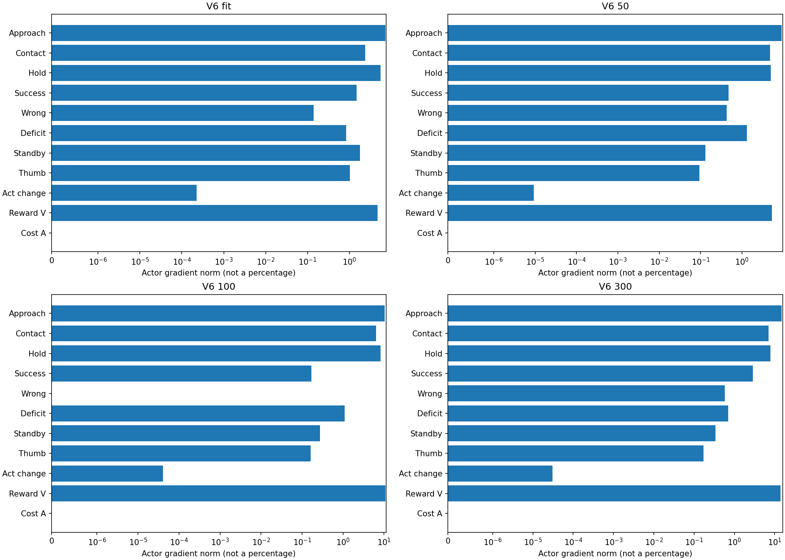
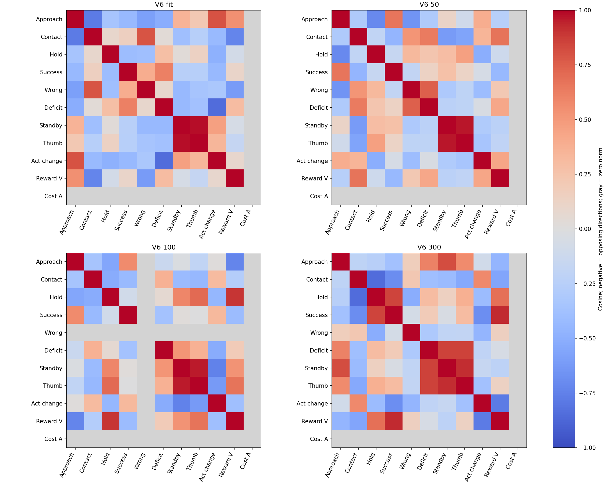
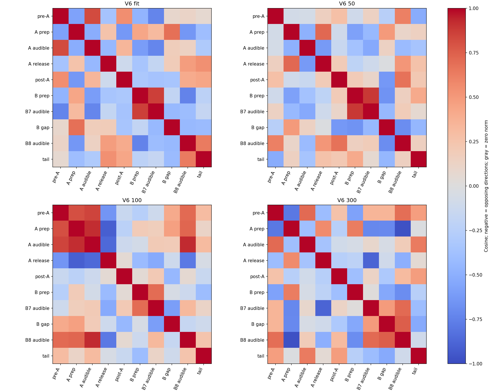
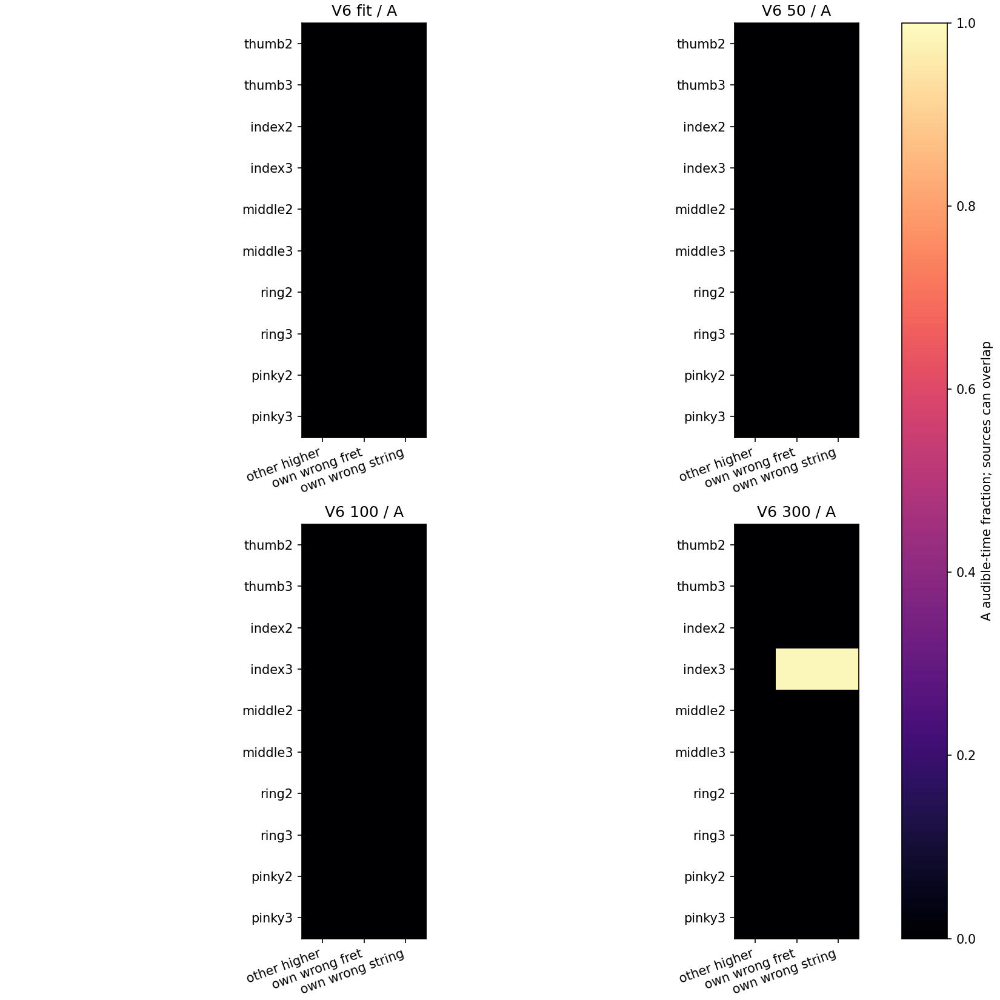

# 보상·구간별 초기 정책 기울기와 오압현 출처

고정 V6 저장본마다 새 확률 수행128시도·384음을 분석했다. 모델·보상·물리는 바꾸지 않았다. 과거 학습 미니배치나 Adam 갱신을 재현한 결과가 아니다.

|모델|A/B7/B8 달성|세 음 달성|A 오압현 비율|A clean 비율|평균 총보상|
|---|---|---:|---:|---:|---:|
|fit|24/42/53|14/128|0.0000|0.5238|1.344531|
|50|4/0/9|0/128|0.0000|0.4070|0.516201|
|100|1/0/0|0/128|0.0000|0.2218|-0.245555|
|300|2/10/7|0/128|0.9844|0.0156|-0.007149|

|보상항|fit|50|100|300|
|---|---:|---:|---:|---:|
|song_left_approach|-1.714677|-1.709157|-1.740849|-1.738418|
|song_left_contact|0.710452|0.670478|0.604191|0.500000|
|song_clean_hold|2.103915|1.580979|0.981451|1.399523|
|song_left_success|0.224609|0.023438|0.001953|0.035156|
|song_wrong_press|-0.002344|-0.007031|0.000000|-0.150000|
|song_performance_deficit|-0.109215|-0.174322|-0.223650|-0.181764|
|song_finger_standby|0.088029|0.087996|0.087931|0.087800|
|song_thumb_support|0.043762|0.043820|0.043417|0.040554|
|action_change|-0.000001|-0.000001|-0.000001|-0.000000|

각 기울기는 원H32(마지막H2)의 GAE·공통 정규화를 유지하고 전이 수로 가중합했다. 354tick 통합GAE가 아니다. 9개 보상 stream 외에 공통 reward critic/bootstrap 잔차와 비용 advantage를 별도로 분해했다. CPU의 동일 forward logp를 고정 기준으로 삼았으며 GPU에서 저장한 logp와의 차이는 원 analysis.json에 별도 기록했다. 구간별 기울기는 보상이 지급된 시간이 아니라 행동의 출발시점 구간으로 묶었다.

기울기 norm은 기여율이 아니며 합산되는 비율도 아니다. 음수 cosine은 해당 모델·수행에서 방향이 상반된다는 뜻이다. 이것만으로 학습 실패의 단독 원인이나 어떤 보상항을 삭제할 근거가 되지는 않는다.

오압현 출처는 기존 원장의240Hz 끝점 적분값이다. 같은 발음 시간에 여러 몸체·원인이 겹칠 수 있어 합이1일 필요는 없다. other_higher는 다른 손가락의 높은 프렛 경합, own_wrong_fret는 담당 패드의 잘못된 프렛, own_wrong_string은 담당 패드의 잘못된 현이다. 현재 finger-skill v2 계약을 확인해 해석했다. 몸체 합력이나 판정 출처를 실제 현 압력·음향의 증거로 확대하지 않는다.

|모델|A 주요 출처(시간 비율)|60Hz 끝점의 출처 프렛 범위|
|---|---|---|
|fit|없음|없음|
|50|없음|없음|
|100|없음|없음|
|300|index3/own_wrong_fret 0.9844, index3/own_wrong_string 0.9844|index3 5..5|

|모델|검지4축 latent 표준편차 평균|
|---|---|
|fit|0.00811661, 0.01191628, 0.01259846, 0.00944169|
|50|0.00811638, 0.01191618, 0.01259747, 0.00944159|
|100|0.00811590, 0.01191605, 0.01259701, 0.00944159|
|300|0.00811501, 0.01191514, 0.01259449, 0.00944105|

표준편차는 정규화된 latent 단위이며 관절 각도나 실제 움직임의 표준편차가 아니다. 실제 자세 변동은 목표 평균·tanh/관절 변환·접촉과 물리 제어의 영향을 함께 받는다.
