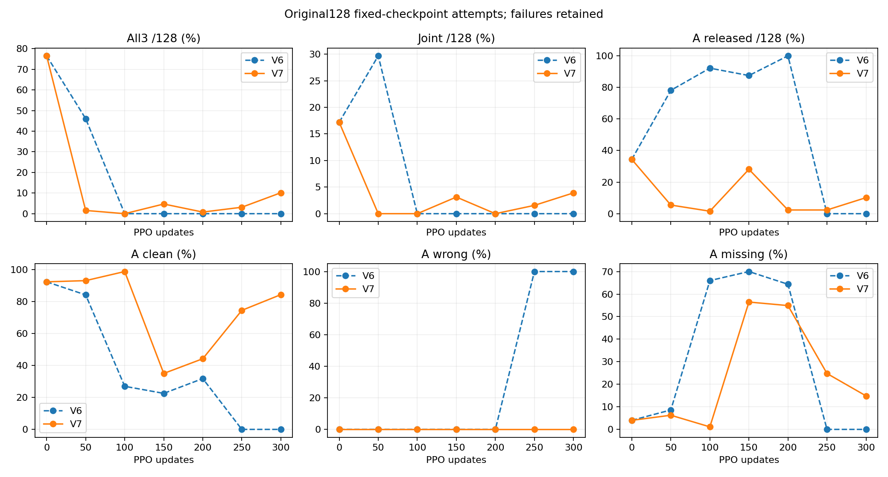
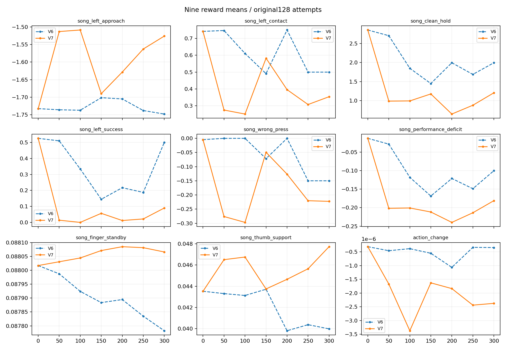
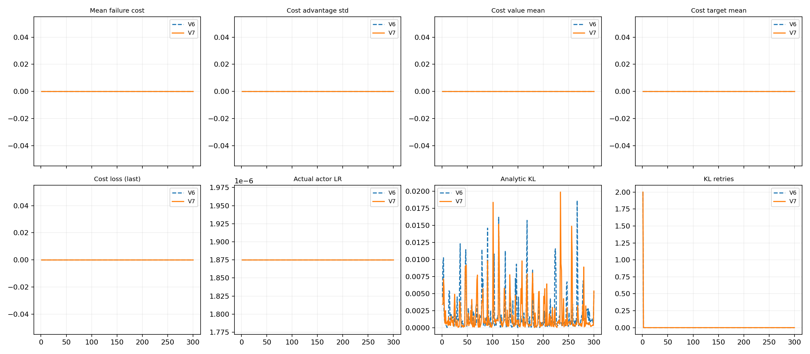

# V7 reward 가치망 사전 보정과 V6 비교

고정기타·검지4축·원3음 view354tick·seed7의 비교다. 원128시도·384음에 실패를 포함한다. 초기 고정/확률128 및 50회간격6고정·마지막확률128을 검사하며 마지막300을 점수와 무관하게 보고한다.

|버전/회차/모드|A/B7/B8 달성|all3|A 해제|joint|실패|평균보상|
|---|---|---:|---:|---:|---:|---:|
|V6/0/고정|100/122/125|98|44|22|0|2.501710|
|V6/0/확률|24/42/53|14|111|12|0|1.344531|
|V6/50/고정|68/97/120|59|100|38|0|2.327677|
|V6/100/고정|0/83/88|0|118|0|0|1.070662|
|V6/150/고정|0/38/36|0|112|0|0|0.276258|
|V6/200/고정|0/47/64|0|128|0|0|1.263567|
|V6/250/고정|0/34/62|0|0|0|0|0.468865|
|V6/300/고정|0/128/128|0|0|0|0|1.123712|
|V6/300/확률|2/10/7|0|1|0|0|-0.007149|
|V7/0/고정|100/122/125|98|44|22|0|2.501710|
|V7/0/확률|24/42/53|14|111|12|0|1.344531|
|V7/50/고정|117/2/2|2|7|0|0|-0.577884|
|V7/100/고정|126/0/0|0|2|0|0|-0.625665|
|V7/150/고정|21/11/14|6|36|4|0|-0.001948|
|V7/200/고정|55/3/3|1|3|0|0|-0.802920|
|V7/250/고정|98/4/4|4|3|2|0|-0.652299|
|V7/300/고정|110/18/19|13|13|5|0|-0.142705|
|V7/300/확률|60/100/100|58|60|30|0|1.772976|

|버전/회차/모드/음|clean|wrong|missing|최장clean(s)|
|---|---:|---:|---:|---:|
|V6/0/고정/4|0.92231|0.00000|0.04018|0.12700|
|V6/0/고정/7|0.95085|0.01562|0.01913|0.64989|
|V6/0/고정/8|0.97975|0.01562|0.00236|0.32888|
|V6/0/확률/4|0.52385|0.00000|0.39429|0.04825|
|V6/0/확률/7|0.79045|0.00781|0.16076|0.28184|
|V6/0/확률/8|0.78962|0.00781|0.15521|0.14683|
|V6/50/고정/4|0.84074|0.00000|0.08621|0.09614|
|V6/50/고정/7|0.88239|0.00000|0.07797|0.49004|
|V6/50/고정/8|0.98075|0.00000|0.00963|0.30063|
|V6/100/고정/4|0.26936|0.00000|0.65991|0.02214|
|V6/100/고정/7|0.64668|0.00000|0.32602|0.37784|
|V6/100/고정/8|0.93401|0.00000|0.03427|0.23277|
|V6/150/고정/4|0.22515|0.00000|0.70003|0.02040|
|V6/150/고정/7|0.57445|0.24365|0.11860|0.19779|
|V6/150/고정/8|0.65105|0.23438|0.06475|0.11105|
|V6/200/고정/4|0.31753|0.00000|0.64367|0.03288|
|V6/200/고정/7|0.79709|0.00000|0.16275|0.30885|
|V6/200/고정/8|0.88046|0.00000|0.06469|0.17268|
|V6/250/고정/4|0.00000|1.00000|0.00000|0.00000|
|V6/250/고정/7|0.81685|0.00000|0.13003|0.25147|
|V6/250/고정/8|0.87297|0.00000|0.06798|0.17117|
|V6/300/고정/4|0.00000|1.00000|0.00000|0.00000|
|V6/300/고정/7|0.99441|0.00000|0.00300|0.76868|
|V6/300/고정/8|0.99963|0.00000|0.00019|0.34695|
|V6/300/확률/4|0.01562|0.98438|0.00000|0.00266|
|V6/300/확률/7|0.75342|0.00781|0.18970|0.20893|
|V6/300/확률/8|0.63048|0.00781|0.29143|0.08009|
|V7/0/고정/4|0.92231|0.00000|0.04018|0.12700|
|V7/0/고정/7|0.95085|0.01562|0.01913|0.64989|
|V7/0/고정/8|0.97975|0.01562|0.00236|0.32888|
|V7/0/확률/4|0.52385|0.00000|0.39429|0.04825|
|V7/0/확률/7|0.79045|0.00781|0.16076|0.28184|
|V7/0/확률/8|0.78962|0.00781|0.15521|0.14683|
|V7/50/고정/4|0.92983|0.00000|0.06281|0.15269|
|V7/50/고정/7|0.03075|0.92188|0.04478|0.01730|
|V7/50/고정/8|0.02962|0.91956|0.04502|0.00642|
|V7/100/고정/4|0.98667|0.00000|0.01123|0.16780|
|V7/100/고정/7|0.00359|0.99219|0.00343|0.00036|
|V7/100/고정/8|0.00477|0.98754|0.00654|0.00042|
|V7/150/고정/4|0.34971|0.00000|0.56477|0.03654|
|V7/150/고정/7|0.37863|0.16406|0.40394|0.12214|
|V7/150/고정/8|0.44958|0.16406|0.28547|0.05726|
|V7/200/고정/4|0.44171|0.00000|0.54913|0.07322|
|V7/200/고정/7|0.11303|0.42188|0.44064|0.04372|
|V7/200/고정/8|0.09664|0.42169|0.43313|0.01426|
|V7/250/고정/4|0.74408|0.00000|0.24783|0.12374|
|V7/250/고정/7|0.06830|0.73438|0.18881|0.03650|
|V7/250/고정/8|0.06946|0.73438|0.17642|0.01363|
|V7/300/고정/4|0.84239|0.00000|0.14860|0.13992|
|V7/300/고정/7|0.17516|0.74219|0.07528|0.11072|
|V7/300/고정/8|0.19002|0.74219|0.05206|0.05438|
|V7/300/확률/4|0.63356|0.00000|0.32679|0.07847|
|V7/300/확률/7|0.82981|0.02340|0.13488|0.61122|
|V7/300/확률/8|0.83169|0.02344|0.13098|0.27781|

V6: PPO전이 1228800, 완료episode에 속한 전이 1223424, 아직 열린episode 전이 5376. 완료episode의 비용합 0.000000와 매 PPO창 비용평균을 구분한다. KL재시도합 2, 실제actor LR범위 1.875e-06~1.875e-06.
V6 실제비용 전구간0=True, cost advantage/value/target/loss 정확0=True. 양의 비용이 나오면 cost신호가0이라고 가정하지 않는다.
V7: PPO전이 1228800, 완료episode에 속한 전이 1223424, 아직 열린episode 전이 5376. 완료episode의 비용합 0.000000와 매 PPO창 비용평균을 구분한다. KL재시도합 2, 실제actor LR범위 1.875e-06~1.875e-06.
V7 실제비용 전구간0=True, cost advantage/value/target/loss 정확0=True. 양의 비용이 나오면 cost신호가0이라고 가정하지 않는다.

초기 배우71tensor 및 고정/확률128의 원장·물리·NN동작은 V6와 같다. reward 가치망만 fit자료 train96환경으로1000회×512 보정했다. 별도 holdout32환경은 같은 장면이며 다른 seed/장면 holdout이 아니다. 관측 MC는 확률 수행의 실현값이며 기대가치 정답 자체가 아니다.
구간별 가치 MSE가 악화한 phase(train/holdout): {'train': ['9'], 'holdout': ['9']}. 전체 holdout 개선이 모든 tail구간 개선을 뜻하지 않는다.
학습률·KL재시도 변화는 개입 이후 경로로 기록하며 수동 설정 차이로 설명하지 않는다. 단일seed 비교로 원인·일반효과를 확정하지 않는다. 다른 손가락·자유기타/J33·원67음·다른seed는 미완료다.
