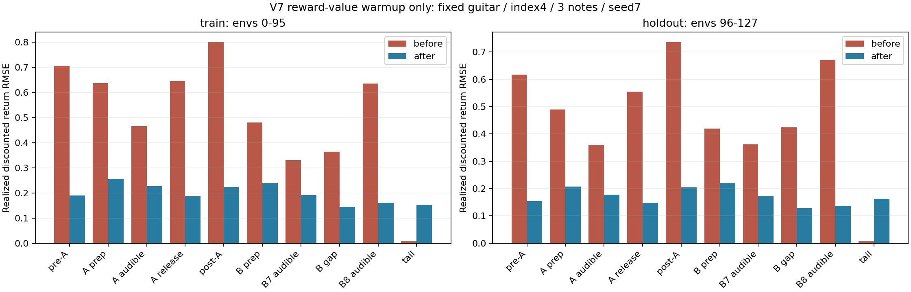

# V7 초기 가치망 보정 결과

고정1000회 GPU 보정을 완료했다(종료0). 배우 지도1000회 재현 시 fresh/fit의71개 텐서는 V6와 전부 같았다. 보정 후에는 value_encoder/reward_critic의17개 텐서만 달라졌고, 배우·표준편차·costhead·난수 경계는 동일했다. PPO는 아직0회다.

| 분할 | 전 MSE | 후 MSE | 전 RMSE | 후 RMSE |
| --- | ---: | ---: | ---: | ---: |
| 학습 환경0–95 | 0.382308 | 0.036241 | 0.618311 | 0.190370 |
| 별도 환경96–127 | 0.317608 | 0.026550 | 0.563567 | 0.162941 |

전체 오차 개선 게이트는 통과했다. 구간별로는 마지막 tail의 오차가 증가했으며, 모든 구간이 개선됐다는 뜻은 아니다. 같은 장면·seed의 환경 분할이고 원67음/다른 장면에 대한 일반화 검증도 아니다. 실현된 확률 반환값과의 오차 감소를 정책의 압현 성능 개선으로 해석하지 않는다.

실제 초기 평균행동128평가의 전체384음 원장·9보상과 env0 관절/목표/후보/NNgoal은 V6와 정확히 일치했다. 세음 모두달성98/128, 달성+첫음해제22/128이다. 힘 비교 최대차이7.6294e-6N은 별도로 기록한다. 초기 확률128평가도 종료0으로 완료했고 전체 원장·9보상·env0 관절/목표/후보/NNgoal이 V6와 정확히 일치했다. 세음 모두달성14/128, 달성+첫음해제12/128이며 힘 최대차이7.6294e-6N은 별도다. 독립 실제검수는 마무리 중이다.
