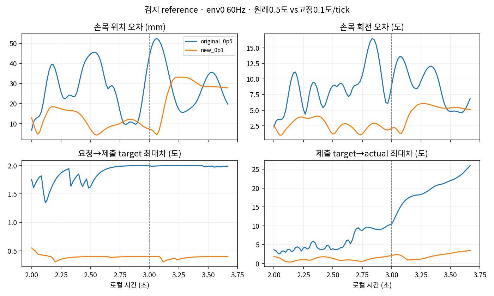

# 검지 보정 상한0.5도와0.1도 비교

**0.1도 조건은 손목과 팔의 추종 오차를 줄였지만 압현 달성은0/4였다. 기준 도달 문제는 해결되지 않았으며 추가 gain은 탐색하지 않는다.** 초기 모델73개 tensor는 원래 조건과 정확히 같고, 원래3초 onset·row1 teacher/reference·물리·보상·종료는 유지했다. 차이는 tick당 보정 상한과 해당 schema/속도 메타데이터뿐이다.

| 조건 | 대조 | 달성/4 | 음중 유지 | 음중 오압현 | 물리/손목 실패 |
|---|---|---:|---:|---:|---:|
| 원래0.5도 | reference | 0 | 0.00% | 0.00% | 0 / 0 |
| 원래0.5도 | zero | 0 | 0.00% | 0.00% | 0 / 0 |
| 원래0.5도 | random | 0 | 0.00% | 11.85% | 0 / 0 |
| 새0.1도 | reference | 0 | 1.835% | 5.121% | 0 / 0 |
| 새0.1도 | zero | 0 | 0.00% | 8.062% | 0 / 0 |
| 새0.1도 | random | 0 | 0.00% | 5.199% | 0 / 0 |

표는 배정4환경 첫 시도를 모두 포함한 총24시도다. 분수는 원래240Hz 음악 원장의 음 구간 통합값이다. bootstrap1은 initial.pt 생성용이며 PPO 뒤 final.pt는 평가하지 않았다. 새 reference의 clean0.0125초는env3에서만 기록됐고 env0의clean은0이다. 전체 평균을 아래env0 표본으로 대체하지 않는다.

env0 reference의 음중11개60Hz 끝점(3.000~3.1667초)의 중앙값이다. 각도 gap은 해당 시각의 팔12축 최대절댓값을 먼저 계산한 뒤 시간 중앙값을 낸 것이다.

| 항목 | 원래0.5도 | 새0.1도 |
|---|---:|---:|
| 실제 손목–goal 위치오차 | 47.60mm | 7.42mm |
| 실제 손목–goal 회전오차 | 12.11도 | 2.13도 |
| 요청→scene 제출 target 최대각차 | 2.00도 | 0.40도 |
| scene 제출 target→actual 최대각차 | 15.48도 | 2.07도 |
| 요청→actual 최대각차 | 17.47도 | 2.15도 |
| nearest 패드거리 | 24.64mm | 4.06mm |
| 검지 distal body 합력 | 30.99N | 0N |
| 엄지 body 합력 / source rear-normal load | 0 / 0N | 0 / 0N |

요청→제출 target의 차이는 두 조건 모두 원래alpha0.2 평활식으로 재현됐다. 새 조건의 음중 요청→제출 최대차는0.400도 이하지만 제출→actual 최대차는2.383도까지 남는다. 팔에서 남은 각차는 평활 지연보다 제출 target을 실제 관절이 따라가는 쪽이 더 크다. 주축은Thorax_z(최대2.383도), Shoulder_z(1.302도), Elbow_z(1.196도)다. 이 각도 비교가7.42mm 손목 위치오차의 기여율이나 접촉 원인을 뜻하지는 않는다.

선택 손가락의 목표도 그대로지만 실제각의 차이는 남는다. 음중 중앙값은아래와 같고 순서는index1_x·index1_z·index2·index3다(도).

| 조건 | 실제 q | 동일 target |
|---|---|---|
| 원래0.5도 | 30.09, 16.04, 53.74, 24.00 | 39.31, 27.76, 54.48, 24.07 |
| 새0.1도 | 36.66, 17.43, 54.34, 24.05 | 39.31, 27.76, 54.48, 24.07 |

특히 새 조건의index1_z는중앙값 기준 목표와약10.33도 다르다. 따라서 남은 문제를 팔의 요청 평활 지연만으로 설명할 수 없다. 토크·joint qd·접촉 상대가 미저장이므로 관절 차이를 만든 힘이나 물체를 확정하지 않는다.

원래 production helper로 다시 판정한 음중 env0 gate 수다.

| gate /11끝점 | 원래0.5도 | 새0.1도 |
|---|---:|---:|
| assigned distal loaded | 11 | 1 |
| any-sample position | 0 | 4 |
| 같은 표본의 position+facing | 0 | 4 |
| positive before wrong | 0 | 0 |
| candidate / wrong | 0 / 0 | 0 / 1 |

새 조건에서는 위치·방향 gate가 일부 충족됐으나 같은 시점의 distal load와 결합해 positive를 만들지는 못했다. nearest 거리·높이는 independently selected 표본의 값이며 any-sample witness로 쓰지 않았다. 이11끝점 밖의240Hz gate 전이는 복원할 수 없다. 전체4시도의 음악 원장과 구분한다.

2.0~3.6667초101끝점에서 재구성한 bounded correction 최대절댓값은24.74도→6.24도로 줄었다. 이는 저장 request−고정 feedforward로 재구성한 값이며 memory 자체가 독립 저장된 것은 아니다. 요청 action bounds 일치는원래6축에서 새2축(Thorax_y 상한13끝점·Wrist_y 하한29끝점)으로 줄었고, 실제 scene target의동일 경계 일치는두 조건 모두0이다(1e-6rad 수치 일치). 경계 바깥의 무제한 누적이라고 설명하지 않는다. 저장delta는DLS 결과의 각 조건 step cap 뒤, 이후 request rate/action bound clipping 전 값이다.

nonarm 실제 자세도 두 실행에서 달라졌다. 예를 들어 음중env0 Chest_z 중앙값은2.145도→−0.195도, Spine_z는2.026도→0.434도다. 제어 설정을 동일하게 두어도 실제 전신 응답은 같지 않으므로 몸통 차이와 feedback/접촉의 인과를 분리했다고 말하지 않는다. JSON에는몸통9축과 원래 음 전/중/후의 손목·각도·거리·distal/엄지 합력·rear-normal load·gate를 함께 남겼다. rear-normal load는 원래 helper의 valid gate와양의 법선성분이며 접촉쌍·현별힘·압력 인증이 아니다.

root의 실제 launcher 종료0·wall103.599735초, 새4장면과 기존12장면의 완료/scene종료, 전체 분모, actual initial73tensor 동일성, 설정·계약의 정확3필드 차이, 준비689핀과 현재703입력 경로를 확인했다. 원래 strict loader·입력 검증은 유지했다. comparison.json/performance.csv에 수치, validation.json에 원자료SHA·완료 검증을 보존했다. 원래 메인·추종 분석의 원자료와 production 판정 경로를 재사용했으며 생산 소스·봉인·기존 결과는 수정하지 않았다. 분석 GPU 실행은0이다.

다음 구조 진단의 대상은 남은 실제 관절 추종 차이와 음 구간의 위치·하중 동시 충족 문제다. 어느 제어 또는 자세를 바꿀지는 이 자료에서 확정하지 않는다. 현재 기준 도달 실패를 보존하며 추가 gain·teacher 재선정·준비시간 증가·성공 기준 완화로 이어가지 않는다. 이 비교는 고정 기타·유한 팔 teacher·검지 단음의 scripted 대조로, 학습 성과·자유 기타·전곡·자연스러움의 검증이 아니다.
