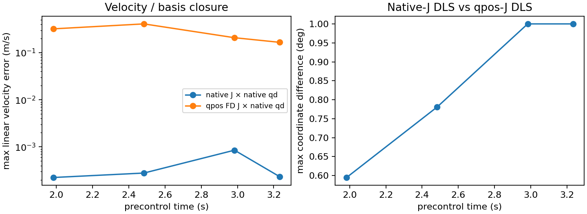

# 실제 동시 Jacobian 좌표 감사

이번 팔/wrist 표본에서는 **native velocity 기준 Jacobian과 qpos 미분 Jacobian이 다르며, 측정한 국소 좌표 변환으로 차이가 해소된다.** 원래 teacher가 native Jacobian으로 계산한 delta는 실제 저장된 delta와 재현됐다. 이를 qpos target에 직접 누적하는 현재 식에는 국소 좌표 혼용의 실제 근거가 있다. 생산 보정이나 압현 개선을 실행·검증한 결과는 아니다.

root의 단1조건 native 관찰은 exit0, wall32.061937178초이며 scene closed 및17개 원래 audit가 모두 참이다. 분석은 CPU만 사용했다. 원래 initial checkpoint/control/teacher/PD/재료/범위/실패/보상과690개 봉인 입력은 그대로다. 4환경 첫시도 모두 포함했고 달성0/4·clean0·wrong0·물리/손목실패0이다. 원래 평가 JSON은 exact, env0 trace는19필드 중18개 exact이며 `net_body_force_n`만 최대 **3.8146973e−6N** 다르다. 실제 힘 차이를 숨기지 않는다. 영상의 네 precontrol q/qd/target/body는 모두 exact다. 관찰 시각·frame 관계를 바꿔 결과를 맞추지 않았다.

## 같은 시각의 속도 대조

clock476/596/716/776, 즉 control 시작1.983333/2.483333/2.983333/3.233333초의4환경을 사용했다. 다음 feedback endpoint는2/2.5/3/3.25초다. 각 snapshot의 scene physics_step과 env clock이 같고 first=true·reset/physical/wrist=false다. human/L_Wrist는body17/nativeJ row16이며 qd105열의 이름 순서를 그대로 사용했다. COM→원점은 `r=Rbody(−COM)`, `Jorigin=Jlinear+Jangular×r`, 실제속도는 `vCOM+omega×r`다.

아래는 각 시각4환경 중 최대값이다. native 속도 잔차는 작지만 정확한0이 아니며 잔차 자체의 원인은 이번에 규명하지 않았다. qpos 미분에 native qd를 그대로 곱하는 경우와 차이가 크다.

| start clock | native J×native qd 원점오차(m/s) | 각속도오차(rad/s) | qpos FD J×native qd 원점오차(m/s) | 각속도오차(rad/s) |
|---:|---:|---:|---:|---:|
| 476 | .00022371 | .00065817 | .321195 | 1.325697 |
| 596 | .00027818 | .00108048 | .409288 | 1.761785 |
| 716 | .00085063 | .00154885 | .208244 | .885709 |
| 776 | .00023251 | .00373595 | .166092 | .927038 |

16표본에서 실제 원점/각속도 norm 대비 native closure 최대비는 각각 **0.4592% / 0.2032%**다. 앞선60Hz 중앙차분 증거와 달리 이 표는 실제 같은 native snapshot의 q/qd/J/body로 계산했다. 그래도 유한차분의 위치 미분은 수치 근사이므로 epsilon 민감도를 별도로 확인했다.

## 팔4개 관절의 국소 basis 검증

L_Thorax/Shoulder/Elbow/Wrist 각각에 대해 ownbody의 native angular3×3 block을 S, 독립 full_fk의 qpos 미분을 M으로 구했다. 미분은 float64 q±1e−5와 world 회전 `Rp*Rm.inv()`다. `S T=M`을 풀었으므로 **T는 qpos differential→native velocity 좌표**의 국소 변환이다. 같은 네 관절의 blockdiag(T)를 wrist native6×12 Jacobian 오른쪽에 곱해 독립 wrist qpos 미분과 대조했다. 설치 velocity의 특정 local/world 축 의미를 미리 가정해 T를 정하지 않았다.

| 16 frame×env·64 ownjoint block의 최대값 | 결과 |
|---|---:|
| ownbody FK/native 위치·회전 오차 | 6.1812e−7m / 6.8792e−7rad |
| cond(S), cond(M) | 1.00000050 / 1.40167713 |
| S T−M 잔차 | 3.3307e−16 |
| 변환 전 wrist nativeJ−qposJ, linear/angular element차 | .25481894 / 1.02675631 |
| 변환 후 wrist nativeJ T−qposJ, linear/angular element차 | **3.8729e−7m/rad / 3.9031e−11** |
| qpos-J epsilon절반 변화 최대 element차 | 7.5193e−11 |
| epsilon절반에서도 변환 후 차 | 3.8729e−7 |

S T−M은 변환 정의상 성립하며 이것만을 독립 검증으로 보지 않는다. downstream wrist의 별도 위치 미분과 native linear 행까지 재현되는 것이 추가 검산이다. ownbody pose 일치와 낮은 조건수도 함께 확인했다. T와 wrist 행렬은 `matrices.npz`, 64개 block의 요약 수치는 `measurements.json`에 보존했다. S/M 행렬 자체는 중복 저장하지 않았으며 raw nativeJ와 pin된 full_fk/q에서 재구성한다. M은 pin된 독립 FK 모델의 미분이며, native qpos를±epsilon으로 직접 바꾸는 실험을 한 것은 아니다. finger MCP의 숨은 relative rotvec y 문제에는 이4×3축 결과를 확대하지 않는다.

## 실제 teacher delta의 재현

원래 production helper로 저장 nativeJ와 같은 snapshot의 goal/error를 다시 계산했다. env0에만 저장된 nextfeedback4개의 delta와 최대 **4.3772e−8rad** 이내 일치했고 pose error 차는1.4901e−8이었다. 다른3환경에는 저장 delta가 없어 이 재현분모를16으로 늘리지 않는다.

같은 error/damping1e−5/±.5° clip에서 native-J DLS와 qpos-J DLS는 env0에서 .44572/.52225/1.00000/1.00000° 차이다. 4환경 최대는 .59494/.78085/1.00000/1.00000°다. 반면 nativeJ T로 재계산한 qpos-DLS는 독립 FK qpos-DLS와 최대5.3166e−6° 차다. 원래 코드가 계산하는 값과 위치 미분에 맞는 값의 차이를 시각 오정렬이나 저장 delta 불일치로 설명할 수 없었다.

이 비교는 국소 differential와 좌표별 damping metric의 비교다. `T⁻¹ delta_native`를 취하는 것과 `Jnative T`에서 같은 Euclidean damping을 다시 푸는 것은 일반적으로 같은 최적화 문제가 아니다. 유한 회전을 정확히 옮겼다고 주장하거나 scalar gain 하나의 변경으로 해결된다고 결론 내리지 않는다. 현재 target rate/범위·누적 메모리·feedback 경로는 전혀 바꾸지 않았다.

결론 범위는 이 고정 기타·검지 reference·팔12축·16 snapshot이다. 자유손 압현, 다른 joint 종류, MCP2축, 안정성·하중·음악 성공 개선은 미검증이다. native body resultant를 접촉쌍 압력으로 해석하지 않는다. 690봉인과 실제 raw는 수정하지 않았고 새 GPU 실행도 하지 않았다. `verification.json`은 원래 자료와의 exact/힘 차이, 전체 분모, 모든 입력 SHA를 담는다. preliminary `results_v1`은 보존하되 최종 근거는 이 `results_v2`다.

독립 actual 검수 `review_policy_load`: **PASS**. 원16snapshot을 직접 재계산하고 epsilon2e−5·회전행렬 미분 `(dR)Rᵀ`라는 별도 방법으로 downstream linear 최대3.87283e−7/angular1.44013e−11을 확인했다. 전체 분석 메모리 재실행에서16rows·64blocks·NPZ6배열 exact를 확인했다. 문서의 S/M 저장 설명1건을 수정한 뒤 남은 finding은 없다. 검수자 파일수정/native/GPU 실행은0이다.
