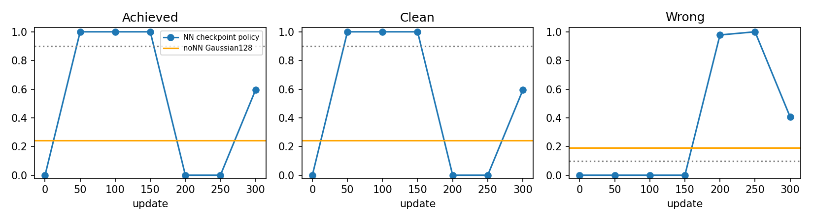
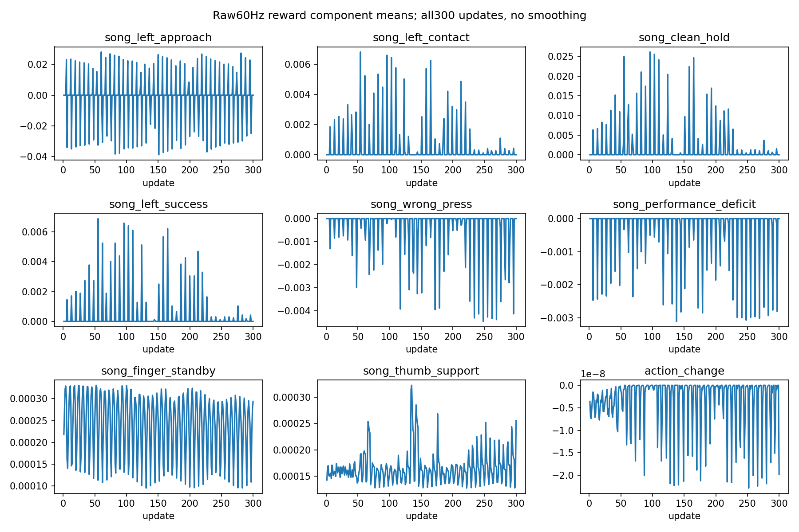

# 검지 낮은 상한 fresh300 실제 분석

중간50/100/150회는각128/128이지만200/250회는0/128로후퇴했다. 최종300회는76/128·clean59.3392%·wrong40.6512%로회복이불완전하다. 중간연속수용통과와최종성능유지는별개다.

| update | 달성/128 | clean | wrong | 물리/손목실패 | 단일기준 |
|---:|---:|---:|---:|---:|---|
| 0 | 0/128 | 0.000000 | 0.000000 | 0.000000/0.000000 | 미달 |
| 50 | 128/128 | 1.000000 | 0.000000 | 0.000000/0.000000 | 통과 |
| 100 | 128/128 | 1.000000 | 0.000000 | 0.000000/0.000000 | 통과 |
| 150 | 128/128 | 1.000000 | 0.000000 | 0.000000/0.000000 | 통과 |
| 200 | 0/128 | 0.000000 | 0.978104 | 0.000000/0.000000 | 미달 |
| 250 | 0/128 | 0.000000 | 1.000000 | 0.000000/0.000000 | 미달 |
| 300 | 76/128 | 0.593392 | 0.406512 | 0.000000/0.000000 | 미달 |

| env0 update | 음중60Hz끝점 | actual4 ° | target4 ° | body1/2/3 평균N | 손목평균 mm/° | CPU6gate |
|---:|---:|---|---|---|---|---|
| 0 | 11 | 40.24512, 14.53530, 51.89306, 20.75189 | 40.55396, 24.86826, 51.89725, 20.75147 | 8.47455, 0.24313, 0.00000 | 1.65101, 0.42382 | [0, 11, 11, 0, 0, 0] |
| 50 | 11 | 46.15791, 23.99855, 52.40829, 29.27594 | 49.92326, 29.36839, 63.25602, 30.80364 | 16.66285, 0.00000, 5.79784 | 3.04266, 0.22218 | [11, 11, 11, 11, 11, 0] |
| 100 | 11 | 33.48645, 6.87191, 41.08062, 51.39031 | 90.00019, 18.22484, 90.00019, 54.12272 | 0.00000, 0.00000, 6.34895 | 1.71612, 0.39968 | [11, 11, 11, 11, 11, 0] |
| 150 | 11 | 41.48109, 8.17426, 17.70785, 83.72537 | 90.00019, 30.00000, 90.00019, 88.37375 | 0.00000, 0.00000, 6.50917 | 3.54675, 1.09113 | [11, 11, 11, 11, 11, 0] |
| 200 | 11 | 36.17174, 7.19928, 20.06361, 88.87964 | 90.00019, 30.00000, 90.00019, 90.00019 | 1.50610, 0.00000, 7.30878 | 2.07765, 0.19560 | [11, 0, 0, 0, 0, 11] |
| 250 | 11 | 51.38487, 16.37703, 11.88760, 89.25486 | 90.00019, 30.00000, 90.00019, 90.00019 | 1.25950, 0.00000, 6.37308 | 7.51863, 1.38208 | [11, 11, 11, 11, 0, 11] |
| 300 | 11 | 49.70971, 17.68077, 13.17803, 89.21575 | 90.00019, 30.00000, 90.00019, 90.00019 | 2.72332, 0.00000, 6.29160 | 11.87248, 2.52868 | [11, 11, 11, 11, 11, 0] |

학습후인접2평가수용: **통과**, 통과쌍[[50, 100], [100, 150]]. 초기0은기준선이며연속학습후쌍에는포함하지않았다.
사전순위best=150,latest=300,영상대상[150, 300]. 7평가/896첫시도와실패를모두보존했고단일best를연속수용으로대체하지않았다.
비NNGaussian사전대조31/128은기존검수된별도기준선이며실제NN초기정책0회평가와다르다. 이번128/seed7·고정기타·유한팔·손목v3·private16effort0.25의단음결과를자유기타/J33/전곡·다른손가락/자연스러움/해제·전환으로확대하지않는다.

전체300metrics/1,228,800raw전이/종료episode5504·남은미종료episode전이12416를감사했다. 모든실패원장과원9보상/평균합산잔차를보존했고8scene/실제exit/105native/90쌍/source/alias/닫기를검사했다.
원costhead와gamma/PPO를유지했다. 실제initial73tensor는동일seed7/large/index1의원CPU초기화와같으며7저장본identity/source핀을대조했다. CPU에서CUDA RNG불러오기를우회하거나학습을재개하지않았다. rawcost는GAE필드와구분하고순간비용min/max/tape미저장한계를남겼다.

실제실패비용nonzero는0/300회,종료실패episode는0건이며비용평균×전이수합과종료episode비용합의차이는0이다. 반면cost GAE/loss는각300/300회nonzero다. 실제실패비용과초기critic/bootstrap의추정오차는다른양이며nonzero GAE를새실패로세지않는다.

best150 env0 음중의index2(PIP)는actual평균17.70785°/target90.00019°,index3(DIP)는83.72537°/88.37375°이며distal몸체합력평균6.50917N이다. 음달성에도큰추종차이와극단적인굴곡이남고자연스러움은확인되지않았다. latest300의env0은성공사례지만전체는76/128이므로이trace를전체128의성공으로확대하지않는다. env0은성과로선별하지않은원래고정환경이다.

env0 60Hz의세phase selectedtarget/actual·body1/2/3합력·손목/6gate·armbounds는comparison.json/env0_tracking.csv에있다. 전체128의원각도통계는attempts.csv에보존하지만나머지127의상세force는없다. 목표추종차이/하한체류와고하중이남아도접촉쌍/원인/보편관절상한으로확정하지않는다. 몸체합력은압력·모터torque·240Hz최대가아니다.

