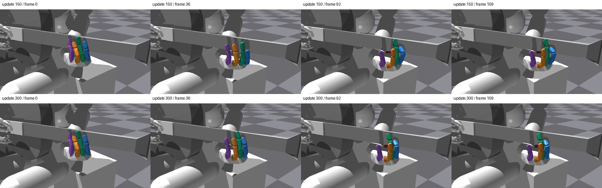
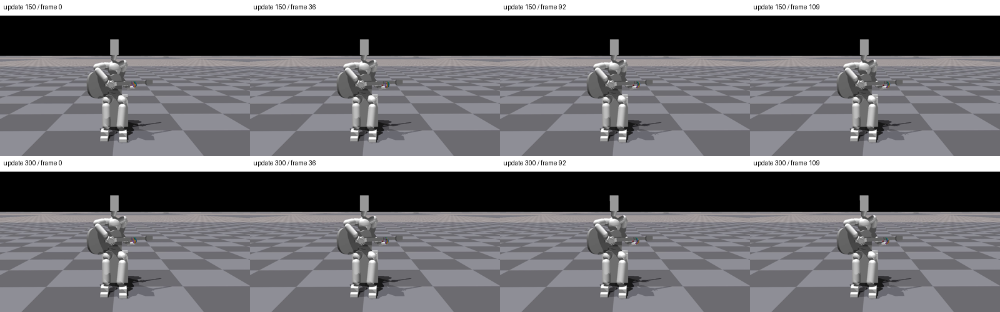

# 검지 학습 모델의 실제 영상

150반복 모델은 고정 평가에서 128/128, 최종 300반복 모델은 76/128을 달성했다. 영상은 각각 같은 128환경 장면의 **0번 환경 첫 시도**다. 영상에 나온 두 시도는 모두 성공하며, 이를 전체 128환경의 성공으로 해석하지 않는다.

| 모델 | 손 확대 | 전신 |
|---|---|---|
| 150반복 | [손 영상](/home/ajou/yigyu/3/docs/2026-10-27/guitar_learning_failure_diagnosis_v1/05_verified_fixes/low_effort_index_learning_v1/native_video_000150/hand.mp4) | [전신 영상](/home/ajou/yigyu/3/docs/2026-10-27/guitar_learning_failure_diagnosis_v1/05_verified_fixes/low_effort_index_learning_v1/native_video_000150/fullbody.mp4) |
| 300반복 | [손 영상](/home/ajou/yigyu/3/docs/2026-10-27/guitar_learning_failure_diagnosis_v1/05_verified_fixes/low_effort_index_learning_v1/native_video_000300/hand.mp4) | [전신 영상](/home/ajou/yigyu/3/docs/2026-10-27/guitar_learning_failure_diagnosis_v1/05_verified_fixes/low_effort_index_learning_v1/native_video_000300/fullbody.mp4) |

4개 영상은 h264·1280×720·30fps·110프레임이며 전체 디코딩을 통과했다. 원 렌더러의 모델 불변·strict load·native 속성·90개 충돌쌍·입력 불변·장면 종료 기록도 확인했다. 프레임 n은 제어 끝점 2×(n+1)에 해당한다.

영상과 원 고정 평가의 221개 끝점에서 관절각·목표각·몸체 상태·명령·candidate/wrong·손목 기록은 정확히 같았다. 몸체 합력의 최대 수치 차이는 150반복 3.81e-6N, 300반복 7.63e-6N이며 완전 동일하다고 표시하지 않았다. 비교와 입력 SHA는 verification.json에 보존했다.

추출 이미지에서 화면 방향이 정상이고 전신의 머리와 양발이 화면 안에 있음을 직접 확인했다. 파란색 검지의 마지막 관절이 크게 굽는 모습도 확인되며, 성공 점수와 별개로 손 모양·목표 추종 문제는 남아 있다. 손 영상에서는 넥에 일부 가려지는 부분이 있다. 몸체 합력은 접촉쌍 압력이나 240Hz 최대 하중이 아니며 실제 현 압력·음향을 인증하지 않는다.

별도 독립검수의 최종 판정은 review.json을 따른다.
