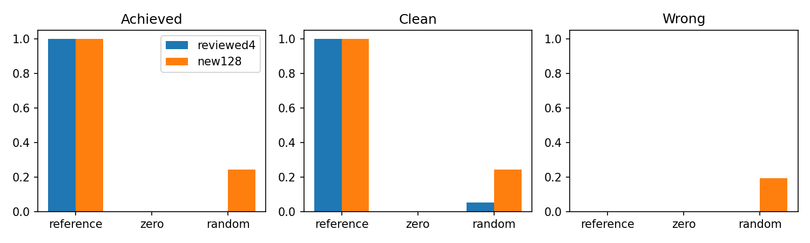
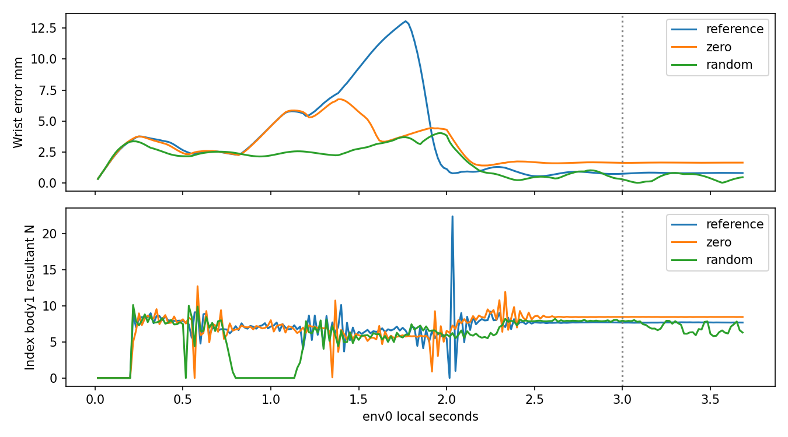

# 검지128환경 낮은 상한 사전 대조

| 명령 | 달성/전체128 | 평균clean | 평균wrong | 물리/손목실패 | 기존4 달성 |
|---|---:|---:|---:|---:|---:|
| reference | 128/128 | 0.99847084 | 0.00000000 | 0/0 | 4/4 |
| zero | 0/128 | 0.00000000 | 0.00000000 | 0/0 | 0/4 |
| random | 31/128 | 0.24357445 | 0.19208749 | 0/0 | 0/4 |

원PLAN 사전 수용기준: **통과**. 원384첫시도·실패를 모두 포함하고 random은 문턱/선별 없이 전부 공개했다. 이 판정은 봉인된 probe.acceptance의 원기준 재계산이며 실제 독립검수 PASS와 별개다.

| env0 명령 | 음중끝점 | actual4 ° | target4 ° | body1/2/3 평균N | 손목평균 mm/° | CPU6gate |
|---|---:|---|---|---|---|---|
| reference | 11 | 39.20735, 16.88951, 54.47031, 24.06209 | 39.30695, 27.75550, 54.48471, 24.06758 | 7.68083, 0.00000, 0.14685 | 0.82149, 0.23119 | [11, 11, 11, 11, 11, 0] |
| zero | 11 | 40.24512, 14.53530, 51.89306, 20.75189 | 40.55396, 24.86826, 51.89725, 20.75147 | 8.47455, 0.24313, 0.00000 | 1.65101, 0.42382 | [0, 11, 11, 0, 0, 0] |
| random | 11 | 33.34500, 10.12917, 45.38358, 28.27458 | 32.04915, 19.83018, 44.92363, 28.38913 | 7.64080, 0.00000, 0.09507 | 0.14377, 0.04400 | [3, 11, 11, 3, 3, 0] |

reference env0 음중 index1_z actual평균16.88951°/target평균27.75550°로추종차이10.86599°가남는다. 원음달성과요청각완전추종은별개이며이값을보편적인관절상한으로해석하지않는다.
reference/zero env0 음중 L_Wrist_y의request와target은11끝점모두원하한에있지만actual은하한체류가없다. zero는해당env0의위치/방향11끝점통과에도distal합력0으로loaded/positive/candidate0이다. 이것은env0의관찰이며나머지127의실패원인이나접촉쌍인과를확정하지않는다.
random31/128은비NN Gaussian명령의실제기준선이며후속NN initial정책과exact가아니다. 기존4와의설정차이는num_envs/updates및파생planned_transitions/full_song_after로모두JSON에기록했고진단환경의원음·손목·판정은동일하다.

CPU6gate 순서는loaded/position/position_facing/positive/candidate/wrong이다. gate와bounds·request→target·target→actual 차이는 comparison.json/CSV에세phase별저장했다. 이것은저장된env0 60Hz끝점의기하/몸체합력재구성이며240Hz음원장/보상을재지급하지않는다. nearest 잔차나candidate/wrong불일치는숨기지않고verification/comparison에남겼다.

원9보상은전체384원장의각항및합산잔차를attempts.csv에보존했다. native105속성은각128환경직접readback·controllercaps·90쌍과같고전체3scene의실제exit0/닫기/입력/alias복원을확인했다. NN/checkpoint/학습은없다.

같은seed7의128환경이지128seed가아니다. 기존4대비는분모/배치확대의관찰이며단일인과효과가아니다. env0 body1/2/3합력은실제접촉쌍압력·motor torque·240Hz최대하중이아니고나머지127환경상세하중은미저장이다. 제한과제사전통과를정책학습/자연스러움/자유기타/다른손가락/전곡성과로확대하지않는다.

독립검수뒤이분석소스·PLAN·결과·review를동결한다. 후속학습분석은별도learning_analysis/에작성하며root만GPU를실행한다.

