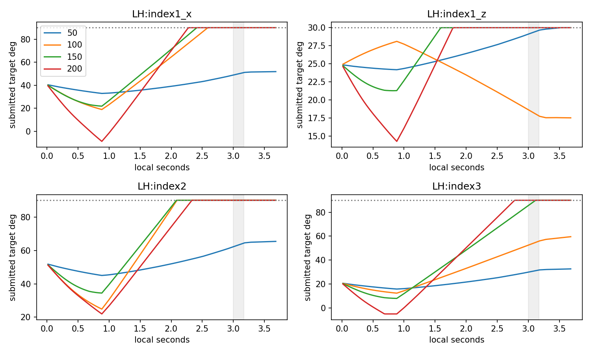
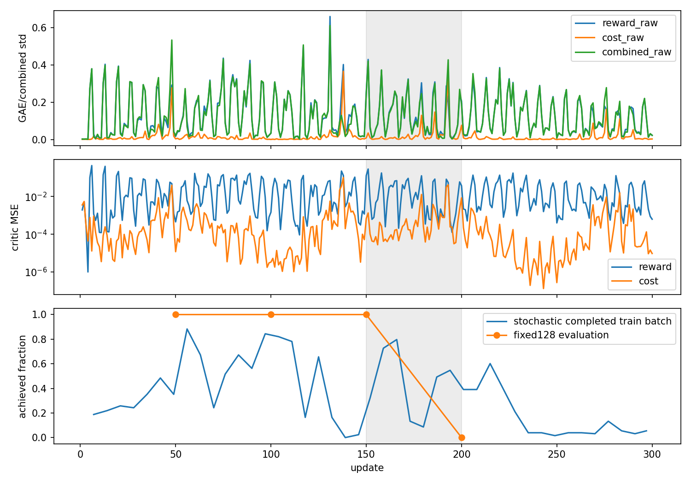

# 검지 학습 후퇴: 누적 목표와 비용 추정의 분리 감사

50/100/150회는 각각128/128이지만200회는0/128·wrong97.8104%다. 큰 목표−실제 차이와 마지막 관절 굴곡은 성공한150회에도 이미 존재한다. 비용 추정 영향과 이 추종 현상을 별도로 확인했으며 단일 원인은 확정하지 않는다.

## 선택4의 bounded 목표와 추종

아래는 env0 첫시도 60Hz 끝점이다. 순서는 MCPx/MCPz/PIP/DIP이며 상한은 약90/30/90/90°다. 시각은 local초(음중 [3.0,3.1703)초); 전체128의 상세 추종 원인이 아니다.

| update | 상한 최초 도달 local초 | 음중 target평균° | 음중 actual평균° | 음중 target−actual평균° |
|---:|---|---|---|---|
| 50 | 미도달, 3.5167, 미도달, 미도달 | 49.923, 29.368, 63.256, 30.804 | 46.158, 23.999, 52.408, 29.276 | 3.765, 5.370, 10.848, 1.528 |
| 100 | 2.6000, 미도달, 2.1000, 미도달 | 90.000, 18.225, 90.000, 54.123 | 33.486, 6.872, 41.081, 51.390 | 56.514, 11.353, 48.920, 2.732 |
| 150 | 2.4167, 1.6000, 2.1000, 3.1333 | 90.000, 30.000, 90.000, 88.374 | 41.481, 8.174, 17.708, 83.725 | 48.519, 21.826, 72.292, 4.648 |
| 200 | 2.2833, 1.8000, 2.3333, 2.7833 | 90.000, 30.000, 90.000, 90.000 | 36.172, 7.199, 20.064, 88.880 | 53.828, 22.801, 69.937, 1.121 |

50회의 MCPz 상한은3.5167초로 음후다. 100회부터 MCPx/PIP 목표가 음전 상한에 도달한다. 150회 PIP actual17.7079°/target90.0002°(차72.2923°), DIP actual83.7254°/target88.3738°가 이미 관측된다. 200회는4축 모두 음전 상한이며 PIP차69.9366°는150회보다 작다. 따라서 큰 PIP차 하나만으로150→200의 성공/실패 차이를 설명할 수 없다.

원 `BatchedController.targets`의 `clamp(old_target + action*4/60, native_bounds)`를 저장된 action/이전target으로 재계산한884끝점 잔차는0rad다. LH21은alpha1/누적codec이며 손목의alpha0.2와 구분한다. 1e-6rad는 이 감사의 상한분류·재귀검사 수치허용이며 음악판정을 바꾸지 않는다. 선택4의 실제각은 음중 상한에 도달하지 않았다.

| update | 직전target이상한인데양의명령인끝점수(MCPx/z/PIP/DIP) |
|---:|---|
| 50 | [0, 10, 0, 0] |
| 100 | [65, 0, 95, 0] |
| 150 | [76, 125, 95, 33] |
| 200 | [84, 113, 81, 54] |

상한으로 향하는 명령과 실제 추종 지연은 확인되지만 저장되는 목표는 clamp된 유한값이다. 범위 밖 숨은 목표의 무제한 누적은 아니다. 정방향 명령은 상한에서 유지되고 반대 명령은 다음 제어틱부터 목표를 되돌릴 수 있다는 원codec 계약은 유지된다. 실제 원인에 접촉 차단·모터/자세 한계 중 무엇이 기여했는지는 이 로그만으로 분리할 수 없다.

## 실제 오압현 분리

| update | loaded/position/facing/positive/candidate/wrong (음중11끝점) | 몸체1/2/3합력평균N | 손목오차평균mm/° |
|---:|---|---|---|
| 50 | [11, 11, 11, 11, 11, 0] | 16.663, 0.000, 5.798 | 3.043, 0.222 |
| 100 | [11, 11, 11, 11, 11, 0] | 0.000, 0.000, 6.349 | 1.716, 0.400 |
| 150 | [11, 11, 11, 11, 11, 0] | 0.000, 0.000, 6.509 | 3.547, 1.091 |
| 200 | [11, 0, 0, 0, 0, 11] | 1.506, 0.000, 7.309 | 2.078, 0.196 |

cp200 env0 원helper 재생은 검지 distal(index3)의 own_wrong_string을11/11에서 반환했다. 목표는physical3현4프렛이며 qualifying any-sample은physical2현3프렛11끝점,2현4프렛1끝점이다(중복가능). 다른손가락 other_higher와 own_wrong_fret는0이다. 150회는positive/candidate11이며 wrong0이다. cp200에서distal합력은 남아도 목표 위치·positive는0이다. 이는 원판정의 현/프렛 기하를 좁힌 관찰이며 접촉 상대쌍·실제압력·음향의 증거는 아니다.

candidate/wrong은884끝점 모두 원저장값과exact다. nearest 거리/높이 잔차>1µm는 없지만 nearest scalar는 qualifying any-sample witness와 다르며 실제native sample index는 저장되지 않았다. 위 현/프렛·원인표는 저장snapshot에 현재와SHA일치한 원helper를 적용한 CPU 재구성이다. 다른127의 몸체pose/force/cause endpoint는 없으므로 전체128 실패를 같은 원인으로 확정하지 않는다.

## 비용 추정과 PPO 로그

300회 모두 즉시실패비용평균0, 종료5504원장 cost0·물리/손목실패0이다. cost GAE와cost loss는각300회nonzero다. 원 `compute_decision_gae`는 cost+discount*next_cost_value−cost_value에서 시작하고 반환target=GAE+value이므로 실제비용0과 추정GAE0은 동치가 아니다. cost_weight1에서 combined=reward_GAE−cost_GAE이며 평균식 최대잔차는5.07e-10다. 추정된 비용이 실제 actor 목적에 들어간 경로는 확인되지만 이를 유일한 후퇴원인으로 확정하지 않는다.

| update | reward/cost/combined GAE std | cost value/target평균 | cost MSE / EV |
|---:|---|---|---|
| 150 | 0.253, 0.009, 0.244 | -0.026, -0.002 | 0.000668238 / -1.21724 |
| 180 | 0.106, 0.015, 0.097 | -0.019, -0.011 | 0.00024905 / -1.15793 |
| 190 | 0.029, 0.024, 0.007 | -0.011, -0.021 | 0.00078409 / 0.310581 |
| 200 | 0.206, 0.076, 0.191 | 0.059, 0.008 | 0.00844436 / -36.2648 |

190회의cost GAE std.02417은reward.02855에비해작지않고 combined std는.00669다. 200회cost value평균.05864/target.00772·MSE.00844·EV−36.26으로불일치가보인다. 음의EV는상수평균예측보다못한분산설명이며 target분산에도영향받으므로 단독정책원인척도가아니다. 실제old value/nextvalue/transition별GAE tape는저장되지않아동일표본counterfactual advantage/gradient를재계산할수없다.

학습률은1~215회3e−5이고유일한KL재시도/7.5e−6변경은216회다. 200회붕괴보다뒤라최초후퇴의선행사건으로둘수없다. latentGaussian entropy는150/200회각−1.386003/−1.385548이며이는연속Gaussian의미분entropy다. 음수나작은변동만으로탐색붕괴를확정하지않는다. ratio/KL/entropy/value/target/MSE/EV의전체300행은metrics300.csv에보존했다.

stochastic학습종료batch와deterministic고정평가는다른표본이다. 학습은H32연속시계/221tick episode를이어가므로인접update가서로다른음전·음중노출을포함한다. 150회고정128/128을그주변stochastic종료batch와같은모집단으로비교하지않는다. 그래프에두분모를구분했다.

## 다음 단일 대조 후보와 한계

비용초기화B는별도worker설계범위다. 추종측의다음후보는동일저장action tape에서원누적대비유한target−actual오차완화의matched진단이다. 원4rad/s와native범위교집합안에서만target memory/반환native제출/관측target_error를동시에맞추고다른축·엄지035·팔teacher·보상/실패는유지해야한다. 큰기존오차를한번에actual로치환하면원속도제약을벗어나므로그런동작을부드러운보정으로부르지않는다. 진단게이트/완화수치는여기서채택하지않았다.

원적positioncodec 대조도가능하지만0명령이reset기준을요청하는등행동의미와엄지/비선택축영향까지달라질수있어분리설계가필요하다. 기존incremental checkpoint의strict계약을우회해position모델로로드할수없으며새계약·명시적action tape대조또는fresh학습이어야한다. 이번에는어느대조도구현/실행하지않았다. 두가설의인과입증이나새gain/범위/힘/성공문턱변경을확대하지않는다.

고정기타/검지단음/seed7의전체128음원장과env0 60Hz관찰이다. 몸체합력은모터torque·접촉쌍·압력·240Hz최대가아니고학습성과의자연스러움·해제/다음음·자유기타/J33로확대하지않는다. 원자료·source·기존분석·봉인/GPU변경0.

재현: 이폴더 analyze.py --root-completed (rl38,CUDA_VISIBLE_DEVICES빈값). verification.json에모든원입력/SHA와원함수경로,comparison.json에첫상한시각·source시각·원인/phase통계,CSV에전체행을보존했다.

