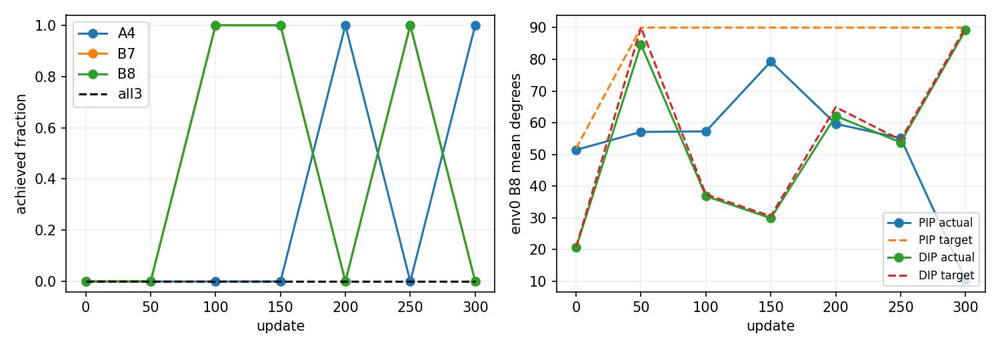
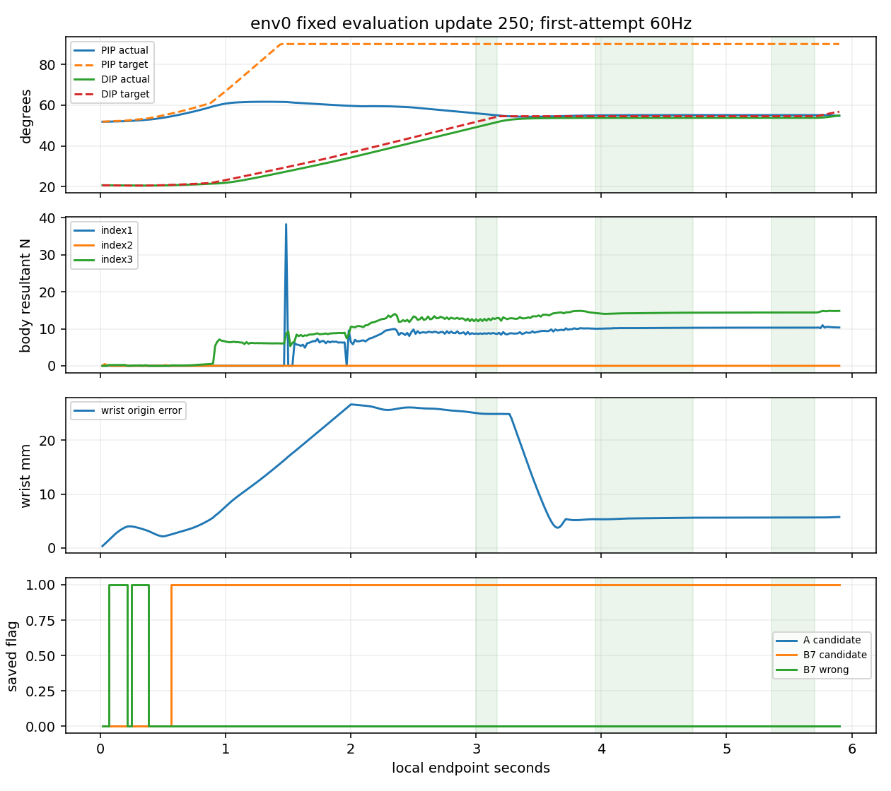
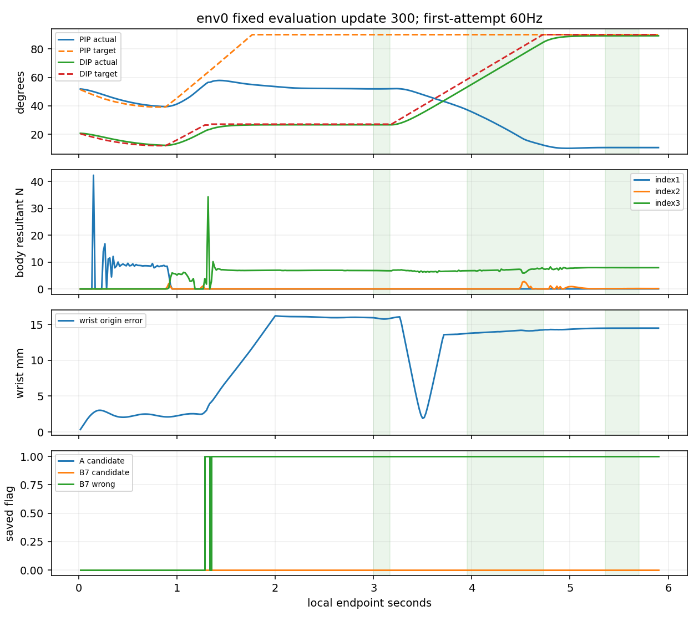

# 실제 학습 결과의 해석

**어느 저장 평가도 세 음을 모두 달성하지 못했다.** 원 음악·A 해제·AND 기준의 초기제외 인접2회 및200/250/300 후반유지는 모두 미달이다. best250은 사전순위의 상대적 최상위일 뿐 통과 모델이 아니다. latest300과 함께 공개한다.

| 반복 | A4/B7/B8 달성/각128 | all3/128 | A released/128 | 각음 평균clean | 각음 평균wrong |
|---:|---|---:|---:|---|---|
| 초기 | 0 / 0 / 0 | 0 | 0 | 0 / 0 / 0 | 0 / 1 / 1 |
| 50 | 0 / 0 / 0 | 0 | 0 | 0 / .075911 / 0 | 1 / .921432 / 1 |
| 100 | 0 / 128 / 128 | 0 | 0 | 0 / 1 / 1 | 1 / 0 / 0 |
| 150 | 0 / 128 / 128 | 0 | 0 | 0 / 1 / 1 | 1 / 0 / 0 |
| 200 | 128 / 0 / 0 | 0 | 0 | 1 / 0 / 0 | 0 / 1 / 1 |
| 250 | 0 / 128 / 128 | 0 | 0 | 0 / 1 / 1 | 1 / 0 / 0 |
| 300 | 128 / 0 / 0 | 0 | 0 | 1 / 0 / 0 | 0 / 1 / 1 |

100/150/250은 all3·평균clean·평균wrong·실패율이 같아 update 큰 순으로250이 선정됐다. best의 A는128환경 모두 clean0이고 env0 contact_progress도0이므로 해제0을 독립적인 **압현 후 해제 능력 실패**라고 해석하지 않는다. 200/300은 A를128/128·clean1로 달성했지만 원 native end..end+.10s 해제는0이다. 이 두 평가에서는 성공한 A의 제한된 원 해제 창을 충족하지 못한 것으로 구분할 수 있다. env0의 저장60Hz A candidate는 두 경우 모두 해제 창6끝점에서 남았다. 이 기록만으로 미저장240Hz의 연속성·피부 전체 분리를 새로 증명하지 않는다.

## 원시도·전이·보상과 비용

300업데이트·1,228,800 raw전이 가운데3456완료 episode/10,368음·1,223,424전이와 남은 열린5376전이를 구분했다. 완료 episode는 모두 timeline_complete이며 학습·896고정평가/2688음에서 물리·손목 실패는0이었다. 열린 전이를 완료 episode 점수의 분모에 넣지 않는다.

| 학습 update 구간 | 완료episode | A4/B7/B8 달성 | all3 | A native release |
|---|---:|---|---:|---:|
| 1~50 | 512 | 110 / 162 / 152 | 3 | 28 |
| 51~100 | 640 | 91 / 297 / 286 | 1 | 7 |
| 101~150 | 512 | 51 / 333 / 325 | 0 | 1 |
| 151~200 | 640 | 166 / 257 / 233 | 0 | 5 |
| 201~250 | 512 | 314 / 142 / 154 | 0 | 4 |
| 251~300 | 640 | 370 / 220 / 221 | 0 | 4 |
| 전체 | 3456 | 1102 / 1411 / 1371 | 4 | 49 |

확률적 학습의 all3 네 사례는 update23/env67,34/env26,45/env48,100/env126이며 모두 A released=False다. 첫/셋째 사례의 A clean은 약.710/.560이므로 all3 달성이 곧 각음clean≥.90은 아니다. 고정평가의0/896과 학습의4/3456을 혼합하지 않으며 학습49개의 release를 A달성1102개와 같은 코호트라고 간주해 조건부 비율을 만들지 않는다. 각 episode 원장과줄번호는 원 `train/episodes.jsonl`에 남아 있다.

실제 실패비용 합과 완료 episode 비용 합은 모두0이다. 비용 GAE 원분포·cost value loss·post-update critic value/target/MSE도300회 모두0이고, 분산0인 EV는 None으로 보존했다. 따라서 이번 3음 실패를 비용 예측기의 허위 신호 때문이라고 확정할 근거는 없다. 비용0 초기화가 전환 학습 성공을 보장하지도 않았다. 원9보상은 raw전이 합과 완료 episode 합을 따로 보존했고 원 평가 reward−9항 합 최대잔차는3.0409506734940805e-6이다. 보상을 음별로 재지급하지 않았다.

## 선택4축의 실제 움직임과 명령

정책은 첫 tick부터 선택4축을 직접 제어했다. 각 평가의 NN ctor1/reference_N_injected=False·새 계약/CPU 연결근거, 저장 policy/executed 선택4 행동 exact, 원 incremental codec와 guard 전후 target 재귀를 대조했다. 참고 precheck의128성공은 NN 점수에 합치지 않았다. 같은 seed7 fresh 모델의73초기값은 새 CPU 모델 및 이전 B 모델의73값과 일치했고 cost2는0이었다. 이는 CPU tensor 비교이며 구계약 strict로드 우회나 CUDA 난수열 동일성 검증이 아니다. 현재 계약의7 native strict평가는 별도 실행 근거다.

250 env0에서는 A음의 손목 오차가24.92mm이고 A candidate0/11, B7·B8 candidate가 A음 중 각각11/11로 이미 켜졌다. A의 index3 wrong 원인은 own-wrong-string11/11이며 실제 A clean/contact_progress0이다. B7/B8 음에는 원6gate가46/46·21/21 모두 통과하고 wrong0이다. B7/B8 손목 오차5.50/5.66mm, distal 순힘14.24/14.42N·proximal10.21/10.32N이 남았다. B8 PIP 실제55.15도/목표90.00도, DIP 실제53.80도/목표54.58도다. MCP z는 목표−30도/실제약9.10도로 추종 차이가 크다.

300 env0에서는 A candidate11/11·clean1이지만 해제 창6끝점과 이동26끝점에 A candidate가 계속 관측되고 B candidate0이었다. 해제·이동 구간에 PIP/DIP 음수 명령은0개였으며 MCP z의 음수 명령만6/26개였다. MCP z 목표가 이미−30도 하한이어서 해당 목표 음수증분은0이었다. 이동 중 실제 PIP는 약52.00→43.46도, DIP는27.68→42.98도로 바뀌었지만 PIP목표는90도였고 distal 순힘 평균6.57N이 남았다. 명령 부호나 PIP의 실제 감소를 피부 분리 또는 능동 해제 성공으로 바꾸어 부르지 않는다.

300의 B7/B8은 loaded46/46·21/21이지만 위치/방향/positive/candidate0이고 wrong은 전부였다. index3 own-wrong-string은46/46·21/21, own-wrong-fret은7/46·0/21로 재구성됐다. B7에는 A candidate46/46이 남았다. B7/B8 손목 오차14.03/14.49mm·distal6.999/7.914N이다. B8 PIP 실제10.68도/목표90.00도, DIP 실제89.22도/목표90.00도로 말미 마디 분담 문제가 다시 관찰됐다. body1 하중이0인 시점도 있어 distal 합력만으로 손 전체의 저하중을 인증하지 않는다.

현재목표는 원 end를 지나는 순간 다음 음으로 넘어가며 A end 이후에는 B7 candidate가 guard를 결정한다. 300은 B7/B8 candidate가 없어 해당 구간 DIP 양의 증분이 억제되지 않았다. guard는 A에서14,564 control을 억제했지만 B7/B8에서는0개였고, 250은 A0/B7 11,904/B8 7552개였다(각128첫시도 전체). 이는 설계된 현재목표 선택과 실제 관찰이며 새 guard나 gain 변경의 효과를 시험한 결과가 아니다. none행 wrong은 현재목표 통계에서 제외했고 전체 학습 guard 집계와 first-attempt sidecar를 혼합하지 않았다.

## 범위와 남은 문제

env0의 원6gate/candidate/wrong 재구성 불일치는0이며 nearest height/distance의1µm 초과 잔차도 없었다. 다른127환경 상세힘·nativeqd·native nearest sample/normalcos·240Hz 재접촉 수는 미저장이다. wrong flag는 원 CPU 기하의 원인 분류이지 접촉쌍·실제 현 압력 인증이 아니다. 선택관절의 목표−실제 차이를 단일 contactconstraint나 MCP coupling 원인으로 확정하지 않는다.

원67행/선택3음·354tick·공유 B7/8 press/release와 무음gap·PD/범위/4rad/s·0.25Nm/90쌍을 유지한 조건부 고정 기타 F4 진단이다. 참고 명령에서는 도달했지만 NN에서는 A와 B의 성공이 저장 시점별로 갈렸다. 어떤 새 보상·임계·범위·주입 동작도 이 분석에서 추가하지 않았다. 자유 기타/J33/원곡67음이나 자연스러움 해결·생산 채택으로 넘어갈 근거는 아직 없다.

