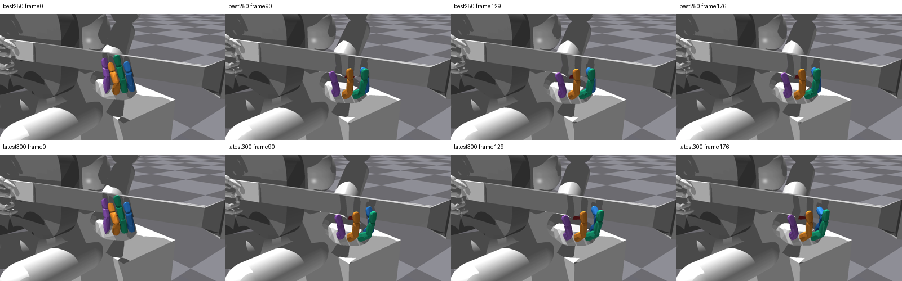
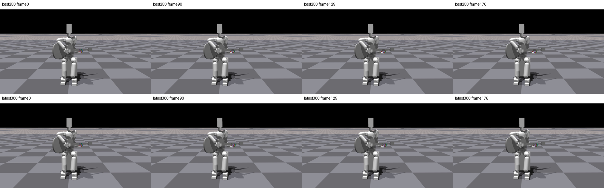

# 3음 prefix 정책 실제 영상 QA

| 모델 | 손 | 전신 |
|---|---|---|
| best250 | [손](/home/ajou/yigyu/3/docs/2026-10-27/guitar_learning_failure_diagnosis_v1/05_verified_fixes/low_effort_index_prefix_learning_v1/native_video_v1/runs/update_000250/hand.mp4) | [전신](/home/ajou/yigyu/3/docs/2026-10-27/guitar_learning_failure_diagnosis_v1/05_verified_fixes/low_effort_index_prefix_learning_v1/native_video_v1/runs/update_000250/fullbody.mp4) |
| latest300 | [손](/home/ajou/yigyu/3/docs/2026-10-27/guitar_learning_failure_diagnosis_v1/05_verified_fixes/low_effort_index_prefix_learning_v1/native_video_v1/runs/update_000300/hand.mp4) | [전신](/home/ajou/yigyu/3/docs/2026-10-27/guitar_learning_failure_diagnosis_v1/05_verified_fixes/low_effort_index_prefix_learning_v1/native_video_v1/runs/update_000300/fullbody.mp4) |

두 모델 모두 원 all3/release0인 진단용 실패 모델이다. 새3음 schema/PrefixPolicy fresh=False, 원본 checkpoint strict load·128cap.25/90쌍·staged wrist/current-goal guard이며 N 주입은 없다. 영상은 env0 첫시도만이고 전체128 영상이 아니다.
각 H264/1280×720/30fps/177프레임, 네 영상 총708프레임을 전부 CPU decode하고 16대표PNG/4sheet를 만들었다. frame n은 endpoint2(n+1), t0 frame은 없다. 0/90/129/176은 각각 시작/A음중/B7음중/마지막이다.
원 고정평가 대비 env0 raw 모든 공통필드 exact/최대차와9항 episode보상·전128 sidecar는 verification.json에 그대로 기록했다. qd·tick별 보상은 원 평가에 저장되지 않아 동일성 검산을 주장하지 않는다. evaluator fingerprint callback은 사용하지 않았다. 몸체합력은 쌍별압력·motor torque·240Hz 최대가 아니다.
색: 엄지 빨강, 검지 파랑, 중지 초록, 약지 주황, 소지 보라. 직접 시각검사와 넥/다른손가락 가림 한계는 VISUAL_QA.md, 통합독립검수는 review.json에 별도 기록한다. 자연스러움·해제·학습 성공·자유기타/J33 성공을 인증하지 않는다.

