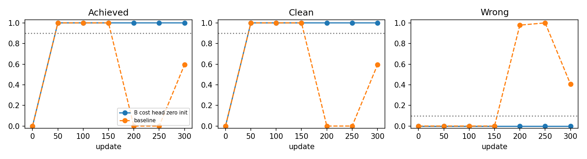
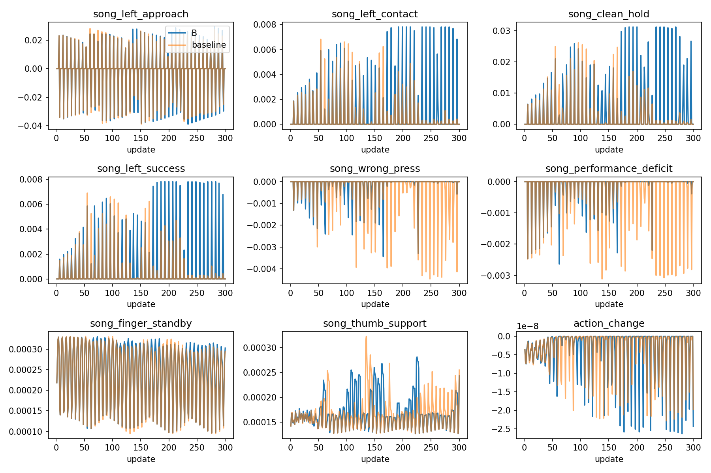
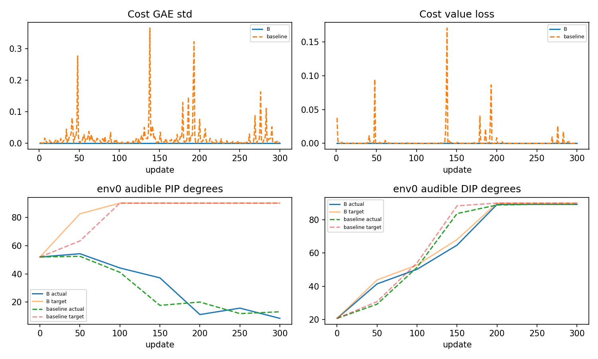

# B 비용 head 0 초기화: 실제 비교

B의 전체7평가 달성수는 [0, 128, 128, 128, 128, 128, 128]/128이다. 기존 연속 기준과 후반 유지기준을 아래에서 별도로 보고한다.

이 비교는 원 검지 seed7 설정/physics/PPO를 유지하고 fresh cost head 두 tensor만0으로 시작한 B다. B expected73과 baseline71exact+cost2zero를 각각 확인했다. 단일 seed의 통제 대조이며 자연성이나 보편 인과를 인증하지 않는다.

| update | baseline 달성/128 | B 달성/128 | B clean/wrong | B 물리/손목실패 | B 단일기준 |
|---:|---:|---:|---|---|---|
| 0 | 0 | 0 | 0.000000 / 0.000000 | 0.000000 / 0.000000 | False |
| 50 | 128 | 128 | 1.000000 / 0.000000 | 0.000000 / 0.000000 | True |
| 100 | 128 | 128 | 1.000000 / 0.000000 | 0.000000 / 0.000000 | True |
| 150 | 128 | 128 | 1.000000 / 0.000000 | 0.000000 / 0.000000 | True |
| 200 | 0 | 128 | 1.000000 / 0.000000 | 0.000000 / 0.000000 | True |
| 250 | 0 | 128 | 1.000000 / 0.000000 | 0.000000 / 0.000000 | True |
| 300 | 76 | 128 | 1.000000 / 0.000000 | 0.000000 / 0.000000 | True |

원 연속2음악기준: True, 통과쌍[[50, 100], [100, 150], [150, 200], [200, 250], [250, 300]]. 별도후반유지(200/250/300 모두원단일기준): True; baseline후반유지는False.
best=300/latest300, 영상후보[300]. 전체7평가/896첫시도와실패를포함했다. noNN precheck random31/128은재사용자료이며 NN initial과다르고 새384실행처럼합산하지않는다.

전체300회/1,228,800 raw전이·종료episode5504·남은open전이12416. 실제비용nonzero update0회, 실패/cost episode0건; costGAE/loss nonzero는0/0회다. 실제비용합0/완료episode비용합0를구분한다. truefailure이후학습을허위비용으로부르지않으며 원costhead는계속학습가능하다.

| B update | env0 음중끝점 | actual4° | target4° | 몸체1/2/3평균N | 손목mm/° | CPU6gate |
|---:|---:|---|---|---|---|---|
| 0 | 11 | 40.2451, 14.5353, 51.8931, 20.7519 | 40.5540, 24.8683, 51.8972, 20.7515 | 8.4745, 0.2431, 0.0000 | 1.6510, 0.4238 | [0, 11, 11, 0, 0, 0] |
| 50 | 11 | 37.0568, 16.5940, 54.2294, 41.4652 | 71.4611, 22.0381, 82.4705, 43.8523 | 7.0244, 0.0000, 4.6132 | 6.0182, 1.9806 | [11, 11, 11, 11, 11, 0] |
| 100 | 11 | 43.5301, 16.4600, 44.1573, 50.2372 | 85.6756, 8.7513, 90.0002, 52.7915 | 10.2962, 0.0000, 9.0601 | 4.9438, 1.5941 | [11, 11, 11, 11, 11, 0] |
| 150 | 11 | 37.9297, 9.6019, 37.1609, 64.7552 | 90.0002, -30.0000, 90.0002, 68.0924 | 0.9951, 0.0000, 7.5289 | 11.6357, 3.4574 | [11, 11, 11, 11, 11, 0] |
| 200 | 11 | 44.3530, 5.0849, 11.2245, 89.2000 | 90.0002, -30.0000, 90.0002, 90.0002 | 0.0000, 0.0000, 7.8748 | 13.1318, 3.5934 | [11, 11, 11, 11, 11, 0] |
| 250 | 11 | 45.0164, 7.9504, 15.7493, 89.2349 | 90.0002, -30.0000, 90.0002, 90.0002 | 0.0000, 0.0000, 8.0092 | 14.2791, 3.6984 | [11, 11, 11, 11, 11, 0] |
| 300 | 11 | 47.5874, 7.4295, 8.5215, 89.2113 | 90.0002, -30.0000, 90.0002, 90.0002 | 0.0000, 0.0000, 7.9778 | 16.5912, 3.8535 | [11, 11, 11, 11, 11, 0] |

cost critic value/target의 mean·std·min·max 또는MSE nonzero는0/300회이며 EV기록은{'None': 300}다. target분산0의EV None을성능값0으로바꾸지않는다. 7저장본head값은comparison에모두보존했고 평가fresh=False/strict복원경로를확인했다. baseline은실제비용0인데GAE/loss가300회nonzero였으며 B의비용추정경로차이와음악유지는이번조건의통제대조관찰이다.
B의KL재시도update는[250],LR변경은[{'update': 1, 'actor_lr': 3e-05}, {'update': 250, 'actor_lr': 7.5e-06}]다. cost초기화개입후같은seed설정에서후반퇴행이재현됐는지는전체표로판단하며 다른seed/조건의단일원인으로일반화하지않는다.

| 후반update | baseline PIP actual/target° | B PIP actual/target° | baseline DIP actual/target° | B DIP actual/target° | B target4 상한/하한 음중끝점 |
|---:|---|---|---|---|---|
| 200 | 20.0636, 90.0002 | 11.2245, 90.0002 | 88.8796, 90.0002 | 89.2000, 90.0002 | [(11, 0), (0, 11), (11, 0), (11, 0)] |
| 250 | 11.8876, 90.0002 | 15.7493, 90.0002 | 89.2549, 90.0002 | 89.2349, 90.0002 | [(11, 0), (0, 11), (11, 0), (11, 0)] |
| 300 | 13.1780, 90.0002 | 8.5215, 90.0002 | 89.2157, 90.0002 | 89.2113, 90.0002 | [(11, 0), (0, 11), (11, 0), (11, 0)] |

B300 env0음중 PIP actual8.52155°/target90.00019°(차81.47864°), DIP actual89.21126°/target90.00019°다. MCPz target-30.00000°이며 몸체3합력평균7.97780N·손목평균16.59123mm/3.85352°가남는다. 음악기준유지가큰목표추종차이·마지막관절극단굴곡을해결했다는뜻은아니다. 상한/하한분류1e−6rad는보고수치허용이며성공문턱변경0이다.

선택4상한최초시각/팔bounds·request/target/actual은comparison.json, 전체128원9보상·각도원장은attempts.csv,300회advantage/critic/value/target/MSE/EV·entropy/ratio/KL/LR는metrics300.csv에보존했다. 후반PIP/DIP 목표와실제차이를 비용추정결과와별개로읽어야한다.

env0은사전고정첫시도의60Hz끝점이며나머지127의힘/기하원인을대변하지않는다. 몸체합력은압력·접촉쌍·모터torque·240Hz극값이아니다. nearest잔차/CPUcandidatewrong불일치는verification에그대로남기며원음원장을재분류하지않는다. 미노출·비유한trace는미확인으로남긴다.

원native105/16cap/90pairs·8scene닫기·실제strict평가/입력SHA/alias·Btag를검증했다. CPU에서는model-only73/71/2비교와identity를확인했으며 CUDA RNG full-load를우회하거나학습을재개하지않았다. 고정기타단음결과를해제/다음음/자유기타/J33 성과로확대하지않는다.

