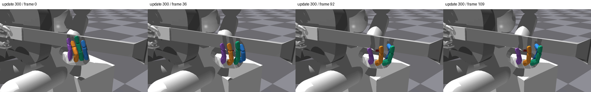
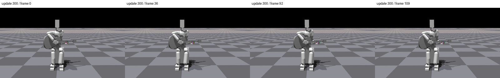

# 검지 실제 영상 확인

독립 검수된 B 고정평가의 사전 순위에 따라 선택한 모델과 최종300회 모델이다. 영상은 동일128장면의env0첫시도다. 전체128 성과는 비교 분석 원장을 따른다.

| 모델 | 손 | 전신 |
|---|---|---|
| 300 | [손](/home/ajou/yigyu/3/docs/2026-10-27/guitar_learning_failure_diagnosis_v1/05_verified_fixes/low_effort_index_zero_cost_init_v1/native_video_000300/hand.mp4) | [전신](/home/ajou/yigyu/3/docs/2026-10-27/guitar_learning_failure_diagnosis_v1/05_verified_fixes/low_effort_index_zero_cost_init_v1/native_video_000300/fullbody.mp4) |

선정된영상h264/1280×720/30fps/110프레임·전체디코딩을확인했다. 원renderer의모델불변/strictload/105native/90쌍/입력·장면종료검사를재확인했고프레임은control endpoint2*(n+1)에해당한다. 비교수치와원장/SHA는verification.json에있다. 몸체합력은접촉쌍압력이나240Hz최대가아니며음성인증은없다.

자세·구도는추출이미지를직접보고독립검수한뒤확정한다.
