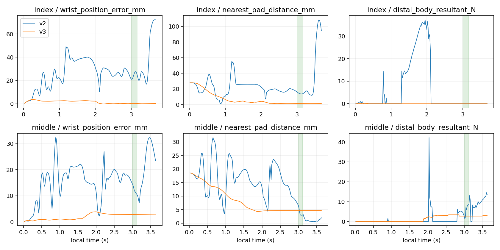

# 실제각 후보 v3와 직전 손목 Jacobian v2 비교

**v3는 검지 reference의 손목 추종을 크게 개선했지만, 검지·중지의 reference/zero/random은 모두0/4다. 손목 기준 도달과 압현 판정은 여전히 분리된다. 중지 reference의 전체4시도 wrong은100%다.**

같은 seed7·teacher/reference·4환경 첫 시도의 비교다. settings와 training contract 차이는 wrist_control뿐이며 실제 초기73 tensor는 손가락별로 전부 일치한다. scripted/zero/initial random 대조이며 학습성과가 아니다.

| 버전 | 손가락 | 조건 | 달성/4 | clean | wrong | 물리/손목 실패 |
|---|---|---|---:|---:|---:|---:|
| v2 | index | reference | 0 | 0.00% | 0.00% | 0/0 |
| v2 | index | zero | 0 | 0.00% | 0.00% | 0/0 |
| v2 | index | random | 0 | 0.00% | 0.00% | 0/0 |
| v2 | middle | reference | 0 | 0.00% | 75.00% | 0/0 |
| v2 | middle | zero | 0 | 0.00% | 0.00% | 0/0 |
| v2 | middle | random | 0 | 0.00% | 0.00% | 0/0 |
| v3 | index | reference | 0 | 0.00% | 0.00% | 0/0 |
| v3 | index | zero | 0 | 0.00% | 0.00% | 0/0 |
| v3 | index | random | 0 | 0.00% | 0.00% | 0/0 |
| v3 | middle | reference | 0 | 0.00% | 100.00% | 0/0 |
| v3 | middle | zero | 0 | 0.00% | 0.00% | 0/0 |
| v3 | middle | random | 0 | 0.00% | 0.00% | 0/0 |

아래는 reference의 음 중 env0 저장60Hz 끝점 통계다. 손목·거리·힘·cosine은 중앙값이며 전체4환경의 대표값이나240Hz 극값이 아니다.

| 버전/손가락 | 끝점 | 손목 mm/도 | postramp 위치max mm | nearest mm | nearest cosine | distal N | loaded/위치/위치+facing/positive/candidate/wrong |
|---|---:|---:|---:|---:|---:|---:|---|
| v2/index | 11 | 25.0985/8.1363 | 72.2585 | 13.9747 | 0.8740 | 0.0000 | 0/0/0/0/0/0 |
| v2/middle | 8 | 11.7724/6.8993 | 32.3044 | 3.0376 | 0.7866 | 6.6984 | 8/0/0/0/0/8 |
| v3/index | 11 | 0.2049/0.0409 | 2.2493 | 1.3525 | 0.9857 | 0.0000 | 0/11/11/0/0/0 |
| v3/middle | 8 | 2.8083/2.2545 | 3.8862 | 4.6532 | 0.9382 | 2.6972 | 8/0/0/0/0/8 |

v3 reference의 선택4축(1_x·1_z·2·3) 음 중 env0 중앙값은 다음과 같다.

| 손가락 | actual q (도) | native target (도) |
|---|---|---|
| index | 36.741, 17.461, 54.485, 24.068 | 39.307, 27.756, 54.485, 24.068 |
| middle | 62.825, 13.554, 56.358, 2.192 | 64.175, 11.367, 56.954, 2.467 |

검지 reference env0 음 중11끝점은 위치11/11·위치+facing11/11이지만 loaded0/11이고 distal 합력 min/median/max가 모두0N이다. 이 저장 범위에서는 facing보다 하중 gate 부재로 positive0을 분리할 수 있다. 선택1_x·1_z의 target−actual 중앙값은 각각 2.5655°·10.2946°로 손가락 추종 오차도 남는다. 손목 도달만으로 손가락 압현이 해결됐다고 할 수 없으며, 이 각도 오차를 하중 부재의 단독 원인으로 확정하지 않는다.

중지 reference env0 음 중8끝점은 loaded8/8이지만 목표 any-sample 위치0/8·positive0/8·wrong8/8이다. 원 wrong source helper는 middle3의 own_wrong_string을8/8, source fret 범위7..7로 기록했고 other_higher·own_wrong_fret는0이었다. 이 flag는 기하·하중 후보 분류이며 실제 접촉상대나 잘못 누른 현 번호를 인증하지 않는다. nearest 높이 중앙값 3.2600mm와 cosine 0.9382는 참고값이며 독립 최근접 표본 하나를 any-sample 위치 실패의 단독 원인으로 사용하지 않는다.

v3의 기록 후보→clip(candidate−proposal)→원 request rate/bounds→executed action decode→native alpha.2/rate/bounds를6trace에서 재구성했다. 최대절대 잔차는 2.23e-07 rad다. k>=1 precontrol q/body는 직전 끝점이며 첫 inactive reset은 candidate=proposal·delta0으로 따로 확인했다. v2 delta에는 이 recurrence를 적용하지 않았다. 후보는 unclipped 가상 관절 위치이며 새 J 캡처나 실제 후보 도달을 주장하지 않는다.

전체48시도는 모두 timeline_complete였고 음악 수치는 원래240Hz 음 원장이다. 조기 실패가 발생해도4분모에 포함하는 원래 할당을 유지했다. 같은 seed7의 병렬4환경이므로 독립4seed로 해석하지 않는다. gate는 각 env0 저장60Hz 끝점만 현재 ShortEnvironment._snapshot→원 contact helper로 재생했다. 위치 gate와 위치+facing을 구분하며 nearest cosine/거리 표본을 any-sample witness로 쓰지 않았다. JSON은 음 전·중·후/postramp 선택각·target/actual gap·표면·합력과 원 wrong source flags/fret 범위를 포함한다.

몸체 합력은 현별힘·압력·접촉상대·음향·인과 인증이 아니다. joint qd는 저장되지 않아 CPU 기하 재생에서만0이며 body velocity는 보존했다. 손목 도달 오차 감소를 압현 성공이나 단독 원인 해결로 확대하지 않는다. teacher·목표·문턱·관측·보상·범위는 바꾸지 않았다. 중지 과거128이나 다른 손가락 성과는 비교하지 않는다.

verification.json은 새700핀·원 archive521 byte/SHA·과거 pin별 verified_at 매핑·24scene 종료·초기73 tensor·settings/contract 차이·원자료 SHA를 기록한다. 과거 checkpoint는 CPU tensor 비교로만 읽었고 현 strict loader를 우회해 재개/평가하지 않았다. GPU/native 추가 실행은0이다.
