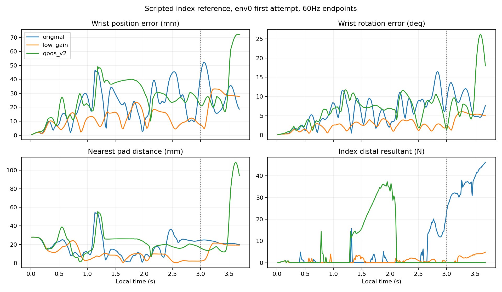

# 손목 위치 미분 보정 뒤 검지 실제 비교

좌표 오류의 최소 수정은 구현/독립 검수를 통과했지만 **검지 압현은 해결되지 않았다.** 새 GPU 실행4단계는 실제 종료0·103.875초다. 새 initial의73개 모델 tensor가 원래 initial과 모두 같고, 평가 세조건은 새 initial만 strict load했다. 각4환경 전체 첫시도를 실패 포함 평가했으며 reference/zero/random 모두0/4, clean0·오압현0·물리/손목 종료0이었다. bootstrap의1회 학습된 final은 사용하지 않았다.

기존0.5도·기존0.1도·새 qpos-J0.5도의9조건36시도를 비교했다. 아래는 **reference env0 음 구간11개60Hz 끝점의 중앙값**이다. 전체4환경의 압현 결과와 추적 표본을 구분한다.

| 지표 | 기존0.5도 | 기존0.1도 | qpos-J v2 0.5도 |
|---|---:|---:|---:|
| 달성/4 전체 첫시도 | 0/4 | 0/4 | 0/4 |
| 손목 위치 오차 mm | 47.60 | 7.42 | 25.10 |
| 손목 회전 오차 도 | 12.11 | 2.13 | 8.14 |
| 팔 목표−실제 최대축 오차 도 | 15.48 | 2.07 | 12.62 |
| 팔 요청−제출목표 최대축 오차 도 | 2.00 | 0.40 | 1.98 |
| 최근접 목표 패드 거리 mm | 24.64 | 4.06 | 13.97 |
| 검지 distal 몸체 합력 N | 30.99 | 0 | 0 |
| position / loaded / positive 끝점수 | 0 / 11 / 0 | 4 / 1 / 0 | 0 / 0 / 0 |

v2에서 손목/패드 거리는 원래0.5도보다 작지만 목표에 도달하지 못한다. 음 구간의 position과 loaded가 모두0이다. index1_z의 목표−실제 차이도 중앙11.03도로 남는다. 이를 가동범위 부족이나 특정 충돌쌍 때문으로 확정할 자료는 이번에 없다.

2초 뒤 전체102끝점에서 v2 손목 위치 오차는 중앙26.61mm·최대72.26mm, 회전은 중앙8.01도·최대26.16도였다. 팔 목표−실제 최대축 차이는 중앙12.71도·최대26.50도다. 파형은 정착해서 한 방향으로 접근하는 형태가 아니며 말미에 오차가 커진다. 짧은 episode의 종료0을 안정 도달이나 장시간 안전으로 해석하지 않는다.

이번 결과는 좌표 수정만으로 남은 추종 문제가 해소되지 않음을 보여준다. 기존0.1도도 도달/부하가 동시에 성립하지 않아 채택하지 않는다. 새 gain을 계속 탐색하거나 음 시간을 늘리지 않고, 실제 오차를 누적 목표에 더하는 feedback과 물리 추종 지연을 다음으로 분리한다. 현재 source/기존 결과는 동결하고 중지·약지·소지 회귀를 먼저 확인한다. 장기 RL 재시작이나 기본 J33 보상 수정의 근거로 삼지 않는다.

`verification.json`은 과거 실행 입력의 변경된3소스를 보관된519원문에서 SHA로 검증한다. 과거 checkpoint를 현재 코드에 strict load한 결과가 아니다. 새 실행은 준비봉인686개와 런타임 bootstrap688개·각 평가689개 입력 검증 및 모델 불변·업데이트0·4환경 전체 시도·scene종료가 모두 통과했다. reference/zero의 RNG는 불변, random은 원래 sampling의 RNG 소비를 기록했다. 판정은 원래240Hz 원장이며 표의 기하/힘 추적만 env0/60Hz다. 힘은 몸체 합력이며 접촉쌍 압력이나240Hz 최대 힘이 아니다.

독립 실제 분석 검수 PASS. 별도 review.json/REVIEW.md에 원자료·계산 재현과 최종 SHA를 기록한다. 자유 기타·학습된 정책·손가락별 학습·음 전환·전곡 성과는 이번 비교 범위가 아니다.
