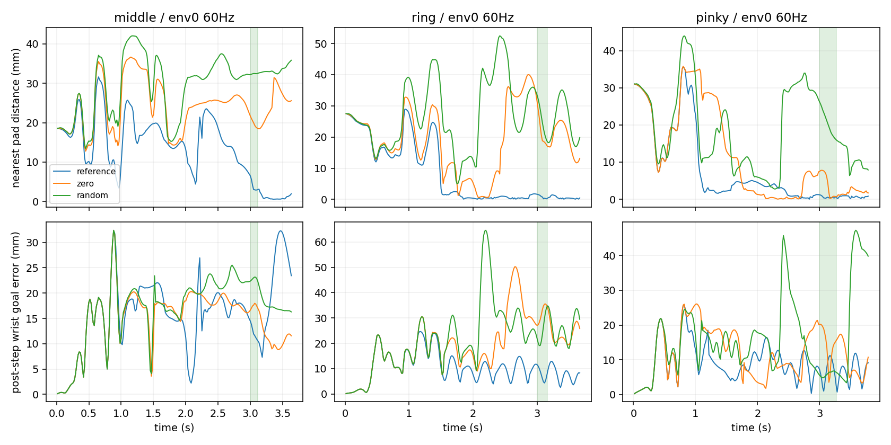

# 손목 qpos-J v2 중지·약지·소지 실제 회귀

**reference 달성은 중지0/4·약지4/4·소지3/4다. zero는0/4·0/4·1/4, random은0/4·0/4·1/4다. 모든36시도는 물리/손목 실패 없이 timeline_complete로 끝났다. 손목 미분 교정만으로 모든 손가락의 기준 압현이 해결되지는 않았다.**

이번 고정 기타/팔 teacher 조건의 새 initial scripted·zero·random 9조건36첫시도만 보고한다. bootstrap final.pt는 사용하지 않았다. 과거 중지128 또는 약지/소지 구버전과 비교하지 않는다.

| 손가락 | 조건 | 달성/4 | clean | wrong | 물리/손목 실패 |
|---|---|---:|---:|---:|---:|
| 중지 | reference | 0 | 0.00% | 75.00% | 0/0 |
| 중지 | zero | 0 | 0.00% | 0.00% | 0/0 |
| 중지 | random | 0 | 0.00% | 0.00% | 0/0 |
| 약지 | reference | 4 | 100.00% | 0.00% | 0/0 |
| 약지 | zero | 0 | 0.00% | 14.74% | 0/0 |
| 약지 | random | 0 | 0.00% | 11.54% | 0/0 |
| 소지 | reference | 3 | 68.76% | 0.00% | 0/0 |
| 소지 | zero | 1 | 45.32% | 6.63% | 0/0 |
| 소지 | random | 1 | 27.69% | 4.29% | 0/0 |

아래는 reference의 음 중 env0 저장 끝점이다. 거리·손목·힘은 중앙값이며 전체4환경 대표값이 아니다.

| 손가락 | 끝점 | loaded / 위치 / 위치+facing / positive / candidate / wrong | nearest mm | 손목 mm / 도 | distal 합력 N |
|---|---:|---|---:|---:|---:|
| 중지 | 8 | 8 / 0 / 0 / 0 / 0 / 8 | 3.04 | 11.77 / 6.90 | 6.70 |
| 약지 | 10 | 10 / 10 / 10 / 10 / 10 / 0 | 0.83 | 7.32 / 3.17 | 19.34 |
| 소지 | 17 | 17 / 17 / 17 / 17 / 17 / 0 | 0.46 | 7.16 / 2.60 | 5.13 |

중지 reference는 전체4시도의 평균 wrong이75%이며 clean은0이다. env0 음 중8끝점은 loaded8이지만 원래 any-sample 위치 gate0, positive/candidate0, wrong8이었다. nearest거리 약3mm만으로 원래 유한 위치 조건 통과를 주장할 수 없으며 이 요약만으로 오압현의 손가락·줄·프렛 원인이나 접촉의 인과를 확정하지 않는다. 약지/소지 reference env0의 positive/candidate 통과를 전체4개 시도의 성공으로 확대하지 않았다.

선택4축 순서는1_x·1_z·2·3이며 다음도 reference의 음 중 env0 중앙값(도)이다.

| 손가락 | actual q | native target |
|---|---|---|
| 중지 | 63.42, 14.85, 56.85, 2.43 | 64.18, 11.37, 56.95, 2.47 |
| 약지 | 53.50, 16.30, 87.35, -5.01 | 56.65, 15.26, 89.62, -4.49 |
| 소지 | 86.81, -9.77, 24.67, -2.93 | 87.94, -10.37, 25.31, -2.65 |

각 조건4환경 전체 첫 시도를 실패 포함 분모로 사용했다. 음악 지표는 원래240Hz 음 원장이며, gate/자세/힘은 env0의 저장60Hz 끝점만 재검산했다. JSON은 음 전·중·후의 선택4 실제/목표각과 차이·손목 위치/회전 오차·nearest 거리/높이·distal 합력 및 loaded/any-sample geometry/facing/positive/candidate/wrong를 포함한다.

손목 오차는 post-step body pose와 같은 tick에 저장된 G목표의 차이다. nearest 패드 값은 독립 최근접 표본이며, positive는 같은 한 표본의 원래 위치·facing·loaded gate다. facing gate는 위치 조건도 포함하므로 방향 단독 실패로 해석하지 않는다.

몸체 합력은 현별힘·접촉상대·압력·음향 또는 인과기여 인증이 아니며 전체4환경/240Hz 극값으로 확대하지 않는다. loaded gate는 원래 허용 패드 몸체 기준이며 distal 합력 하나와 동일하지 않다. JSON에는 finger2와distal 각각의 합력 표본도 기록했다. joint qd는 미저장이라 CPU 기하 재생에서만0을 사용했고 저장 body velocity는 유지했다. candidate/wrong/거리/높이는 현재 ShortEnvironment._snapshot→_contacts→pad_target_geometry·wrong_press_sources로9trace 총1,995끝점에서 재현했다. 이 helper들의 현재 SHA가 실제 각 실행 입력핀과 일치한다.

소지 zero가 성공하더라도 손가락 학습 증거가 아니다. finite 팔/손목 teacher·엄지035·다른 손가락B가 함께 존재한다. 이번 scripted 대조를 전곡·자유 기타·일반 도달/학습성과로 확대하지 않는다. validation.json은 launcher/12scene/현재 source와settings/실제 initial73hash/준비봉인 검증 및 원자료 SHA를 기록한다. CPU 분석에서 새 GPU/native 실행은 없다.
