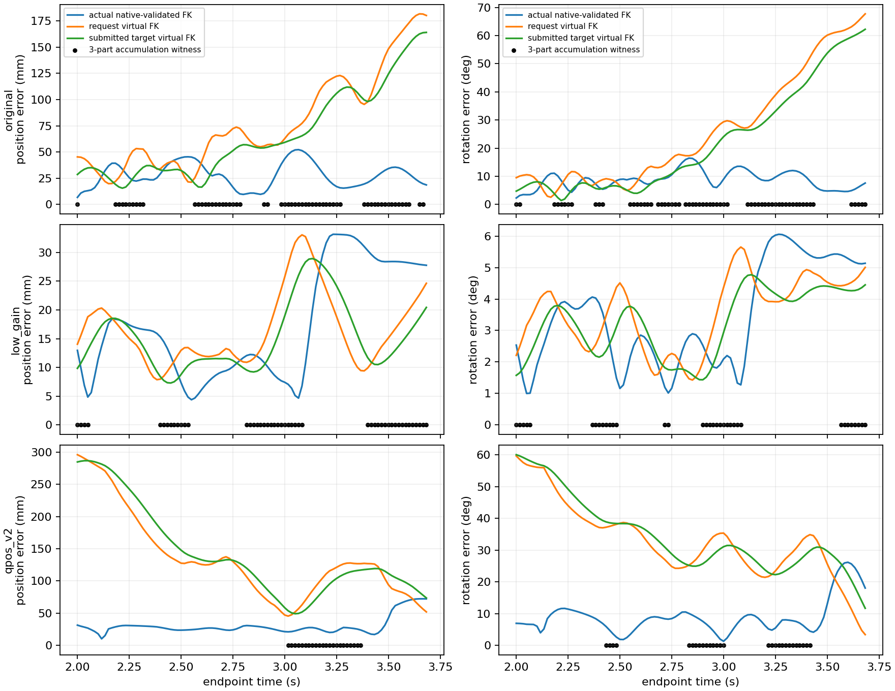

# 실제 추종 지연과 누적 손목 요청의 분리

**가상 요청이 이미 목표의 반대쪽에 있는데도 실제 손목 오차 방향으로 요청을 더 누적하는 표본이 세 조건 모두에 있다.** qpos-J v2에서도 위치22/102·회전28/102끝점에서 사전 정의한 세 조건이 함께 성립했다. 실제 pose 오차를 누적 request에 반복 더하는 구조의 추가 진단 근거다. 이 관찰만으로 실제 지연의 원인이나 압현 실패의 단독 원인을 확정하지 않는다.

대상은 original0.5°·lowgain0.1°·qpos-J v2 0.5°의 **index_reference env0**다. 각221전체 끝점에서 actualq→full_fk 손목 pose를 native pose와 비교했고 최대오차는3.378e−7m·9.348e−7rad였다. 아래 통계는2초 이상102끝점을 빠짐없이 사용했다. 첫2초 endpoint의 feedback은 직전1.983333초 상태에서 계산됐으므로, 완전히 ramp 이후인 누적식 검산은 나머지101전이로 별도 구분했다. 모든 trace는60Hz다. 원래 reference 평가4시도씩의 달성0/4·clean0·wrong0·물리/손목 종료0을 유지하며 이 env0 관찰을4환경 전체 tracking으로 확대하지 않는다.

## 실제 오차와 가상 목표 오차

각 끝점에서 nonarm q는 **실제 q 그대로** 두고 arm12만 저장된 requested angle 또는 submitted target으로 바꿔 FK를 계산했다. 이 두 곡선은 **요청각/목표각의 가상 FK**다. 실제 native 실현·충돌 가능·평형·도달가능성을 뜻하지 않는다. 손가락 MCP의 누락 회전축 문제에도 적용하지 않고 손목만 비교했다.

아래 값은 각102끝점 중앙값이다. 위치는mm, 회전은도다.

| 조건 | 실제 위치 | 요청 가상 위치 | 제출목표 가상 위치 | 실제 회전 | 요청 가상 회전 | 제출목표 가상 회전 |
|---|---:|---:|---:|---:|---:|---:|
| original0.5° | 26.57 | 64.37 | 54.86 | 8.69 | 17.68 | 13.97 |
| lowgain0.1° | 15.25 | 14.42 | 13.36 | 3.02 | 3.92 | 3.52 |
| qpos-J v2 | 26.61 | **126.44** | **119.25** | 8.01 | **32.20** | **30.66** |

| 조건 | 요청−실제 최대축 차 중앙(°) | 제출목표−실제 최대축 차 중앙(°) | 요청−제출목표 최대축 차 중앙(°) |
|---|---:|---:|---:|
| original0.5° | 11.33 | 9.33 | 1.98 |
| lowgain0.1° | 1.78 | 1.44 | .40 |
| qpos-J v2 | 13.30 | 12.71 | 1.97 |

v2는2초부터 요청 가상 오차가296.08mm·59.64°로 크다. 말미에는51.94mm·3.38°로 줄지만 실제 오차는31.35mm·6.93°에서72.20mm·18.04°로 늘었다. **v2 전 구간의 요청 오차가 단조 증가한다는 결과는 아니다.** 반면 original의 요청 가상 위치 오차는2초45.34mm에서말미180.13mm로 커졌다. lowgain은 요청−실제 간격이 작지만 실제 도달/압현을 해결하지 못했다. old 두 조건은 이미 확인된 native-velocity/qpos Jacobian 좌표 혼용도 포함하므로 신구 차이를 gain 또는 누적식 하나의 인과효과로 해석하지 않는다.

## 목표 반대편에서도 같은 방향으로 더하는가

선택편향을 피하기 위해 세 조건을 분석 전에 PLAN에 남겼다. feedback[k]의 실제 상태는[k−1], goal은[k]를 사용했다. 이전 요청/새 요청의 가상 FK에도 동일한 precontrol nonarm actualq를 사용해 다른 관절의 시간 변화를 제거했다.

위치에서 `ea=goal−actual`, `er=goal−old_request_FK`, `dp=new_request_FK−old_request_FK`로 두고 다음을 따로 센다.

1. `ea·er<0`: 요청이 실제 goal-error 축을 따라 목표 반대 halfspace에 있음.
2. `ea·dp>0`: 현재 요청 증분이 아직 실제 오차의 보정 방향으로 향함.
3. 새 요청 가상 FK의 goal 거리가 이전 요청보다 증가함.

세 조건의 교집합이 누적 증거다. 회전은 같은world Log-error 및 `Log(Rnew Rold⁻¹)`로 동일 부호와 goal 각거리 증가를 계산했다. 회전의 전역 직선통과를 뜻하지 않는다. 임의 크기 문턱이나 새 성공 gate는 사용하지 않았다.

| 조건 | 위치 반대 halfspace | 위치 계속 실제오차 방향 | 위치 가상거리 증가 | 위치 세조건 교집합 | 회전 세조건 교집합 |
|---|---:|---:|---:|---:|---:|
| original0.5° | 78/102 | 92/102 | 69/102 | **60/102** | **63/102** |
| lowgain0.1° | 52/102 | 100/102 | 57/102 | **48/102** | **35/102** |
| qpos-J v2 | 33/102 | 95/102 | 32/102 | **22/102** | **28/102** |

완전한 post-ramp101전이에서는 위치/회전 교집합이 original59/62,lowgain47/34,v2 22/28이다. v2 위치 교집합의 최초 끝점은3.016667초, 회전은2.433333초다. 위치 증거 하나만으로6D 목적 전체가 악화됐다고 해석하지 않는다. 자료 확인 후의 추가 요약으로 **위치와 회전 두 교집합이 동시에 성립하는 끝점**도 세었고 original41·lowgain30·v2 10개였다(v2최초3.216667초). 이 추가 요약은 사전 선언된 별도 release/성공 결과가 아니다.

## 누적식·필터·지연의 구분

ramp가 끝난101전이의 요청은 `request[k]=clip(request[k−1]+stored_delta[k],bounds)`로 최대1.173e−7rad 이내 재현됐다. 매 끝점 적어도 한 축의 raw delta가 각 조건의 기존 .5°/.1° cap에 닿았다. 2초경계 요청 증분에는 마지막 feedforward ramp분이 더해지므로 raw delta cap과 요청 증분을 혼동하지 않는다.

제출목표는 기존 alpha.2와3rad/s rate를 적용한 `old_target+.2*(request−old_target)`의 rate/bounds clip으로 최대9.550e−8rad 이내 재현됐다. 요청/제출목표 rate 초과는0이다. 일정 .5°증분이 계속될 때 alpha.2 필터의 정상 요청−목표 간격은 `(1−alpha)/alpha×.5°=2°`이며, 관측된 약1.98°와 같은 규모다(.1°에서는.4°). 이 필터 간격과 v2 제출목표−실제 최대축 중앙12.71°는 별도 단계다. 전자를 없애면 후자가 해결된다고 결론 내릴 수 없다.

저장 feedback pose error도 precontrol FK/nextgoal로 최대2.951e−7 이내 재현했다. 이 수치는 world 위치m와0.1×회전rad가 합쳐진 저장6열의 element오차다. 모든 증분 방향은 qpos 요청의 유한 FK차로 계산했으며 native velocity Jacobian에 qpos 증분을 곱하지 않았다. 손목 원점 pose만 사용해 COM 속도 변환은 필요 없고, native COM 속도를 위치 오차에 섞지도 않았다.

## 다음 최소 비교안 — 이번에는 구현하지 않음

현재 qpos-J v2를 대조로 두고, 원래 reference/초기모델/시간/PD/범위/보상/실패/가중치·damping을 유지한 유한 비교가 타당하다. 근거는 누적 요청과 실제 상태의 불일치를 직접 관찰했다는 데 있다.

- **이전 요청의 가상 FK에서 feedback 계산:** actual nonarm을 유지한 virtual request q에서 goal error와 같은 qpos Jacobian을 함께 구해 원래 bounded delta를 누적한다. 요청 자체가 어디를 향하는지 보지만 actual이 지지/충돌 때문에 따라오지 못하는 문제에는 무감각할 수 있다. 제출목표 FK를 쓰는 변형도 필터 단계를 분리하는 후보이며 아직 선택하지 않는다. 가상 q에서의 Jacobian은 실제 snapshot의 nativeJ를 그대로 가져올 수 없으므로 일관된 FK 미분이 추가로 필요하다. 이 점에서 아래 actual 기준 후보보다 구현 범위가 크다.
- **actual 기준의 위치 후보 생성:** `q_candidate=actual_arm+Jq(actual)# full_pose_error`를 만든 뒤, previous_request에서 이 후보까지의 변화에 기존 .5°/tick·범위·기존 rate를 적용한다. actual에 즉시 대입하거나 native state를 덮어쓰는 방법이 아니다. 현재처럼 raw delta만 clip해 무조건 누적하는 식과 달리, 오래 앞서간 request를 actual 기반 후보 쪽으로 유한하게 되돌릴 수 있다. correction/previous_request 메모리는 실제 제출 요청과 일치시켜야 한다.

어느 쪽도 유효성·도달 개선·저하중을 보장하지 않는다. 가상 FK가 충돌 제약을 고려하지 않으므로 native 단일 대조가 필요하다. 이후에도 actual/request/submitted goal 오차·전체 실패 포함 성과·원래 bounds/rate를 함께 관찰해야 한다. 새로운 gain탐색·임의 lead 문턱·힘 cap·보상/종료 변경은 제안하거나 구현하지 않았다. 물리 lag가 PD/제약/접촉/자세 결합 중 무엇 때문인지도 이번 자료로 분해하지 못한다.

입력 SHA와 기존 archive/source 검증 참조는 `verification.json`, 전체 통계는 `measurements.json`,102끝점의 벡터·부호·곡선은 세 `*_curves.npz`에 있다. 원래 실행 봉인·raw·active source를 수정하지 않았고 GPU/native 실행은0이다. 이 관찰은 자유손 압현·힘/접촉쌍 압력·MCP·전곡 개선을 입증하지 않는다. 독립 검수는 후속 기록에 남긴다.
