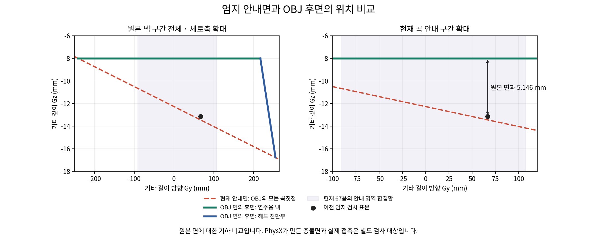

# 왼손 학습 실패 진단 v1

## 현재 결론: 목표각 탐색의 접촉 유지 취약성과 해제 여유가 미해결

신경망 없는 성공 참고 동작도 현재 후보 목표각 잡음에서 세음 전체128/128→2/128로 감소했다. DIP 보호만 꺼도 NN 확률평가의 전체 달성은10/128로 같았다. 따라서 신경망 근사나 보호 하나만을 원인으로 볼 수 없으며, 장기학습 전에 **distal 안쪽128표본의 해제 이격 여유와 탐색의 물리 단위**를 확인한다. [참고 잡음 비교의 실제 분석·독립검수 PASS](05_verified_fixes/index_prefix_reference_noise_v1/analysis/results_v1/REVIEW.md)다. 아래 고정기타 진단과 자유기타 전곡 성과를 구분하며 기본학습은 변경하지 않았다.

선택 검지4축의 출력을 목표각으로 바꾼 모델은 같은1000회 지도학습에서 세 음 전체 달성이 **91→126/128**로 개선됐다. 음별126/128/128·평균clean98.26%/98.31%/100%·오압현/물리·손목실패0으로 음악 기준은 통과했지만, 첫 음 A 해제는73/128(57.03%)로 다음 단계 기준에 미달했다. [실제 분석·독립 검수 PASS](05_verified_fixes/index_prefix_goal_codec_v1/analysis/results_recovery_v1/INTERPRETATION.md).

후속으로 손실만 실제각도 rad² 오차로 바꾼 비교는 세음 전체109/128·해제31/128로 후퇴했다. fit/evaluate 모두 정상 종료했으며 [실제 분석 독립검수도 PASS](05_verified_fixes/index_prefix_goal_angle_loss_v1/analysis/results_v1/REVIEW.md)다. 이 변경은 채택하지 않으며 추가fit·100PPO·자유기타/J33 확대도 시작하지 않았다.

| 조건: 각각 NN-only128시도 | A4/B7/B8 달성 수 | 세 음 전체 | A 해제 | 물리/손목 실패 |
|---|---|---:|---:|---:|
| 참고 요청1000회 초기값 | 113/95/91 | 91 | 67 | 0/0 |
| 같은 자료만 추가1000회 | 27/7/11 | 0 | 52 | 0/0 |
| 저장NN상태 교정자료를 섞어 추가1000회 | 51/76/76 | 0 | 1 | 0/0 |
| 목표각 출력1000회·원종료오류 별도회복 | 126/128/128 | 126 | 73 | 0/0 |
| 목표각·실제각도 손실1000회 | 126/110/111 | 109 | 31 | 0/0 |

각 조건의 분모·학습량·초기값 차이를 보존한다. 추가1000회 두 조건은 원incremental1000회 모델에서 이어 학습했고, 목표각 두 조건은 같은 원fresh 값에서 각각1000회만 학습했다. 지도학습과 PPO반복을 구분하며 모든 위 모델의 PPO는0이다. [초기값 분석](05_verified_fixes/index_prefix_imitation_warmstart_v1/recovery_v1/analysis/results_v1/INTERPRETATION.md) · [추가학습 비교·그림](05_verified_fixes/index_prefix_corrective_imitation_v1/analysis/results_v1/INTERPRETATION.md) · [각도손실 비교 계획](05_verified_fixes/index_prefix_goal_angle_loss_v1/PLAN.md).

목표각 모델의 실제 reference128은 음별/전체/해제 모두128/128이었다([독립검수](05_verified_fixes/index_prefix_goal_codec_v1/reference_analysis/results_v1/REVIEW.md)). 원fit는 모델·1000손실·불변성 기록을 저장한 뒤 종료감사에서 sys import 누락으로 exit1을 남겼다. 원source/실패/누락보고서2개를 보존하고, 별도 [회복 감사·독립검수](05_verified_fixes/index_prefix_goal_codec_v1/recovery_v1/PLAN.md) 뒤 재fit 없이 같은70e40d 모델을 NN-only128에서 평가했다(exit0). 원실패를 성공으로 다시 쓰거나 reference 성과를 NN 성과에 합치지 않았다.

현재126모델의 [손 영상](05_verified_fixes/index_prefix_goal_codec_v1/native_video_v1/runs/initial/hand.mp4) · [전신 영상](05_verified_fixes/index_prefix_goal_codec_v1/native_video_v1/runs/initial/fullbody.mp4) · [영상 QA·독립검수 PASS](05_verified_fixes/index_prefix_goal_codec_v1/native_video_v1/qa/results_v1/README.md). 환경0의 첫시도는 세음 달성/A 해제 실패 사례 그대로다. 전체354프레임·원장9항·전128요약·typedgoal을 대조했고 힘3.8147e−6N/시각8.88e−16s 차이를 보존했다. 화면방향·전신 포함을 확인했으며 후반 검지는 중지·넥에 일부 가린다. 원incremental1000회의 A만 달성한 실패영상도 [별도로 보존](05_verified_fixes/index_prefix_imitation_warmstart_v1/recovery_v1/native_video_v1/qa/results_v1/README.md)한다.

[해제 구간 우선순위 CPU 검사](05_verified_fixes/index_prefix_priority_release_audit_v1/results_v1/RESULTS.md)도 독립검수 PASS다. 원24행 상태/시계/main token을 유지하고 priority 두개만 A4/B7으로 바꿨더니 예정목표 PIP/DIP RMS가 .964/1.251°→1.596/2.047°로 증가했다. 원4행 no-op·나머지20행 교체/다른관측·73모델텐서 불변을 검증했다. A정보는 원main에도 있으므로 정보누락이나 학습인과를 단정하지 않으며 이 입력변경은 채택하지 않는다.

[해제 목적·탐색 단위의 두CPU 검사](04_ablation/prefix_release_alignment_v1/RESULTS.md)는 독립검수 PASS다. 기존 A달성 .25b 유보는 예산·다른항목·B7/B8을 유지하면서 적시해제/미해제 시간표를 분리했다. 목표각 출력의 원std는 N자세 목표노이즈 RMS6.49~11.13도로 계산됐고, 기존 증분제어의 명목크기를 상한으로 삼는 공식후보를 계산했다. 두 결과는 산술·고정분포이며 실제학습 성과가 아니다. 원reward/std/모델/활성source는 변경하지 않았다.

[보상불변 native 탐색 사전비교](05_verified_fixes/index_prefix_goal_exploration_precheck_v1/PLAN.md)는 두128조건 모두 정상종료했다(총175.24초). 후보std의 평균평가는 기존126/73·음별clean/wrong과 같았다. 확률평가는 A/B7/B8=46/34/36·전체10/128로 크게 후퇴했고 물리/손목실패는0이었다. A해제118/128 중 달성+해제41/미달성+해제77이므로 정상압현후해제118로 해석하지 않는다. [실제분석 독립검수도 PASS](05_verified_fixes/index_prefix_goal_exploration_precheck_v1/analysis/results_v1/REVIEW.md)이며 PPO·새보상·추가fit·후보계수탐색은 시작하지 않았다.

[DIP 보호만 끈 실제 비교](05_verified_fixes/index_prefix_goal_guard_off_v1/PLAN.md)는 두128조건 모두 종료0(총178.54초)이다. 평균 전체125/128·A해제64/128, 확률 전체10/128·A해제124/128로 음악과 해제의 동시 기준에 미달했다. 확률의 A달성은43회이며 달성+해제41·미달성+해제83이다. 원보호의 목표감소 편향은 줄었지만 전체 달성이10/128로 같아, 보호만 제거하는 변경은 채택하지 않는다. 원모델·후보std·9보상·물리/범위/충돌/종료는 유지했고 물리·손목 실패0이다. [실제분석 독립검수 PASS](05_verified_fixes/index_prefix_goal_guard_off_v1/analysis/results_v1/REVIEW.md)다. [성공 참고 동작에 같은 잡음만 넣은 한 조건](05_verified_fixes/index_prefix_reference_noise_v1/PLAN.md)도 정상종료했다(86.67초). 신경망 없이 원reference 전체128/128이 잡음추가 후2/128로 감소했고, A/B7/B8=54/16/12·A해제117/128·물리/손목실패0이었다. 해제117중65는A미달성과함께다. [실제분석 독립검수 PASS](05_verified_fixes/index_prefix_reference_noise_v1/analysis/results_v1/REVIEW.md)이며, 신경망 근사만으로 이 실패를 설명하지 않는다. 새학습·보상·K·상관 변경은 없다.

이 결과는 **고정기타·유한손목안내·다른손가락B·선택검지4축·비엄지0.25Nm·105/90쌍** 조건의 진단이다. 자유기타/J33·다른seed·원곡67음·실제줄압력/음향·자연스러움은 미해결이다. 같은std도 출력방식에 따라 실제각도 탐색크기가 달라 이후 PPO 전에 별도 확인이 필요하다. 기본학습 설정은 바꾸지 않았고, 사용자 지시대로 저장공간 정리 중단·기준/진단자료 전체 보호를 유지한다.

### 실제 distal 표본의 해제 여유

[읽기 전용 수집·실제 분석 독립검수 PASS](05_verified_fixes/index_release_clearance_v1/analysis/results_v1/RESULTS.md)를 완료했다. 원reference/noisy-reference를 각각 실행해 env0..3·clock692..920의 끝점232행씩을 저장했다. 원index3 안쪽128표본만 다루며 전체 손가락 피부·접촉쌍·240Hz 연속 무접촉을 판정하지 않는다. 원목표·분포·보상·물리는 바꾸지 않았다.

N 유지·이동104끝점에서 geometry/facing 통과는 무잡음101·잡음99, loaded/candidate는27·15였다. 해제 latch 뒤 후보가 다시 켜진 저장쌍8·6건은 전후 기하·방향 조건이 통과한 채 body-loaded가0→1로 바뀌었다. 거리는 실제로 변했으므로 고정돼 있었다고 해석하지 않는다. 무잡음의 가장 가까운 표본 유한 셀 거리 중앙값은 환경별 약0.87~0.90mm다. 현재N은 충분한 기하 이격 여유를 가진 목표로 검증되지 않았다는 근거이며, 이것만으로 잡음에 따른 첫음 유지 실패까지 모두 설명하지 않는다.

[대표 타임라인](05_verified_fixes/index_release_clearance_v1/analysis/results_v1/timeline.png)은 mm·방향/비율·부하/후보/latch를 분리했다. 다음은 기존 source FK가 MCP2/현재 distal pose와 맞는지 확인한 뒤 **유한한 해제 목표**를 설계하는 단계다. 팔용 qpos-J를 손가락에 일반화하지 않는다. 이후 접촉 유지 구간의 탐색 단위를 별도로 점검하며, 새보상·std계수 검색·장기PPO/전곡 확대는 아직 시작하지 않는다.

### 원 보상 기반 fresh PPO300의 실패 기록

**새3음 정책은 첫음만 성공하거나 뒤의 두음만 성공하는 상태로 갈렸고, 전체를 달성한 고정 평가는0/896이었다.** 원9보상·실패 조건과 전체 가동범위를 유지한 large128/H32/seed7/300(1,228,800전이)·고정 기타/유한 손목 안내 진단이다. 선택 검지4축은 첫 tick부터 NN이 직접 제어했고 참고 N각도는 정책에 주입하지 않았다. 이전 단음의 성공이나 참고 동작의 성공을 이번 NN 성과로 합치지 않는다.

| 저장 반복 | 첫음 A4 달성/128 | B7 달성/128 | B8 달성/128 | 세음 전체/128 | A 해제/128 |
|---:|---:|---:|---:|---:|---:|
| 초기 | 0 | 0 | 0 | 0 | 0 |
| 50 | 0 | 0 | 0 | 0 | 0 |
| 100 | 0 | 128 | 128 | 0 | 0 |
| 150 | 0 | 128 | 128 | 0 | 0 |
| 200 | 128 | 0 | 0 | 0 | 0 |
| 250 | 0 | 128 | 128 | 0 | 0 |
| 최종300 | 128 | 0 | 0 | 0 | 0 |

학습3456완료 episode/10,368음과 열린5376전이를 구분했다. 확률적 학습에서는 세음 달성4건이 있었으나 모두 A 해제false였고, 고정평가896회에서는 세음 달성0이었다. 학습·평가의 물리/손목 실패와 실제비용은0이고 비용 GAE·예측손실·critic도300회 모두0이다. 따라서 이번 실패를 비용 예측기의 허위 신호로 귀속하지 않는다. 음악·해제·AND 기준의 인접2회 및200/250/300 후반 유지는 모두 미달이다.

250은 A음 중 이미 B위치를 압현했고,300은 A를 달성한 뒤에도 해제/이동 구간에 PIP/DIP 열기 명령이 없었다(env0). 목표가 B로 바뀌면서 이전 A접촉이 남아도 DIP 추가 양의 증분 보호가 풀렸고, B8에서 PIP실제10.68도/목표90도·DIP실제89.22도가 다시 관찰됐다. 목표−실제 차이와 비슷한 방향의 명령이 남았다는 근거이며 특정 물리 제약이나 보상 하나를 단독 원인으로 확정하지 않는다. A를 달성하지 못한250의 해제0은 별개의 압현후 해제 실패라고 해석하지 않는다.

- [실제 결과·보상/비용·동작 분석](05_verified_fixes/low_effort_index_prefix_learning_v1/learning_analysis/results_v1/INTERPRETATION.md) · [독립 검수](05_verified_fixes/low_effort_index_prefix_learning_v1/learning_analysis/results_v1/REVIEW.md)
- [그림](05_verified_fixes/low_effort_index_prefix_learning_v1/learning_analysis/results_v1/performance.png) · [학습 계획](05_verified_fixes/low_effort_index_prefix_learning_v1/PLAN.md)

사전 순위의 best250과latest300 손/전신 영상4개의 전체708프레임과 원 평가 수치 일치를 확인하고 독립 검수를 완료했다. best도 통과 모델이 아니다. 후반 검지는 넥·중지에 일부 가려져 수치와 함께 해석한다. [250 손](05_verified_fixes/low_effort_index_prefix_learning_v1/native_video_v1/runs/update_000250/hand.mp4) · [300 손](05_verified_fixes/low_effort_index_prefix_learning_v1/native_video_v1/runs/update_000300/hand.mp4) · [300 전신](05_verified_fixes/low_effort_index_prefix_learning_v1/native_video_v1/runs/update_000300/fullbody.mp4) · [영상 QA](05_verified_fixes/low_effort_index_prefix_learning_v1/native_video_v1/qa/results_v1/README.md)

정상 획득한 이전 접촉을 기억하는 보호만 바꾸는 frozen300 비교는 두 조건 각128회·총256시도/768음의 실제 분석과 독립 검수를 완료했다. 양쪽 모두 A128/128·B7/B8각0·A해제0·실패0이었다. 접촉 기억 조건의 env0 마지막 음 PIP/DIP는10.68/89.22도→55.02/26.73도로 바뀌었지만, 다음 음 수행은 개선되지 않았다. 열기 명령을 생성하지 않는 이 보호만으로는 전환을 해결하지 못했다. [실제 비교·그림](05_verified_fixes/index_acquired_contact_guard_v1/analysis/results_v1/INTERPRETATION.md) · [독립 검수](05_verified_fixes/index_acquired_contact_guard_v1/analysis/results_v1/REVIEW.md)

후속 비교는 참고 동작의 관측·요청 행동으로 신경망 초기값을 지도학습한 뒤, **첫 tick부터 선택 검지4축을 NN으로** 세 음을 재현했다. 보상·원 current-goal 제어·std는 유지하고 접촉 기억 개입은 섞지 않는다. 참고 각도/N을 실행 중 대신 넣지 않으며, 지도학습 성과와 이후 PPO 유지 성과를 분리한다. CPU 준비·독립 검수와1882입력 봉인 후 원 reference128의 관측·요청 수집을 완료했다. 각음/전체/해제128/128·물리/손목실패0이지만, 종료 검사의 신경망 생성 횟수 누락(None 대0 비교) 때문에 parent exit1을 남겼다. 원 실패기록을 보존한 독립 CPU 감사와 명시적 자료 재사용 검수를 완료했다. 새 [회복 근거](05_verified_fixes/index_prefix_imitation_warmstart_v1/recovery_v1/collection_recovery.json)·1912입력 봉인 아래 고정1000회 지도학습(exit0,25.34초)과 NN-only128(exit0,76.35초)을 완료했다. 물리 수집은 재실행하지 않았다. 위 현재 결과처럼 개선됐지만 통과 기준에는 미달이다. [초기화 진단 계획](05_verified_fixes/index_prefix_imitation_warmstart_v1/PLAN.md)

핵심 음악5항의 지정 시간표 감사에서는 full3-clean 합4.500004가 비교한 A만 성공1.000811·B7/B8만 성공2.751599보다 높았다. A 종료 뒤의 해제 자체는 같은 clean/wrong 궤적에서5항을 바꾸지 않았지만, 다음 음 성공에는 간접 유인이 있다. 원9항 전체나 모든 achieved 조합의 일반 순위를 증명한 것은 아니다. 해제 조건부 달성 지급안은 보류·미구현이다. [보상 목적 감사](04_ablation/prefix_release_objective_v1/README.md)

저장공간 정리는 사용자 지시에 따라 중단 중이며 이 진단과 원기준 자료 전체를 제외한다. 자유 기타/J33·다른seed·원곡67음 및 자연스러움 해결은 미완료이고 기본 학습 설정을 바꾸지 않았다.

## 이전 단음에서 확인한 개선과 참고 동작

검지 단음에서는 비용 예측 head의 fresh 초기값2개를0으로 바꾼 B가50~300 평가 모두128/128을 달성했다. 저장 정책에 접촉 중 DIP 추가 양의 목표증분 억제를 더하면 PIP8.52→52.43도·DIP89.21→37.19도로 바뀌며 성공을 유지했다. 별도 참고3음 동작도각4/4·새128대조각128/128이었다. 아래 성과는 각 조건의 증거이며 위3음 NN 학습의 성공으로 확대하지 않는다.

### 동일 조건의 실제 학습 비교

두 조건은 large·128환경·H32·seed7·300반복(각1,228,800전이)이다. 기타 고정·유한 팔/손목v3 안내·다른 손가락 B·엄지035 아래 선택 검지4축을 학습했다. 비엄지16축의 native effort0.25Nm는 별도 진단 조건이다. 원9보상·gamma/PPO·종료·전체 범위·4rad/s·90개 충돌쌍을 유지했다.

B는 fresh 모델의 최종 cost_critic weight/bias 두 tensor만0으로 초기화했다. 나머지71개 tensor와 초기actor/reward critic은 같다. CPU 검사에서 난수 상태 동일·추가 난수 소비0을 확인했으며 CUDA 난수열의 실측 동일성을 주장하지 않는다. 실제 실패가 생기면 비용 예측기는 계속 학습하며, 평가·영상에서는 초기화를 다시 하지 않는다. 기존 조건과 B의 계약을 구분해 엄격히 읽었다.

| 저장 시점 | 기존 달성/128 | B 달성/128 | B 평균 압현 유지 | B 평균 오압현 |
|---:|---:|---:|---:|---:|
| 초기 | 0 | 0 | 0% | 0% |
| 50 | 128 | 128 | 100% | 0% |
| 100 | 128 | 128 | 100% | 0% |
| 150 | 128 | 128 | 100% | 0% |
| 200 | 0 | 128 | 100% | 0% |
| 250 | 0 | 128 | 100% | 0% |
| 최종300 | 76 | 128 | 100% | 0% |

각 조건의 전체896회 고정 평가와5,504회 완료 학습 시도에서 물리·손목 종료는0회였다. B는 기존 인접2회 음악 기준과 추가 후반200·250·300 유지 기준을 모두 통과했다. 기존 조건은 실제 실패 비용이0이어도 비용 GAE·예측 손실이 남았고, B는300회 모두0이었다. 단일seed 결과이므로 원래 전곡 실패의 단일 원인을 입증하거나 모든 과제의 재현성을 보장하지 않는다.

- [B 전체 결과·9항 보상·비용/각도 그래프](05_verified_fixes/low_effort_index_zero_cost_init_v1/analysis/results_v1/RESULTS.md) · [독립 검수](05_verified_fixes/low_effort_index_zero_cost_init_v1/analysis/results_v1/REVIEW.md)
- [기존 조건 전체 결과](05_verified_fixes/low_effort_index_learning_v1/learning_analysis/results_v1/RESULTS.md) · [후퇴 추가 분석](05_verified_fixes/low_effort_index_learning_v1/regression_audit/results_v1/RESULTS.md)

### 접촉 뒤 끝마디 목표 증가 억제와 실제 영상

B300의 env0 음 구간 평균은 가운데 마디(PIP) 목표90도/실제8.52도, 끝마디(DIP) 실제89.21도였다. 현재 목표의 올바른 접촉 후보가 있을 때 **DIP의 추가 양의 목표증분만 억제**하는 별도 재생 조건에서는 PIP52.43도·DIP37.19도로 바뀌었다. 열기 방향·나머지104열·원 가동범위·속도·보상은 보존했고 양쪽128/128 성공·유지100%·오압현0이었다. 이는 같은 저장 정책에 제어 개입을 더한 결과이며 새로 학습한 정책의 성과는 아니다.

끝마디 몸체 합력은7.98→6.61N, 손목 오차는16.59→16.52mm였다. 목표 누적 계산은 native 범위 안에 clamp되며 무한 누적 버그는 확인하지 않았다. 접촉 뒤 목표가 계속 증가하는 현상이 극단적인 마디 분담에 기여한다는 근거지만 손 전체의 자연스러움이나 자유 기타 성능을 입증하지 않는다.

- [제어 비교·각도 그래프·독립 검수](05_verified_fixes/index_candidate_dip_guard_v1/analysis/results_v1/RESULTS.md)
- [개입 조건 손 영상](05_verified_fixes/index_candidate_dip_guard_v1/native_video_v1/runs/guard/hand.mp4) · [전신 영상](05_verified_fixes/index_candidate_dip_guard_v1/native_video_v1/runs/guard/fullbody.mp4) · [영상 QA](05_verified_fixes/index_candidate_dip_guard_v1/native_video_v1/qa/results_v1/README.md)
- [원 B300 손 영상](05_verified_fixes/low_effort_index_zero_cost_init_v1/native_video_000300/hand.mp4) · [전신 영상](05_verified_fixes/low_effort_index_zero_cost_init_v1/native_video_000300/fullbody.mp4)

개입 영상2개의 전체220프레임·대표8프레임을 확인하고 독립 검수를 완료했다. 같은 평가와 관절·목표·행동·압현 판정은 정확히 일치하고 합력의 최대3.81470e−6N 수치 차이는 남겼다. 화면은 정상 방향이며 전신 머리·양발이 보인다. 넥과 다른 손가락이 검지 일부를 가리므로 수치와 함께 해석한다.

### 도달 가능성과 다음 전환 진단

별도 유한 명령에서는 검지112·중지114·약지row16·소지121이 각각4/4·유지100%·오압현0을 재현했다. 네 손가락 동시 학습 성과가 아니다. [소지 재현](05_verified_fixes/low_effort_pinky_oracle_v1/reproduction_v1/analysis/results_v1/RESULTS.md)

검지 학습 전128환경 대조는 기준 자세128/128, 무명령0/128, 비NN 무작위 명령31/128이었다. 실제 NN 초기 정책0/128과 구분하며 이번 B에서 재실행한384회로 합산하지 않는다. [사전 대조](05_verified_fixes/low_effort_index_learning_v1/precheck_analysis/results_v1/RESULTS.md)

원곡의 다음 검지 목표 source7(2현5fret)은 A(source4·3현4fret)의 손목 위치를 원 셀 중심 차29.523mm만큼 옮기는 별도 가설 명령으로4/4·유지100%·오압현0을 확인했다. 팔 목표12개·손목 회전·선택4각도는 A와 같으며 이 단독 성공은 이동 중 성공의 증거가 아니다. [다음 목표 실제 결과](05_verified_fixes/index_target7_reference_v1/analysis/results_v1/RESULTS.md) · [독립 검수](05_verified_fixes/index_target7_reference_v1/analysis/results_v1/REVIEW.md)

원67개 목표를 보존한 검지3음 source4→7→8에서 손가락을 같은 압현 각도로 유지한 채 손목만 이동하면 A는4/4지만 B7·B8은 각각0/4·오압현100%였다. 손목 오차도17.39/18.03mm였다. [기존 전환 결과](05_verified_fixes/index_prefix_4_7_8_v1/analysis/results_v1/RESULTS.md)

A 끝에서 선택 각도를 조금 열고→손목을 이동하고→다시 닫는 참고 동작은 세 음 각각4/4·유지100%·오압현0을 통과했다. 원 native A 해제 판정은 끝난 뒤17~51ms에 발생했고 B7·B8 손목 오차는1.01/1.09mm였다. 다만 이동 중106개 native 끝점 중22~28개에서 A 후보·하중이 재등장했고, B의 근위마디 합력도 약13N으로 증가했다. 피부 전체 분리나 전체 저하중을 달성한 것은 아니다. 손목 이동 속도도 달라진 결합 일정이므로 해제만의 단독 효과라고 해석하지 않는다. [참고 전환 결과·독립 검수](05_verified_fixes/index_prefix_release_transfer_v1/analysis/results_v1/RESULTS.md)

다음은 동일한 세 음과 손목 안내 아래 **선택4축을 첫 tick부터 정책이 직접 제어**하는 새 조건부 학습이다. 참고 동작의 각도/N 명령을 정책 학습·평가·영상에 대신 넣지 않는다. 현재 목표별 DIP 제어·비용 예측 초기화·엄격한 새 계약을 연결했고,128환경의 새 사전 대조와 독립 검수를 통과했다. 참고 명령은 각음/all3/해제128/128, 무명령은각음0, 무작위는각10/15/18·all3 1/128이며 전체384시도·1152음에서 물리/손목실패0이었다. [사전 대조 검수](05_verified_fixes/low_effort_index_prefix_learning_v1/precheck_analysis/results_v1/REVIEW.md) 이후 fresh300반복과7회 고정 평가를 완료했으며 결과는 위 현재 결론에 반영했다. 음악 성공과 A 해제 기준은 따로 보고한다. [구현·검증 계획](05_verified_fixes/low_effort_index_prefix_learning_v1/PLAN.md)

source7/8의 공유 press/release·무음 간격과 원67개 목표는 유지한다. 다른 손가락을 제외한 이 진단 subset은 원 all-finger 악구나 전곡과 같지 않다.

진단 손목 v3는 위치 미분 좌표와 누적 요청을 교정했지만 기본 J33은 이 helper를 직접 사용하지 않는다. 낮은 힘 상한도 전체 오압현을 줄인 보편 해법은 아니었다. 몸체 합력은 접촉쌍 압력·모터 토크·음향 인증이 아니며, 같은seed의128환경을128seed로 해석하지 않는다. 해제·악구 학습·다른seed·자유 기타·원곡67음 평가는 남아 있다.

진행표는 [status.json](status.json)과 [전체 계획](../../plans/guitar_learning_failure_diagnosis_20261027.md)을 따른다. 갱신 전 원문은 [보존본](baseline/document_snapshots/20261028_before_guard_and_release_summary/README.md)에 있다. 아래는 **각 실행 당시의 기록**이며 과거의 진행 중 표현을 현재 상태로 해석하지 않는다.

## 이전 단계의 기록

상태: 엄지 후면 기하 교정·CPU101검사·고정GPU회귀를 완료했다. 비용 예측 head 초기값 비교 B는150~250회128/128달성했지만 마지막300회65/128로 후퇴했다. 목표 누적 억제 재생 실험은128/128달성을 유지하며 중지 음 구간 합력 중앙값89.61→30.23N으로 낮췄다. 기존 오차까지 푼 조건은0/128이었다. 진단 결과이며 기본 제어 채택·자유 기타·전곡 개선은 아직 미확인이다.

- 계획: `../../plans/guitar_learning_failure_diagnosis_20261027.md`
- 기준 실행: `../guitar_learning_large_until0900_v1`
- `baseline/source_preservation.json`: 558원문 보존, 655입력 SHA 확인
- `baseline/cpu_before.log`: 관련60개 CPU 검사 통과
- `baseline/`: 기존 모델의 읽기전용 상세 추적
- `01_control/`: 이름별21관절/양방향/누적·위치 제어 비교
- `02_contact_reward/`: 도달 가능성과 현행 압현 판정 확인
- `03_short_learning/`: 앞 단계 통과 뒤 제한 과제 학습
- `04_ablation/`: 근거가 있는 보상·학습 설정의 독립 비교

기존 학습·checkpoint·로그는 보존한다. 진단용 고정 기타·스크립트 제어 결과를 학습한 자유 기타 정책 성과로 보고하지 않는다.

## 현재 확인된 사실

1. **기본 관절 제어의 전달 오류는 발견되지 않았다.** 같은 유한 목표각 궤적에 두 제어 모드가 따라가며, 고정 기타에서는 모든 관절·방향 사례에서 B 자세 도달 기준을 통과했다. 작은 지속 출력은 누적 방식에서 큰 목표각 편향을 만들었다. 이는 정의된 동작이며 codec 계산 오류는 아니다. [고정/자유 비교](01_control/FREE_FIXED_COMPARISON.md)
2. **최종 정책은 한계각을 향해 계속 명령했다.** 기존 최종 모델 상세 추적에서 손가락 목표의 한계 체류와 바깥 방향 출력이 겹쳤다. B 보상 gate는 열려 있어도 실제 B 복귀는 이루어지지 않았다. [모델 상세 추적](baseline/README.md)
3. **정적 접촉과 실제 음악 시점 수행은 다르다.** 원곡에서 미리 정한24목표를 검사했고, 실제 패드 위치와 손목 오차를 함께 보정한 유한 제어에서 각 손가락의 정적 연속 후보를 확보했다. 실제 악보 시계에서는6/24달성, 중지는0/6이었다. 최초접촉·유지·달성·오압현·부족 및 PBRS 정산 검산은 통과했다. 보상·판정 문턱은 바꾸지 않았다. 일부 경로의 높은 접촉력은 미해결이며 진단 제어 성과를 정책 학습 성과로 확대하지 않는다. [접촉·보상 검사](02_contact_reward/README.md)
4. **엄지 안내 품질과 실제 접촉은 다르다.** 제한 범위 후면 접근 두 검사에서 기하 품질은1이었지만 실제 엄지 순접촉힘과 후보는0이었다. 전체 가동범위 도달 불가능이나 cooked mesh 오류를 입증한 것은 아니다. [엄지 검사](01_control/thumb/RESULTS.md)

단계3은 팔을 유한 제어로 배치하고 선택 손가락4축만 정책이 제어하는 진단 조건이다. 처음 사용한 두 중지 목표는 reference에서도0/4달성이었다. source 접촉 순간의 실제 손목과 목표각 기반 손목이약5.7cm 달랐다. 실제 손목 pose를 유지하는 별도 조건은 두 제어 방식 모두 reference3/4달성·출력0/무작위0/4·실패0을 확인했다. 원래 보상/종료 조건으로 fresh300회 seed7/17 두 모드 비교를 완료했다. 기본 공동 학습 실행과 과거 자료는 유지한다. [v1 실패](03_short_learning/PRECHECK_V1.md) · [v2 사전검사](03_short_learning/PRECHECK_V2.md) · [실험 조건](03_short_learning/EXPERIMENT_SPEC.md)

incremental/seed7의 실제 고정128평가는 초기0→50회85→100회20→150~300회0달성이었다. 전체 학습·평가의 물리/손목 종료는0이고 탐색 std도 거의 같았지만, 최종 정책은 준비 중 크게 반대로 움직이며 목표 한계 체류를 만들었다. 최고 저장본도 사전 통과 기준에 미달한다. reference128대조는108달성·wrong14.13%이며 학습 정책 성과로 계산하지 않는다. [완료된 첫 비교 분석](03_short_learning/pilot_incremental_seed7_v2_retry2/analysis/INTERPRETATION.md)

position/seed7은300회 학습5,632시도와 초기·50간격 모든 고정 평가에서 달성0이었다. 최종 실제 선택 관절 움직임은 약1.5~2.95° 범위였고 한계 체류는 없었다. 같은 reference 목표각 명령도 실제 물리 반응은 분기했으며 reference76/128달성·wrong32%였다. 제어 모드의 일반적인 우열로 확대하지 않고, 긴 시간의 탐색/접촉 민감성과 학습 신호를 더 분리한다. [위치 제어 비교 분석](03_short_learning/pilot_position_seed7_v2/analysis/INTERPRETATION.md)

동시에 진행되던 문서 정리에서 현재 진단/기준 자료430항목을 제외하고 필요한 자료를 runs/failure_diagnosis_live_preservation_20261027에 추가 보존했다. 이후 호스트 재부팅으로 pilot이49회 부근에서 중단됐다. 입력674개·활성Python517개와 자세 자료의 SHA를 재검증한 뒤 동일 조건의 새 retry2를 완료했다. 중단된 원자료와 불완전한 마지막 로그 행은 수정하지 않았다.

단계4의 시간척도·탐색 기하 감사는 학습 변경과 구분한다. [할인 계수 분석](04_ablation/TIME_SCALE.md) · [팔/손가락 탐색 분석](04_ablation/exploration_conditioning/README.md) · [지정한 접촉 시간표의 보상 순서](04_ablation/reward_objective_audit/README.md) · [PPO 경로 점검](04_ablation/PPO_PATH_AUDIT.md) · [수집 시각 분포](04_ablation/temporal_sampling/README.md) · [실제 기울기 진단](04_ablation/gradient_probe/RESULTS.md) · [가치 예측 검산](04_ablation/gradient_probe/VALUE_CALIBRATION.md)

보상 산술 감사8조건에서 정상 clean 점수1.5가 짧은 반복 접촉.478/누락−.1/오압현−.250보다 높았다. 다섯 핵심 압현 항에서는 음 종료 뒤 해제 유무의 점수가 같으며, 전곡 균형 점수와 무가중 달성 음 수는 서로 다른 수행 순위를 만들 수 있다. 실제 정책·전환 과제에서 별도 확인할 사항이며 이 결과만으로 보상 계수를 바꾸지 않았다. 독립 재계산과 별도 검수를 통과했다.

## 후속 실제 검사와 다음 비교

- 실제 악보 시계의128시도에서 짧은 접촉만17개, 연속50ms 이상 해제95개, 달성53개를 관측했다. 범주는 겹친다. 전체 원장·9보상·240Hz 시계 검산과 독립 검수를 통과했다. loaded back-facing 부정 사례는 전체111,616표본에서도0개여서 미확인으로 유지한다. [접촉·해제 결과](02_contact_reward/live_release_probe/analysis_01/RESULTS.md)
- cp50/100/300에서 가중치 변경 없이 각각7개 연속H32를 실제 수집해9보상·가치 잔차·비용의 기울기를 나눴다. 비용 관측은 모두0이지만 비용 critic을 통한 정책 신호는0이 아니었다. cp100의 음 구간 비용 가치 bias는 약+.401이었다. 반대로 cp300의 reward MC MSE는 약.000272로 작았다. 큰 가치 잔차 기울기를 예측 오류로 해석하지 않으며, 비용 초기화가 퇴행 원인이라고 확정하지 않는다. [기울기](04_ablation/gradient_probe/RESULTS.md) · [실제 관측 return 대조](04_ablation/gradient_probe/VALUE_CALIBRATION.md)
- 증분 최고50회·최종300회 및 위치 최종300회의 손/전신6영상을 저장했다. 사전 지정env0 첫 시도는 모두 미달성이다. 별도128평가 성과와 구분한다. [영상과 검증](03_short_learning/native_videos_seed7/README.md)
- 원래 seed17 두 제어 비교는 완료했다. 실제 엄지 안내면 오류 수정·재검증 뒤 같은 수정 기하의 fresh 기준선과 시간척도만 변경하는 실험을 비교한다. 필요하면 원래 시간척도에서 비용 critic 마지막층만0 초기화하는 별도 실험을 한다. 각각 fresh300회와 동일 고정 평가를 사용한다. 두 변경을 한꺼번에 넣거나 기본값으로 채택하지 않았다. [다음 독립 비교 계획](04_ablation/INTERVENTION_PLAN.md)

단계2의 잘못된 방향 사례·모든 손가락의 실제 음악 수행, 단계3의2~4음/자유 기타 복구 및 최종 원곡 검증은 남아 있다. 현재 진단 결과를 학습 개선 완료로 보고하지 않는다.

## Seed17 증분 재현 결과

같은 예산의 두 번째 증분 학습은 결정론 평가 달성/128이 `0→0→77→127→0→89→128`(초기·50간격)이었다. 최종 clean100%·wrong0%·물리/손목 종료0이므로, 이 제한 과제가 항상 학습 불가능하다고 볼 수 없다. 다만150회와300회만 단일 기준을 통과했고 비연속이어서 사전의 연속2평가 기준은 미달이다. seed7 최종0과의 차이 및 저장본 간 큰 변동을 함께 본다. 확률적 훈련5,632시도의2,170달성과 탐색을 끈 고정 평가를 구분한다. 초기 reference108/128은 seed7과 정확히 같았다. [재현 분석](03_short_learning/pilot_incremental_seed17_v2/analysis/INTERPRETATION.md)

최종 실제 중지4축의 전체 에피소드60Hz 움직임 범위 중앙값은 약50.3°/24.9°/38.3°/29.7°였다. 실제 움직임은 있지만 특정 음 구간의 관절 분담이나 자연스러움의 인증은 아니다. 목표각 한계 체류도 남아 있다. 위치seed17도 모든 정책 평가 달성0으로 완료했다. GPU 작업은 계속 한 번에 하나만 실행한다.

## 수정 전 엄지 안내면의 source 기하 불일치

수정 전 loader는 OBJ의 모든 꼭짓점으로 hull을 만들어, 면이 참조하지 않는 꼭짓점까지 안내에 포함했다. face를 기준으로 재계산한 연주용 neck1 후면과 현재 안내면은 현곡67목표의 센터에서3.371~5.463mm 다르다. 이전 엄지 검사점은 neck1의 유한 삼각형에서5.146mm 뒤였다. 67개 안내센터와±40mm 범위는 모두 neck1 안에 있으므로, 현곡은 headstock 전환부를 포함한 가상 공통 경사면을 쓸 필요가 없다. 독립 source/수치/그림 검수를 통과했다. [상세 감사](04_ablation/thumb_geometry_audit/README.md)

이는 원본 face 기하와 안내의 불일치이며, PhysX cooked 충돌면의 직접 측정은 아니다. 실제 힘은 기타 충돌이 활성화된 thumb3에서 측정하고 있어, 충돌 없는 marker의 힘을 읽어서0이 된 경우는 아니었다. 이 근거로 활성 수정 전에 동일한 물리·범위·유한 제어의 별도 native A/B를 수행했다.

## 실제 A/B로 확인한 안내면 오류와 후속 수정

같은 자산·PD·범위·고정 기타에서 기존 안내는 접촉0/3600endpoint, face-only playing-neck1 안내는 접촉→유지→해제→재접촉을 모두 통과했다. 새 면에서 안정 유지 약2.4N, 재접근 transient peak약11.2N이었다. [actual matched 결과](04_ablation/thumb_geometry_audit/native_comparison/analysis_v1/RESULTS.md)를 보존하고, [생산 수정 계획](05_verified_fixes/thumb_rear_surface_v3/PLAN.md)에 따라 실제 면과 안내를 맞췄다. 이전517Python/README/AGENTS519파일은 새 archive에 보존했다. 수정 후 입력으로 별도 재봉인해 fresh 기준선을 완료했고 시간척도 A를 실행 중이다. 비용 초기화 B는 아직 실행하지 않았다.

성공한 seed17 최종 env0은 중지 audible 합력 p95약69.83N·엄지59.43N이며 관절 목표 추종 오차도 남았다. 엄지 목표035 고정과 유한 손목 teacher가 포함된 조건이다. [하중 감사](04_ablation/policy_contact_load_audit/RESULTS.md) · [성공한 첫 시도 손/전신 영상](03_short_learning/native_videos_seed17/README.md). 이 자료는 실제 현 압력/자연스러운 전곡 연주 인증이 아니다.

## 교정된 새 기준선과 현재 비교

같은 large128/H32/300/seed7 예산의 새 기준선은 저장시점50/100/150/200/250/300회에서2/21/37/90/74/127개를 달성했다. 최종 압현 유지99.2644%·오압현0.6940%·물리/손목 실패0이다. 최종만 기준을 통과해 연속2평가 수용 기준은 미달이다. [분석](04_ablation/time_credit_ablation/corrected_source_v3/baseline_original_gamma_seed7/analysis/INTERPRETATION.md) · [성과 그래프](04_ablation/time_credit_ablation/corrected_source_v3/baseline_original_gamma_seed7/analysis/performance.png) · [최종 손/전신 영상](04_ablation/time_credit_ablation/corrected_source_v3/native_video_baseline_final300/README.md)

네 조건(초기zero/reference·50회정책·최종정책) 전체128 첫시도의240Hz 힘·목표각·point Jacobian 관찰을 완료했다. [하중 관찰](05_verified_fixes/contact_load_probe/README.md)의 별도 분석에서 힘과 명령을 함께 확인한다. 몸체 합력을 현 압력으로 해석하지 않는다. 시간 할인만 바꾼 A가 실행 중이며, 다른 손가락·음 전환·자유 기타·전곡 검증은 이후 단계로 남아 있다.

전체128환경 하중 관찰의 독립 검산을 완료했다. 최종 모델의 음 구간 중지 접촉 합력 중앙값은89.61N(목표각 대조6.02N), 엄지84.11N이며 음 종료 뒤 중지도95.35N이다. 선택4관절 target−actual 오차 norm 중앙값은44.34도였다. 동일 성공 예산은 두 힘 수준 모두에 지급됐다. 현재 제어는 접촉으로 실제각이 막혀도 목표를 계속 누적할 수 있으므로, 추가 안쪽 명령 억제와 기존 목표오차의 유한 완화를 분리하는 진단을 준비한다. 힘의 단독 원인이나 실제 현 압력으로 확정하지 않는다. [240Hz 전체128 결과·검수](05_verified_fixes/contact_load_probe/analysis/results_v1/RESULTS.md) · [비교 그림](05_verified_fixes/contact_load_probe/analysis/results_v1/summary.png)

시간 할인 A의300회와10평가도 종료코드0으로 완료했다. 달성은50/100/150/200/250/300회에서0/80/126/0/0/0이며 후반 세 평가의 오압현은100%였다. 두 조건 모두 연속2평가 기준에 미달해 A를 기본 채택하지 않는다. 실제 초기 가중치73개·초기4대조 성과는 같았고717개 입력과 수치를 독립 검수했다. [동일 기하 비교표·그림](04_ablation/time_credit_ablation/corrected_source_v3/comparison_gamma_seed7/RESULTS.md)

후속 B는 원래gamma .99와 실패 비용을 사용하고 비용 예측 마지막층의 fresh 초기값만0으로 둔다. 실제 초기 저장본에서 그2텐서만 변경되고 나머지71개는 같음을 확인했다. 동시에 [목표각 누적 진단 계획](05_verified_fixes/contact_target_windup/PLAN.md)에 따라 같은 명령 tape·처음2초 무개입·최종4rad/s 제한의 세 조건을 CPU에서 구현 중이다. 일반 제어는 아직 변경하지 않았다.

## 비용 초기화 비교와 접촉 목표 누적 실험 완료

- [기준·A·B 비교](04_ablation/time_credit_ablation/corrected_source_v3/comparison_cost_head_seed7/RESULTS.md)는 독립검수를 통과했다. B의 비용 신호는 전체300회0이고 기존 연속2평가 기준을 통과했으나 최종 후퇴는 남았다. 원래 계획의seed17 재현 학습을 시작했다. 실패 비용과 보상 계수는 유지한다.
- [동일 명령의 세 제어 조건](05_verified_fixes/contact_target_windup/analysis/results_v1/RESULTS.md)은 실제GPU 종료코드0·원본 전체재현·첫2초동일성을 확인했다. 추가 안쪽 목표 누적 억제는 하중을 줄이며 압현을 유지했고, 기존 목표 오차 완화는 압현을 잃었다. 팔 안내의 후속 반응도 달라졌으므로 손가락 단독 효과라고 해석하지 않는다. 실제 결과 독립검수도 통과했다.
- [B 최고250회 손·전신 영상](04_ablation/time_credit_ablation/corrected_source_v3/native_video_B_best250/README.md)은 사전 지정env0 첫시도다. 촬영 시도도달성했지만60Hz8표본의 중지 합력 중앙값53.17N으로 높은 하중이 남아 있다. 자유 기타·전곡·자연스러운 손 모양의 해결을 뜻하지 않는다.

최초 접촉 후속 확인에서 전128환경의 첫 부하는1.721~1.758초였고, 기존 개입시점2초에 이미 중지합력 중앙값31.98N이었다. [근거](05_verified_fixes/contact_target_windup/analysis/PRELOAD_FOLLOWUP.md)는 독립검수를 통과했다. 같은 누적억제를 최초 유효접촉부터 적용하는 단일 시점 비교를 새 진단으로 준비하며, 생산 제어는 유지한다.
