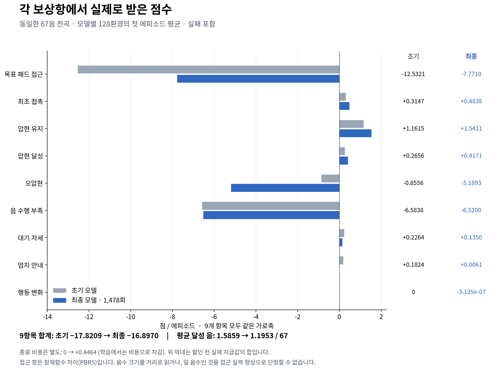
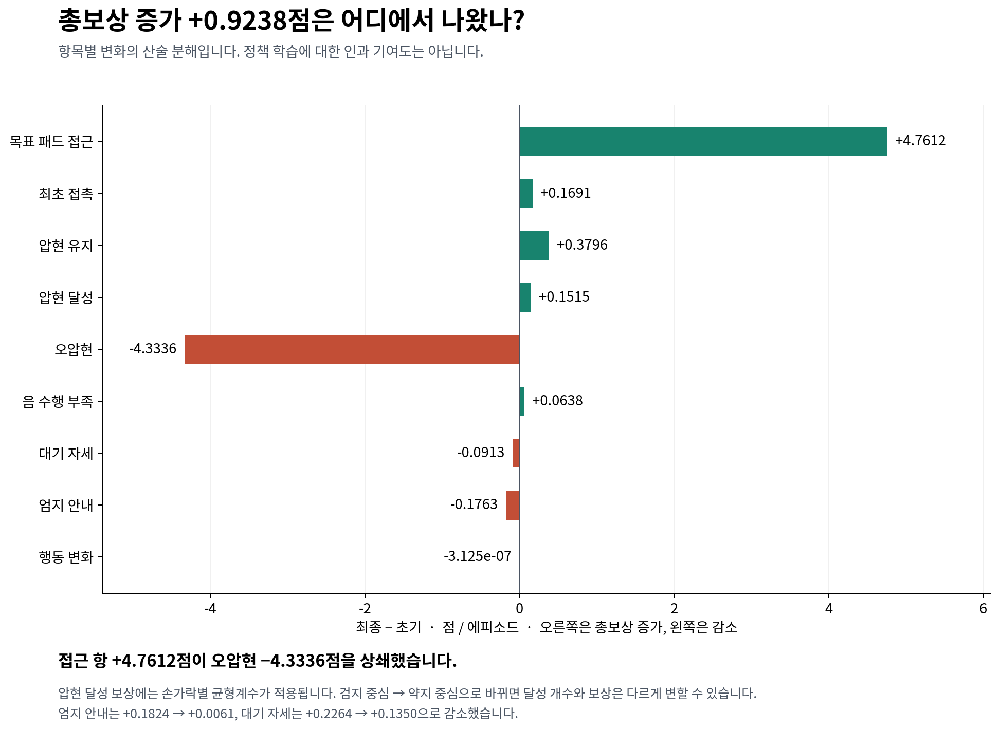
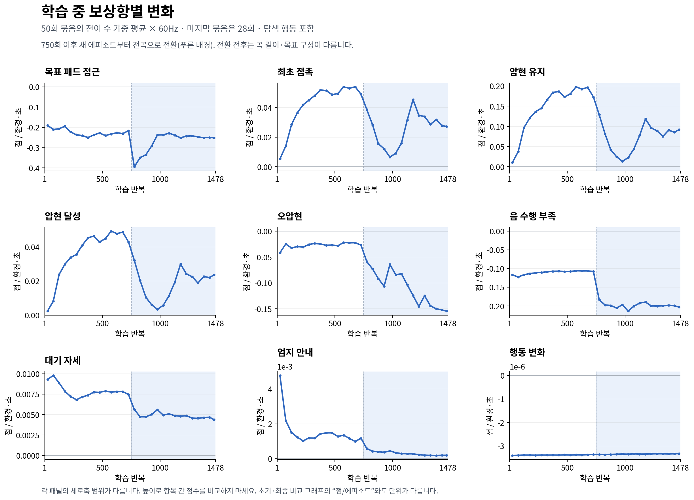

# 최신 large 학습: 보상항별 실제 지급값

2026-10-27 오전9시까지 수행한 large / GPU1024 / H32 / 1478회 학습을 대상으로 한다. 이 자료는 원자료를 읽어 시각화했으며 학습·보상 구현은 변경하지 않았다.

## 1. 같은 전곡을 평가했을 때 받은 점수

초기·최종 모델 각각 128환경의 **첫 에피소드**, 원곡67음을 평가한 결과다. 실패도 포함한다. 초기 모델은 학습 전 정책이며 행동0 시험은 아니다. 아래 값은 **실제 계수가 적용된 보상의 할인 전 누적값을 에피소드 간 평균**한 것이다. 매 시점 점수나 PPO의 할인된 return이 아니다.

| 보상항 | 초기 | 최종 | 변화(최종−초기) |
|---|---:|---:|---:|
| 목표 패드 접근 | -12.5321 | -7.7710 | +4.7612 |
| 최초 접촉 | +0.3147 | +0.4838 | +0.1691 |
| 압현 유지 | +1.1615 | +1.5411 | +0.3796 |
| 압현 달성 | +0.2656 | +0.4171 | +0.1515 |
| 오압현 | -0.8556 | -5.1893 | -4.3336 |
| 음 수행 부족 | -6.5838 | -6.5200 | +0.0638 |
| 대기 자세 | +0.2264 | +0.1350 | -0.0913 |
| 엄지 안내 | +0.1824 | +0.0061 | -0.1763 |
| 행동 변화 | 0 | -3.125e-07 | -3.125e-07 |
| **9항목 합계** | **-17.8209** | **-16.8970** | **+0.9238** |

종료 비용은 위 9항목과 별개다. 평균 비용은 초기0, 최종+0.446432로 학습 시 차감한다. 보상·비용은 서로 다른 할인과 critic을 사용하므로 단순한 원시 합계 차이를 PPO 목적함수와 같다고 해석하면 안 된다.

## 2. 무엇이 총보상 변화를 만들었나

- **총보상은 +0.9238점 증가했지만 평균 달성 음은 1.5859→1.1953/67개로 감소했다.** 총보상만으로 음악 성능 개선을 판단할 수 없다.
- **오압현 감점은 −0.8556→−5.1893으로 약6.07배 커졌다.** 가중 접촉·유지·달성 점수 증가와 함께 봐야 한다. 이는 실제 기타 음향 녹음 판정이 아니라 현재 구현의 접촉 후보 기반 오압현 판정이다.
- **접근 항의 누적값은 −12.5321→−7.7710으로 변했다.** `0.99 × Φ_next − Φ_current` 형태의 잠재함수 차이(PBRS)이고 종료 정산이 포함된다. 덜 음수인 것만으로 목표와 더 가까워졌다고 판단할 수 없다. 체류시간·궤적·종료 시점도 영향을 준다.
- **압현 달성 점수는 +0.2656→+0.4171로 올랐지만 실제 달성 개수는 줄었다.** 원곡 손가락별 균형계수는 검지0.670, 중지0.931, 약지·소지1.396이다. 초기203음은 모두 검지, 최종153음은 약지148·소지5로, 가중 점수와 원곡 달성 개수는 다르게 움직였다.
- **음 수행 부족은 −6.5838→−6.5200으로 거의 줄지 않았다.** 목표 수행이 전반적으로 부족한 상태가 남았다.
- **대기 자세는 +0.2264→+0.1350, 엄지 안내는 +0.1824→+0.0061로 감소했다.** 이 보상만으로 자세 품질이나 접촉률을 직접 환산할 수는 없다. 다만 해당 목표에 대한 지급 신호가 줄어든 것은 확인된다.
- **행동 변화 감점은 최종 −3.12×10⁻⁷점으로 매우 작다.** LH21 손가락·엄지는 이 비용에서 제외되어 있다. 이 항목이 손가락을 움직이지 못하게 만든 직접 비용이라고 보기는 어렵다.

초기는128환경 모두 정상 끝, 최종은124환경 정상 끝·4환경 물리 실패·손목 종료0이다. 따라서 위 표는 동일 전곡 시험의 실패 포함 비교이지, 모든 에피소드의 길이가 같다는 뜻은 아니다. 단일 학습·한 곡·한 번의128환경 평가 결과다.

## 3. 학습하는 동안의 변화

`learning_metrics.jsonl`의 1478개 갱신 기록을 사용한다. 각 점은50회 묶음(마지막28회)의 전이 수 가중 평균에60을 곱한 **점/환경·초**다. 환경1024개의 점수를 합한 값이 아니다. 평활한 곡선이 아니라 구간별 실제 평균이며 끝나지 않은 에피소드의 전이도 포함한다. 첫 그래프의 점/에피소드와 단위가 다르므로 숫자를 직접 비교하지 않는다.

750회 이후 새로 시작하는 환경부터 구간 학습에서 전곡으로 바뀐다. 푸른 배경의 초기에는 아직 진행 중인 구간 에피소드가 섞여 있다. 전환 전후에는 목표 수·길이·손가락 구성이 달라지므로 곡선 변화를 정책 성능 변화 하나로 설명할 수 없다. 학습 곡선은 탐색 행동을 포함하며 고정 평가와도 조건이 다르다. 각 패널은 읽기 쉽도록 세로축 범위가 다르다.

## 원자료와 재현

- `reward_comparison.csv`: 위 표의 반올림 전9항목 값.
- `training_reward_50update_bins.csv`: 추세 그래프에 사용한 모든 구간의 수치.
- `verification.json`: 원자료 SHA256, 전이 수, 합계 검산 결과.
- `support/build_charts.py`: 그래프·표 생성 도구. 이 디렉토리의 산출물만 갱신한다.
- 평가 원본: `../fixed_evaluation_summary.json`
- 학습 원본: `../../run_01/J/learning_metrics.jsonl`

평가에서 9항목 합과 별도로 누적 기록된 총보상의 차이는 초기 +0.0000202322점, 최종 −0.0000003463점이다. 소수 넷째 자리 표시에 영향을 주지 않는 작은 잔차이며, 완전 동일한 값이라고 가정하지 않았다. 모든1478회에서9항목의 합과 기록된 전이당 평균 보상의 차이는 최대1.17e-9점이었다. 비용은 항목 합에서 제외했다. 기존 로그·checkpoint·학습 소스는 수정하지 않았다.
