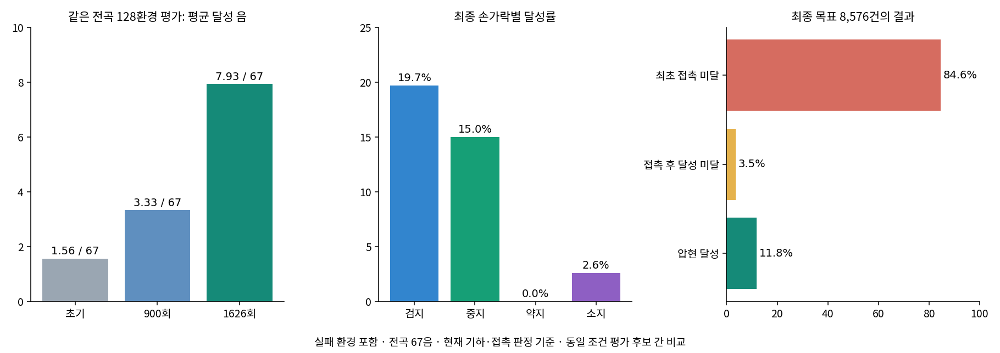

# 8시간 직접 위치제어 학습 해석

학습은 정상 완료됐고 압현 성과는 개선됐지만, 곡 연주 학습은 아직 부족하다. 8시간(28,802.98초), 1,626회, 53,280,768전이의 새 학습이다. 기존 누적 제어와의 조건을 맞춘 비교실험이 아니므로 개선 원인을 직접제어 하나로 확정하지 않는다.

## 동일 조건 독립 평가

전곡67음·128환경·결정적 정책·각 환경 첫 에피소드이며 실패 환경도 포함한다. 세 후보의 평가 설정은 동일하다.

| 모델 | 평균 달성 음 | 음 기준 달성률 | 타임라인 완료 | 전곡 모든 음 달성 |
| --- | ---: | ---: | ---: | ---: |
| 초기 | 1.5625 / 67 | 2.33% | 128 / 128 | 0 / 128 |
| 900회 | 3.3281 / 67 | 4.97% | 126 / 128 | 0 / 128 |
| 최종1626회 | 7.9297 / 67 | 11.84% | 128 / 128 | 0 / 128 |

최종은 초기의 약5.08배, 평균6.37음 개선이다. 최종128회에는 물리·손목 조기 종료가 없었다. 타임라인 완료는 끝까지 버틴다는 의미이며 곡을 성공적으로 연주했다는 뜻이 아니다. 최고는 평가한 세 후보 중 최종이며 다른 중간 저장본의 최고 성능은 확인하지 않았다.

## 어디서 막히는가

최종128환경의 총8,576개 목표 중7,257개(84.62%)는 최초 접촉 문턱에 도달하지 못했다. 304개(3.54%)는 최초 접촉을 달성했으나 최종 압현 달성에 도달하지 못했고,1,015개(11.84%)는 달성했다. 접촉 문턱 미달은 물리적으로 한 번도 닿지 않았다는 뜻이 아니다. 짧거나 조건을 충족하지 못한 접촉도 포함된다. 최초 접촉 달성1,319건 중 최종 달성 비율은76.95%다. 따라서 이번 결과의 가장 큰 손실은 최초 접촉 획득 전 단계에 있다.

| 손가락 | 접근 near 완료 비율 | 최초 접촉 완료 비율 | 압현 달성률 |
| --- | ---: | ---: | ---: |
| 검지 | 64.94% | 23.37% | 19.69% |
| 중지 | 82.34% | 21.83% | 14.97% |
| 약지 | 8.40% | 0% | 0% |
| 소지 | 30.14% | 4.43% | 2.60% |

각 비율의 분모는 해당 손가락의 목표 기회다(검지3,200·중지2,304·약지1,536·소지1,536). near는 기존 접근 판정이지 올바른 압현 접촉이 아니다. 검지·중지는 접근에서 접촉으로 넘어가는 병목이 있고, 약지는 접근 자체도 부족하다. 소지도 접촉 획득이 부족하다.

## 제어가 명령을 못 따라가는가

최종 독립 평가를 다시 집계하면 비엄지16축의 적용목표−실제각 RMS는 약0.00157~0.02569rad(0.09~1.47도)다. 속도 제한 전후 차이도 대부분 작다. 관절이 명령을 전혀 수행하지 못하는 상황을 주된 병목으로 볼 근거는 약하다. 다만 전체 시간 RMS는 순간적인 큰 오차를 숨길 수 있고 일반화 힘 센서는 모터 단독 힘이 아니므로, 압현 순간의 힘 부족 가능성까지 배제하지 않는다.

반대로 정책 목표 자체가 좁게 움직인다. 최종 평가의 에피소드별 목표각 범위 평균은 약지 PIP4.23도·DIP5.29도, 소지 PIP5.36도·DIP5.77도다. 소지 MCP 굽힘축(pinky1_x)의 목표 범위는 약0.016도에 불과하다. 이는 준비시점까지 포함한 전체 에피소드 범위다. 직접제어가 정상이어도 정책이 충분한 굽힘·펴짐 동작을 학습하지 못하면 손이 거의 움직이지 않아 보일 수 있다. 특정 관절의 압현 역할 과중이나 자연스러움 개선은 이 숫자만으로 확정하지 않는다.

엄지 안내도 아직 실제 지지로 정착하지 않았다. 최종평가 전체 시간에서 엄지 접촉 후보는0.172%, 기하 근접은1.55%, 선택 패치 평균 signed gap은약7.57mm다. 자세 방향 품질은 일부 얻지만 지속 접촉은 드물다. 이 값은 접촉쌍·현 압력·실제 지지 기여의 인증이 아니다.

## 보상과 안정성 해석

학습 처음/마지막10% 전이당 최초 접촉 보상은0.000265→0.001580, 압현 유지0.000670→0.003498, 압현 달성0.000137→0.000753으로 증가했다. 동시에 오압현 감점은−0.000180→−0.001221, 음 수행 부족은−0.001998→−0.003072로 커졌다. 목표 패드 접근도−0.003638→−0.009385다. 구간에서 전곡으로 노출이 달라졌고 접근은 potential 정산을 포함하므로 이 비교만으로 거리 악화나 보상 설계 오류를 단정하지 않는다.

학습 중 전곡 마지막10%는 평균6.684/67, 타임라인 완료2,441/2,724(89.61%)다. 탐색이 있는 학습과 결정적 평가128/128의 차이를 구분한다. 학습 중 실패는 기타 이동·회전이 많았으며, 최종 결정적 평가에서 실패가 없었다는 이유로 모든 조건의 물리 문제가 해결됐다고 볼 수 없다.

## 영상과 다음 판단

[손 영상](../video/hand.mp4) · [전신 영상](../video/fullbody.mp4)

둘 다 최종 모델·환경0·첫 전곡 에피소드,1280×720/30fps/984프레임/32.8초다. 영상 환경의 달성은3/67이며128환경 평가 평균7.93/67과 다르다. 손 색상은 엄지 빨강·검지 파랑·중지 초록·약지 주황·소지 보라다. 손가락이 펴진 채 머무는 모습이24초 표본에서도 보이며 자연스러움 개선을 성공으로 선언하지 않는다.

다음 우선순위는 (1)약지·소지의 목표각이 작은 이유와 목표 조건에 따른 행동 변화, (2)검지·중지의 접근→접촉 실패 순간의 패드 방향·줄/프렛 위치, (3)접촉 뒤 미달성304건의 유지·오압현 원인 분리다. 전역 힘 상한 증가나 보상 전면 변경은 이번 집계만으로 결정하지 않는다. 이번 요청에서는 제어·보상을 추가 수정하거나 새 학습을 시작하지 않았다.

원시 수치: [추가 집계](final_detail.json) · [전체 자동 분석](RESULTS.md) · [전체 보상 그래프](reward_curves.png).
