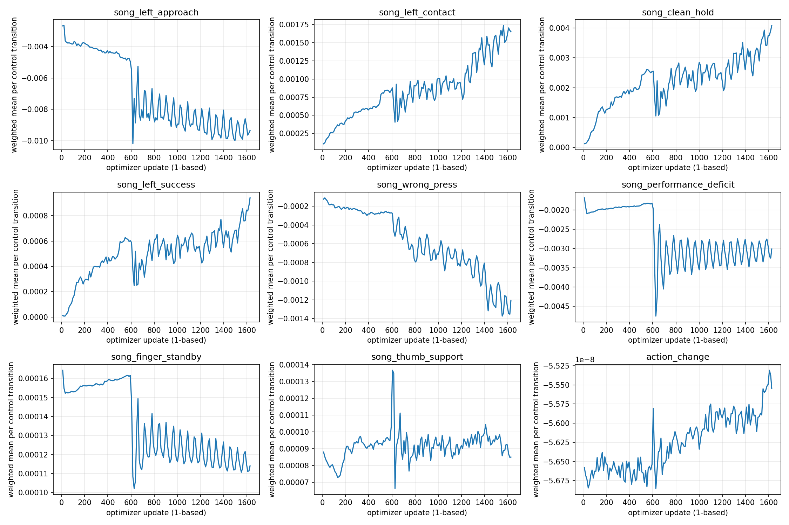

# 직접 목표각 장시간 학습 결과

학습 상태: `True`; 종료 사유: `wall_budget`; 반복: 1626; 전이: 53280768; 학습 시간: 8.00시간.

## 보상 변화

각 창은 실제 기록된 반복의 처음/마지막 10%(각 163회). 물리 제어 전이 수로 가중한 전이당 보상이며 에피소드 총점이 아니다. 구간/전곡 노출 혼합의 영향이 있다.

|보상|처음|마지막|
|---|---:|---:|
|목표 패드 접근|-0.003637992|-0.009384971|
|최초 접촉|0.0002654829|0.001579707|
|압현 유지|0.0006696308|0.003498459|
|압현 달성|0.0001373375|0.0007528015|
|오압현|-0.0001802616|-0.001221452|
|음 수행 부족|-0.001998491|-0.003071624|
|대기 자세|0.0001542226|0.0001152448|
|엄지 안내|7.897604e-05|9.178393e-05|
|행동 변화|-5.662791e-08|-5.570158e-08|

## 압현과 종료

실패 에피소드도 포함한다. 구간과 전곡의 평균 달성 음을 섞지 않는다. 비율은 달성 음 합계/선정 목표 음 합계이며 음향 성공률이 아닌 현재 기하·접촉 판정이다.

|범위/기간|에피소드|평균 달성/평균 목표|음 기준 달성률|타임라인 완료|
|---|---:|---:|---:|---:|
|phrase/all|62093|0.614/6.628|9.261%|61240|
|phrase/first10pct|16519|0.207/6.565|3.155%|16473|
|full_song/all|17822|5.876/67.000|8.771%|14570|
|full_song/last10pct|2724|6.684/67.000|9.976%|2441|

|범위/기간|종료 사유별 횟수|실패 원인별 횟수(중복 가능)|
|---|---|---|
|phrase/all|{'terminal_failure': 853, 'timeline_complete': 61240}|{'guitar_displacement': 608, 'wrist_outside': 140, 'guitar_rotation': 114, 'joint_speed': 8}|
|phrase/first10pct|{'terminal_failure': 46, 'timeline_complete': 16473}|{'guitar_displacement': 6, 'wrist_outside': 40}|
|full_song/all|{'terminal_failure': 3252, 'timeline_complete': 14570}|{'wrist_outside': 406, 'guitar_rotation': 1469, 'guitar_displacement': 1520, 'joint_speed': 8, 'support_lost': 11, 'foot_displacement': 3, 'ground_contact_lost': 1, 'wrist_severe': 1}|
|full_song/last10pct|{'timeline_complete': 2441, 'terminal_failure': 283}|{'guitar_rotation': 108, 'guitar_displacement': 163, 'wrist_outside': 23, 'support_lost': 4, 'foot_displacement': 1}|

관절별 수치는 [summary.json](summary.json)에 저장했다. 관절 RMS는 표본 수로 제곱평균 후 제곱근을 취했다. 힘 센서는 관절별 유효 표본 수로 가중했다. 완료 에피소드와 종료 시 미완료 에피소드의 집계는 분리했다.

센서는 순 일반화 힘이며 모터 힘이나 힘 제한 도달률을 뜻하지 않는다. 위치 구동 관절의 제출 토크가 미제공이면 통계에서 제외한다. 상세 추적은 대표 환경의 최초 600 제어틱까지만 있으므로 후반 학습 행동을 설명하는 자료로 사용하지 않는다.

### 완료 에피소드 관절 추종

|관절|요청−실제 RMS(rad)|전달−실제 RMS(rad)|속도제한 차이 RMS(rad)|속도 RMS(rad/s)|
|---|---:|---:|---:|---:|
|LH:thumb1_x|0.019626|0.01874|0.0028817|0.1096|
|LH:thumb1_y|0.036388|0.030789|0.012669|0.16941|
|LH:thumb1_z|0.036556|0.027078|0.016281|0.13122|
|LH:thumb2|0.055185|0.041941|0.026399|0.23897|
|LH:thumb3|0.040906|0.033927|0.015534|0.18816|
|LH:index1_x|0.051858|0.040162|0.024009|0.25405|
|LH:index1_z|0.031596|0.027622|0.0089136|0.16733|
|LH:index2|0.03605|0.031068|0.011807|0.21466|
|LH:index3|0.054208|0.040362|0.026496|0.29177|
|LH:middle1_x|0.069067|0.045441|0.040821|0.33048|
|LH:middle1_z|0.025646|0.024363|0.0042541|0.12461|
|LH:middle2|0.040609|0.033719|0.015135|0.24063|
|LH:middle3|0.04777|0.033239|0.024673|0.23889|
|LH:ring1_x|0.064316|0.043843|0.036084|0.31773|
|LH:ring1_z|0.012833|0.012714|0.00069834|0.077931|
|LH:ring2|0.056316|0.039598|0.029553|0.28655|
|LH:ring3|0.064913|0.043607|0.036968|0.31874|
|LH:pinky1_x|0.061207|0.036841|0.036821|0.26385|
|LH:pinky1_z|0.028633|0.025693|0.0070016|0.1147|
|LH:pinky2|0.043201|0.033969|0.018213|0.24233|
|LH:pinky3|0.049117|0.034496|0.02489|0.24751|

## 별도 평가

- `initial`: {"completed": true, "failure": null, "checkpoint_sha256": "5dae41b1ab380bc4b5426a43c61de83f53f3e5bc250ffc74175bf4c72fa4dfd6", "scope": "full_song", "summary": {"episodes": 128, "achieved_notes": 200.0, "target_notes": 8576.0, "episode_note_fraction_sum": 2.985074626865671, "reward_sum": -2304.1120347976685, "timeline_complete": 128, "reasons": {"timeline_complete": 128}, "failure_reasons": {}, "mean_achieved_notes": 1.5625, "mean_target_notes": 67.0, "note_weighted_achievement": 0.02332089552238806, "episode_weighted_achievement": 0.023320895522388054, "mean_reward": -18.000875271856785}}
- `middle`: {"completed": true, "failure": null, "checkpoint_sha256": "975845ca6b9834090cbd9771e8167eeb888ca9c673897844c538ab3af435ed78", "scope": "full_song", "summary": {"episodes": 128, "achieved_notes": 426.0, "target_notes": 8576.0, "episode_note_fraction_sum": 6.35820895522388, "reward_sum": -2669.1804847717285, "timeline_complete": 126, "reasons": {"terminal_failure": 2, "timeline_complete": 126}, "failure_reasons": {"guitar_displacement": 2, "guitar_rotation": 1}, "mean_achieved_notes": 3.328125, "mean_target_notes": 67.0, "note_weighted_achievement": 0.04967350746268657, "episode_weighted_achievement": 0.04967350746268656, "mean_reward": -20.85297253727913}}
- `final`: {"completed": true, "failure": null, "checkpoint_sha256": "361533cabab594cfb13bf7211b730504ac809892ed6e6e76b2c704d9d7e0eee2", "scope": "full_song", "summary": {"episodes": 128, "achieved_notes": 1015.0, "target_notes": 8576.0, "episode_note_fraction_sum": 15.149253731343276, "reward_sum": -2311.7448587417603, "timeline_complete": 128, "reasons": {"timeline_complete": 128}, "failure_reasons": {}, "mean_achieved_notes": 7.9296875, "mean_target_notes": 67.0, "note_weighted_achievement": 0.11835354477611941, "episode_weighted_achievement": 0.11835354477611934, "mean_reward": -18.060506708920002}}

영상용 선택 후보: `final` (`/home/ajou/yigyu/3/docs/2026-10-29/direct_position_8h_v1/train/J/final.pt`). 선택 규칙: highest deterministic128env full-song mean achieved notes among evaluated candidates; later wins ties.

초기/중간/최종 평가가 동일한 범위와 환경 설정인지 확인한 뒤 비교해야 한다. 선택은 실제 평가한 후보들에 한정되며 전체 저장본 중 최고라는 뜻은 아니다.
