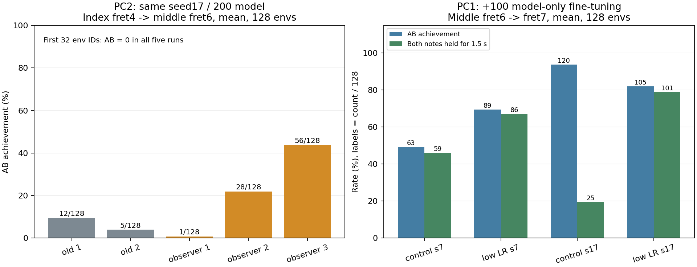

# PC1 추가 검토: PC2 검지→중지 전환과 원시 로그 분석

검토 시점: 2026-11-01 19시대 KST. 공유상태·공유검증의 ready=true를 먼저 확인하고 다른PC_검토프롬프트의 범위를 따랐다. **새 학습·GPU 평가·보상/제어 변경은 실행하지 않았다.** 작성 위치는 이 새 추가검토 디렉토리뿐이다.

## 1. 결론

**PC2 보고서의 핵심 수행·보상·궤적 수치는 독립 재계산과 일치한다. 현재의 사실/가설 구분과 기본 미채택 판단에 동의한다.** 평균 정책의 B 실패는 중지의 정밀 위치 조건 불충족과 자기 오압현으로 관측된다. 대표 평균 평가에서 늦은 검지 해제, 중지 대기 보상, 단순 무하중이 주원인이라는 설명은 지지되지 않는다.

다음 우선순위는 **① 평가 재현성의 최초 차이 분리 → ② 지원 축 한 개의 정책 초기 bias 단독 비교 → ③ 최종 근접 potential의 동일 표본 기하 정밀도 단독 비교**다. 세 개 모두 설계 제안이며 이번 검토에서 실행하지 않았다. [구체적 단독 실험 설계](다음_단독실험_설계.md).

PC1의 학습률 비교는 검토 시점에 이미 18:31:04 KST 완료 상태였다. 모든 20개 평가를 원장에서 검산했다. 낮은 LR에서 두 난수의 전체 유지 수가 증가한 관측은 있지만, AB는 난수에 따라 반대 방향이고 반복 민감도도 남는다. 이를 PC2 전환의 검증된 개선으로 옮겨 적용할 근거는 없다.

## 2. 자료 무결성과 검증 범위

- 복사 manifest의 연구 958파일+읽기용 참고 306파일, 총 **1,264파일·2,838,205,353바이트**를 SHA/크기로 대조해 모두 일치했다. manifest SHA도 공유검증의 aa1e2a96…과 일치한다. [검토 전 검증](integrity_before.json).
- 원래 PC2 프로젝트의13,943개 봉인 중 이 공유본에서 파일 원문까지 대응되는 것은 **325개**, 모두 일치했다. 나머지13,618개는 공유본에 대응 원문이 없는 범위다. 누락된 입력을 PC1의 다른 버전으로 치환하지 않았다.
- 모델은 복사 SHA와 평가 보고의 checkpoint SHA를 대조했다. 핵심 seed17/200회 모델은 29afaa304ed71b3fa998035831e3065e246b86c08819680baa362a8cd755f405다. PC2의 저장된 strict identity/pin 검증 보고를 읽었지만, 이 불완전 실행환경에서 전체 identity 로더를 재실행했다고 주장하지 않는다. 모델 역직렬화나 metadata 수정도 하지 않았다.
- PC1의 기존 봉인 소스/입력498개와 완료 출력 evidence128개도 기대 SHA와 일치했다. 최종 전후 검증은 [검토 후 검증](integrity_after.json), [PC1 보존 검증](pc1_preservation_after.json)에 기록한다.
- 참고 사본의296개 Python은 현재PC1의 동명296개와 바이트가 같고 README/AGENTS까지298개가 같다. 그러나 **연구별 runtime, 관측/정책 확장, 활성 축, 목표 입력, 초기 catalog, 학습 이력은 다르다.** PC2의 전용 곡 입력8개는 PC1 기본 data 경로에 존재하지 않는다. 공용 라이브러리가 같다는 사실을 실험 전체 동일성으로 확대하지 않는다.

전체 근거: [출처·봉인 범위·PC1 관절 비교](provenance_and_pc1_axis.json). 공유 원문은 실행 가능한 완전한 프로젝트가 아니라는 공유안내의 설명이 타당하다.

## 3. PC2 수행과 실패 위치 재검산

[원시 수치 검산](PC2_원시수치검산.md)과 [기계판독 원장](raw_audit.json)에서 기존12개100/200/300 mean/sample, 기존 128평가 3개, 신규 반복 6개, 총 21조건을 재검산했다. 첫 episode를 env_id/episode_id로 연결하고 실패도 분모에 유지했다.

|확인 항목|독립 확인값|판단과 범위|
|---|---|---|
|300회 평균 양 seed|A clean1.5초, B clean0초, AB0/32|평균 B 전환 실패는 사실|
|300회 탐색 seed7/17|AB2/32·3/32, 두 음 전체 유지0/32·0/32|0.6초 달성을1.5초 전체 유지로 읽으면 안 됨|
|평균300 B 위치 판정|양 seed·각32환경에서0초|동일 표본의 프렛/횡/높이 결합 조건 미통과|
|담당 몸체 loaded|B1.5초|몸체 합력 bool이며 실제 줄 압력·적절한 압현력의 인증이 아님|
|B 자기 오압현|중지 끝마디 own_wrong_fret/own_wrong_string 각각1.5초|두 cause가 겹치므로3초로 더하지 않음|
|B 검지 잔류|검지 A raw0초, index other_higher 출처 없음|이 평균 조건의 주원인이 늦은 검지 해제라는 설명은 지지되지 않음|
|탐색 seed17/300의 A 간섭|중지 other_higher20/32, 소지8/32|준비 중 높은 프렛 간섭은 탐색에서 실제 관측됨|
|대표 B 중지 요청−적용|4축 RMS0°|이 구간의 실패를 속도 제한 차단만으로 설명하기 어려움|
|대표 MCP x 요청−실제|seed7 1.712°, seed17 1.916° RMS|추종 차이가 공간 오차에 얼마나 기여했는지는 미검증|

위치·facing·loaded·오압현은 서로 다른 조건이다. facing_geometry가 위치 조건을 포함하므로 facing_geometry=0만으로 방향 불량을 독립 원인으로 확정하지 않는다. 최근접 접근 표본과 실제 positive 판정 표본도 동일하다고 가정하지 않았다.

평균 env0의 B 프렛 영역 밖 오차는 약3.726/2.438mm이고 줄 횡오차는2.251/2.064mm다. 실제 판정은 같은 패드 표본에서 셀 내부·횡3mm·높이−1..3mm·normal≥0.1을 요구한다. 대표 표본의 방향은 문턱을 넘었지만, 이것을 모든 표본·모든 환경의 방향 성공으로 확대하지 않는다.

source 프렛 min/max는 **음×몸체의 모든 cause 공통 범위**다. 특정 cause·줄·시각·패드 표본의 결합 witness가 아니다. 정확한 오압현 줄 번호나 연속 발생 시점을 이 원장만으로 복원할 수 없다.

참조 성공은1환경·정답 q 궤적·고정 시점이며 정책은64환경 학습·32/128환경 평가·관측 기반 행동이다. 참조는 해당 동작의 실현 가능성을 지지하지만 정책의 안정적 학습 가능성이나 일반화 성과를 입증하지 않는다.

## 4. 지원 관절 포화: 사실과 인과를 분리

L_Thorax_y의 초기 실제각/기준각은약9°, 정책 hold/상한은약10°다. 정규화 후 float32 atanh clamp로 초기 bias가약7.247733이 된다. 참조의 B 요청8.235896518°와 달리 학습된 대표 B 요청·적용은상한약10° 부근에 머문다.

독립 검산에서12개 평균/탐색 기록의 **적용각은 모두 일정**했다. 요청각은11개 기록에서 일정하고 seed7/200/sample에서만 한 float32 ULP 폭으로 변했다. “실질적으로 압축됐다”는 보고서는 타당하지만 “모든 요청이 비트 단위 완전 상수”로 확대하면 부정확하다. 국소 요청각 std 약1e−7°는 연속 변환의 선형 근사이며 float32 분포의 직접 실측 분산이 아니다. [코드·보상 검토](PC2_코드보상검토.md).

추가로 PC1 중지6→7프렛의 원800회 성공 모델도 env0 B의360개240Hz 끝점에서 이 축 요청이9.999999709°로 일정했고, 전체 AB는107/128이었다. 실패한1000회 모델도 같은 축 요청이 동일했고 AB5/128이었다.

따라서 **포화 현상만으로 모든 전환의 실패를 설명할 수 없다.** 반대로 과제·초기 자세·다른 축·학습 이력이 다르므로 PC2에서 이 축이 중요한지 반박한 것도 아니다. 실제 관절각이 변하는 것은 PD·외력 아래의 반응일 수 있어 정책 요청 탐색이 살아 있다는 증거도 아니다. 한 축 bias만 바꾸는 인과 비교가 적절하다.

## 5. 보상 분석: 동의하는 점과 남은 공백

실제 보상 함수의60Hz 반환항을 저장한 신규 6평가를 독립 검산했다. 항합−반환 총보상 오차≤9.2243e−8, episode 원장과 항합 오차≤4.3512e−6으로 보고 범위와 일치한다. 신규 평가의 시점별 지급을 원래 무관찰 평가의 시점별 값으로 치환하지 않았다.

- 유효 준비 목표를 가진 손가락의 실제 standby gate/rate 비영 사례는 검사한대표 1919끝점에서0이다. B 구간 총 대기 보상이 남는 것은 다른 손가락의 지급일 수 있다.
- gamma0.99와 terminal nextPhi=0의 potential 정산을 코드/원시값으로 확인했다. 신규 6평가의 접근 할인 합은−0.958014625..−0.958013795로 재현된다. t0 Phi는 첫 전이로 추정한 값이며 별도 t0 실측이 아니다.
- 큰 비할인 음수 합만으로 접근 보상이 성공 보상을 압도하거나 목표 회피를 유도한다고 단정할 수 없다. raw advantage std 비율도 항별 경사 지배율이 아니다. 전체 관측·latent·가치 rollout이 없어 원래 업데이트의 항별 gradient norm/cosine을 정확히 재구성할 수 없다.
- 30mm 거리 척도·마지막20% 방향 보정과 실제 좁은 positive 조건 사이의 정밀도 차이는 설계상 가설이다. 정밀 potential 변경이 도움이 되는지는 단독 실험으로 확인해야 한다. potential shaping을 바꾸면 완결 할인 목적함수가 곧바로 더 커진다는 설명은 피한다.

엄지 지지는 이 PC2 pair20 및 PC1 arm16 비교의 학습 축에 포함되지 않는다. 기록된 간격/접촉 후보만으로 엄지 학습의 실패나 보상 증액 필요성을 결론 내리지 않는다.

## 6. 평가 반복 민감도는 다음 실험의 선행 문제

같은 PC2 seed17/200회 모델의 평균128환경 결과를 원장으로 재현했다.

|평가|AB/128|두 음 전체 유지/128|앞32 AB|
|---|---:|---:|---:|
|기존1|12|12|0|
|기존2|5|5|0|
|새 관찰 반복1|1|1|0|
|새 관찰 반복2|28|27|0|
|새 관찰 반복3|56|55|0|

새32환경3회는모두0/32다. 신규AB28/56을 전체 유지28/56으로 읽으면 안 된다. 신규 3회는 관찰기 CPU동기화가 추가된 평가이므로 기존 무관찰과 완전히 같은 실행 방식이라고도 하지 않는다. 다만 기존 128끼리12→5였으므로 새 관찰기만이 전체 변동의 유일 원인이라는 설명도 성립하지 않는다.

기존128 두 회의 첫 전체 거리1μm 초과 차이는 **0.008333초/env100/A/2.9755756μm**로 독립 재현됐다. env0 관절 차이보다 이르다. 집계나 B 직전 문턱에서만 달라졌다는 설명은 맞지 않는다. 초기 전체 body/force/controller/origin·RNG 스냅샷이 없어 최초 원인이 초기화, 신경망 계산, 물리 실행 순서 중 무엇인지 확정할 수 없다.

PC2 all-time effective-dual assert는 논리적으로 실제 audible 성공보다 강하지만, 이번 PC2 원시 자료에서 그 assert가 실제 잘못 탈락시킨 사례는 발견하지 못했다. PC1의 음 종료 후 후보 오판 중단을 PC2에서도 발생한 오류처럼 옮겨 쓰면 안 된다. A audible 중 B raw와 A effective의 조합도 접촉 판정/veto의 표본 범위를 대조하기 전에는 무조건 논리적 모순이라고 단정하지 않는다.

## 7. PC1 최신 결과와 비교

PC1 runs_recovery는18:31:04에 complete였다. 새 실행을 하지 않고 기존20평가의 원장·on-time을 다시 계산해 모두 일치했다. [PC1 평가 CSV](PC1_평가재검산.csv), [검토 시점 스냅샷](pc1_comparison_snapshot.json).

|PC1 조건|seed|AB/128|두 음 전체 유지/128|정시+직전 끝부분 유지/128|물리/손목 종료|
|---|---:|---:|---:|---:|---|
|기존 LR|7|63|59|65|0/0|
|낮은 LR|7|89|86|95|0/0|
|기존 LR|17|120|25|28|0/0|
|낮은 LR|17|105|101|115|1/0|

낮은 LR의 전체 유지는 두 seed 모두 증가했지만 AB는 seed17에서 감소했다. 기존 LR seed17의AB120/128도전체 유지 25/128·정시 28/128과 함께 봐야 한다. 어느 조건도 기존90%의 AB·유지·정시를 모두 통과하지 못했다. 물리 실패1/128도 분모에 남았다.

같은PC1 seed7/추가100회 모델의128환경 재평가는기존LR AB63→57·전체59→54, 낮은LR AB89→94·전체86→85였다. 체크포인트 SHA·설정·평가 방식이 같다. 두 번만의 반복이므로 일반 변동 범위로 인증하지 않는다.

|구분|PC1 LR 비교|PC2 검지→중지|
|---|---|---|
|목표|중지 하나,3번줄6→7프렛|검지4→중지6프렛,3번줄|
|학습 축|팔12+중지4=16|팔12+검지4+중지4=20|
|시작 정책|최고800회 가중치만 이전, 새 Adam/RNG|새 정책, A-hover 정렬 bias|
|비교|추가100회, 초기/상한LR3e−5 대1e−5|fresh100/200/300회, 기존 LR규칙|
|공통|자유 기타·GPU·large64H32·0.75초 휴지·동일 공용 Python|연구별 runtime/입력은 별도 계약|

공통적으로 정밀 위치 실패와 평균/표본 성과 차이가 있지만, PC1 모델 보존 효과를 PC2의 새 목표 학습 효과로 일반화할 수 없다. H128은PC1 첫 seed250회만 수행했고AB0/32·Bclean0.607초였다. 두 seed 구조 비교·초기분포 I·엄지 T는미완료이므로 “긴수집이 항상 안 된다/엄지도실패했다”는 결론은 없다.

왼쪽은 동일PC2모델의 반복 평가이며 회색은기존,주황은새관찰평가다. 오른쪽은PC1의마지막 모델 첫128평가이며 막대 위 숫자는성공환경수다. 두패널은서로다른과제/학습이력으로직접우열비교하지않는다.

## 8. 동의·반박·미확정과 다음 단계

|명제|판정|
|---|---|
|PC2 평균 B는 담당 하중이 없어서 실패|현재 원장과 맞지 않음. loaded는있지만위치0|
|평균 B 실패의 주원인은 검지 미해제|해당300평균 자료는지지하지 않음|
|준비 중 중지 대기 보상이 동작을 막음|실제gate/rate 검산은지지하지 않음|
|상한 초기화로 한 지원축의 요청 탐색이 압축됨|확인된 현상. 기계적 고정이나 인과확정은아님|
|그 축을 풀면 PC2 전환이 해결됨|미검증. PC1 성공모델에도같은대표포화가있음|
|접근 음수합/adv std가 경사 지배를 입증|그근거만으로 결론 불가|
|128평가의 차이는 모델이 좋아진 결과|반박. 동일모델의평가변동|
|변동은 GPU물리 비결정성만의 문제|미확정. reset·action계산·origin·order분리가안됨|
|PC1 낮은LR을 PC2에즉시채택|근거부족. 새목표학습·전체유지·반복민감도확인필요|

먼저 고정 모델의 reset→action→physics 첫차이를 기록할 새 평가 계약을 설계하고, 그다음 한 축 bias만 비교하며, 마지막에 근접 potential만 비교한다. 현재 성공 기준을 낮추지 않는다. 원문·공유 소스·모델·출력 변경이나 새GPU 실행은이번 검토범위가아니며수행하지않았다.

## 검토 산출물

- [실험 설계와 수치 기준](다음_단독실험_설계.md)
- [PC2 원시 재검산](PC2_원시수치검산.md) / [JSON](raw_audit.json)
- [코드·보상·포화 검토](PC2_코드보상검토.md) / [JSON](code_reward_audit.json)
- [PC1 결과 스냅샷](pc1_comparison_snapshot.json) / [CSV](PC1_평가재검산.csv)
- [출처와 봉인 한계](provenance_and_pc1_axis.json)
- [독립 검수](REVIEW.md)
- tools/ 아래 스크립트는CPU 읽기·재계산 전용이며원실험코드를실행하지않는다.
