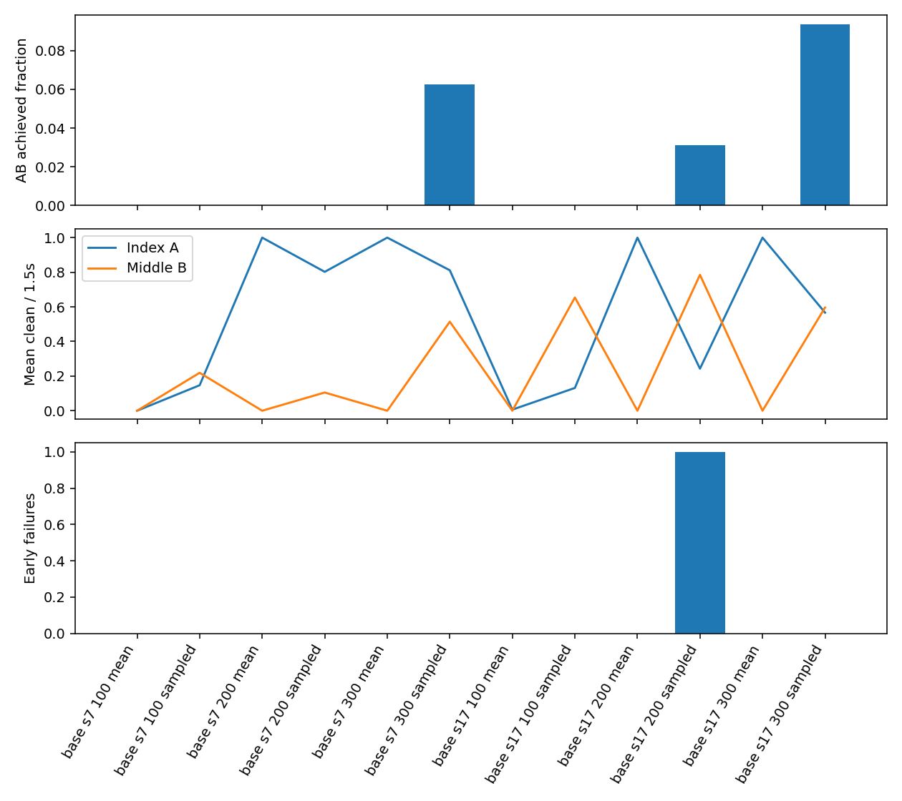
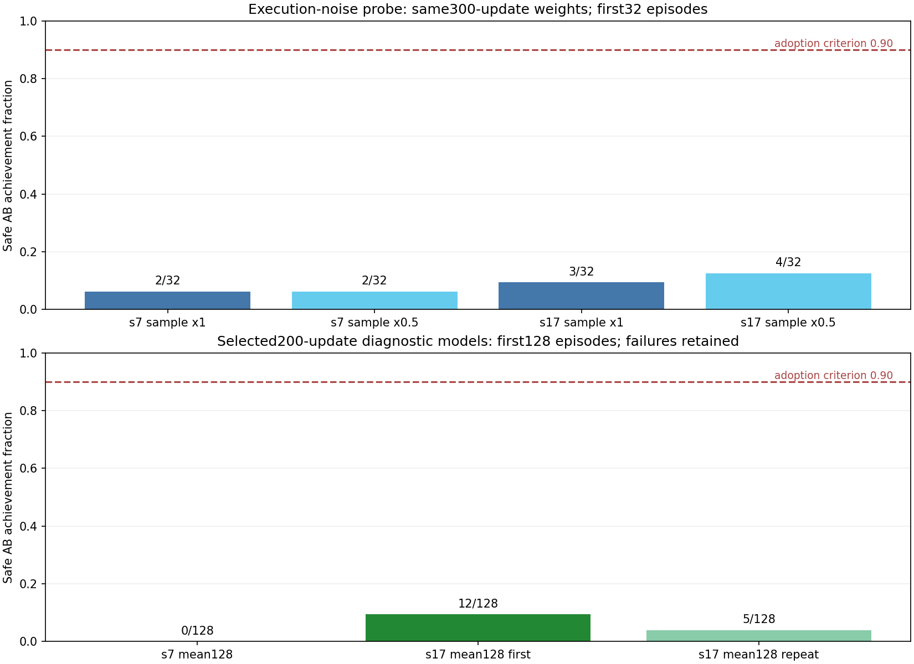

# 검지→중지 압현 전환 연구 결과

완료 기준 시각: 2026-11-01T04:08:08.149224+09:00. 폴더 날짜2026-11-02는 사용자 지정 연구 위치다.

**안정적인 학습 전환은 확인하지 못했다. 기본 학습 코드·공유 소스에 채택한 개선은 없다.** 자유 기타의 유한 참조 제어에서는 A/B 각각1.5초 전체 유지와 정시 시작이 가능했지만, 첫32평가의 평균 정책은 주로 검지A만 수행했다. 기하 명령 재생을 학습 성과로 계산하지 않았다.

## 조건과 격리

- 독립 프로젝트: `/home/yigyu/local-research/index_middle_transition_20261101_v1/project`. 공유 원본 `/home/yigyu/cgl-lab` 및 다른 PC의 중지6→7프렛 연구는 수정하지 않았다.
- 실행 봉인: `46526892ba0444dc35891cc56e2374b69f390b6569240f389235190d5ecf0b3e`, 13943개 파일. 실제 복사 바이트는 `보존/source_snapshot.json`(14,685개)에 기록. 새 번들/생성기 의존성은 별도SHA 기록. Git HEAD는 읽은 시점의 참고이며 미커밋·미추적 바이트를 대표한다고 가정하지 않았다.
- RTX4070Ti SUPER16GiB, Python3.8.20/Torch2.4.1+cu121/Isaac Gym Preview4 GPU PhysX. 물리240Hz·정책60Hz·K1. CPU fallback 없음. 구형 모델의 metadata나입력SHA를 바꾸지 않았다.
- 목표A=검지·표준3번줄·4프렛, B=중지·같은줄·6프렛. A3.00–4.50초, B5.25–6.75초, 준비3초/휴지.75초/말미.5초. 무음 번들은 시계용이며 음향 실험이 아니다.
- large·64환경·H32·seed7/17. 팔12+검지4+중지4=20학습축. 엄지5·약지4·소지4는 초기 `hold_target105` 명령을 기존유한PD로유지하며 실제q를고정하거나진행중덮어쓰지않는다. 엄지를학습했다고보고하지않는다.
- 초기 상태는 **새FK로생성한A-hover 정렬 초기**다. v9는행동0기준이고reset이일반v9분포라는뜻은아니다. 최초관측env0최근접목표거리는A약8.51mm/B약18.63mm로A에유리하다. 이것만으로실패원인을확정하지않는다.
- 중지B는3.25초부터priority목표에노출된다. 전역단계가A를따르는동안에도중지의4행동축은막히지않는다. B를A음중미리누르면높은프렛간섭이될수있으며예외를추가하지않았다.
- 매100회후저장·엄격재개(물리장면은새에피소드) 방식으로200·300회까지진행했다. 이방식을모든조건에고정했고단일프로세스연속300회와동일한물리궤적이라고주장하지않는다.

## 구현·실현성 검증

- 현행 기본 Python295개는보존본과동일. 연구오버레이에서두head학습권한·20축우도/KL/entropy마스크·초기std.15/하한.10(잠재Gaussian공간)·부분reset·미래목표를CPU검사했다. CPU검사7개통과, 별도change-reviewer검수완료. 중간검사실패와수정로그도보존했다.
- 기존catalog provenance의contact.py만현행SHA와다름을발견해원문을보존했다. 이를현재값으로고쳐과거성공을상속하지않고,현행FK·패드로press/hover를새생성하고실제GPU에서다시검증했다.
- GPU참조v1은A1.5/B1.35초와B지연때문에엄격성공으로인정하지않았다. 학습전휴지내도착여유를조정한v2는A/B각1.5초, 최초clean3.00/5.25초, 연속달성3.60/5.85초, 물리/손목실패0으로통과했다. 기타고정·중간reset·q순간이동없음. 초기snapshot/첫0.5초후보·wrong없음을확인했다.
- v2 FK/native대조의관측최대위치오차약0.251mm/회전0.00709rad. 이대조는매60controltick표본으로전240Hz오차상한이아니다.
- 최종소스에서GPU학습2회→저장→strict1회재개→첫32평가→native손/전신렌더통과. 모델·두Adam·Python/NumPy/Torch CPU/CUDA RNG의정확복원을확인했다. 초기구동검증의서로다른소스버전은원문SHA와함께분리보존하고본600회성과에합치지않았다.
- 자동실행기는봉인·출력덮어쓰기방지·-O거부·부분JSON행제외·오류시자기자식종료/회수를검사했다. 저장/재개/입력무결성검사를완화하지않았다.

## 실제 학습량

|seed|업데이트|전이|승인actor minibatch step|critic step|폐기actor step|최종LR|KL재시도|
|---:|---:|---:|---:|---:|---:|---:|---:|
|7|300|614,400|600|600|2|1.8310547e-05|2|
|17|300|614,400|600|600|2|1.4648437e-05|2|

총600업데이트·1,228,800전이, 승인actor/critic각1,200step. 두seed의학습량은동일하다. KL상한.02와정책/Adam복원을유지했다. 학습률은0이아니며최종경우각1.8311e-5/1.4648e-5. 학습중완료에피소드에서손목실패1회(seed17),물리실패0을기록했으며이탐색통계는아래결정적평가와분리한다. 보상/비용advantage의std는경사기여율로해석하지않았다.

## 100→200→300회 비교

각셀은첫32환경별첫에피소드,실패포함. 달성은연속clean.6초,유지는1.5초중누적clean이며별개다. AB는안전완주를요구한다. 음별원장은실패전에달성한음을보존한다.

|seed|update|실행|A/B달성|AB/32|A/B평균clean초|이전끝+정시B/32|실패/32|
|---:|---:|---|---|---:|---|---:|---:|
|7|100|mean|0/0|0|0.0001/0.0000|0|0|
|7|100|sampled|0/0|0|0.2207/0.3286|0|0|
|7|200|mean|32/0|0|1.5000/0.0000|0|0|
|7|200|sampled|11/2|0|1.2035/0.1577|1|0|
|7|300|mean|32/0|0|1.5000/0.0000|0|0|
|7|300|sampled|17/2|2|1.2169/0.7716|2|0|
|17|100|mean|0/0|0|0.0094/0.0000|0|0|
|17|100|sampled|0/0|0|0.1974/0.9814|1|0|
|17|200|mean|32/0|0|1.5000/0.0000|0|0|
|17|200|sampled|2/20|1|0.3642/1.1775|1|1|
|17|300|mean|32/0|0|1.5000/0.0000|0|0|
|17|300|sampled|14/11|3|0.8500/0.8939|3|0|

100→200회에서는첫검지음이개선됐지만300회까지중지전환의평균성공은생기지않았다. 300회탐색AB는2/32·3/32이며두음전체1.5초유지는모두0/32. 탐색중성공과평균정책의안정수행을구분한다.

## 단독 노이즈 진단

사전새학습narrow분기(두seed모두sample AB−mean AB≥4)와broad분기(B접촉<16/32)가둘다미충족하여추가학습프로파일을실행하지않았다. 사전조건·90%문턱을사후완화하지않았다. 별도원인진단으로같은300회모델의실행표본화std배율만1→.5로비교했다. 학습·mean·optimizer는변경하지않았다.

|seed|std배율|AB/32|A/B평균clean초|두음전체유지/32|
|---:|---:|---:|---|---:|
|7|1|2|1.2169/0.7716|0|
|7|0.5|2|1.3180/0.1945|0|
|17|1|3|0.8500/0.8939|0|
|17|0.5|4|1.1711/0.5535|0|

이번표본에서노이즈축소는검지유지를늘렸지만중지유지를줄였다. 동일128설정반복에서도변동했으므로작은AB차이를확정효과로단정하지않는다. 두seed에재현된AB개선이나안정전환으로채택하지않는다. 이는실행진단이며재학습의효과가아니다.

## 선정(실패진단용)과128회 확장평가

두seed모두mean에서동률일때더이른200회모델을최고가용진단모델로선정했다. **적격개선후보라는뜻이아니다.** 원래채택기준은mean AB≥90%,각음평균유지≥90%,각음정시시작≥90%,물리/손목실패≤1%다. 관측된성공만골라분모를바꾸지않았다.

|seed/실행|N|A/B달성|AB|두음전체유지|A/B평균clean초|A/B정시|물리/손목실패|
|---|---:|---|---:|---:|---|---|---|
|final128_seed7_mean|128|125/0|0|0|1.4630/0.0000|121/0|0/0|
|final128_seed7_sampled|128|39/4|0|0|1.0166/0.3552|67/18|0/0|
|final128_seed17_mean|128|89/32|12|12|1.0430/0.3750|89/32|0/0|
|final128_seed17_sampled|128|8/68|2|0|0.2527/1.1855|29/99|0/1|

동일한seed17·200회모델의追加반복:32환경은A32/B0/AB0으로다시나왔으나,동일128설정은A79/B6/AB5였다(첫128은A89/B32/AB12). 두128보고서의settings와checkpoint SHA는동일하고봉인위반은없다. 따라서환경수단독효과라고단정할수없고,**같은128설정반복의변동**도남는다. 평균정책이결정적이어도전체물리·제어피드백궤적의bit재현을보장하지않았다.

env0에서1e-6rad차이를처음넘은관측시각은실제팔/손가락.15833초,요청각.17083초,적용팔목표.20417초였다. 이는문턱이하의더이른요청차나기록하지않은제어힘을배제하지못하며PhysX만을원인으로확정하지않는다. 정확한시작원인은미확정이다. 12/128이나5/128모두90%에크게못미치므로어느반복도개선채택근거가아니다.

## 원인 분리: 확인된 사실과 가설

1. **단독물리도달/전환가능성:** 한참조경로에서실현가능했다. 실제정책이그경로를배웠다는증거는아니다.
2. **이전검지해제:** 300회mean은검지음전체유지후중지시작전에raw담당패드부재를보였다. 단순부재proxy는A가처음부터안눌린경우에도참이므로,실제A접촉후해제지표를별도로집계했다.
3. **다음중지의정밀정렬:** 300회32mean의B구간은두seed모두위치기하통과0초·몸체하중1.5초·자기오압현1.5초였다. other_higher간섭0초. 본인프렛/줄오압현원인시간은중복가능하므로합산하지않는다. 이전검지간섭이나단순무하중보다올바른목표영역정렬이안된다는근거가강하다.
4. **요청→실제움직임:** 두손가락head의학습경사연결과활성우도를CPU로확인했고최종checkpoint의A/gap/B요청·적용·실제각을별도평가로수집했다. env0 B구간중지4축적용목표대실제RMS오차는약[.030,.003,.014,.004]rad(seed7mean),[.033,.005,.016,.005]rad(seed17mean)였다. 추종오차가0이라는뜻이아니며기여를배제하지않는다. 상세phase수치는env0한회이고전체환경분포를대신하지않는다.
5. **신호/학습원인:** support의정밀패드정보제한,공동advantage의credit분산,H32=.533초와짧은직접책임전파,A-hover초기편향은남은가설이다. 이번연구에서이요인을함께변경하지않았으며원인으로확정하지않았다. std.5의tradeoff도단순탐색부족/과다하나만으로설명할수없음을보인다.
6. **엄지:** 마지막훈련에서도학습축에없고초기목표각유지다. 선정128mean의평균signed gap은약65.0/66.1mm,접촉후보0초,thumb3 native합력최대0N이었다. 이를엄지제어학습실패나전환실패의확정원인으로확대하지않는다. 다른PC의엄지비교와독립적관측이다.
7. **안전진단한계:** 선정128mean의index/middle distal샘플최소간격은약8.18/9.33mm,2mm근접시간0,기존극단조합플래그시간0이었다. 그러나128표본근접은모든손가락·마디충돌검사가아니며,선택목표의wrong판정은모든비목표줄의무압현을인증하지않는다. 이항목은미확인범위로남겼고자연스러움을선언하지않았다.

제출effort, native일반화합력,몸체순합력은서로구분한다. 어느것도모터단독토크·실제현압력·음향성공으로단정하지않는다. 상세기록은`진단/motion_training_summary.json`, `진단/causal_summary.json`, 각평가원장과240Hztrace를따른다. 최초학습10초로그를최종정책증거로사용하지않았다.

## 영상과 재현

네영상은seed7의선정200회/마지막300회 **평균정책env0한회**다. 성공사례를고른영상이아니며집계성공률을대체하지않는다. 전체ffmpeg디코딩과A/B손·전신프레임시각검수를완료했다. `동영상/`에는설명형이름의MP4만둔다.
- [검지4프렛_중지6프렛_진단용선정200회_seed7_평균_전신.mp4](/home/yigyu/local-research/index_middle_transition_20261101_v1/project/docs/2026-11-02/손가락전환실험/동영상/검지4프렛_중지6프렛_진단용선정200회_seed7_평균_전신.mp4)
- [검지4프렛_중지6프렛_마지막300회_seed7_평균_손확대.mp4](/home/yigyu/local-research/index_middle_transition_20261101_v1/project/docs/2026-11-02/손가락전환실험/동영상/검지4프렛_중지6프렛_마지막300회_seed7_평균_손확대.mp4)
- [검지4프렛_중지6프렛_진단용선정200회_seed7_평균_손확대.mp4](/home/yigyu/local-research/index_middle_transition_20261101_v1/project/docs/2026-11-02/손가락전환실험/동영상/검지4프렛_중지6프렛_진단용선정200회_seed7_평균_손확대.mp4)
- [검지4프렛_중지6프렛_마지막300회_seed7_평균_전신.mp4](/home/yigyu/local-research/index_middle_transition_20261101_v1/project/docs/2026-11-02/손가락전환실험/동영상/검지4프렛_중지6프렛_마지막300회_seed7_평균_전신.mp4)

재현은[문서/REPRODUCE.md](문서/REPRODUCE.md),설정·SHA·checkpoint는[진단/model_selection.json](진단/model_selection.json),[보존/study_seal.json](보존/study_seal.json),[진단/video_manifest.json](진단/video_manifest.json)을따른다. 기존출력에덮어쓰지않고새out을지정한다.

## 채택과 다음 과제

**기본코드미채택, 연구추천설정없음.** 구현·구동검증과부정적실험결과를보존했다. 적격후보가없으므로반대중지→검지·동시압현·전곡확장·더긴학습은진행하지않았다. 이는사전조건부진행규칙을따른것이며생략을성공으로표현하지않는다.

다음우선검증은(1)동일128설정의GPU물리/제어반복변동분리,(2)B정밀오차가팔/손목출력에전달되는관측·credit의단독비교,(3)A/B대칭초기분포검증이다. 실제학습표본의observation/latent/value를소량봉인저장하면경사norm/cos를직접분리할수있다. 각각새계약·새기준군으로시험하며엄지·탐색·보상·H를한꺼번에바꾸지않는다. 안정전환이확인된후에만역방향및동시압현후속계획을구체화한다.

