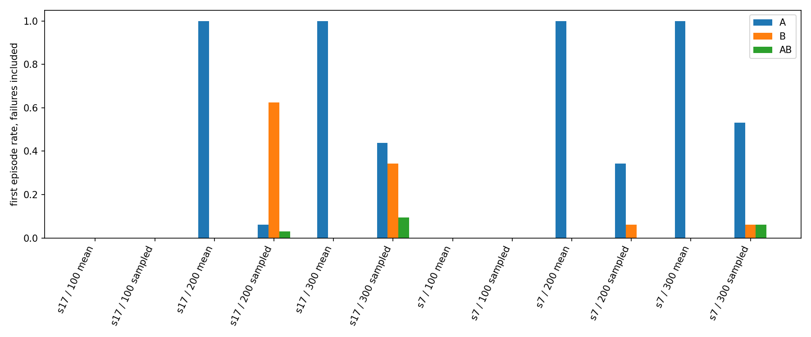
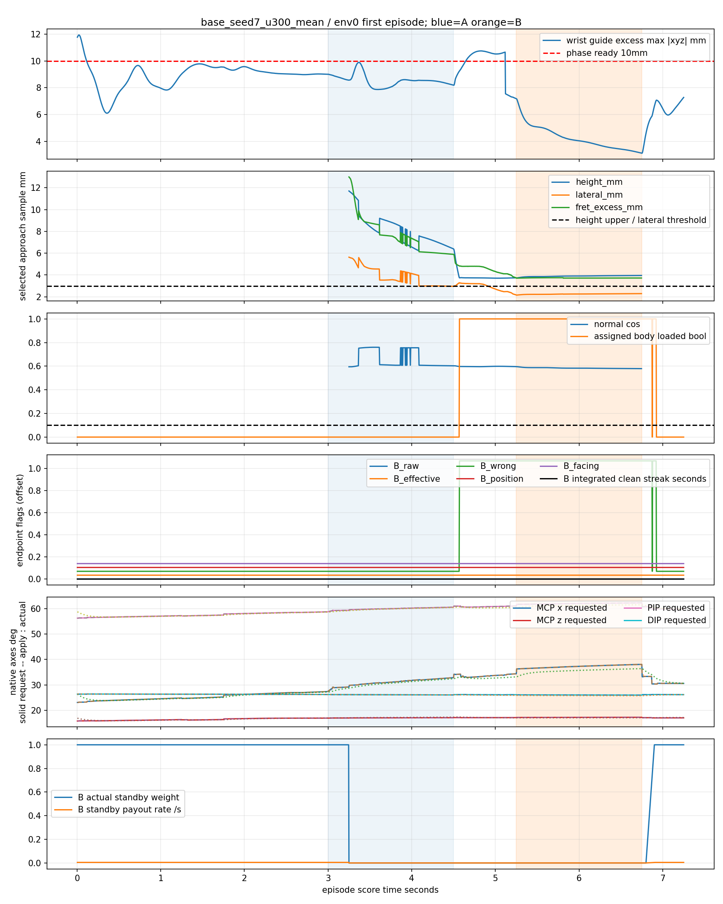
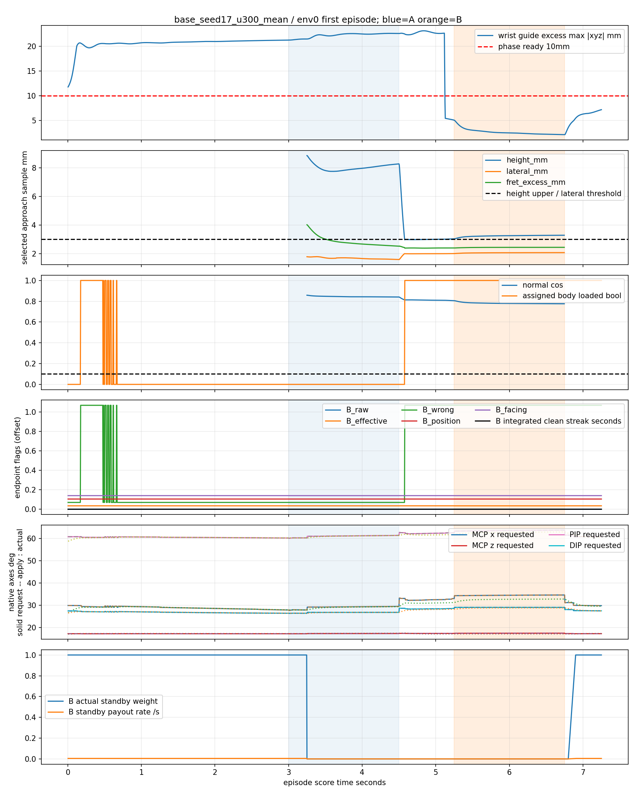
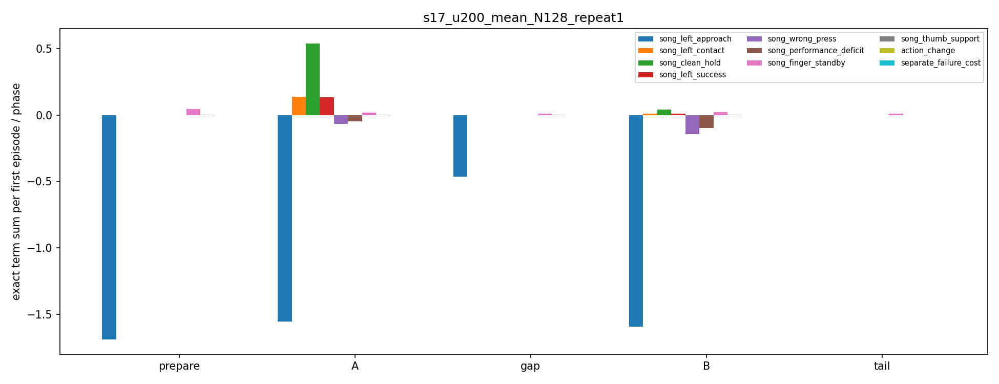
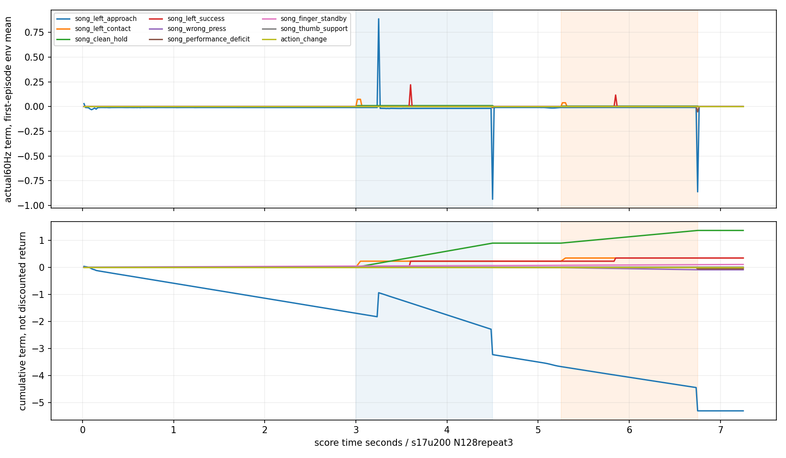
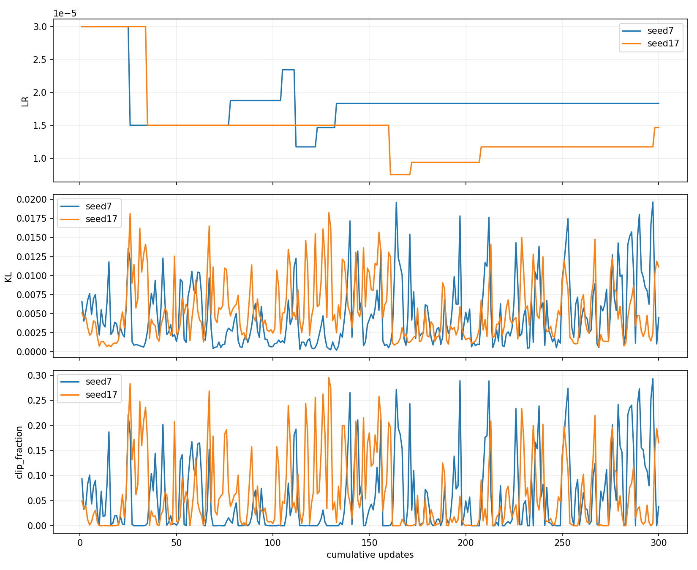
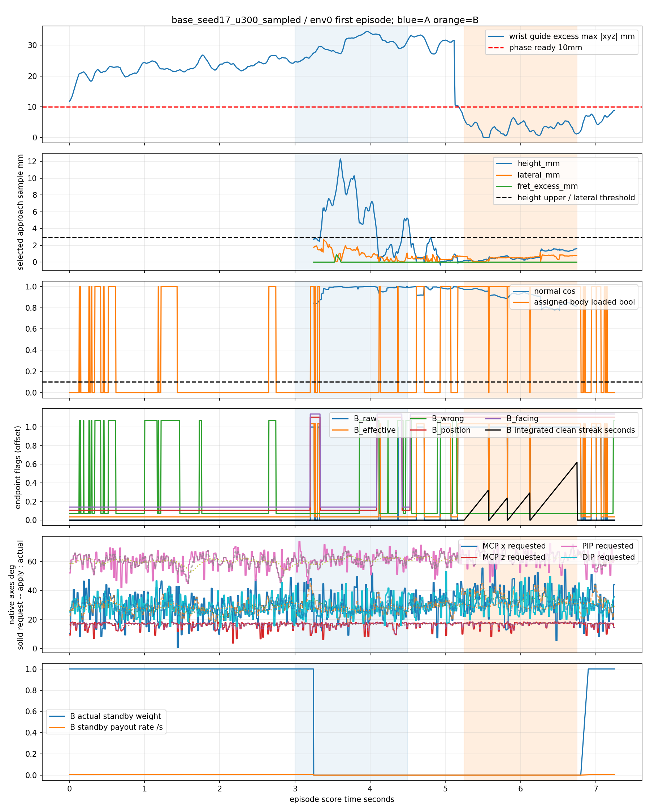
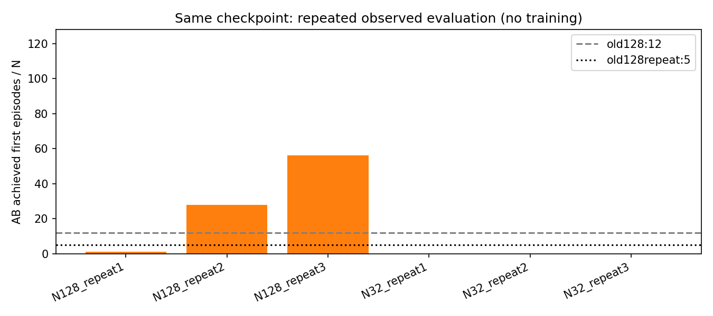

# 검지→중지 전환 원시 로그 분석

작성: 2026-11-01 KST. 이 보고서는 기존 결과의 재요약이 아니라 봉인된 원장·240Hz 추적·300개 업데이트 지표의 재집계와, seed17/200회 체크포인트의 추가 평균 평가 6회를 근거로 한다. **새 학습·보상/제어 변경·기본 코드 채택은 하지 않았다.**

## 핵심 결론

1. **평균 정책의 중지는 목표에 접근한 뒤 잘못된 위치에서 정체한다.** 300회/32환경의 두 seed 모두 B 위치 기하 통과 0초, 최초 clean 접촉 0/32, clean 0초다. 반면 담당 몸체 loaded는 B 전체 1.5초다. 중지 끝마디의 자기 오프렛·다른 줄 접촉 출처가 각각 1.5초 기록된다. 하중이 전혀 없거나 검지가 B를 계속 막는 설명은 이 평균 평가와 맞지 않는다.
2. **정책의 지원 축 하나는 실질적으로 탐색하지 못하는 초기화 상태다.** `L_Thorax_y`는 100/200/300회 양 seed의 대표 환경 B 구간에서 행동 ≈0.999999, 요청/적용각 10°에 머문다. 참조 제어의 B 요청은 8.236°다. 상한 근처 초기 latent≈7.248 때문에 latent std≈0.05가 있어도 요청각 변동이 float32 기록에서 사실상 사라진다. 이 현상은 확인됐지만 전환 실패의 인과적 기여는 아직 미검증이다.
3. **128환경 평가의 반복 민감도가 크다.** 기존 12/128→5/128을 재확인했다. 같은 체크포인트의 이번 128환경 3회는 **1/128·28/128·56/128**, 32환경 3회는 **0/32·0/32·0/32**다. 모델 성능 향상이 아니라 같은 정책 평가의 불안정성이다. 원래 두128평가부터 집계 이전에 궤적이 달랐다. GPU 물리만의 문제인지, 초기화/수치/실행 순서가 결합된 문제인지는 분리되지 않았다.

## 범위·버전·보존

- 복사본: `/home/yigyu/local-research/index_middle_transition_20261101_v1/project`.
- 최상위 AGENTS.md는 없고 실제 적용 지침은 `guitar_learning/AGENTS.md`다. 연구 PLAN, RESULTS, PROGRESS, FINAL_REVIEW와 현행 실행 경로를 확인했다. 과거 archive 규칙과 현행 규칙을 구분했다.
- 원본 Git HEAD 기록: `cdca74d921d25142af73caed326a6f19ae1fc27b`. **HEAD만으로 실행 버전을 특정하지 않는다.** 미커밋·미추적 코드를 포함한 `보존/study_seal.json`의 13,943개 실제 파일 SHA가 기준이다. 원래 artifact_manifest의 756개 파일도 별도로 검산했다. 결과는 `identity_integrity.json`이다.
- 검사 환경: 이 PC의 rl38 Python3.8.20, Torch2.4.1+cu121, Isaac Gym Preview4, RTX4070TiSUPER16GB, driver580.178.04. GPU PhysX/텐서 CUDA를 유지했다. 기존 두128평가와 신규6평가의 native cache runtime SHA는 모두 `54dfee478d466807fa369586724b0a1d83c9cfedde608c315408ffaccb2454f0`다. 설치 배포 메타데이터 경로와 실제 캐시 import 경로를 `environment.json`에서 구분했다. Gym native를 Torch보다 먼저 불러오는 공식 launcher를 사용했고 CPU 대체 실행은 없었다.
- seed17/200회 체크포인트 SHA: `29afaa304ed71b3fa998035831e3065e246b86c08819680baa362a8cd755f405`.
- `identity_integrity.json`에서 기존12/5평가 및 신규6평가의 비설정 입력 pin 일치, 환경 수를 제외한 설정 일치를 확인했다. CPU 분석도 여섯 모델의 입력 pin과 정책/PPO identity를 정확히 검사했다. 메타데이터를 현재 값으로 치환하지 않았다.
- 추가 실행은 단독 GPU 잠금·기존 compute 프로세스 비점유 확인 후 32→128을 3번 순차 실행했다. 원본 반환값을 그대로 돌려주는 관찰기를 이 디렉토리에만 추가했다. 새 결과는 원래 무관찰 결과와 구별한다. 관찰기의 clone/cpu 동기화가 GPU 궤적에 미칠 영향은 제거하지 못했다.

## 1. 원장으로 다시 확인한 수행

A=검지/표준3번줄/4프렛, B=중지/3번줄/6프렛. A 3.00–4.50초, 휴지4.50–5.25초, B5.25–6.75초, 말미7.25초. large·64환경·H32·seed7/17 각300회. seed당 실제 전이614,400, 수락된 actor 갱신600, value 갱신600이다. 다음 표는 실패한 첫 episode를 분모에 포함한다.

|seed|업데이트|실행|A 평균 clean 초|B 평균 clean 초|AB 달성/32|
|---:|---:|---|---:|---:|---:|
|7|100|평균|0.000|0.000|0|
|7|100|탐색|0.221|0.329|0|
|7|200|평균|1.500|0.000|0|
|7|200|탐색|1.204|0.158|0|
|7|300|평균|1.500|0.000|0|
|7|300|탐색|1.217|0.772|2|
|17|100|평균|0.009|0.000|0|
|17|100|탐색|0.197|0.981|0|
|17|200|평균|1.500|0.000|0|
|17|200|탐색|0.364|1.177|1|
|17|300|평균|1.500|0.000|0|
|17|300|탐색|0.850|0.894|3|

300회 탐색의 AB 달성2/3은 연속0.6초 기준이고, 두 음 각각 전체1.5초 유지는 두 seed 모두 **0/32**다. 선정200회 모델의 기존 평균128평가는 seed7=0/128, seed17=12/128이다. seed17 반복은5/128이고, 이 12/5는 두 음 전체 유지 수도 각각12/5였다. 원래 완료 보고의 주요 숫자는 맞는다. 전체 표와 원장 식별은 `tables/conditions.csv`, `analysis_ledger.json`에 있다.

### 참조 성공과 정책 성공의 조건 차이

`진단/native_reference_v2/report.json`의 자유 기타 유한 제어는 A/B 각각 clean1.5초, 첫 clean3.00/5.25초, 연속 달성3.60/5.85초를 통과했다. 0.4초의 B 정착을 포함한 사전 계산 궤적을 사용한다. 기타 고정이나 음 시작 시 실제 q 순간 덮어쓰기로 성공한 기록이 아니다. 제출 action은 같은 유한 제어·속도/힘 상한을 지난다. FK/native 점검의 최대 위치 차이는0.251mm, 회전 차이는0.406°였지만 이는 주기적 검사 표본의 상한이다.

그러나 참조는 **1환경·정답 q 궤적·미리 정한 전환 시점**이고 정책은 **학습64환경·평가32/128환경·관측에서 생성한 행동**이다. 두 조건은 동일한 제어기·입력 목표를 공유해도 정보와 실행 배치가 같지 않다. 초기 자세도 임의의 자유 정렬이 아니라 A-hover 쪽에 유리한 정렬이다. 참조 가능성은 이번 정책의 학습 가능성·안정성 증명이 아니다.

## 2. 중지 실패의 시간적 위치

다음은 **300회 평균/env0/첫 episode**다. 모든 환경의 상세 관절이 아니라 대표 환경의 수치다. 위치 값은 접근 로그가 선택한 패드 표본이며 실제 접촉 판정은 다른 표본도 검색한다. 따라서 아래 수치와 별도로 모든 표본에 대한 `position_geometry`, `facing_geometry`, loaded, raw/effective를 대조했다.

|시점|seed7 높이/줄 횡오차/프렛 영역 초과 mm|seed17 높이/줄 횡오차/프렛 영역 초과 mm|해석|
|---:|---|---|---|
|3.25초|11.71 / 5.63 / 13.00|8.84 / 1.79 / 4.02|B가 미리 노출된 초기 준비; 아직 A 유지|
|4.75초|3.73 / 3.20 / 4.80|2.99 / 2.00 / 2.40|휴지 중 내려왔지만 프렛 영역 정렬 실패|
|5.25초|3.74 / 2.17 / 3.74|3.04 / 2.01 / 2.40|B 시작에 위치를 맞추지 못함|
|6.70초|3.95 / 2.29 / 3.72|3.29 / 2.08 / 2.44|접근 후 오차가 거의 줄지 않거나 조금 악화|

B 발음1.5초 전체의 대표 환경 평균:

|항목|seed7|seed17|
|---|---:|---:|
|접근 표본 높이 mm|3.897|3.242|
|줄 횡오차 mm|2.251|2.064|
|프렛 영역 초과 mm|3.726|2.438|
|표본 normal cosine|0.584|0.781|
|법선 기준 각도 arccos(cos), 대략 °|54.3|38.6|
|손목 안내 영역 밖 최대 xyz 성분, 평균 mm|4.265|2.630|
|같은 손목량 범위 mm|3.146–7.187|2.089–5.034|

실제 positive 판정은 **같은 표본**에서 줄 횡오차≤3mm, 프렛 셀 내부, signed height−1..3mm, normal cosine≥0.1에 담당 몸체 loaded를 결합한다. 접근 표본만 보면 seed17은 높이 상한과0.033mm까지 가까워지지만 프렛 오차가2.4mm 이상 남는다. **최근접 높이 하나의 경계 민감성으로 전체 실패를 설명할 수 없다.** 두 seed의 전체32환경에서도 B 위치 기하 통과0초·facing 기하 통과0초·raw positive0초·effective0초인 반면 assigned loaded는1.5초다. `facing_geometry`는 위치 조건을 포함하므로 이0초는 독립적인 방향 불량의 증거가 아니다. 대표 표본의 방향 자체는0.1 문턱을 넉넉히 넘는다. 하중은 몸체 합력 기반 bool이며 현을 올바르게 누르는 하중 측정은 아니다.

손목 로그는 목표와 손목 중심의 거리 대신 **안내 영역 밖 excess**다. 0이면 영역 안, 양수면 밖이다. 대표 환경은 B에서 대체로 영역 밖 수mm에 있지만 phase ready 문턱10mm는 통과하고, 종료 문턱30mm와도 떨어져 있다. 두 seed 평균32평가의 물리·손목 종료는0이다. 따라서 “손목 완전 정렬 성공”도 “손목 종료 때문에 B를 못 함”도 맞지 않는다.

### 관절 요청→적용→실제 움직임

B 구간의 중지 native 축이다. MCP는 두 native 축 x/z로 나누며 이 좌표를 해부학적 단일 굽힘각으로 합치지 않았다.

|seed|축|요청-적용 RMS °|요청-실제 RMS °|실제 움직임 범위 °|
|---:|---|---:|---:|---:|
|7|MCP x|0.000|1.712|3.225|
|7|MCP z|0.000|0.178|0.042|
|7|PIP|0.000|0.782|1.084|
|7|DIP|0.000|0.241|0.169|
|17|MCP x|0.000|1.916|1.546|
|17|MCP z|0.000|0.288|0.048|
|17|PIP|0.000|0.907|1.168|
|17|DIP|0.000|0.309|0.583|

평균 정책이 B 발음 중 요청한 각은 제어기에 그대로 전달됐다. 이 구간의 원인을 속도 제한 차단 하나로 설명할 근거는 없다. 실제 MCP x에는약1.7–1.9° 추종 오차가 있으며, 이 오차가 공간적으로 얼마를 설명하는지는 같은 상태의 Jacobian/재생 개입 없이 확정할 수 없다. MCP z와 DIP의 작은 변화도 관측됐지만 관절 역할의 단절이나 건 구조 결함을 뜻하지 않는다. 전 단계·탐색의 요청/적용 차이와 속도는 `tables/active_axis_stats.csv`, 정확한 표본은 `snapshots.json`에 있다.

## 3. 오압현의 출처와 해제

- 평균300회 A 구간: 두 seed 모두 clean1.5초, audible wrong0초. B 준비가 A를 항상 망친다는 설명은 반박된다.
- 평균300회 휴지: env0 검지 raw positive는 seed7에서5.129초까지(끝점 수/240=0.558초), seed17에서4.579초까지(0.083초) 남는다. **휴지의 부수 접촉은 A 발음 유지나 오압현 지급이 아니다.** B 시작 전 두 경우 모두 사라지고, 전체32환경 B 구간에서도 A raw positive 시간은0이다.
- 평균300회 B 구간: 두 seed 모두 audible wrong1.5초. 원장의 출처는 **중지 끝마디 `human/LH:middle3`의 own_wrong_fret와 own_wrong_string 각각1.5초/환경**이다. 두 원인은 겹치므로3초로 더하지 않는다. 검지의 other_higher 출처는 없다. seed7 이 몸체의 모든 cause를 합친 프렛 범위는5..5, seed17은5..6이다.
- own_wrong_string은 목표3번줄 이외 표본이 있다는 판정이다. 정확히 몇 번 줄인지는 로그에 없다. 프렛 min/max도 **음×몸체 전체 cause 공통 범위**라 “5프렛/특정 줄/특정 시각”이라는 하나의 witness로 결합하면 안 된다. 프렛 방향의 부호도 표본 along 정의를 따라야 하므로 프렛 초과 거리에서 임의의 프렛 번호를 역산하지 않았다.

탐색300회/seed17의 원장 출처:

|대상 발음|출처|원인|해당 환경/32|모든32환경 평균 출처 시간 초|그 몸체 모든 cause의 프렛 범위|
|---|---|---|---:|---:|---|
|A|검지 끝마디|own_wrong_fret|15|0.4653|4..5|
|A|검지 끝마디|own_wrong_string|11|0.1624|4..5|
|A|중지 끝마디|other_higher|20|0.0764|5..6|
|A|소지 끝마디|other_higher|8|0.0345|7..8|
|B|중지 끝마디|own_wrong_fret|7|0.2186|5..6|
|B|중지 끝마디|own_wrong_string|16|0.5109|5..6|

other_higher는 코드상 목표와 같은 줄의 높은 프렛 간섭이다. 중지 준비 중 높은 프렛을 누르는 실패와 비목표 소지 간섭은 **탐색 A의 실제 audible 적분**으로 확인된다. 언제 시작하고 끊겼는지는 source flag의240Hz 기록이 없어서 이 표에서 복구할 수 없다. 전체 원자료·모든 조건은 `tables/wrong_sources.csv`, `tables/wrong_sources_aggregated.csv`다. 행별 기간을 임의로 연속 한 덩어리로 배치하지 않았다.

240Hz 시계열의 `wrong` bool은 준비·휴지에도 계산된다. 그러나 원장 wrong 시간·패널티는 실제 발음 overlap에만 적분된다. raw positive, effective candidate, 두 끝점 사이 clean 적분,0.6초 연속 달성,1.5초 전체 유지는 별개로 보존했다. raw 동시 접촉은 높은 목표와 낮은 부수 접촉일 수 있다.

## 4. 보상이 실제로 주는 신호

원래 평가에는9항의 episode 합계만 있고 시점별 항은 없다. 그것을 준비/A/휴지/B로 역산하지 않았다. 대신 같은 seed17/200회 모델의 신규6평가에서 **원본 `_reward_components` 반환 텐서**를60Hz로 복사했다. 원래 함수 반환·상태·난수의 CPU 패리티를 검사했다. 모든 첫 episode는435행이고, 항 합 대 실제 반환 오차≤9.23e−8, 항의 episode합 대 원장 counter 오차≤4.36e−6이다. float32 누적차와 실제 지급항은 구분했다.

다음은 **신규128환경 반복1(AB1/128)**의 첫 episode당 평균 실제 항 합이다. 이 값을 원래12/128 평가의 시점별 보상으로 대체하지 않는다.60Hz 구간 중앙 시각으로 분류했으며0.01667초 지급을240Hz에 균등 재분배하지 않았다.

|보상항|준비0–3|A3–4.5|휴지4.5–5.25|B5.25–6.75|말미|
|---|---:|---:|---:|---:|---:|
|목표 패드 접근|−1.69028|−1.55514|−0.46250|−1.59214|0|
|최초 접촉|0|0.13672|0|0.00977|0|
|압현 유지|0|0.54004|0|0.03906|0|
|압현 달성|0|0.13477|0|0.00977|0|
|오압현|0|−0.06883|0|−0.14414|0|
|음 수행 부족|0|−0.04599|0|−0.09609|0|
|대기 자세|0.04356|0.01585|0.01060|0.02219|0.00929|
|엄지 안내|0.00162|0.00086|0.00044|0.00075|0.00026|
|행동 변화|약−5.26e−8의 episode합; 시점별 상세는CSV| | | | |
|별도 종료 비용|0|0|0|0|0|

대기 보상 합이 B에 남는다고 중지를 쉬게 유도한다고 해석하면 안 된다. 손가락별 trace와 `_finger_preparation`에서 **유효 준비 목표가 있는 손가락의 실제 standby_reward_gate=0, per_finger_rate=0**임을 확인했다. 평균300회/env0의 중지는 B 노출 후 준비·압현 중 대기 지급이0이다. 옛 관측용 gate는 별도로 유지되며 실제 지급 gate와 혼동하면 안 된다. 다른 손가락의 대기 보상은 계속 가능하다.

원래300회 탐색의 AB성공/실패 episode 평균 비교:

|seed/그룹|접근|접촉|유지|달성|오압현|수행 부족|
|---|---:|---:|---:|---:|---:|---:|
|7 성공2|−5.268|0.500|1.686|0.500|−0.004|−0.026|
|7 실패30|−5.248|0.437|1.302|0.125|−0.064|−0.072|
|17 성공3|−5.367|0.500|1.703|0.500|−0.030|−0.008|
|17 실패29|−5.290|0.369|1.107|0.164|−0.116|−0.088|

달성·유지·오압현·수행 부족의 episode 차이는 원하는 방향이다. 다만 이것은 reward 항별 gradient의 인과 검사가 아니다. 접근 보상은 gamma0.99의 potential 차분과 종료 시 nextPhi=0 정산을 사용하므로 **음수 단순 합의 크기만으로 버그나 gradient 지배를 선언할 수 없다.** 같은 이유로 준비/A/B 구간 단순 합의 부호만으로 정책이 어느 동작을 선호한다고 확정하지 않았다. 추가로 신규6평가 모든 첫 episode의 접근 **할인 수익은 −0.9580146..−0.9580138**로 성공 여부와 거의 무관하게 같았다. env0에서 첫 전이로 추정한 초기Phi를 따로 표시하고, 이후434개 실제 전이를 endpoint potential과 대조한 최대 오차는7.63e−8 이하였다. 종료Phi0까지 합친 할인 정산도 검사했다(`potential_check.json`). 초기Phi는 t0 실측이 아니므로 독립 초기상태 검증으로 확대하지 않았다. 이 항의 큰 비할인 음수 합은 정책 갱신에서의 지배나 목표 회피를 뜻하지 않으며, shaping은 중간 TD 신호·critic 근사와 함께 해석해야 한다. 원래 rollout의 전체 observation/latent/value가 없어 reward·cost별 gradient norm/cosine을 이 로그에서 정확히 복구할 수 없다.

E4는 준비 중 hover 품질을 쓴 뒤 press 전0.2초에 일반 표면 거리 potential로 전환한다. 마지막 근접 안내는 거리 스케일30mm와 최대20% 방향 보정이다. 실제 clean의−1..3mm/프렛 셀/3mm 횡오차 조건과 매끈한 접근 품질 사이에는 정밀도 차이가 있다. 이는 설계상 위험이며 이번 결과만으로 보상 결함으로 분류하지 않는다.

같은 신규128 반복3의 B 구간에서 AB성공56환경/실패72환경의 평균 유지항은1.000/0.0556, 달성항은0.250/0.0139, 오압현은0/−0.1417이었다. 전체 구간·9항은 `tables/phase_reward_by_outcome.csv`에 있다. 성공/실패는 최종 outcome으로 분류한 관찰적 비교다.

## 5. 평균·탐색·정책 갱신

### 탐색 크기와 행동 포화

여섯 모델 모두 활성 손가락8축 latent std는0.14969..0.15009, 지지12축은약0.0497..0.0499다. 손가락 std가 하한0.10으로 붕괴한 현상은 아니다. 각 축·모델의 정확한 값은 `learning_ledger.json`, 실제 행동 평균·포화율·요청/적용/실제각은 `tables/active_axis_stats.csv`다. env0의 B 중지4축 평균 행동은 |a|≥0.98 포화율0이다.

그러나 `L_Thorax_y`는 예외다. 여섯 평균 모델과 탐색 실행 모두 B에서 |a|≥0.98 비율100%다. catalog 기준각9°, 초기 정책 hold 목표10°, 허용 상한10°를 정규화한 뒤 atanh(clamp(.999999))로 bias를 시작한다. 초기 latent≈7.248, d요청각/dlatent≈2.0e−6°라 std0.05의 국소 요청각 표준편차는약1.0e−7°다. 기록된 요청각도10°에 붙어 있다. 실제각은 평균300회 seed7=9.188°, seed17=8.385°로 다르므로 실제각 변화가 곧 정책의 이 축 탐색을 뜻하지 않는다. 참조는 B에서8.236°를 요청한다. **상한 초기화와 tanh 압축은 확인 사실, 이 축의 비가동성이 B 실패를 만든다는 것은 우선 검증할 미검증 가설**이다. 전체 제어 범위를 넓히거나 엄지를 추가해야 한다는 결론은 내리지 않았다.

같은 관측의 Gaussian을32점 적분해 구한 중지 E[요청각]과 q(tanh(평균latent)) 차이의 최대 절댓값은 seed7의100/200/300회에서1.887/1.605/1.776°, seed17은1.244/0.980/1.363°다. 비대칭 각 변환·tanh 때문에 요청각 기대값과 평균 실행이 같지 않다. 이것은 **다른 상태로 진행한 탐색 episode의 평균 실제각과 같다는 의미가 아니다.** 기존 평균 실행은 deterministic tanh(mean)이며 expected-angle 방식이 아니었다.

|seed|회|최종 사용LR|최종KL|최종 clip fraction|최종 reward explained variance|
|---:|---:|---:|---:|---:|---:|
|7|100|1.875e−5|0.00069|0.0000|0.185|
|7|200|1.831e−5|0.00518|0.0493|0.016|
|7|300|1.831e−5|0.00446|0.0381|0.425|
|17|100|1.500e−5|0.00244|0.0044|−0.103|
|17|200|9.375e−6|0.00155|0.0000|0.054|
|17|300|1.465e−5|0.01114|0.1655|0.428|

|seed/회|마지막 reward value loss|reward raw advantage std|cost raw advantage std|정규화 결합 advantage 범위|
|---|---:|---:|---:|---|
|s7_u100|0.002145|0.04461|0.00229|-2.36..2.86|
|s7_u200|0.002576|0.04915|0.00324|-2.23..4.98|
|s7_u300|0.001259|0.03522|0.00097|-3.97..5.00|
|s17_u100|0.001448|0.03770|0.00205|-2.87..2.74|
|s17_u200|0.002295|0.04143|0.00336|-3.10..3.89|
|s17_u300|0.002705|0.05250|0.00345|-2.62..3.37|

이 표의 advantage는 마지막 H32 valid2048표본의 분포다. 전체 업데이트 분포는 CSV/원시 지표에 있다. std 비율을 gradient 지배로 바꾸어 해석하지 않았다.

- seed7/17 각각 KL 재시도2회, 거절 actor step2회가 있었고, 수락 actor step은각600회다. 최대 시도KL=0.02128/0.02052였다. LR 회복은4/3회 실제 발동했다. 학습률 회복 미관측 상황이 아니다.
- clip fraction>10%인 업데이트는69/72개다. 업데이트별 마지막 actor 미니배치 gradient norm의 중앙값은5.462/7.712, clipping 상한은0.5다. clipping 전 norm이 크지만 이 사실만으로 손가락별 gradient 방향이나 reward/cost 지배를 알 수 없다. 전체 accepted 미니배치 최대 norm은 `training_summary.json`의 별도 키를 사용한다.
- reward raw/cost raw advantage의 평균·표준편차·범위와 정규화 결과가 원시 metrics에 있고, 요약 CSV는업데이트300개씩 보존한다. value loss는마지막 미니배치 값, explained variance는업데이트 후 모든 valid decision 기준이다. 두 값의 범위를 혼동하지 않았다.
- 200→300회에 평균32환경 B는0으로 남고, 탐색 B clean은seed7에서0.158→0.772초로 증가했지만 seed17은1.177→0.894초로 감소했다. 대표 환경에서200→300회의 프렛 영역 초과 평균은 seed7이5.671→3.726mm로 줄었지만 seed17은1.584→2.438mm로 늘었다. 높이만 가까워진 것을 정밀 정렬 개선으로 읽지 않았다. 단순 학습 길이 부족으로 단정할 수 없다. std0.5배의 기존 실행도 AB2/4에 그쳤고 B clean이0.195/0.554초로 줄었다. 단순 탐색 확대/축소만으로 해결된다는 근거가 없다.
- H32=0.533초. gamma0.99의1초 뒤 가중치는0.547,5초 뒤는0.049다. 실제 lambda는0.98로 gamma×lambda=0.9702이며 H32 끝까지의 trace 감쇠는약0.380이다. B를 미리 본3.25초와 B 시작5.25초 사이의 행동 신용 할당은 critic에 크게 의존한다는 위험은 있지만 이 로그만으로 인과를 확정하지 않는다.
- 지원 인코더는 손목/몸통/엄지 상태와 event앞9열을 받고 손가락의 정밀 패드 오차를 직접 받지 않는다. 손가락 인코더는 전체 입력을 받으며 추가 phase/hold 입력도 있다. 지원부 정밀 피드백 부족은 설계 가설이지 관측 누락 버그로 확정한 것이 아니다. 다른 PC의 학습 구조 비교와 대조할 항목으로 남긴다.

## 6. 12/128→5/128의 원인 분리

### 일치한 것과 일치가 증명되지 않은 것

기존 두128평가는 체크포인트SHA·설정·입력 pin·action_mode=mean·seed17·full_song·첫 episode 선택이 같다. 신규6평가도 같은 모델과 비설정 입력 pin을 확인했다. strict loader는 모델·optimizer·CPU/CUDA 난수 상태를 복원하고, 그 뒤 pool reset을 한다. aligned/v9 선택은CPU torch.rand를 쓰지만 v9_fraction=0이어서 모든 행의 초기 분포 종류는aligned다. 이것만으로 **모든 환경의 초기 body/force 텐서와 native 실행 순서까지 bit 동일함을 증명하지 못한다.** 저장된 런타임 RNG 스냅샷·전체 환경 q105/body state·실제 origin 배열은 없다.

|실행|A 달성|B 달성|AB/128|앞32의AB|AB 환경ID 32개 블록별 수(0–31/32–63/64–95/96–127)|
|---|---:|---:|---:|---:|---|
|기존 선정128|89|32|12|0|0 / 0 / 3 / 9|
|기존 재평가128|79|6|5|0|0 / 4 / 0 / 1|
|신규 반복1|69|5|1|0|0 / 0 / 1 / 0|
|신규 반복2|90|30|28|0|0 / 28 / 0 / 0|
|신규 반복3|114|60|56|0|0 / 28 / 0 / 28|

신규32환경 3회는A32/B0/AB0이며, 기록한 첫 episode1740개240Hz 끝점의 관절·명령·모든환경 거리/후보/wrong에1e−9 초과 차이를 찾지 못했다. 이것은 기록하지 않은 모든 native 상태까지 동일하다는 증명이 아니다. 기존128평가의 앞32도AB0이므로 처음 보고된32와128 차이를 단순 분모 개선으로 읽으면 안 된다. 성공이 특정 환경ID 묶음에 몰리는 것은 수치/배치 의존성을 의심할 근거이나 인덱스 코드 결함의 확정 증거는 아니다.

### 최초 기록 차이

- **기존128 대128:** 첫 기록0.004167초는 추적 필드가 같았다. 전체환경 거리의 첫1e−6m 초과 차이는 **0.008333초/env100/A:2.976μm**. effective candidate의 첫 차이는0.116667초/env65/A, wrong은0.129167초/env41/A다. env0의 실제 관절 차이는0.158333초(최대4.953e−5rad≈0.00284°), 요청각 차이는0.170833초다. 따라서 **집계나 B 직전 판정에서 갑자기12→5가 된 것이 아니라 준비 초반에 궤적이 이미 갈라졌다.**
- **기존32 대128 앞32:** 첫 끝점0.004167초부터 env19/B 거리3.126μm 차이가 있다. env0 요청각도5.96e−8rad 차이가 있어 배치별 신경망 수치 차이 가능성을 완전히 배제할 수 없다. 실제 q의1e−6rad 초과 차이는0.041667초다.
- **신규128 반복1 대2:** 첫 끝점부터 env107/A 거리21.50μm 차이, 첫 후보 차이는0.116667초, env0 실제 q 차이는0.179167초다. 반복1 대3은거리0.008333초부터, env0 q0.233333초부터다.

scene의 배치는ceil(sqrt(N))열로32환경은6열,128환경은12열이다. 좌표 계약은environment-local이지만 실제 origin 배열과 전체초기상태가 저장되지 않아 위치배치 영향은 분리할 수 없다. 같은128 반복에서도 차이가 나므로 **환경 수 변경만이 원인이라는 설명은 충분하지 않다.** 원래128끼리도 달라 새 관찰기만을 유일 원인으로 볼 수도 없다.

현재로서는 “초기 수μm급 차이가 접촉 문턱·정책 피드백을 거쳐 증폭되는 배치 민감 궤적”이 유력한 설명이다. 그러나 초기값 차이·네트워크 계산·native 연산 순서 중 최초 원인은 미확정이다. 정확한 contact witness와 load 크기가 없어 최초 clean 경계의 mm/N 여유를 전 환경에서 복구할 수 없으며, env0 최근접 표본 여유로 다른 성공 환경을 설명하지 않았다. 병렬128환경은독립 훈련128회가 아니다. 단일 실행12/128이나56/128을 일반 성능·통계적 우위로 채택하지 않는다.

## 7. 분석기의 동시 접촉 처리

봉인된 기존 `도구/analyze.py`는모든 시각의 effective AB 후보 동시 참에 assert한다. 음 이후나 휴지까지 포함하므로 실제 동시 발음 성공 여부보다 강한 검사다. 새로운 분석은 raw_dual/effective_dual/실제 audible를 분리하고 A 발음중 B raw+A effective라는 누락 간섭 의심도 별도 집계했다. B 발음중 낮은A 부수 raw접촉은 자동 오류로 처리하지 않았다.

**이번 실제 기존/신규 자료에서 원래 assert가 결과를 잘못 탈락시킨 effective_dual 사례는 발견하지 못했다.** 신규128의 raw dual은 준비·휴지 등에 존재하지만 effective dual은0이며 A발음중 B raw+A effective 의심도0이다. 두 발음 창은 겹치지 않으므로 audible_dual=0만으로 판정 정상성을 증명할 수는 없다. 접촉 표본과 higher veto의 전체표면 표본이 달라 논리적 무조건 동치를 가정해서도 안 된다. 이 경고와 CPU 합성 예시는 `REVIEW.md`, `reviewer_logical_example.json`에 있다. 원래 성공 기준·분석기·평가 파일은 수정하지 않았다.

## 8. 후속 개선 우선순위 — 최대3개

다음은 **구현 계획만 제시**한다. 현재 학습 코드·모델에는 적용하지 않았다. 다른 PC의 LR 비교와 묶지 않는다. 공통으로 A/B, 음1.5초, 휴지0.75초, 초기 실제 q, 자산, large64H32, seed7/17, optimizer/LR 규칙, 판정을 고정한다. 새 계약·봉인·기준군을 만들고 조건별 학습량을 동일하게 한다. 평가 안정성을 먼저 확보해야 성공률 비교를 채택한다. 후속 단독 비교의 선별 문턱은 원래 최종 채택 기준(평균 AB·각 음 유지·정시 시작90% 이상, 물리/손목 실패1% 이하)을 낮추는 것이 아니다.

### 1순위: 평가 재현성의 최초 차이를 분리 — 추가 학습 없음

- **무엇을 바꾸나:** 관찰 계약만 새 버전으로 만들고 t=0과 초기0.25초의 모든 환경 q105, body pose/velocity, 적용목표, controller 상태, net force, RNG digest, native origin/env ID를 기록한다. 이후2.9–6.8초에는 pad 후보의 동일 witness 위치/법선/줄·프렛/load와 wrong_source_flags를240Hz로 기록한다. 모델은 그대로 둔다.
- **구체적 비교:** seed17/u200 mean32/128을 각각3회, 같은 단독GPU·스레드 설정으로 실행한다. 이어 신경망 계산만 고정배치32블록으로 나눈128환경 조건을3회 비교해 신경망 batch 계산과 physics 배치를 구분한다. 이는 새 평가 방식으로 이름을 분리한다. GPU 결정성 옵션 변경을 시험한다면 별도 단독 조건으로 한다.
- **왜 필요한가:** 이번128의 AB 범위55/128은 후속 개선의 예상 크기를 덮을 수 있다. 제어·보상·훈련은 모두 고정한다.
- **지지/기각:** 최초 차이가 reset 전후 q/body면 초기화 가설, 같은 입력 텐서의 action에서 먼저 나면 계산 가설을 지지한다. action이 같고 native state에서 나면 physics/order 가설을 강화한다. 기록하지 않은 force 차이를 남겨둔 상태에서는 확정하지 않는다. 운영상3회 반복 AB 범위≤2/128을 만족하기 전에는 작은 성능 차이를 채택하지 않는다. 통과해도 일반 결정성을 선언하지 않는다.

### 2순위: `L_Thorax_y`의 상한 초기화만 내부로 이동

- **무엇을 바꾸나:** fresh 정책 초기화에서 이 축만 latent bias 약7.248→0, 즉 첫 요청각10°→준비기준9°로 한다. 다른 축 bias·std, 실제 초기 q, catalog, 상한·하한은 그대로다. 기존 모델의 값이나 메타데이터를 고쳐 재개하지 않는다.
- **구체적 비교:** 기존 초기화와 새 초기화 두 조건을 seed7/17 각각300회 학습한다. 조건당614,400전이, 수락 actor600/value600 목표와 같은 LR 규칙을 유지한다.100/200/300회에 mean/sample 최초32를, 최종 모델은128환경 반복으로 평가한다.
- **왜 필요한가:** a≈1에서 latent std가 실제 요청각으로 전달되지 않는 현상을 직접 분리한다. 참조 B의8.236°를 정답 강제 명령으로 넣는 실험은 아니다.
- **지지/기각:** B 구간 이 축의 포화율이100%→10% 미만, 요청각 범위가0→0.5° 이상이 되고 중지 프렛 오차·위치 통과도 개선되면 기전을 지지한다. 두 seed 평균 AB가 각각≥16/128 증가하고 종료 증가≤1/128이면 수행 후보로 선별한다. 축이 움직여도 B 오차·달성이 그대로면 이 축이 주원인이라는 가설은 약화한다. A 유지율>5%p 하락이나 실패 증가면 채택하지 않는다. 이는 운영상 선별 기준이며 통계적 유의성 기준은 아니다.

### 3순위: 최종 근접 안내의 기하 정밀도만 비교

- **무엇을 바꾸나:** 기존 목표패드 potential 항 안에서 거리≤20mm일 때만 프렛 셀·줄 횡오차·높이·방향의 **같은 표본 품질**을 추가 반영한다. 시작값은 최대70% 기하·최소30% 기존 거리이며, 현재 성공 문턱(lateral3mm, height−1..3mm, cell 내부, normal0.1) 주변을 매끈하게 연결한다. 먼 거리, hover 일정, gamma0.99, 종료 nextPhi0, 접촉·달성 보상과 판정은 유지한다. 별도 중복 보상을 추가하지 않는다.
- **왜 필요한가:** 평균 B가2.4–3.7mm 프렛 오차에 정체하는 현상과 현행30mm 거리 척도의 정밀도 차이를 시험한다. 목적은 중간 TD/critic 학습 신호 개선 가설이며, potential을 바꾸면 전체 할인 목적함수가 커진다는 주장은 하지 않는다.
- **고정할 것:** 2순위와 동시에 적용하지 않는다. 같은 원래 기준군과 단독 비교하고 위와 동일한 두 seed·예산·평가·실패 분모를 쓴다. 기존 E4를 재사용하며 합성 fixture에서 먼 거리 기준 동치, 근접 연속성, 할인 potential 종료 정산을 먼저 검사한다.
- **지지/기각:** 평균 B 프렛 초과 오차가1mm 이상 줄고 위치 기하 통과가0→0.6초 이상인 환경이 늘며, 두 seed 평균 AB가 각각≥16/128 개선되면 지지한다. shaping 합만 증가하거나 A 유지율>5%p 하락·오압현/종료 증가면 기각한다. 평가 반복 범위가 효과를 덮으면 미확정으로 남긴다.

지원부 정밀기하 관측, 긴 지연 신용 할당, 초기 A 편향, 해제 시점은 추가 가설이다. 위 세 실험과 섞지 않고 다른 PC의 구조·실제 압현 진단 결과와 대조한다. 학습률 변경이나 길이 연장부터 권하지 않는 이유는 LR 감소·회복이 실제 작동했고, 긴 학습의 두 seed 방향이 일치하지 않으며 평가 반복 변동도 크기 때문이다.

## 산출물과 검증

- `summary.json`, `analysis_ledger.json`, `learning_ledger.json`: 기계판독수행/기하/학습원장과입력SHA.
- `tables/`: 조건별표,20활성축관절·행동,오압현출처,60Hz구간별9항,업데이트지표,240Hz대표환경시계열.
- `runs/`: 신규6평가원문과60Hz지급항원문. 원본평가와다른위치이며기존모델을가리킨다.
- `trajectory_comparison.json`, `snapshots.json`, `saturation.json`: 최초차이·실제시점값·상한초기화계산.
- `figures/`: 목표구간·손목·패드위치/방향/하중bool·clean/wrong·요청/적용/실제각·학습지표.
- `VIDEO_GUIDE.md`: 기존대표영상의시점과원시수치연결. 영상한회로집계성공을대체하지않는다.
- `REVIEW_FINAL.md`, `logs/`:독립검수와검사로그. 분석전용검사6개,관련기존검사34개통과. 수집관찰기의반환/상태/RNG패리티를포함한다.

제출effort와native generalized net force는서로다른로그다. 어느것도모터단독토크나실제현압력으로단정하지않았다. 하중그래프가bool인구간에서힘의크기를만들어내지않았다. 확인된현상·설계위험·인과미확정을구분했으며공유기본코드에는어떤개선도반영하지않았다.
