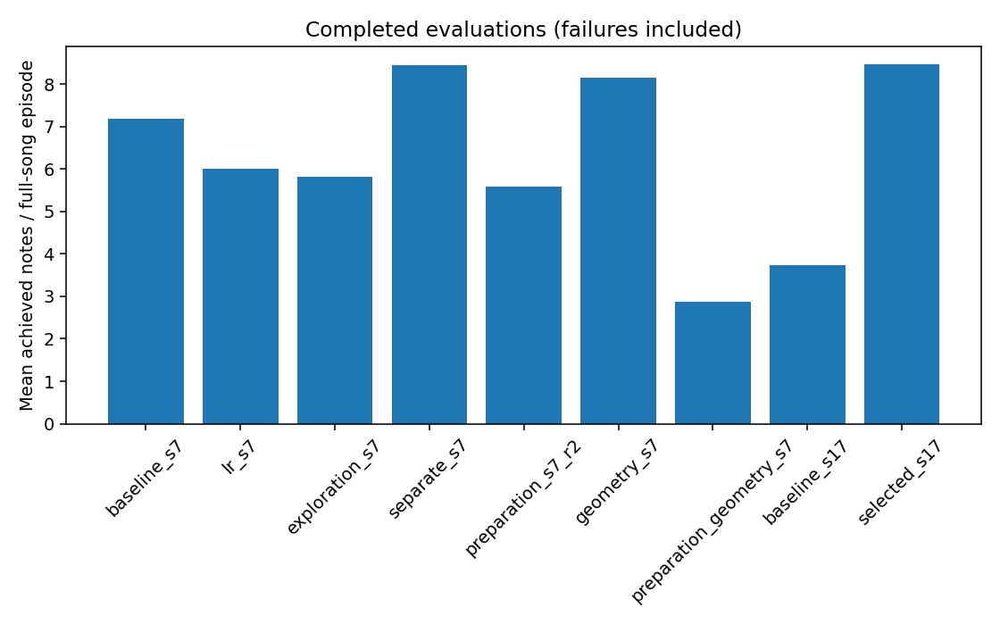

# 개별·조합 연구 결과

이 문서는 현재까지 저장된 실행 상태를 반영한다. 진행 중·실패·평가 미완료를 성공으로 취급하지 않는다.

계획: large / 1024환경 / H32 / 각200업데이트(6,553,600전이), 동일 seed·노출 일정. 실제 반복·전이·시간은 아래에 별도 기록한다. 평가 실패 환경도 분모에 포함한다.

seed7은 선별이고 seed17의 기준/선택 비교는 추가 확인이다. 두 seed만으로 일반적 우위를 확정하지 않으며 연구 선택은 기본 설정 반영을 뜻하지 않는다.

|실행|요인|학습/평가 완료|평균 달성 음|물리/손목 종료|평가 에피소드|실제 반복/전이/학습시간|
|---|---|---|---:|---|---:|---|
|baseline_s7|[]|True/True|7.1953|1/0|128|200/6553600/0.98h|
|lr_s7|['adaptive_lr']|True/True|6.0078|3/1|128|200/6553600/0.99h|
|exploration_s7|['exploration']|True/True|5.8203|0/0|128|200/6553600/0.99h|
|separate_s7|['separate']|True/True|8.4453|6/1|128|200/6553600/0.98h|
|preparation_s7|['preparation']|False/False|미확인|None/None|None|200/6553600/0.99h|
|preparation_s7_r2|['preparation']|True/True|5.5938|1/0|128|200/6553600/0.99h|
|geometry_s7|['geometry']|True/True|8.1484|0/0|128|200/6553600/0.99h|
|lr_exploration_s7|['adaptive_lr', 'exploration']|False/False|미확인|None/None|None|55/1802240/0.29h|
|preparation_geometry_s7|['preparation', 'geometry']|True/True|2.8828|0/2|128|200/6553600/0.99h|
|baseline_s17|[]|True/True|3.7344|1/0|128|200/6553600/0.98h|
|selected_s17|['geometry']|True/True|8.4609|0/0|128|200/6553600/0.98h|

## 학습률과 손가락별 결과

손가락 비율은 해당 손가락의 목표 음 개수로 가중한다. 기하·하중 기반 접촉/달성 판정이며 음향 성공을 뜻하지 않는다. 평가 보상은 에피소드 총점의 평균이며 전이당 보상과 혼합하지 않는다.

### baseline_s7

학습률 진단: `{"first": 3e-05, "last": 7.5e-06, "changes": 1, "decreases": 1, "increases": 0, "recovered_updates": 0, "kl_retry_attempts": 1, "logged_updates": 200}`
계획 학습 예산 일치: `True`; 평가 범위: `full_song`.

|손가락|목표 음 기회|접촉 비율|달성 비율|
|---|---:|---:|---:|
|index|3200|0.2265624994179234|0.18624999426538125|
|middle|2304|0.0|0.0|
|ring|1536|0.316406260302756|0.21158854273380712|
|pinky|1536|0.0|0.0|

평가 보상별 평균 총점: `{"song_left_approach": -13.886084221303463, "song_left_contact": 2.393877006135881, "song_clean_hold": 6.926925656152889, "song_left_success": 1.665948973968625, "song_wrong_press": -1.65215974021703, "song_performance_deficit": -5.930762942880392, "song_finger_standby": 0.22599284094758332, "song_thumb_support": 0.13205001462483779, "action_change": -4.856410325965177e-09}`

실행 실패: `None`

### lr_s7

학습률 진단: `{"first": 3e-05, "last": 1.5e-05, "changes": 1, "decreases": 1, "increases": 0, "recovered_updates": 0, "kl_retry_attempts": 1, "logged_updates": 200}`
계획 학습 예산 일치: `True`; 평가 범위: `full_song`.

|손가락|목표 음 기회|접촉 비율|달성 비율|
|---|---:|---:|---:|
|index|3200|0.14468749472871423|0.12562499480554834|
|middle|2304|0.0|0.0|
|ring|1536|0.274088547041174|0.23893229430541396|
|pinky|1536|0.0|0.0|

평가 보상별 평균 총점: `{"song_left_approach": -14.810686718672514, "song_left_contact": 1.7709153776522726, "song_clean_hold": 6.070974064525217, "song_left_success": 1.5265837120823562, "song_wrong_press": -2.430786428041756, "song_performance_deficit": -6.017379627563059, "song_finger_standby": 0.22422711132094264, "song_thumb_support": 0.11593695799820125, "action_change": -2.076559929597207e-10}`

실행 실패: `None`

### exploration_s7

학습률 진단: `{"first": 3e-05, "last": 7.5e-06, "changes": 1, "decreases": 1, "increases": 0, "recovered_updates": 0, "kl_retry_attempts": 1, "logged_updates": 200}`
계획 학습 예산 일치: `True`; 평가 범위: `full_song`.

|손가락|목표 음 기회|접촉 비율|달성 비율|
|---|---:|---:|---:|
|index|3200|0.12468749709660187|0.07874999823980033|
|middle|2304|0.0|0.0|
|ring|1536|0.32617188710719347|0.3209635535022244|
|pinky|1536|0.0|0.0|

평가 보상별 평균 총점: `{"song_left_approach": -14.577259838581085, "song_left_contact": 1.9007251597940922, "song_clean_hold": 6.649576664000051, "song_left_success": 1.673800538177602, "song_wrong_press": -3.680073724593967, "song_performance_deficit": -6.0246279910206795, "song_finger_standby": 0.24212920607533306, "song_thumb_support": 0.10908016079338267, "action_change": -3.413696682304907e-11}`

실행 실패: `None`

### separate_s7

학습률 진단: `{"first": 3e-05, "last": 3e-05, "changes": 0, "decreases": 0, "increases": 0, "recovered_updates": 0, "kl_retry_attempts": 0, "logged_updates": 200}`
계획 학습 예산 일치: `True`; 평가 범위: `full_song`.

|손가락|목표 음 기회|접촉 비율|달성 비율|
|---|---:|---:|---:|
|index|3200|0.22406249563209713|0.18156249792082235|
|middle|2304|0.0|0.0|
|ring|1536|0.3587239658809267|0.32552084216149524|
|pinky|1536|0.0|0.0|

평가 보상별 평균 총점: `{"song_left_approach": -15.093200027942657, "song_left_contact": 2.4704506117559504, "song_clean_hold": 8.183474657766055, "song_left_success": 2.1234115462284535, "song_wrong_press": -2.792176307324553, "song_performance_deficit": -5.762587376870215, "song_finger_standby": 0.22542700223857537, "song_thumb_support": 0.12483854283345863, "action_change": -9.200348565462091e-09}`

실행 실패: `None`

### preparation_s7

학습률 진단: `{"first": 3e-05, "last": 7.5e-06, "changes": 1, "decreases": 1, "increases": 0, "recovered_updates": 0, "kl_retry_attempts": 1, "logged_updates": 200}`
계획 학습 예산 일치: `True`; 평가 범위: `None`.

|손가락|목표 음 기회|접촉 비율|달성 비율|
|---|---:|---:|---:|
|index|0|None|None|
|middle|0|None|None|
|ring|0|None|None|
|pinky|0|None|None|

평가 보상별 평균 총점: `{}`

실행 실패: `Command '['/home/ajou/miniconda3/envs/rl38/bin/python', '-B', '-m', 'guitar_learning.tool.experiments.finger_ablation', 'train', '--updates', '200', '--num-envs', '1024', '--size', 'large', '--seed', '7', '--out', '/home/ajou/yigyu/3/docs/2026-11-02/수정사항/개별비교연구/runs/preparation_s7/train', '--factors', 'preparation']' returned non-zero exit status 1.`

### preparation_s7_r2

학습률 진단: `{"first": 3e-05, "last": 7.5e-06, "changes": 1, "decreases": 1, "increases": 0, "recovered_updates": 0, "kl_retry_attempts": 1, "logged_updates": 200}`
계획 학습 예산 일치: `True`; 평가 범위: `full_song`.

|손가락|목표 음 기회|접촉 비율|달성 비율|
|---|---:|---:|---:|
|index|3200|0.13999999378575012|0.13156249414896592|
|middle|2304|0.0|0.0|
|ring|1536|0.19531250541331246|0.19205729704117402|
|pinky|1536|0.0|0.0|

평가 보상별 평균 총점: `{"song_left_approach": -21.17330975830555, "song_left_contact": 1.4178767292760313, "song_clean_hold": 5.379506926983595, "song_left_success": 1.3551579199265689, "song_wrong_press": -4.091461008414626, "song_performance_deficit": -6.14881607145071, "song_finger_standby": 0.16823079291498289, "song_thumb_support": 0.11373788100900128, "action_change": -5.549742727005424e-10}`

실행 실패: `None`

### geometry_s7

학습률 진단: `{"first": 3e-05, "last": 1.875e-06, "changes": 1, "decreases": 1, "increases": 0, "recovered_updates": 0, "kl_retry_attempts": 2, "logged_updates": 200}`
계획 학습 예산 일치: `True`; 평가 범위: `full_song`.

|손가락|목표 음 기회|접촉 비율|달성 비율|
|---|---:|---:|---:|
|index|3200|0.18624999444000423|0.1496874928707257|
|middle|2304|0.0|0.0|
|ring|1536|0.3906250161235221|0.36718751455191523|
|pinky|1536|0.0|0.0|

평가 보상별 평균 총점: `{"song_left_approach": -13.287747725844383, "song_left_contact": 2.442552843829617, "song_clean_hold": 8.663583466317505, "song_left_success": 2.1644141662400216, "song_wrong_press": -2.8945308392867446, "song_performance_deficit": -5.809632878750563, "song_finger_standby": 0.22808481589891016, "song_thumb_support": 0.11728714063065127, "action_change": 0.0}`

실행 실패: `None`

### lr_exploration_s7

학습률 진단: `{"first": 3e-05, "last": 3e-05, "changes": 0, "decreases": 0, "increases": 0, "recovered_updates": 0, "kl_retry_attempts": 0, "logged_updates": 55}`
계획 학습 예산 일치: `False`; 평가 범위: `None`.
학습률 감소·회복이 관측되지 않았다. 이200회 결과만으로 학습률 변경의 효과를 판단할 수 없다.

|손가락|목표 음 기회|접촉 비율|달성 비율|
|---|---:|---:|---:|
|index|0|None|None|
|middle|0|None|None|
|ring|0|None|None|
|pinky|0|None|None|

평가 보상별 평균 총점: `{}`

실행 실패: `Command '['bwrap', '--ro-bind', '/', '/', '--proc', '/proc', '--ro-bind', '/sys', '/sys', '--dev-bind', '/dev', '/dev', '--bind', '/tmp', '/tmp', '--bind', '/home/ajou/yigyu/3', '/home/ajou/yigyu/3', '--ro-bind', '/home/ajou/yigyu/3/docs/2026-11-02/수정사항/개별비교연구/recovery/frozen/guitar_learning', '/home/ajou/yigyu/3/guitar_learning', '--ro-bind', '/home/ajou/yigyu/3/docs/2026-11-02/수정사항/개별비교연구/recovery/pinned_inputs/0000', '/home/ajou/yigyu/3/data/song_bundles/05_BN2-131-B_solo/manifest.json', '--ro-bind', '/home/ajou/yigyu/3/docs/2026-11-02/수정사항/개별비교연구/recovery/pinned_inputs/0001', '/home/ajou/yigyu/3/data/song_bundles/05_BN2-131-B_solo/mapping/chords.json', '--ro-bind', '/home/ajou/yigyu/3/docs/2026-11-02/수정사항/개별비교연구/recovery/pinned_inputs/0002', '/home/ajou/yigyu/3/data/song_bundles/05_BN2-131-B_solo/mapping/fingering.json', '--ro-bind', '/home/ajou/yigyu/3/docs/2026-11-02/수정사항/개별비교연구/recovery/pinned_inputs/0003', '/home/ajou/yigyu/3/data/song_bundles/05_BN2-131-B_solo/mapping/notes.json', '--ro-bind', '/home/ajou/yigyu/3/docs/2026-11-02/수정사항/개별비교연구/recovery/pinned_inputs/0004', '/home/ajou/yigyu/3/data/song_bundles/05_BN2-131-B_solo/mapping/tablature.notes.csv', '--ro-bind', '/home/ajou/yigyu/3/docs/2026-11-02/수정사항/개별비교연구/recovery/pinned_inputs/0005', '/home/ajou/yigyu/3/data/song_bundles/05_BN2-131-B_solo/preview/fingering.png', '--ro-bind', '/home/ajou/yigyu/3/docs/2026-11-02/수정사항/개별비교연구/recovery/pinned_inputs/0006', '/home/ajou/yigyu/3/data/song_bundles/05_BN2-131-B_solo/source/annotation.jams', '--ro-bind', '/home/ajou/yigyu/3/docs/2026-11-02/수정사항/개별비교연구/recovery/pinned_inputs/0007', '/home/ajou/yigyu/3/data/song_bundles/05_BN2-131-B_solo/source/audio.wav', '--ro-bind', '/home/ajou/yigyu/3/docs/2026-11-02/수정사항/개별비교연구/recovery/pinned_inputs/0008', '/home/ajou/yigyu/3/data/song_bundles/05_BN2-131-B_solo/training/fret_training.json', '--ro-bind', '/home/ajou/yigyu/3/docs/2026-11-02/수정사항/개별비교연구/recovery/pinned_inputs/0009', '/home/ajou/yigyu/3/data/song_bundles/05_BN2-131-B_solo/training/hand_position_targets.json', '--ro-bind', '/home/ajou/yigyu/3/docs/2026-11-02/수정사항/개별비교연구/recovery/pinned_inputs/0010', '/home/ajou/yigyu/3/data/song_bundles/05_BN2-131-B_solo/training/strike_plan.json', '--ro-bind', '/home/ajou/yigyu/3/docs/2026-11-02/수정사항/개별비교연구/recovery/pinned_inputs/0011', '/home/ajou/yigyu/3/data/song_bundles/05_BN2-131-B_solo/training/strike_training.json', '--ro-bind', '/home/ajou/yigyu/3/docs/2026-11-02/수정사항/개별비교연구/recovery/pinned_inputs/0012', '/home/ajou/yigyu/3/docs/2026-11-02/수정사항/개별비교연구/runs/baseline_s7/train/J/settings.json', '--ro-bind', '/home/ajou/yigyu/3/docs/2026-11-02/수정사항/개별비교연구/recovery/pinned_inputs/0429', '/media/ajou/새 볼륨1/Guitar/guitar_project_docs_20261027_v1/docs/2026-10-12/stability_adapter_2/results/free_guitar_fretting_v1/native_probe_v1/initial_values.json', '--ro-bind', '/home/ajou/yigyu/3/docs/2026-11-02/수정사항/개별비교연구/recovery/pinned_inputs/0430', '/media/ajou/새 볼륨1/Guitar/guitar_project_docs_20261027_v1/docs/2026-10-12/stability_adapter_2/results/free_guitar_fretting_v1/native_probe_v1/inputs_before.json', '--ro-bind', '/home/ajou/yigyu/3/docs/2026-11-02/수정사항/개별비교연구/recovery/pinned_inputs/0431', '/media/ajou/새 볼륨1/Guitar/guitar_project_docs_20261027_v1/docs/2026-10-12/stability_adapter_2/results/free_guitar_fretting_v1/native_probe_v1/prepared.json', '--chdir', '/home/ajou/yigyu/3', '--', '/home/ajou/miniconda3/envs/rl38/bin/python', '-B', '-m', 'guitar_learning.tool.experiments.finger_ablation', 'train', '--updates', '200', '--num-envs', '1024', '--size', 'large', '--seed', '7', '--out', '/home/ajou/yigyu/3/docs/2026-11-02/수정사항/개별비교연구/runs/lr_exploration_s7/train', '--factors', 'adaptive_lr', 'exploration']' returned non-zero exit status 1.`

### preparation_geometry_s7

학습률 진단: `{"first": 3e-05, "last": 7.5e-06, "changes": 1, "decreases": 1, "increases": 0, "recovered_updates": 0, "kl_retry_attempts": 1, "logged_updates": 200}`
계획 학습 예산 일치: `True`; 평가 범위: `full_song`.

|손가락|목표 음 기회|접촉 비율|달성 비율|
|---|---:|---:|---:|
|index|3200|0.06374999857507646|0.0631249985890463|
|middle|2304|0.0|0.0|
|ring|1536|0.11002604448003694|0.10872396116610616|
|pinky|1536|0.0|0.0|

평가 보상별 평균 총점: `{"song_left_approach": -18.9886352494359, "song_left_contact": 0.7406943031819537, "song_clean_hold": 2.8271805234253407, "song_left_success": 0.7196175254648551, "song_wrong_press": -2.814320500008762, "song_performance_deficit": -6.3091800273396075, "song_finger_standby": 0.16722045541973785, "song_thumb_support": 0.12540074493153952, "action_change": 0.0}`

실행 실패: `None`

### baseline_s17

학습률 진단: `{"first": 3e-05, "last": 4.6875e-07, "changes": 1, "decreases": 1, "increases": 0, "recovered_updates": 0, "kl_retry_attempts": 3, "logged_updates": 200}`
계획 학습 예산 일치: `True`; 평가 범위: `full_song`.

|손가락|목표 음 기회|접촉 비율|달성 비율|
|---|---:|---:|---:|
|index|3200|0.17656249657738954|0.14937499637017027|
|middle|2304|0.0|0.0|
|ring|1536|0.0|0.0|
|pinky|1536|0.0|0.0|

평가 보상별 평균 총점: `{"song_left_approach": -12.97555111348629, "song_left_contact": 0.7456647054059431, "song_clean_hold": 2.6063765399740078, "song_left_success": 0.6255078178364784, "song_wrong_press": -0.8760402488405816, "song_performance_deficit": -6.440519627183676, "song_finger_standby": 0.2270649013807997, "song_thumb_support": 0.1314026324544102, "action_change": 0.0}`

실행 실패: `None`

### selected_s17

학습률 진단: `{"first": 3e-05, "last": 1.875e-06, "changes": 1, "decreases": 1, "increases": 0, "recovered_updates": 0, "kl_retry_attempts": 2, "logged_updates": 200}`
계획 학습 예산 일치: `True`; 평가 범위: `full_song`.

|손가락|목표 음 기회|접촉 비율|달성 비율|
|---|---:|---:|---:|
|index|3200|0.20468749554129317|0.16468749492196366|
|middle|2304|0.0|0.0|
|ring|1536|0.3658854318782687|0.36197918199468404|
|pinky|1536|0.0|0.0|

평가 보상별 평균 총점: `{"song_left_approach": -13.604659218341112, "song_left_contact": 2.407321537612006, "song_clean_hold": 8.819877008441836, "song_left_success": 2.2054167937021703, "song_wrong_press": -2.756162131438032, "song_performance_deficit": -5.8128571175038815, "song_finger_standby": 0.22790471254847944, "song_thumb_support": 0.12594319286290556, "action_change": -8.761319495419195e-10}`

실행 실패: `None`

## 해석 범위

200회는 짧은 선별이다. 초기 조건·실제 학습 예산·평가 범위가 동일한 실행끼리 비교해야 한다. 단일 미세 향상, 미발동 요인, 조합 상호작용을 구분한다.

권장 후보 판단 기준은 두 seed에서 각각 기준 대비 평균 달성 음 +0.25 이상, 실패 횟수는 기준 대비 +2/128 이내인 경우다. 실제 채택 판단은 선택 기록을 따르며 이 문서는 기본 설정을 변경하지 않는다.

선택 기록: `{"phase": "complete", "screen_winner": "geometry_s7", "recommended_factors": ["geometry"], "confirmed": true, "default_changed": false, "confirmation_candidate": "selected_s17", "confirmation_baseline": "baseline_s17", "reason": "positive in both tested training seeds", "adoption": "reviewed research recipe only; production default unchanged"}`

