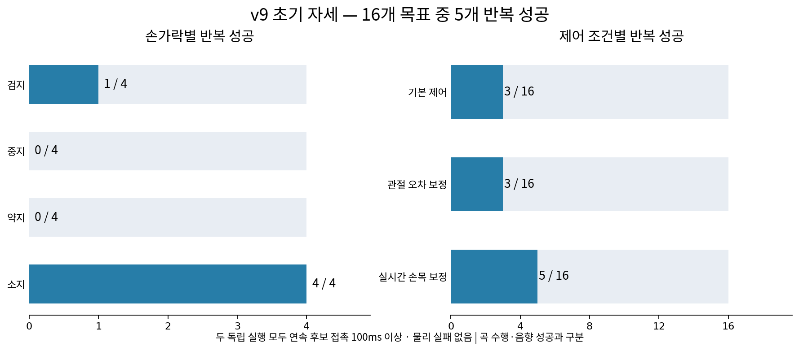

# v9 초기 자세의 손가락별 압현 실험

현재 결과만 볼 때는 [실험별 역할 목록](experiments/README.md)의 최신 완료 행부터 읽는다. 이 문서의 아래 단일음·기하 재생·초기 구조는 이전 연구 이력이다.

## 최신 완료: 목표 전환 v2

실험은 2026-10-31 20:18 KST에 완료했다. E4·large64·H32·팔12+중지4축·휴지0.75초의 A→B 두 음을 seed7/17 각300회, 총600회 학습하고 평균/확률 행동 각32에피소드로12회 평가했다. 평균 행동은 두 난수 모두 A32/32·B0/32·전체 AB0/32였다. 최종 확률 행동의 AB 달성은16/32·10/32였지만 두 음을 각각1.5초 전체 유지한 경우는1/32·0/32였다. 물리·손목 종료는 없었다. 참조 동작의 실현성과 학습 정책의 성과는 구분하며 안정적인 전환 학습은 아직 달성하지 못했다.

[실험 안내](experiments/target_transition_v2/README.md) · [전체 결과](experiments/target_transition_v2/runs/comparison_v1/RESULTS.md) · [영상](video/target_transition_v2/)

## 이전 구현: 자연스러운 압현 준비 v3

[새 구현과 실행 안내](experiments/natural_press_v3/README.md). 목표 노출·대기 보상·줄 위4~8mm 준비 영역을 E0~E4로 분리하고, 음 시작0.2초 전부터 기존 표면 접근 보상으로 연결한다. 정렬/v9 초기 상태와 목표4축/팔 포함16축/전체33축을 별도로 선택한다. 기존 보상·제어 기본값은 자동 변경하지 않으며, 동작 개선 여부는 같은 예산의 후속 비교로 판단한다.

## 이전 구현: 정렬 시작 → 오차 확장 → v9

[구조 v2 안내](experiments/structured_press_v2/README.md). 별도 연구 사본에서 목표 손가락을 항상 움직일 수 있게 두고, A 정렬 시작의 손가락 압현 → B 작은 오차 → C 원래 v9 분포로 확장한다. 초기 선접촉이 있는 후보는 제외한다. 생산 기본값은 아직 바꾸지 않았으며, 실행 검증을 학습 성공으로 해석하지 않는다.

## 후속 비교: 탐색·학습률·순차 구조

[최종 분석](experiments/exploration_lr_sequence_v1/analysis/FINAL_ANALYSIS.md) · [진행 기록](experiments/exploration_lr_sequence_v1/progress.md). 대표4목표×5조건의 최종640평가는 접촉·clean·달성 모두0이었다. 이전 순차 gate는 정렬 단계에서 굽힘 권한으로 넘어가지 못해 구조 v2에서는 손가락 차단을 제거한다. 이전 소스·체크포인트·결과는 보존한다.

## 완료된 실제 PPO 단일음 학습

기존 기하 후보 재생과 별개로, 실제 J33 학습 환경에서 가상 단일음 16개를 각각 새 정책으로 학습·평가했다. 최종256평가의 달성·목표접촉은 모두0이며, 손가락 명령과 탐색 병목을 후속 연구에서 분리한다. 각 목표는 large·64환경·H32·100회이며 보상·물리·제어·종료 조건을 유지한다. 목표는 준비 3초 후 2.5초 동안 지정 손가락·줄·프렛을 누르는 것이며, 기존 연속 clean 1초 기준으로 달성을 판정한다.

- [실시간 진행](process/learning/progress.md): 실행 단계와 완료한 목표 수
- [평가 수치](analysis/learning/summary.json): 목표마다 초기·최종 모델의 동일 16환경 평가가 끝나면 누적 기록
- [실행·목표·원본 고정 정보](process/learning/run_manifest.json)
- [학습 결과·영상](analysis/learning/RESULTS.md) · [실패 원인 분석](analysis/learning/diagnosis/ANALYSIS.md). 학습 영상은 `video/learning/`, 과정과 로그는 `process/learning/`에 저장했다.

아래는 앞서 완료한 기하 후보 재생 검사다. 아래 성공 5/16은 실제 PPO 학습 성과가 아니다.

## 앞선 기하 후보 재생 검사

기존 줄·프렛 압현 실험249파일(약1.03GiB)을 제거하고 새로 검사했다. 초기자세 개발 자료는 initial_pose/로 모아 보존했다. 새초기자세에서16목표를 자유기타3조건×2회, 총96개실행으로 확인했다.

반복 검증 성공은 **5/16개 목표**다. 검지1/4, 중지0/4, 약지0/4, 소지4/4다. 기본제어와관절오차보정은3/16, 실시간손목보정은5/16이며 물리안전실패는96개실행중0건이었다.

[결과 해석과 다음 검사 제안](analysis/INTERPRETATION.md) · [전체96개 결과](analysis/RESULTS.md) · [원목표16개](TARGETS.md) · [수치CSV](analysis/analysis.csv)

성공 영상에서도 활성손가락의 실제 굽힘 변화는 작고 팔·손목 이동 비중이 컸다. 이번5개를 자연스러운 손가락 능동압현의 성공으로 해석하지 않는다. 구체 수치는 결과 해석에 기록했다.

| 반복 성공 목표 | 연속 접촉 | 손 확대 영상 | 전신 영상 |
|---|---:|---|---|
| 검지 3줄·4프렛 | 6.733초 | [손 확대](video/free_open/index_s3_f4_hand.mp4) | [전신](video/free_open/index_s3_f4_full.mp4) |
| 소지 3줄·9프렛 | 6.654초 | [손 확대](video/free_open/pinky_s3_f9_hand.mp4) | [전신](video/free_open/pinky_s3_f9_full.mp4) |
| 소지 2줄·10프렛 | 6.912초 | [손 확대](video/free_open/pinky_s2_f10_hand.mp4) | [전신](video/free_open/pinky_s2_f10_full.mp4) |
| 소지 4줄·11프렛 | 6.421초 | [손 확대](video/free_live/pinky_s4_f11_hand.mp4) | [전신](video/free_live/pinky_s4_f11_full.mp4) |
| 소지 4줄·12프렛 | 5.750초 | [손 확대](video/free_live/pinky_s4_f12_hand.mp4) | [전신](video/free_live/pinky_s4_f12_full.mp4) |

| 디렉토리 | 저장 내용 |
|---|---|
| video/ | 성공 목표의 손 확대·전신 MP410개만 |
| analysis/ | 해석·전체 결과·CSV·JSON·그래프 |
| process/ | 실행 도구·기하 후보·물리 기록·로그·렌더 증거·캐시·검수 |
| initial_pose/ | 초기 자세 개발·적용 기록 |

[초기 자세 자료](initial_pose/README.md) · [실험 상태](process/status.json) · [삭제·이동 목록](process/cleanup.json) · [독립 검수](process/final_result_review.json) · [영상 검사](process/media_qa.json)

성공 기준은 두 독립 실행 모두 유효패드 기하·방향·distal순접촉합력≥0.01N·오압현 제외를 만족하는 연속100ms와 물리실패 없음이다. 접촉쌍·실제줄압력·음향성공은인증하지않으며 곡시계의손목안내/J종료는이번정적진단에적용하지않았다. 정책의 곡 수행 성공과 구분한다.
