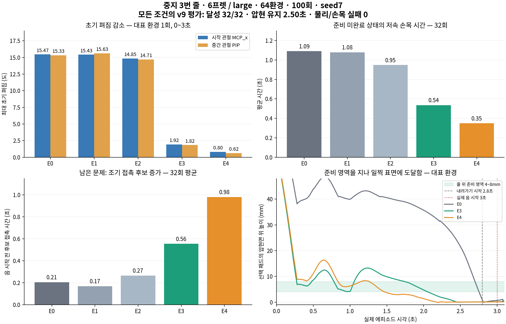

# 2026-10-31 중지 압현 비교 중간 결과 검토

## 결론

100회 비교에서 줄 위 준비 영역을 적용한 E3/E4는 압현 성능을 유지하면서 대표 궤적의 큰 초기 펴짐을 줄였다. 그러나 준비 영역에서 음 시작까지 기다리지 않고 먼저 눌러 버리는 접촉 후보가 늘었다. 현재 결과로 자연스러운 압현이 해결됐다거나 기본 학습에 채택됐다고 선언하지 않는다.

전체 비교는 미완료다. 12:46 KST에 E1의200회 연장 중 누적160회를 마친 뒤 다음 업데이트의 KLGuardError로 중단됐다. 완료된100회5조건과 E0 200회만 결과로 사용한다. 원래 후보 E1/E2는 바꾸지 않고, 실패한 블록은 보존한 채 나머지 독립 조건을 이어가는 계획을 별도로 기록한다.

## 같은100회·seed7 비교

| 조건 | 변경 | v9 달성 | clean 평균 | 준비 영역0.2초 이상 | 초기펴짐 MCP_x/PIP | 조기 접촉 후보 평균 |
|---|---|---:|---:|---:|---:|---:|
|E0|기존|32/32|2.50초|0/32|15.47° / 15.33°|0.206초|
|E1|첫 목표 관측 초기 노출|32/32|2.50초|0/32|15.43° / 15.63°|0.170초|
|E2|목표 손가락 대기 보상 해제|32/32|2.50초|0/32|14.85° / 14.71°|0.266초|
|E3|조기 준비 영역 접근|32/32|2.50초|32/32|1.92° / 1.82°|0.555초|
|E4|E1+E2+E3|32/32|2.50초|32/32|0.80° / 0.62°|0.980초|

모든 조건의 정렬 평가도32/32였고 두 평가 모두 물리·손목 실패0이었다. E0 200회도 달성32/32·clean2.50초였지만 대표 초기펴짐은16.90°/21.84°로 커졌다. 단순히 오래 학습하는 것만으로 자연스러워지지는 않았다.

초기펴짐은 env0 첫 에피소드, 첫 실제240Hz 관측각을 기준으로 한0~3초 native MCP_x/PIP 최대 펴짐이다. 리셋 순간각·기하MCP·32환경 평균이 아니다. 성공32회는 같은 중지 S3F6의 명목 초기 상태 반복이며32개의 새 목표나 전곡 일반화가 아니다.

## 준비는 빨라졌지만 기다림은 해결되지 않았다

E4의 대표 초기펴짐은 기존 대비 MCP_x 약94.8%, PIP 약96.0% 감소했다. 준비 미완료 상태에서 손목이 느린 시간도32회 평균1.091→0.349초로 줄었다. E1의 관측 변경만, E2의 대기 보상 해제만으로는 큰 펴짐이 거의 바뀌지 않았다. 이번 비교에서는 조기 준비 영역 접근을 포함하는 변경이 주요 효과와 연관된다.

그 대신 E4의 조기 접촉 후보 시간이 평균0.206→0.980초로 약4.8배 늘었다. 대표 env0는1초에 패드 높이6.29mm로 준비 영역에 있었지만,2초에는1.40mm로 내려갔고 첫 접촉 후보는2.2125초였다. 실제 음 시작3초, 설계상 내려가기 시작2.8초보다 이르다. E3도 대표 첫 접촉 후보2.454초로 일렀다.

조기 접촉은 음이 울리는 구간의 오압현과 다르다. 현재 판정의 손가락 패드 기하·끝마디 하중을 만족한 후보이며 실제 접촉쌍·음향을 인증한 압력 측정은 아니다. 음 시작 이후 오압현 시간은 이번 모든 조건에서0이었다.

이는 준비 영역에 한번 도달하는 것과, 음 시작 직전까지 그 영역을 유지하는 것이 서로 다른 목표임을 보여준다. 현재 최초 접촉 보상은 음 시작 전에는 지급되지 않지만, 미리 누른 채 음 시작을 기다리는 동작 자체를 금지하지는 않는다. 기존 접근 potential의 보간만으로 대기 전략의 최적성을 보장할 수 없다. 후속 개선의 우선순위는 손가락 움직임 비용 추가보다 조기 접촉의 시각을 명확히 다루는 것이다. 이번 결과 확인 중 보상·물리·학습 코드는 변경하지 않았다.

E4 대표 궤적의4초 시점에서 MCP_x/PIP/DIP는 첫 관측 대비 각각 약11.1°/5.2°/13.4° 더 굽혀졌다. 여러 마디가 함께 움직이는 기록이며, 이것만으로 사람과 같은 자연스러운 자세를 인증하지는 않는다.

## 자동 후보가E1/E2인 이유

사전에 정한 후보 순위는 안전→달성→clean→오압현→조기 접촉→펴짐 순이다. 앞 지표가 동률인 상황에서 조기 접촉이 짧은 E1/E2가 선정됐으며, 선택은 기록한 규칙과 일치한다. E3/E4가 누락된 것이 결과 파일 오류는 아니다. 자연스러운 준비 지표가 좋아져도 조기 접촉을 늘리는 trade-off가 드러난 것이다. 현재 단계에서 순위를 몰래 바꾸어 후속 후보를 바꾸지 않는다.

## 중단 원인과 복구 한계

E1은 누적160회까지, 해당 추가 실행에서60회·122,880전이를 반영했다. 다음 수집2,048전이에서 PPO의 정책 변화량 검사 재시도를 소진해 중단했고 해당 수집은 폐기했다. 물리 불안정이나 입력 소스 변경 때문이 아니며 정리 오류도 없다.

직전10개 완료 업데이트의 actor_lr는 모두2.288818359375e-5였고 KL재시도는0이었다. 마지막 완료KL은0.008490이다. 실패 시도의 실제KL·최종 재시도 숫자는 오류 보고서에 저장되지 않아 정확히 확인할 수 없다. 마지막 완료KL을 실패 시도의KL로 해석하지 않는다.

활성4축 가우시안 entropy에서 추정한 std 기하평균은 직전10회 약0.150013→0.150007로 거의 같았다. 탐색 하한0.10에 도달하거나 탐색이 붕괴해서 중단됐다고 볼 근거는 없다. 개별 축 std나 산술평균을 측정한 값은 아니다.

160회 상태의 final.pt/failure_last_valid.pt는 없다. 실패 실행에는100회 상태 initial.pt만 있으므로160회에서 바로 이어갈 수 없다. 동일 조건100회 모델을 새 출력으로 다시 실행하는 것은 가능하지만 같은 오류 재현에 그칠 수 있어 이번에는 해당 실패를 기록하고 독립 조건을 먼저 이어간다. 안전검사를 완화해200회 완료로 만드는 변경은 하지 않는다.

## 다음 단계와 영상

중단된 E1 seed7 블록은 미완료로 남기고 나머지 E2 200회와 seed17 E0/E1/E2의100→200회 검증을 수행한다. 그 뒤 단계별 성능과 자연스러움의 재현성을 판단한다. E3/E4는 별도 후속 후보로서 영상과 조기 접촉 문제를 함께 확인한다. 아직 기본 학습을 자동 변경하지 않았다.

실제 정책의 v9/full33 재생 영상을 `render_E4_u100`과`render_E0_u100`에 생성했다. 렌더는4환경 중 env0이며32환경 평가와 같은 궤적이라고 가정하지 않는다. 공개 video 폴더에는검수한 MP4만 복사한다. 생성 도구와 원본 포즈·로그는 이 검토 폴더에 둔다.

검토용 영상: [E0/E4 손 좌우 비교](../../../../../../압현실험/동영상/11_중지단일음_기존E0와준비개선E4_손동작나란히비교.mp4) · [E4 전신](../../../../../video/natural_press_v3_comparison_v1/review_seed7_E4_u100_fullbody.mp4). 비교 영상은 동일 시각의 실제 재생을 축소·나란히 배치하고 조건명만 표시했으며 재생속도나 관절 포즈를 바꾸지 않았다.

중단 원인 확인 후, 고정 후보와 학습 설정을 유지한 나머지700회 독립 비교를 재개했다. 현재 상태와 예상 종료는 [진행상황](../진행상황.md), 이후 완료 결과는 [별도 집계](../recovery_v1/RESULTS.md)를 따른다. 원래 실패 블록과 최초 집계는 보존한다.
