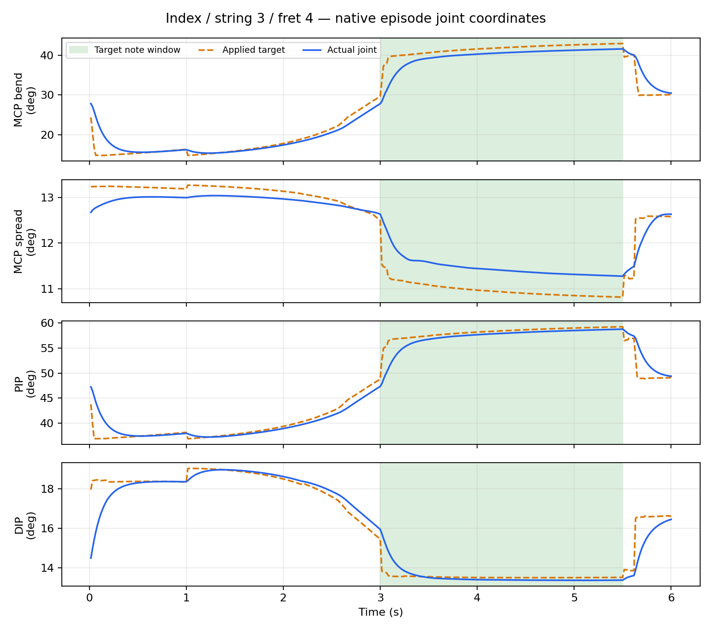

# 검지 3번 줄·4프렛 학습 결과

한 손가락·한 줄·한 프렛만 새 정책으로 학습했다. 정렬된 A 초기 자세에서 팔과 비목표 손가락의 적용 목표를 유한 PD로 유지하며 검지4축을 학습한다. 기타는 자유 강체다.

large·64환경·H32·seed7, 총200업데이트 / 409,600전이를 실행했다.

| 업데이트 | 안전 달성 | 최초 접촉 | audible clean 발생 | 최장 연속 clean(초) | 물리 / 손목 종료 |
|---:|---:|---:|---:|---:|---:|
| 100 | 32/32 | 32/32 | 32/32 | 2.446 | 0 / 0 |
| 200 | 32/32 | 32/32 | 32/32 | 2.096 | 0 / 0 |

고정 정책으로 환경마다 첫 에피소드만32개 평가했고, 실패도 분모에 포함했다. 최초 접촉은 준비·목표 창에서 연속50ms 기준이다. clean은 목표가 울려야 할2.5초 창의 올바른 압현이며, 음 달성은 연속1초와 안전한 에피소드 완료를 요구한다. 실제 소리·현 압력의 인증과 구분한다.

누적 학습의 완결 에피소드 1024개 중 목표 접촉 860회, 안전 달성 2회, 최장 clean 1.933초였다. 마지막 미완결 에피소드는 이 집계에서 제외했다. 학습은 확률적 탐색을 포함하므로 위 고정 정책 평가와 구분한다.

학습률은 3e-05→7.5e-06, KL 재시도 합계 3회였다. 최종 활성 검지4축 탐색 표준편차의 기하평균은 0.1500이다.

영상 선택 모델은 100회 checkpoint다. 안전 달성→실패를0점 처리한 clean 비율→실패 수→최신 순서로 선택했다. A 지원 조건의 결과이며 원래 v9·전체33축 평가나 다른 손가락으로 일반화하지 않는다.

상세 수치는 [summary.json](summary.json), 학습·평가는 각 train_*/eval_* 디렉토리에 있다. 실행 중 구현·보상·종료·초기 자세를 바꾸지 않았다.

실제 렌더 에피소드의 검지 MCP 굽힘/MCP 벌림/PIP/DIP 좌표 변화 범위는 26.2°/1.8°/21.6°/5.6°다. 팔 적용 목표의 최대 변화는 0.000000°로 기록됐다. 실제 상태를 고정한 것이 아니라 유한 PD로 목표를 유지했다.

[hand 영상](../../../../video/structured_press_v2/index_s3_f4_A_u100_hand.mp4) · [fullbody 영상](../../../../video/structured_press_v2/index_s3_f4_A_u100_fullbody.mp4)

100회·200회 모두 안전 달성32/32로 두 번 연속 A 기준을 통과해200회에서 학습을 종료했다. 영상은 유지율이 더 높은100회 모델이다. A는 동일한 정렬 초기 자세의 반복 평가이며, 새 초기 분포·새 seed·다른 줄/프렛·자유33축 수행의 성과는 아니다.
