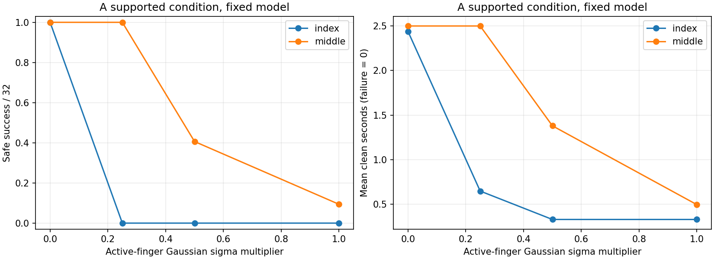

# 고정 모델 자유 평가·잡음 진단

상태: completed
갱신 UTC: 2026-10-30T20:38:05.739052+00:00

새 학습이 아니다. A 잡음 평가 8개는 동일 체크포인트의 평균·제어·초기분포·보상·물리를 유지하며, 저장 RNG를 복원하고 활성 손가락4축의 Gaussian 표준편차 배율만 바꾼다. 자유 평가 5개는 모델 가중치·물리·보상을 보존하지만 초기분포를 원래 v9로 바꾸고, 지원을 해제해 33축을 활성화하므로 실행 출력과 제어 조건이 달라진다. scale0은 평균 행동, scale1은 저장 Gaussian이다. 목표 곡/줄/프렛을 바꾸지 않으므로 새 목표 일반화를 뜻하지 않는다. 손가락마다 목표 줄·프렛이 달라 손가락 자체 난이도로 단정하지 않는다.

## 원래 v9 자유 조건

|평가|모델 갱신|배율|안전 달성 /32|실패 /32|clean 평균(실패0점,초)|상태|
|---|--:|--:|--:|--:|--:|---|
|free_index_A|100|—|32|0|2.4965|completed|
|free_middle_A|200|—|32|0|2.5000|completed|
|free_ring_A|200|—|32|0|2.5000|completed|
|free_pinky_A|200|—|32|0|2.5000|completed|
|free_index_B|0|—|32|0|2.4965|completed|

## A 정렬·지원 조건 잡음 진단

|평가|모델 갱신|배율|안전 달성 /32|실패 /32|clean 평균(실패0점,초)|상태|
|---|--:|--:|--:|--:|--:|---|
|noise_index_scale000|100|0.0|32|0|2.4401|completed|
|noise_index_scale025|100|0.25|0|0|0.6491|completed|
|noise_index_scale050|100|0.5|0|0|0.3307|completed|
|noise_index_scale100|100|1.0|0|0|0.3306|completed|
|noise_middle_scale000|200|0.0|32|0|2.5000|completed|
|noise_middle_scale025|200|0.25|32|0|2.5000|completed|
|noise_middle_scale050|200|0.5|13|0|1.3807|completed|
|noise_middle_scale100|200|1.0|3|0|0.4970|completed|

자유 v9 성과와 A 지원 조건 성과를 합산하지 않는다. 원본 모델 SHA·선택 출처·종료 상태와 각 평가 보고서 경로는 diagnostic_summary.json에 기록한다. 실패/시간 초과/보류는 완료 성과에 포함하지 않는다.
