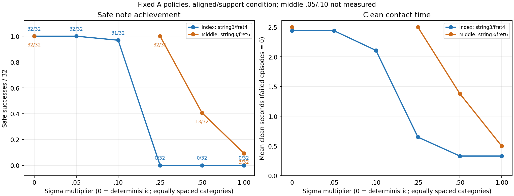

# 고정 A 모델의 미세 탐색 잡음 진단

갱신 UTC: 2026-10-30T20:56:54.242837+00:00

검지·중지 각각 동일 체크포인트의 목표 손가락4축 latent Gaussian 표준편차 배율만 바꾼 결과다. 새 학습을 진행한 실험이 아니며 정책이 학습 도중 바뀌는 효과를 제거한 고정 모델 진단이다. scale0은 결정적 평균 행동이고 scale1은 저장된 Gaussian 분포이다.

|손가락|sigma 배율|안전 달성 /32|실패 /32|clean 평균(실패0점,초)|최장 연속 clean의 에피소드 평균(초)|
|---|--:|--:|--:|--:|--:|
|검지|0.0|32|0|2.440104|2.440104|
|검지|0.05|32|0|2.439714|2.439714|
|검지|0.1|31|0|2.107813|2.049870|
|검지|0.25|0|0|0.649089|0.373958|
|검지|0.5|0|0|0.330729|0.141797|
|검지|1.0|0|0|0.330599|0.136849|
|중지|0.0|32|0|2.500000|2.500000|
|중지|0.25|32|0|2.500000|2.500000|
|중지|0.5|13|0|1.380729|1.154427|
|중지|1.0|3|0|0.497005|0.332552|

## 해석

검지의 안전 달성은 결정적 평가 32/32, .05배 32/32, .1배 31/32, .25배 0/32였다. 중지는 .25배 32/32, .5배 13/32, 저장 잡음1배 3/32였다. 이 고정 모델에서 잡음 배율에 따른 압현 유지 차이를 확인한 결과다. 검지3번줄4프렛과 중지3번줄6프렛의 기하·목표가 다르므로 손가락 자체의 우열로 해석하지 않는다.

검지 .05배의 clean 평균은 2.439714초로 결정적 2.440104초와 가까웠다. 이 결과는 낮은 잡음을 학습 실험으로 검토할 근거이며, 낮은 잡음으로 학습하면 더 좋아진다는 결론은 아니다. 그 학습 효과는 동일 A100에서 같은 seed·갱신 예산으로 시작하는 별도 paired 학습 비교로 확인해야 한다.

이 진단에서 보존한 평균은 latent Gaussian 평균 μ이다. 확률적 실행 행동의 평균 E[tanh(z)]는 일반적으로 tanh(μ)와 다르고 분산에 따라 달라질 수 있다. 따라서 실행 행동의 기댓값까지 동일했다고 주장하지 않는다.

## 검증과 범위

원래13개 batch와 추가2개를 합친 고유15조건·480개 원시 에피소드를 복원해 조건마다 env0~31의 첫 에피소드가 정확히 한 번씩 존재하고 실패도 분모32에 포함됐음을 검증했다. 이 중 표·그래프에 사용한 잡음 진단은10조건·320개다. 원래13개 batch 전체의 완료 및 기존 report/episodes/metadata SHA와 원시 재집계 수치를 대조했다. 추가 .05/.1 진단은 현재 원시 산출물 SHA를 새 분석 입력 스냅샷으로 봉인했다. 각 조건의 inputs_before.json에 기록된 원본 코드·설정·체크포인트 SHA도 현재 파일과 대조했다.

공식 평가 함수의 AST에서 trainer.load 호출과 optimizer update/save 호출 부재를 확인했다. 진단 보고서의 new_checkpoint_saved=False, 원본 source SHA 및 동일 설정/물리 계약도 검증했다. 원래13개 batch에는 별도의 자유 v9 평가5개가 있으나 이 표와 그래프에는 혼합하지 않는다.

A의 정렬·지원 조건이며 같은 기하와 같은 목표를32환경에서 반복한 결과다. 새 프렛/줄/곡이나 새로운 초기 기하에 대한 일반화 성과가 아니다. 저장 체크포인트의 RNG 복원을 재사용한 단일 난수 상태 진단으로 여러 seed에서의 재현성과는 구분한다. 중지의 .05/.1은 측정하지 않았으며 그래프의 빈 구간은 미측정이다.

## 원본 모델

- 검지: `/home/ajou/yigyu/3/docs/2026-11-02/압현성공/experiments/structured_press_v2/runs/index_s3_f4_A_v1/train_100/J/final.pt`
  SHA256: `517dc84dc322af2d76b787f0bba3fcccbda357674e18c185bc964b0f3b6954db`
- 중지: `/home/ajou/yigyu/3/docs/2026-11-02/압현성공/experiments/structured_press_v2/runs/seven_hour_v1/middle_A_seed7_v1/200/train/J/final.pt`
  SHA256: `295d8f88eaf1679954235cffcf3bb73e4fbc1a01d44fa9231f5cda50222ebff8`

모든 입력 SHA·조건별 원시 집계와 분모·평가기 소스 검증은 FINE_NOISE_REPORT.json에 기록했다.
